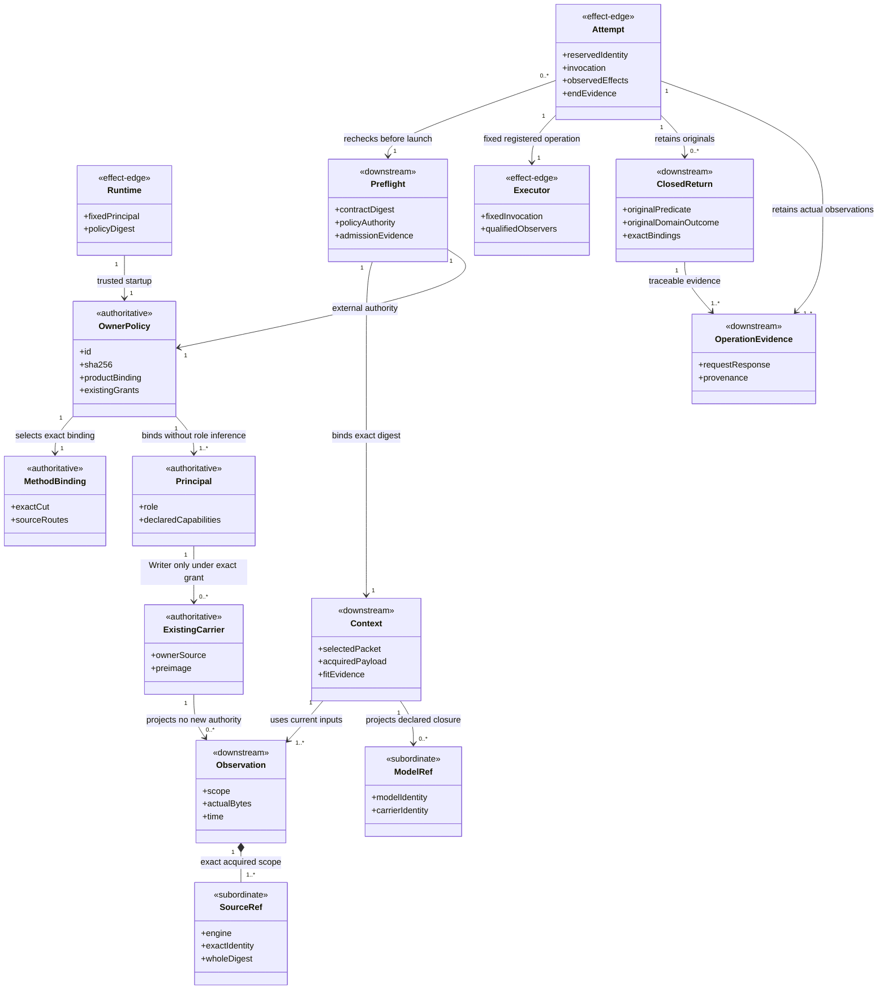
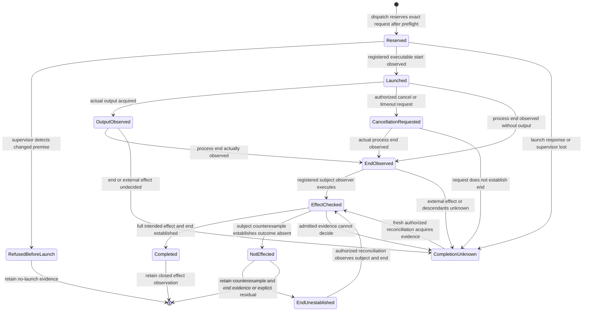

# Deterministic support for F_P development actors

Status: **design candidate for T-008**. This is tenant HOW for
[REQ-AC-FD-001..013](../../../specification/requirements/fd-support-tools.md)
and the [qualification obligations](../../../specification/requirements/fd-support-verification.md).
No executable support-tool behavior, semantic acceptance or benefit is claimed
by this document. The unchanged codec and source-generation designs retain
their existing checked scopes.

## Boundary and method binding

The Product is `urn:stdo:product-definition:a-c-implementations`; Graphify is
its existing registered tenant. The increment adds tools to that tenant, not
an Executive, scheduler, independent Product, graph-owned workflow, work ledger
or method. F_P actors select work, frames, material relations, meaning,
assurance claims and already-authorized actions. Named operations acquire,
render, dispatch, retain and record. `F_D[v]` checks evaluate only declared
supported predicates. An executor invoking F_P does not make its answer F_D.

[T-008](../../../.ai-workspace/tickets/active/T-008-fd-tenant-implementation.md)
records the owner's instruction, exact design activation and external bootstrap
admission. The installed construction constitution stays STDO v2.5.1-rc.2,
manifest `3d860ff4c1746f06ac25295a9e205cffb8e7725869615ac77cf2304b70ff2782`.
The owner selects Claude RC9 for this bounded work's execution, including its
Executive and software-design profiles. This does not rewrite the installed
constitution or assert a published/accepted V3 install.

The [RC9 binding](fd-method-claude-rc9.json) pins source commit
`c2cfa9b908d1722ae3f26c32fa4ece691083bdc3`, custody
`3a2097137c3588ba44b98e3ea801ac7f2be1daf0`, standards tree
`98de394b352179c25dfa63b0b59a9b6bdd43632d` and exact deciding members. The
same profile is the first finite consumer contract supported by the toolset.
The source-owner map from T-007 remains the prior common-candidate derivation,
not a substituted execution basis. Exact model subjects remain a third basis
role. Runtime imports no V3 code, native compiler, sibling Product, study MCP
or generated study model. Method content is supplied through verified source
references; its source repository need not be mutable or colocated.

### Deciding owners and translation scope

| Tool relation | Exact RC9 deciding owner |
|---|---|
| Activation carrier and source/identity relations | REFERENCE_FRAME §11 and RF-005/006/012/013/014 |
| Contract admission, intake, context/fit, actor duties, effects and recovery | ACTIVATION §§1–3, 5 and 7; TICKETS §5 |
| Result predicates, original domain outcomes, gaps, conjunction and reuse | FOUNDATIONS §4 Results, Conjunction of results, Change impact and evidence reuse |
| Evidence versus semantic law, source-first expectations and independence | EVALUATION §§1–4; ASSURANCE §§3, 10, 13–16 |
| Selected role additions, no Executive mutation and event-driven attention | EXECUTIVE_BASELINE §§6, 8–10, 12, 17 and 19 |
| Work/evidence ownership and recorded decisions | TICKETS §7; PRODUCT_DEFINITION §8 |
| This source-to-module gate | DESIGN_MODULE §5 Decision-complete symbolic design and §7 three-view gate |

These routes retain source conditions and exclusions. A profile describes a
finite serialization/check binding; it supplies no new method rule. An unknown
cut, optional-profile selection, vocabulary, predicate primitive, translation
or executor contract refuses specifically. A matching label or hash establishes
neither applicability nor authority. No arbitrary cross-method join is supported.

## Operating model and trust boundary

A trusted local Product operator starts the CLI/server with an exact policy
file, its expected SHA-256 and one fixed principal identity. The operator
selects the Product, source roots/repositories, method profile, owner records,
existing work grants, roles, predicate/operator definitions, executors and
protected evidence root. The API caller is untrusted with respect to these
choices. A request cannot create or replace policy, change its principal,
register an executor, grant territory or declare itself owner. Policy bytes
are acquired and checked again before effects. Their digest checks continuity;
it does not authenticate whoever wrote them. Authority rests on the trusted
operator's separately established Product/owner binding.

The supported deployment is a cooperative local development account: the
operator and registered executor programs are trusted to honor their declared
operation contracts. Requests, workspace content and F_P output are untrusted
input to the tool. Same-account actors able to rewrite protected policy,
executables or retained evidence behind the server are outside this boundary;
the tool provides no OS credential isolation, signing or adversarial concurrent
filesystem sandbox. It still detects ordinary dirty state, dependency drift,
conflicting tool writes, missing evidence and incorrect request boundaries.
No internal path is trusted merely because it is internal.

A registered process is **not OS-confined**. Preflight and dispatch enforce
its exact invocation, input and configuration, check its registered dependency
preimages, and observe declared effect surfaces. They do not prove that an
arbitrary child cannot write elsewhere or create descendants. An executor's
qualified contract must honestly declare its tools, local-effect behavior,
dependency population, termination observations and unobserved host conditions.
Unsupported enforcement requirements refuse; no `sandboxed` guarantee appears.

Policy/source roots and the protected evidence root cannot be in any permitted
Writer territory. All API-relative paths reject absolute paths, `..`, empty or
ambiguous components and symlink components, including a symlink leaf; regular
file opens use non-following checks. Immutable Git acquisition resolves an
exact full object/revision and member, checks regular-blob mode and hash, then
reads blob bytes without checkout, hooks, filters or a moving branch. Product
read roots may exceed write territory only where explicitly configured. A
missing or inaccessible root is a gap, never permission to search elsewhere.

## Ontology and invariants

The irreducible domain carriers are the selected policy/binding, exact acquired
content/observations, activated context, one execution attempt, original return
and downstream operation evidence. Files, CLI messages and MCP results are
representations of those carriers. No separate mutable task object is needed.

| Carrier | Identity, ownership and relationship |
|---|---|
| `OwnerPolicy` | One exact operator-selected id/digest per Runtime, binding one Product definition id/digest and fixed principal. Contains existing grants and approved operation/executor/predicate references. External authority, never public-tool output. |
| `MethodBinding` | One exact registered profile id/digest and method cut plus member hashes. References owners; maps their packet/result contracts to tenant serialization. |
| `SourceRef` | One engine, registered root/repository, exact relative path/object and whole-content SHA-256. One optional selector narrows acquisition, never changes parent identity. |
| `Observation` | One named acquisition scope/time, enumerated path population, existence/mode/byte hashes and relevant configuration/dependency preconditions. Dirty/untracked bytes participate. |
| `ModelRef` | One exact raw input digest, model id/digest, codec/profile and subject basis; source grounding is separately supplied. Model and carrier identities stay distinct. |
| `Context` | One caller-selected method packet plus actual record/source payloads, late-acquisition manifest, projection boundaries, rendered stdin bytes and scoped fit evidence. |
| `Preflight` | One exact activation/context/grant/executor/result-surface tuple, policy and source preimages, finite admission findings and receipt. It does not admit its cited outcome. |
| `Attempt` | One protected identity/reservation, exact invocation/payload/settings, ordered retained observations, stdout/stderr and named result surface. May have predecessor attempt; never an inferred continuation. |
| `ClosedReturn` | One original raw payload and producer/activation/subject/basis/consumer bindings, original predicates/domain values, provenance, residuals and invalidators. Checks do not rewrite it. |
| `OperationEvidence` | One immutable request/response/content manifest and hash-linked observations. Reconstructable downstream evidence, not a work-state authority. |
| `ExistingCarrier` | An externally owned work/evidence source. Projection does not own its state. Only a named, separately granted Writer operation changes it. |

Cross-carrier invariants:

1. Full semantic identities and content digests remain separate. No equality of
   labels or payloads creates a join or grants authority.
2. Acquired payload is distinct from a locator. Derived projections preserve
   parent identity, all required closure records, qualifications and boundaries.
3. Every dependency-sensitive effect rechecks its exact material preconditions,
   policy, Product definition, method/profile and executor dependencies. It does
   not silently rebase on new bytes. Effects are recorded before returning.
4. Admission comes from the protected selected mechanism and existing policy
   authority. A request's alleged grant/receipt is not trusted evidence.
5. Role is startup-bound. Executive/Reviewer cannot call a candidate/work-carrier
   Writer operation or receive mutation authority from a role label. Automatic
   tool evidence stays outside the Product/worktree; it is not such a mutation.
6. Receipt, evaluation, output, intended effect and observed end are independent
   facts. Lost response, timeout, cancellation and process exit do not alone
   establish external completion or rollback.
7. Historical returns retain original subject, basis, predicate and verdict.
   Current applicability is a new check/relation. Duplicate evidence is not an
   additional assessment; inconsistent evidence remains visible.
8. Unsupported/missing premises remain gaps. Negative reachability in incomplete
   coverage proves no non-influence, fit proves no attention, and a necessary
   condition proves no stronger claim.
9. Evidence retention never creates a disposition, acceptance, release, role
   transition, work-state ledger or next-action grant.

## Public wire grammar

All public operations use integer-only JSON, UTF-8, duplicate-key rejection,
finite strings/arrays/objects, no NaN/infinity and a closed versioned request.
Tenant canonical JSON uses the existing sorted-key compact UTF-8 grammar;
array order is significant. It is not asserted to be JCS. `id` is a nonempty
caller request identity; exact retries of an effect reuse its reservation,
while the same id with different effective inputs refuses.

```json
{
  "schema": "a_c.fd-support.request/1",
  "id": "request-001",
  "operation": "tools.describe",
  "arguments": {}
}
```

```json
{
  "schema": "a_c.fd-support.response/1",
  "id": "request-001",
  "operation": "tools.describe",
  "status": "ok",
  "result": {},
  "refusal": null,
  "evidence": {"id": "operation-evidence-id", "sha256": "64 hex characters"}
}
```

`status` is `ok`, `refused` or `error`, a transport/operation distinction, never
a semantic result algebra. Refusal contains exactly `code`, `reason`, `gaps`
and `source_refs`; `result` may retain partial observations but cannot pretend
that the refused effect occurred. `error` preserves caught external failure and
unknown effects. An `F_D[v]` result appears separately under `result.judgment`
with predicate, original domain outcome, core value, subject/basis, evidence
and limits. An unperformed evaluation has no such judgment. Refusals name the
unmet supported contract; they never fabricate a Worker work result.

`SourceRef` has the exact keys below. `object` is null for workspace files and
retained evidence, and an exact full Git revision/object for Git sources.
`selector` is null, `{"lines":[first,last]}` (inclusive 1-based, UTF-8 text) or
`{"json_pointer":"/path"}`. `sha256` always binds whole parent content.

```json
{
  "engine": "workspace-regular-file",
  "root": "registered-read-root",
  "path": "relative/member.md",
  "object": null,
  "sha256": "64 lowercase hex characters",
  "selector": null
}
```

`ArtifactRef` is exactly `{"id":"protected-artifact-id","sha256":"..."}`.
It resolves only in the Runtime's evidence store and checks actual bytes; it
is not an arbitrary filesystem path. `ModelRef` is exactly `{"source":SourceRef,
"format":"model|carrier","model_id":"...","model_sha256":"..."}`.
The `format` value is the enum `model` or `carrier`, not the literal string
containing a vertical bar. A Writer target uses the same SourceRef fields;
only there `sha256:null` denotes a required absent preimage for exclusive
creation. Source reads never accept a null digest.
Inputs requiring currentness take retained Observation refs, not a caller's
unverified assertion that HEAD matches. Unknown fields and enum variants refuse.

The inventory below is the closed operation family for this increment. All
listed keys are required unless marked optional. Empty lists are explicit;
semantically required nonempty populations are checked. Discovery publishes
these same contracts and limits, including JSON Schemas; CLI/MCP do not have
independent schemas or dispatch implementations.

| Operation | `arguments` keys | Result payload |
|---|---|---|
| `tools.describe` | optional `operation`, optional `method_profile` | Inventory or exact contract, effect prerequisites, checked fragment, supported profile, qualification status and unsupported variants. |
| `workspace.observe` | `scope` (registered file/directory scopes), optional `previous` (Observation ref) | Exact enumerated current observation, additions/removals/byte/config changes against previous, acquisition limits and current Git metadata as supplementary data. |
| `source.read` | `source` (SourceRef), `encoding` (`utf8` or `base64`), optional `max_content_bytes` | Actual content, parent/selected hashes and routes, original line coordinates; no locator-only substitution. |
| `records.find` | `model`, `text` | Exact literal matches and model scope, via `ac_graph.find`. |
| `records.read` | `model`, `ids` | Exact payloads and typed references via `ac_graph.inspect`; unknown ids refuse the batch. |
| `graph.project` | `model`, `selections` (ordered `seeds`, optional `budget_records`) | `ac_graph.project_many` views with complete governing closure and untouched boundary/population semantics. |
| `relations.query` | `model`, `declarations` (SourceRef), `query` (`dependencies`, `path`, `impact`, `coverage`), `seeds` | Paths/closure/coverage from explicitly authored typed declarations, supplied applicability separated, incomplete-coverage boundaries. |
| `context.assemble` | `packet`, `models` (ModelRef plus selections), `sources` (SourceRefs), `late_acquisition` (SourceRefs), `envelope` | Protected Context artifact, actual acquisition manifest, byte measurement and method-bound fit judgment. Does not emit over-capacity content to an actor. |
| `contract.preflight` | `context` (ArtifactRef), `grant_id`, `executor_id`, `result_key`, `observations` (ArtifactRefs), optional `admission_record` | Exact draft/admitted/rejected coordinates, deterministic findings and protected receipt bound to policy authority or explicitly registered owner override. |
| `dispatch.start` | `preflight` (ArtifactRef), optional `retry_of` (Attempt ref), optional `reconciliation` (ArtifactRef) | Named attempt receipt, exact effective invocation/input/settings and retained observations. No arbitrary argv/env/script argument. |
| `dispatch.observe` | `attempt` (ArtifactRef), `after_event` (integer) | Events/raw-output routes, available output and subject/effect/end observations; currentness gaps. |
| `dispatch.cancel` | `attempt`, `reason` | Retained cancellation request, any observed signal delivery/end; no automatic completed/not-effected value. |
| `events.wait` | `attempt`, `after_event`, `timeout_ms`, `cadence_ms`, `purpose`, `stop_condition` | Decision-relevant events or bounded timeout observation; notification sink delivery/receipt distinguished. |
| `return.capture` | `attempt`, `payload` (ArtifactRef), `return_contract` (SourceRef) | Original payload/provenance and source coordinates. Output must be from that attempt or an explicitly registered external producer, otherwise unauthenticated. |
| `return.check` | `return` (ArtifactRef), `context`, `consumer`, `observations`, `predicates` (registered ids) | Binding/currentness/predicate findings, duplicate/conflict metadata, preserved historical verdicts and explicit non-consumable gaps. |
| `review.prepare` | `phase` (`expectation` or `candidate`), `claim` (SourceRef), `sources`, `candidate` (SourceRef or null), `proof` (SourceRefs), `comparison` (SourceRef or null), `expectations` (ArtifactRef or null) | Raw acquired authority/candidate/proof/diff payloads, producer/assertion/execution provenance and observed exposure ordering. |
| `checks.evaluate` | `predicate_id`, `inputs` (ArtifactRef/SourceRef bindings), `subject`, `basis` | Actual finite `F_D[v]` judgment with source contract, domain, counterexample/missing premises and limits. |
| `results.conjoin` | `operator_id`, `plan` (SourceRef), `returns` (ArtifactRefs), `current_observations` | Exact method-owned conjunction, original results, stale/absent planned assessments, uncovered obligations, conflicts and failures. |
| `work.project` | `carrier` (SourceRef), `selection` (JSON pointers or Markdown headings) | Exact selected original content, source-linked facts and original owner wording; no inferred task state. |
| `work.write` | `grant_id`, `target` (SourceRef with preimage), `mode` (`append` or `replace`), `record`, `interpretation` (separate or null), `observations` | Named Writer-only exact record application, pre/post identities and actual effect/end evidence or refusal. |
| `refresh.prepare` | `previous`, `current` (Observation refs), `declarations` (SourceRef), `results` (ArtifactRefs), `invalidators` (SourceRef) | Material diffs, affected candidates, explicit unknown impact, surviving exact applicability checks and reconstructable handoff artifact. |
| `resources.aggregate` | `attempts` (unique ArtifactRefs), `accounting` (SourceRef) | Measured/unknown counters, all attempts/failures, elapsed versus summed intervals, overlapping/subcounter metadata and supported selected-limit checks. |

`evidence.read` is additionally provided for all three roles: `artifact`
(ArtifactRef), optional `max_content_bytes`. It returns the retained exact
payload, actual public schemas/prompts/invocation/raw proof and parent digest.
It cannot reach unregistered private paths. Returned evidence refs remain
acquisition routes; the caller chooses whether to acquire them.

The exact ordinary CLI entry is:

```sh
python3 code/ac_support.py --policy POLICY.json --policy-sha256 POLICY_SHA256 --principal EXECUTIVE_ID call --request REQUEST.json
python3 code/ac_support.py --policy POLICY.json --policy-sha256 POLICY_SHA256 --principal REVIEWER_ID mcp
```

`--request -` reads one JSON object from stdin. CLI emits exactly one response
object on stdout and exits 0 for `ok`, 2 for `refused`, 1 for an external/internal
`error`; diagnostics belong on stderr. `mcp` serves the protocol below. There
is one internal fixed supervisor entry, inaccessible through public operation
arguments. No interface changes the operator's host/global configuration.

### Returned actor payload

The supported closed-return carrier is `a_c.fd-support.closed-return/1`.
Its exact keys are `schema`, `id`, `frame`, `activation`, `subject`, `basis`,
`actor`, `consumer`, `evaluations`, `not_performed`, `work_result`, `residuals`
and `invalidators`. Frame is id/revision; activation is id/SHA-256; subject is
id/SHA-256; basis is the exact method-profile id/digest plus Observation refs;
actor is id/family/authorship identity. These coordinates are checked against
the original activation and protected identity bindings, never accepted merely
because the answer asserts them.

Each performed evaluation has exactly `id`, `predicate`, `domain_outcome`,
`core_value`, `evidence`, `residuals` and `invalidators`. `predicate` is its exact
source identity or explicitly supplied predicate body bound to the activation;
`core_value` uses the source-owned five-value vocabulary. Domain outcome is the
original JSON value, not a rewritten success flag. `not_performed` lists planned
evaluation ids and contains no verdict. `work_result` is null for a return not
asserting construction availability; otherwise it contains exactly `value`,
`cause`, `candidate`, `evidence` and `residuals`, preserving RC9 ACTIVATION's
value/cause relation. `candidate_ready` must resolve its exact candidate and
transition evidence. The parser reports a wrong mapping without inventing the
Worker's answer. The original bytes always survive invalid format or binding.

This is a serialization of the selected method-owned relations, not an
additional result algebra or requirement that F_P judgment be deterministic.
Registered return-contract SourceRefs bind this exact carrier/schema and any
role-specific proof obligations. Unsupported return carriers remain retained
raw output with an explicit unsupported-format gap.

### Packet carrier

The `packet` object is a tenant serialization of REFERENCE_FRAME §11's minimum
binding, with exactly the following source-owned groups, not a second packet
law. The RC9 profile supplies each group's owner route. Group values are closed
objects with the listed keys. Text is supplied by the F_P actor or referenced
existing authority; tooling does not author its meaning.

| Group | Keys and binding |
|---|---|
| `activation` | `id`, `revision`, `configuration` (SourceRef) |
| `frame` | `id`, `revision`, `declaration` (SourceRef), `evaluation` (SourceRef), `result_algebra` (SourceRef) |
| `subject_basis` | `subject` (`id`, `sha256`), `method_profile` (id/digest), `product` (id/definition SourceRef), `observations` (ArtifactRefs), `dependencies` (SourceRefs), `time_basis` (explicit string) |
| `attention` | `material_relations` (SourceRefs), `invariants` (SourceRefs), `semantic_sources` (SourceRefs), `exclusions` (strings), `prohibited_assumptions` (strings) |
| `actor_authority` | `actor_id`, `role`, `capability` (SourceRef), `semantic`, `evaluation`, `operation`, `decision`, `acceptance`, `publication` (authority SourceRefs or explicit null), `territory` (registered paths), `tools` (registered ids) |
| `evidence_relations` | `admissible_evidence` (SourceRefs), `acquisition` (SourceRefs), `dependencies` (SourceRefs), `conjunction` (SourceRef or null), `translation` (null in this fragment), `consumer`, `return_contract` (SourceRef) |
| `stop_change` | `invalidators`, `stop_conditions`, `residuals`, `re_entry`, `reconfiguration` (explicit arrays of source-bound supplied records) |
| `profile_additions` | `worker` (operation-grant id, mutation subject and territory) or `reviewer` (claim, composition, population, oracle, ordinary/module path, falsification condition, independence/assurance and severity-scale SourceRefs) or `executive` (Product-role map, mandate, frontier, result/triage ledger, priority policy, conjunction and disposition grant SourceRefs), exactly the selected role |

`envelope` is exactly `{"capacity_bytes": integer-or-null,
"boundary":"executor-stdin-utf8","host_context":{"state":"known|bounded|unknown",
"bytes":integer-or-null,"evidence":SourceRef-or-null}}`. The context artifact
retains the supplied packet, full selected records and source content,
projection boundaries, late-acquisition refs and exact canonical rendered body.
A manifest distinguishes content supplied now, explicitly permitted late reads,
failed/denied reads and unresolved sources. Source locators alone do not count
as acquired deciding material. Mandatory late reads have to be named by the
selected contract; a future read is not reported as already supplied.

Measure the exact UTF-8 stdin bytes, including template/framing and all embedded
content, before worker delivery. A known/bounded host contribution is included
only with its supporting source; unknown host context remains unmeasured and
full-active-context fit is indeterminate unless a measured excess falsifies it.
No declared capacity means no mandatory fit gate; observed byte count may still
be retained. Token capacities refuse as unsupported rather than use a guessed
ratio. Measured envelope excess never trims content. Whether an unresolved fit
blocks dispatch is the selected admission predicate; the supported profile
requires satisfied fit when a capacity applies, absent a separately registered
exact owner override lawful under its source contract. Fit and semantic
sufficiency remain separate.

## Source, state and graph mechanics

`workspace.observe` enumerates configured relevant files and declared directory
scopes, including new untracked paths and deletions, with byte hashes, type,
existence and acquisition time. It hashes present bytes, not HEAD versions.
Relevant Product, policy, method-source and executor configuration/dependency
preimages participate. A declared tree scope detects newly added files; an
explicit file list says nothing about unlisted additions. Enumeration or byte
caps refuse incomplete observations instead of returning a complete-looking
snapshot. Unreadable files, symlinks and scope changes remain named gaps.

Every dependent effect compares a new observation over the same scope to the
retained one, including path population, before its effect begins. Git HEAD and
status are useful metadata, not authority for current bytes. Stable scope can
coexist with unrelated dirty files outside it; those files are preserved.
Read-modify-write operations acquire an exclusive per-target tool lock and
recheck the target inside that lock. The declared threat model excludes a
hostile non-tool filesystem swap between check and effect; this limitation is
recorded rather than mislabeled atomic isolation.

Acquisition supports regular workspace files, exact Git blobs and protected
retained evidence. Whole-content digest and selected payload digest are both
returned. Line reads retain original inclusive coordinates; JSON pointers are
exact, and a missing pointer refuses rather than returns null. UTF-8 decoding
failure is explicit; base64 returns actual binary content when requested.
Missing mappings and source grounding do not become inferred mappings.

`ModelRef` verification uses `ac_graph.validate` or `decode(GraphCarrier)` and
checks exact model and raw carrier coordinates. Existing `find`, `inspect`,
`project_many` and carrier identity are reused without editing their model
schemas or dependency semantics. A model can be methodology-only; its declared
subject/coverage are always returned. No operation calls it a complete Product
workspace map. Composite/cross-model querying needs an explicit supported
identity/translation rule; this first fragment refuses it.

`relations.query` consumes one exact authored declaration carrier with keys
`id`, `subject`, `basis`, `relations` (id/source/target/kind), `governing_kinds`,
`coverage` (obligations, mapped support and explicit unknowns) and
`applicability` (source-bound supplied judgments or registered predicates).
It performs deterministic sorted-identity traversal and set operations only.
A relation not declared governing cannot be promoted by proximity or extraction
confidence. Impact returns an affected candidate set plus missing coverage;
absence of a path never returns a semantic `unaffected` verdict.

## Product-bound admission and exact dispatch

Owner policy has schema `a_c.fd-support.policy/1`, with closed top-level keys
`id`, `product`, `method_profile`, `sources`, `principals`, `grants`,
`predicates`, `operators`, `executors`, `evidence_root`, `limits` and
`authority_sources`. Operator startup supplies its path and expected digest;
there is no public registration/write operation for it.

- `product` binds definition id, exact definition SourceRef and work/outcome
  source records. `sources` registers exact local roots/repositories, allowed
  read scopes and immutable-source aliases.
- `principals` binds startup principal to actor id, role, authorship/family
  metadata and allowed operations. A request cannot change these values.
- Each `grant` names id, existing owner/delegation SourceRefs, exact outcome,
  permitted principals/operations/tools/executors/territory, required material
  preconditions and admission mechanism/conditions. The operator verifies the
  source owners; the tool checks these registered bindings, not the truth of
  arbitrary supplied authority prose.
- Each `predicate` names id, exact source contract, subject/domain/basis and
  supported expression; each `operator` names the exact source-owned
  conjunction and selected declared rule, coverage/basis and decision-owner
  requirements. These cannot be chosen by an unregistered request definition.
- Each `executor` names a fixed executable and argv, dependency/configuration
  SourceRefs, cwd, allowlisted environment, effective actor/settings, input and
  stdout decoders, available tools, permitted local-effect contract and
  termination/effect observation capabilities. Public requests choose its id.
  No shell parsing, arbitrary executable, argument suffix, cwd or environment
  injection is accepted.
- `limits` names selected enumeration, message, attempt, observation and resource
  bounds with their units/scope. They are this deployment's controls, not
  universal method quotas. `authority_sources` names the trusted operator/owner
  records; their hashes establish bytes, not author authenticity.

`contract.preflight` re-acquires policy/definition/method/grant material and
selected current observations, validates the exact packet and registered
predicate premises, checks role/effects/tools/territory/result surface and
executor dependencies, and binds the draft to the exact context digest.
If the protected mechanism's conditions hold it records its actual admission
receipt: mechanism id/digest, authority source, exact contract digest, decision,
evidence and predicates actually evaluated. An optional existing admission or
owner override is usable only when resolved through the trusted policy's
registered source and exact contract binding. Caller-created receipt JSON,
a ticket title or successful schema validation cannot substitute.

The admitted artifact is not an indefinitely valid bearer token. Dispatch
rechecks all material preimages and authority binding. Drift refuses before
launch, names which premise changed and retains the historical receipt. It
never silently substitutes new context or settings. Missing basis, authority,
closure or capability is routed through the selected RC9 owners and is not
reported as a Worker result.

The following concrete registry carriers close the public policy seams. Registry
populations are id-keyed objects; duplicate ids/unknown fields refuse. Source
references use the grammar above. The policy's `method_profile` is the exact
id/digest plus SourceRef of the shipped binding. Each local source root has
exactly `path`, `read_scope`, `kind` (`workspace` or `git`), and `writable`;
root paths are trusted startup configuration, never request fields.

| Registry record | Exact fields |
|---|---|
| Principal | `actor_id`, `role`, `family`, `authorship`, `operations` |
| Grant | `id`, `authority_sources`, `outcome`, `principals`, `operations`, `tools`, `executors`, `territory`, `preconditions`, `admission` |
| Admission selection | `mechanism_id`, `mechanism_source`, `authority_source`, `required_predicates`, `allowed_override_sources` |
| Executor | `id`, `executable`, `argv`, `dependencies`, `cwd`, `environment`, `actor_id`, `settings`, `tools`, `effect_scope`, `stdin_mode`, `stdout_decoder`, `observers` |
| Predicate | `id`, `source`, `subject`, `basis`, `input_names`, `expression`, `limits` |
| Conjunction operator | `id`, `source`, `decision_authority`, `rule`, `plan_source` |

`outcome` is id plus exact source; `territory` is a list of registered-root and
relative file/directory scopes. `preconditions` are exact SourceRefs and retained
Observation refs. `admission` may reference only the implemented finite
mechanism `product-policy-preflight/1`: all source/identity, scope, role, effect,
result-surface and selected registered predicate checks above. It is a real
Product-bound mechanism under the protected policy, not mere shape validation.
An unsupported mechanism id refuses. The mechanism's implementation and policy
remain distinct provenance. An override source must be separately registered
by the operator and explicitly bind the exact contract; the request cannot add
one to that registry. No authority is inferred from the words in `outcome`.

Executor `executable` is an exact absolute regular-file path/digest chosen by
the operator; `argv` is its complete fixed string array including argv[0].
Dependencies/configuration are SourceRefs rechecked before launch; environment
is a complete explicit string map, not inherited arbitrary caller variables.
The tool retains any required host/environment unknowns. `stdin_mode` is
`context-utf8`; its byte payload is exactly the saved Context rendering, with no
unmeasured appended prompt. `stdout_decoder` has exactly `format` (`json` or
`utf8`), `pointer` (JSON pointer or null), and `decode_json_string` (Boolean).
This permits a provider's JSON envelope containing the actual answer as a JSON
string to be unwrapped reproducibly. Missing/invalid decoding retains raw output
and a format gap. No decoder executes code. Observers are `process-end` and
`file-postimages` with exact selected scope/expected hashes; they establish only
their named predicates, not semantic task success. File completion/end is
claimed only where the registered effect contract and actual observer establish
both; otherwise external effects/descendants remain unknown. `effect_scope`
declares the expected local-effect and unsupported enforcement boundary.

`work.write.record` is exactly `{"text":"literal UTF-8 bytes as text",
"provenance":SourceRef}`. Append adds precisely that UTF-8 text, with no
implicit newline or method prose; replace supplies the whole target body.
`interpretation` is null or `{"text":"...","author":SourceRef}` and is
retained separately in operation evidence, not silently inserted as an owner
ruling in the target. New absent targets and existing targets both use explicit
grant/territory and expected preimages as described above.

### Attempts, notifications and uncertain effects

`dispatch.start` atomically reserves a unique request/activation key under the
protected evidence root before launching a small per-attempt supervisor. This
is process supervision for one named invocation, not task scheduling or
method-workflow control. The supervisor rechecks admission/preimages again at
the actual effect edge, starts the fixed executable with exact retained stdin,
records acknowledgments, stdout/stderr, events, timestamps and observed process
end, and writes the named result surface. Provider/actor settings are retained
exactly; provider usage absent from its actual result stays unknown.

A repeated exact request returns the existing attempt and its observations;
a conflicting use of the key refuses. If the caller loses a response or a
supervisor dies during the launch interval, the reservation remains and no
automatic second launch occurs. A fresh actor can acquire the named attempt,
reconcile observed effects/end, and supply an explicit already-authorized retry
with predecessor/reconciliation evidence. `retry_of` is required for another
attempt of the same activation. No success or retry grant follows from silence.

The supervisor is launched through the tenant's own fixed entry point and
pinned code dependencies, without user scripts or shell. Actual child receipt,
process exit, effect snapshots, durable writes and unknown descendants are
separate event kinds. Process exit establishes only that observed process's
end. External work or descendants may remain unknown under that executor's
contract. An actual executor-specific effect observer may establish more,
within its declared checked scope; a return saying “done” alone does not.

Cancellation and timeout retain request/signal/partial-output events and
current subject observations. A terminate/kill request does not establish end,
completion or rollback. On uncertain end, subsequent dependent actions and
retries require the selected reconciliation predicate; no reset deletes the
partial evidence. An effect value is emitted only when the registered observer
establishes RC9 ACTIVATION Effects' premises. Otherwise it is
`completion_unknown`, with end separately unestablished and its deciding
observation named. A counterexample to a bounded outcome may establish
`not_effected` even when its end remains unknown, as that owner requires.

Notifications use a selected named durable event sink carrying consumer,
attempt, kind and cursor. Appending and syncing a sink record establishes
local delivery, not that the consumer saw it. Return, exception, observed basis
change and selected deadline/checkpoint events are distinct. The ordinary CLI
may use `events.wait` as declared bounded fallback with purpose, cadence,
evidence target, deadline and stop/escalation condition; it cannot become an
unbounded polling controller. MCP returns the same event records through tools;
it does not claim unsupported push/task features. Notification failure is
recorded and the declared fallback remains visible.

## Returns, review and qualified checks

`return.capture` preserves original payload and provenance, including malformed
or partial output. `return.check` compares original activation, actor, consumer,
subject, method/basis/dependency and currentness coordinates, applies only the
selected registered predicates and reports exact gaps. A historical satisfied
result on another subject remains that result and is non-consumable here.
A duplicate source payload gets one evidence identity and is not counted as a
second assessment. Different original results over the same bound predicate
are retained and identified as conflict; neither is silently overwritten.

Source/expectation provenance, execution/run provenance and authenticated
producer binding are separate. Protected actor identity proves neither the
independence of expected answers nor completeness of exposure history. Family
independence requires an explicit governing policy; absent one, two activations
of one family do not count independent for semantic judgment.

`review.prepare` expectation phase permits exact governing-source and relevant
proof-contract acquisition, records the Reviewer's source-derived expectations
as its F_P evidence and excludes candidate content. Candidate phase acquires
exact immutable candidate, source, actual tests/fixtures/proof and selected
comparison directly, preserving expectation/preimage and observed exposure
ordering. The author summary is optional evidence, never a replacement. The
same public source/evidence operations are available to Workers for their
implementation/proof context. Comparisons are exact byte and canonical-record
diffs; neither labels a finding, severity, priority or disposition.

Candidate exposure observed earlier for that principal/claim is reported, not
forgotten by a fresh context. Unobserved external exposure remains unknown.
The tool checks only supplied/observed independence premises; it does not
certify all semantic independence or turn a nonauthor name into acceptance.
Reviewer expectation evidence and automatic tool logs stay in the external
protected evidence surface. They do not grant Reviewer write access to the
candidate or authoritative work carrier.

### Predicate and conjunction fragment

Registered predicates operate over explicitly bound JSON observations. The
finite expression grammar has `equals(left,right)`, `member(value,set)`,
`contains_all(set,required)`, `all(expressions)`, `any(expressions)` and
`not(expression)`. Operands are literals or exact JSON pointers into named
acquired inputs. No code strings, import, shell, arbitrary calculus execution,
model-authored predicate body or inferred truth is executed. Boolean operations
use complete known values; missing premises are retained, and a decisive false
for `all` or true for `any` may decide without discarding the missing premises.
Every registered definition states its domain, predicate meaning and source
provenance; support claims are only for this explicit decidable fragment.

Actual evaluation returns satisfied/falsified for a decided predicate,
indeterminate for missing deciding evidence inside its declared domain,
invalid_basis for an input that cannot bind the required subject/basis, and
out_of_frame for an undeclared material capability. Unsupported syntax refuses
without pretending an evaluation ran. Semantic applicability and mandatory
planning remain supplied F_P judgments. Checks over source identity or context
fit establish only those predicates, never candidate fitness or acceptance.

The expression carrier is closed: a literal is `{"literal":JSON}`, a bound
input operand is `{"input":"name","pointer":"/exact/path"}`, and a call
is `{"op":"equals","args":[operand,operand]}` with the named operator's
fixed arity. `member`/`contains_all` have arity two, `not` arity one, and
`all`/`any` a nonempty list of expressions. Bindings resolve only registered
input names acquired in this request; unbound pointers remain explicit missing
premises. Nested results preserve undecided premises even when another branch
decides the Boolean. Integers are not Booleans. A wrong operand domain is a
domain/basis failure, not a false applicability premise.

The sole supported join is `claude-rc9.conjunction/1`, implementing FOUNDATIONS
Conjunction of results under a registered plan. A plan states exact composite
predicate/subject/basis, decision authority, ordered mandatory assessments,
coverage per assessment, required obligations, applicability premises,
conflict rule and basis relations. Its rule selects the first non-satisfied
mandatory returned value in **that declared plan order**; this is the selected
rule, not a universal ordering of the four non-satisfied core values.

The implementation retains original domain outcomes/predicates, every known
failure/counterexample and conflict, stale original returns and the two distinct
gap sets. A stale/wrong-subject held result contributes a missing planned
assessment, not a newly returned invalid_basis. Unplanned required coverage is
uncovered, not a missing or indeterminate component. Where mandatory results
are all satisfied, incoherent required basis relations yield invalid_basis;
otherwise any gap yields indeterminate; otherwise a material counterexample to
a mandatory constraint falsifies; otherwise a declared unresolved conflict
yields indeterminate and otherwise the composite is satisfied. Nonmandatory
failures survive the record and may veto only where the selected rule says so.
Unknown/unqualified rules and cross-basis translations refuse. Joining prior
conjunctions unions failures/planned gaps and recomputes uncovered coverage;
a nested join cannot erase an inherited counterexample or gap.

## Existing records, refresh and accounting

`work.project` supports exact JSON-pointer and Markdown-heading projections of
named authoritative carriers, keeping raw original content and source identity.
It does not derive a work-state value from incidental prose. `work.write` is a
named interface for an already-authorized Writer record. It checks fixed
principal role, selected grant/operation, exact target territory/preimage and
material observations, acquires a per-target lock, rechecks them and writes
complete exact bytes atomically where the local filesystem permits. Appending
preserves original bytes; replacing requires the explicit selected update grant.
Absent-file creation uses exclusive creation, and any conflicting writer or
unexpected target refuses rather than overwrites. Symlink and protected-policy/
evidence aliases refuse. Caller record wording and optional interpretation
remain separate; it neither invents an owner ruling nor adopts a recommendation.
Actual postimage and observed write end are retained before returning.

`refresh.prepare` compares actual observations and declared transitive evidence
dependencies. Affected support is the intersection of declared dependency
closure and the supplied conservative impact cover. It retains missing
coverage/invalidator premises as unknowns, names new obligations and mandatory
gates, and does not prove non-influence from absent edges. Retention on a new
subject requires the registered applicability/preservation evidence; originals
remain bound to old subjects. Unchanged applicable support survives role/session
changes. Handoff names exact current work carriers, original/successor results,
valid-support relations, source routes, residuals and unreconciled attempts;
it needs no hidden conversation or replay of unaffected work. Frozen studies
are never refresh targets.

`resources.aggregate` accepts only actually retained attempt/operation records.
It rejects repeated ids with conflicting content and deduplicates identical
records. Original failures, partial outputs, repair/retry/review/acquisition
attempts and unknown usage remain visible. Integer nanoseconds represent time;
provider counters keep units and raw source. Cache/reasoning subsets are marked
as subsets and never added twice to totals. Wall elapsed is the union/enclosing
boundary declared by the accounting contract; summed actor duration is reported
separately and overlapping intervals are explicit. Known-subtotal and unknown
population are both reported; missing usage is not zero. Unsupported pricing
or a counter's undocumented scope is not guessed. Selected limit checks are
finite declared predicates. No accounting result claims accepted-result benefit.

## Module contracts and composition

Use Python 3.11+ stdlib, the existing codec and explicit typed JSON/dataclasses.
No package installation, global MCP configuration, network service, database
or second runtime is required. Three files separate deterministic relations,
local effects and public transport; no speculative generic framework is added.

| Module | Owned boundary and exported seam |
|---|---|
| `code/ac_support_core.py` | Strict grammar and refusal type, Runtime/policy/source/profile binding, source/observation/model/context relations, read/query/review/return/check/conjunction/refresh/resource operations and inventory/schema data. Exports `SupportError(code, reason, gaps, source_refs)`, `Runtime.from_policy(path, expected_sha256, principal)`, `canonical(value)`, `digest(value)`, `read_source(runtime, ref)`, `observe(runtime, scope)`, `check_preconditions(runtime, refs)`, `describe(operation=None)`, `execute_read(runtime, operation, arguments)` and `build_preflight(runtime, arguments)`. No process launch or authoritative carrier write. |
| `code/ac_support_effects.py` | Protected EvidenceStore, exact preflight receipt persistence, attempt reservation/supervisor, fixed-executor dispatch/observe/cancel/events, Writer effect membrane and retained evidence. Imports core; core does not import effects. Exports `EvidenceStore(runtime)`, `dispatch(runtime, request)`, `supervise(runtime, attempt_ref)`, `observe_attempt(runtime, args)`, `cancel(runtime, args)`, `wait_events(runtime, args)`, `write_record(runtime, args)`, `retain_operation(runtime, request, response)`. |
| `code/ac_support.py` | Thin authoritative dispatcher, JSON CLI and legacy MCP stdio adapter. Imports both modules. Exports `execute(runtime, request)` and `main(argv=None)`. Validates once, routes to existing operations, retains exact response evidence; no independent method logic. Also owns the fixed internal supervisor entry point. |
| `design/fd-method-claude-rc9.json` | Exact data binding to RC9 member bytes and owner routes. Unchanged profile identity/digest required by supported Runtime. No method source-body copy. |

Core functions needing retained content take a narrow store resolver callback
`resolve_artifact(ArtifactRef)->bytes` installed on Runtime by the effect edge;
core never writes the store or imports effects. Core operations return payloads
and effect plans where needed; the effect membrane assigns evidence identity
and performs only its named operation. Full raw bytes and canonical parsed
identities are distinct. This seam avoids a circular import or hidden mutable
runtime state and supports source-selected pure-module tests.

The core Worker owns the public argument/schema inventory in the core module;
the integration Worker emits that one inventory and owns top-level routing
tests. All Workers honor the operation names and argument keys above. If a
required implementation changes a material semantic boundary,
it returns the exact design gap to Executive; it does not silently pick another
policy, algebra, state machine or authority route. Equivalent local algorithms,
helper names and internal immutable types remain ordinary realization choices.

## Three-view projection

These are projections of the ontology and operation contracts above. The state
view concerns **attempt/evidence observation**, not an a_c task lifecycle.
The prior codec boundary is unchanged and cites [its design](README.md).



```mermaid
sequenceDiagram
  participant P as Principal
  participant R as Runtime
  participant M as MethodBinding
  participant O as OwnerPolicy
  participant S as SourceRef
  participant C as Context
  participant F as Preflight
  participant A as Attempt
  participant X as Executor
  participant E as OperationEvidence
  P->>R: select question, frame, sources and declared operation
  R->>M: verify exact supported cut and source routes
  R->>S: acquire current permitted bytes and declared closure
  R->>C: render selected packet and measure exact supplied boundary
  R->>O: resolve existing grant and selected admission predicates
  alt missing authority, basis, closure or fit
    R->>E: retain exact refusal and deciding gap
    R-->>P: return source-owned refusal, no Worker result
  else finite admission conditions hold
    R->>F: bind contract digest, mechanism, authority and checked premises
    P->>R: dispatch selected exact Preflight
    R->>O: recheck policy, sources, dependencies and preimages
    R->>A: reserve named attempt before launch
    A->>X: fixed invocation and exact retained context
    X-->>A: acknowledgment, output and observed process end
    A->>S: acquire declared subject/effect observations
    A->>E: retain raw evidence, partial output, unknowns and notifications
    E-->>P: deliver named result/event routes to declared consumer
    P->>R: capture/check return or request bounded reconciliation
    R->>E: preserve original verdict and separate currentness findings
    R-->>P: exact closed evidence or non-consumable gaps
  end
  Note over P,E: F_P selects/assesses/disposes; no tool output activates another step
```



`NotEffected -> EndUnestablished` does not rewrite the effect verdict; it names
the attempt's unresolved-end observation state for reliance/retry. The retained
not_effected outcome and counterexample survive. No terminal observation grants
continuation; another attempt needs a new exact admitted invocation and, where
applicable, reconciliation. Raw output never transitions to accepted Product.

### Cross-view check of the candidate design

These are Writer design evaluations, not independent acceptance. Source review
must test their support. `pass` maps only to the design predicate named by
DESIGN_MODULE §7; implementation enforcement remains unperformed.

| Axiom | Ontology evidence | Authority | Domain evidence | Sequence evidence | State evidence | Native enforcement | Admission/compiler enforcement | Verdict | Gap owner |
|---|---|---|---|---|---|---|---|---|---|
| Exact identity/basis and no implicit composition | SourceRef/ModelRef, invariants 1–3 | RF-005; PDEF | exact digest associations | exact binding/acquisition | changed-premise refusal | closed JSON/typed refs planned | policy/profile/preimage checks planned | pass for design | implementation/assessor |
| Authority conservation, no Executive/Reviewer mutation | policy/principal and invariant 4–5 | RF-006; EXEC §6 | Writer-only carrier association | separately selected grant | refusal before launch | fixed principal/op family planned | protected policy, exact territory planned | pass for design | implementation/assessor |
| Material closure and bounded context | Context, invariants 2/8 | ACT §2; AC-010/011 | acquired payload and fit evidence | closure then measure before delivery | refusal/unknown retained | existing project_many reused | no truncation, unknown host preserved | pass for design | implementation/assessor |
| Honest effects, cancellation and reuse | Attempt, invariants 6–7 | ACT Effects/§5/7 | invocation versus observers | output and end separate | uncertain/end/counterexample paths | separate variants planned | subject observer/reconciliation planned | pass for design | executor qualification |
| Closed results and joins retain gaps | ClosedReturn and invariant 7–8 | FOUND Results/Conjunction | original predicates retained | capture then checks | output never accepts Product | finite operator planned | exact plan/basis/coverage rules planned | pass for design | implementation/assessor |
| Source-first independent review | review acquisition contract | EVAL §§2–4 | separate principal/exposure evidence | source expectations then candidate | role change does not erase evidence | immutable expectation record planned | policy authorship/family checks planned | pass for design | independent assessor |
| Reconstructable owned truth, no rival work ledger | ExistingCarrier/evidence | TICK §7; ACT §5 | downstream versus source stereotypes | named durable evidence | attempt observations only | immutable evidence refs planned | Writer preimage/grant membrane planned | pass for design | implementation/assessor |
| Graph-owned workflow/runtime admission | no graph-native workflow Product selected | Product boundary; RF-016 | external Executor, no task graph | named local process effect | not a graph execution state machine | not applicable | method coordinates F_P externally | not_applicable | none: actual Product scope |
| Complete a_c calculus execution | existing unsupported operations unchanged | AC-R-011/012; Product | finite model/projection reuse only | no arbitrary predicate execution | no transformation states | unsupported explicit | finite source-bound predicates only | not_applicable to full conformance claim | Product owner if scope changes |

Every public operation maps to a carrier transform or explicit effect above.
No lifecycle state uses a process-local controller as authoritative task truth.
Unknowns in actual run/executor/independence evidence remain proof obligations;
these design-level evaluations do not erase them.

## Qualification plan and requirement-to-module trace

Tests derive from the common requirement/scenario authority and the source-owned
failure conditions, with source-selected expectations established separately
from implementation. They must contain real positive paths as well as meaningful
controls; a stub that always refuses or always reports satisfaction cannot pass.
This is the complete planned first-fragment inventory, not executed evidence.

| Requirement | Public operations and owning module | Deciding positive and adverse proof |
|---|---|---|
| FD-001 | describe; core inventory, integration CLI/MCP | Ordinary actors discover actual schemas; unsupported op/profile refuses; protocol/schema parity. |
| FD-002 | observe/read; core, effect recheck | Dirty and new untracked bytes change observation while HEAD fixed; new path in tree scope and changed dependency/policy block dependent effect; unrelated scope preserved. |
| FD-003 | source/records/evidence read/find; core | Direct raw authority and proof content, exact slices/grounding; stale hash, missing map, denied scope, symlink and malformed source refuse/gap. |
| FD-004 | relations.query/project/checks; core | Authored closure cycles and conditional true/false/missing premises; inferred edge cannot govern, incomplete absence cannot prove unaffectedness. |
| FD-005 | context.assemble; core | Real records/source acquired and exact stdin count; locator-only, denied late read, excess and unknown host remain distinct; no trimming. |
| FD-006 | preflight; core + effects receipt | Product-bound trusted grant actually admits supported contract; fabricated receipt, wrong Product/outcome/basis and missing durable surface refuse. |
| FD-007 | dispatch/observe/cancel/events; effects | Real registered process and actual F_P actor; invocation drift, changed helper/preimage, timeout, lost response, partial write, unknown descendant and bounded fallback retain actual distinctions. |
| FD-008 | return capture/check; core + retention edge | Original valid/stale/wrong-subject/wrong-basis/malformed/duplicate/conflicting returns; no unperformed review result and no duplicate independence. |
| FD-009 | review.prepare, raw proof access/diff; core | Nonauthor source-first expectations then exact candidate/tests/fixtures acquired through public tools; early exposure and same-family-without-policy cannot certify independence. |
| FD-010 | checks/conjoin; core | Decidable truth/false/unknown, method gap-versus-invalid_basis, original domain outcomes, stale component and nested failure/gap survival; necessary-condition cannot satisfy stronger predicate. |
| FD-011 | work.project/write; effects + core projections | Actual already-authorized Writer record with correct pre/postimage; forged grant, Executive/Reviewer mutation, symlink/protected path, conflict and out-of-territory writes refuse. |
| FD-012 | refresh/handoff; core + retained evidence | Changed source affects declared dependent support, unchanged supported survivor remains; incomplete impact unknown, original verdict/history retained, fresh actor resumes without blind retry. |
| FD-013 | resources.aggregate; core + effect observations | Partial/failed/retried calls and real acquisition/review recorded; unknown counter not zero, duplicate ids/subsets not double-counted, overlapping summed versus elapsed times distinct. |
| FDV-001 | all ordinary JSON/MCP interfaces | One actual bounded Product task: Executive prepares/dispatches; Worker acquires source/proof; nonauthor Reviewer records expectations and accesses candidate/proof; no private builders or fixtures supply semantic answers. Retain exact raw interfaces and actor settings. |
| FDV-002 | all adverse/control paths above | Execute SC-AC-FD-002..014 and fresh handoff with exact source/profile/candidate/assertion/run identities. Every unexercised variant stays an explicit gap. |
| FDV-003 | resource/acceptance evidence capability only | SC-AC-FD-015 matched accepted-result benefit study remains unperformed. Support records the required accounting; it makes no efficiency/quality/compression claim. |

Qualification runs include the existing tenant regressions appropriate to the
unchanged codec reuse and an actual pinned-upstream compatibility trial before
renewing a Graphify compatibility claim. New source/profile/dispatch tests do
not replace the prior codec's proof. Protocol tests run real subprocess stdio,
not only direct handler calls. A process fixture is a control for deterministic
transport/effect law, not an F_P semantic reviewer. Actual independently
source-derived assessment is separately activated by Executive and may use the
available Claude CLI with exact configuration/usage preserved. Fixtures do not
supply its expected answers. No expensive broad usefulness claim is selected.

### Disjoint implementation grants proposed for Executive selection

These are proposed territories, not active grants. Each activation must bind its
exact accepted design preimage, source, grant, result surface and invalidators.

1. **Core Worker**: new `code/ac_support_core.py`, new
   `test_env/test_ac_support_core.py`. Own strict grammar/policy/source/model/
   context/read/query/return/review/check/conjunction/refresh/accounting relations
   and their source-derived tests. Read other seams; do not edit codec, effects,
   adapter, common WHAT, frozen studies or another Worker's files.
2. **Effect Worker**: new `code/ac_support_effects.py`, new
   `test_env/test_ac_support_effects.py`, new regular-file process fixtures under
   `test_env/support_fixtures/`. Own protected evidence, admission receipt,
   exact executor lifecycle/observations, event fallback, Writer membrane and
   adverse effect tests. Consume the declared core seam without changing it.
3. **Integration Worker**: new `code/ac_support.py`, new
   `test_env/test_ac_support_interfaces.py`, tenant README ordinary-use guidance,
   new example policy/request carriers under `examples/fd-support/` and a new
   qualification README/inventory. Own shared public schema/routing conformance,
   CLI/MCP actual subprocess tests and runnable public path. Example policy is
   visibly operator-authored demo configuration, never an active owner grant.

Workers 1 and 2 may develop disjoint modules against these accepted contracts.
Worker 3 integrates after their closed candidates, using supported public seams.
A seam defect is returned to Executive and repaired only by a new named grant;
workers do not silently edit each other's source. A separate Writer records
Executive dispositions/evidence in T-008/basis/Goals and any authorized checkpoint.
The independent assessor edits none of the assessed candidate. Design review
must close material underconstraint before retained implementation.

## Design-stage claim boundary

This candidate settles a small finite implementation: one exact RC9 method
binding, real public source/context/check/dispatch/evidence tools, registered
local executors and a thin legacy MCP adapter. It promises no OS sandbox,
universal method engine, semantic oracle, whole-workspace graph completeness,
accepted-result benefit, Product acceptance or release. Complete calculus
execution and unsupported methods/translations are outside this fragment.
Executor/host evidence and actual use are qualified only when exercised. The
finite design claim is available for independent source review; code and
operational qualification remain downstream of Executive disposition.

## Pinned protocol references

The stdio adapter implements the **legacy MCP 2025-11-25** boundary only:
`initialize`, `notifications/initialized`, `ping`, `tools/list`, `tools/call`.
It negotiates that exact revision and explicitly rejects unsupported versions;
it makes no latest/current-protocol claim and does not implement the modern
`server/discover` era. Startup requires the fixed trusted policy and principal;
there is no global host installation or configuration effect.

Transport is newline-delimited UTF-8 JSON-RPC; stdout contains protocol messages
only. Initialize/initialized precede tool calls. All tools expose the same
argument schemas as CLI and return structuredContent plus serialized JSON text;
operation refusals use tool `isError`, whereas malformed/unknown protocol/tool
requests use the applicable JSON-RPC error. No task-augmented execution,
resource/prompt endpoints or unsupported notification capability is advertised.
Internal async Attempt handles are domain records, not claimed MCP Tasks.

Primary exact-version references: [stdio transport](https://modelcontextprotocol.io/specification/2025-11-25/basic/transports),
[lifecycle](https://modelcontextprotocol.io/specification/2025-11-25/basic/lifecycle)
and [tools](https://modelcontextprotocol.io/specification/2025-11-25/server/tools).
The adapter uses stdlib and does not import the I5 study server or an external
MCP SDK. Actual protocol qualification remains to be executed.
