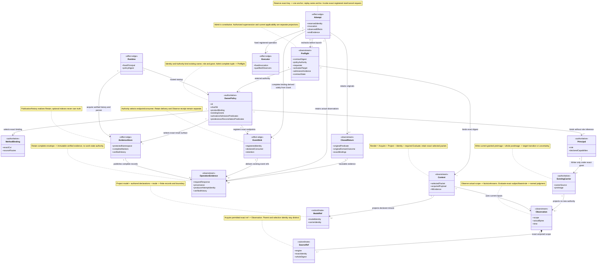
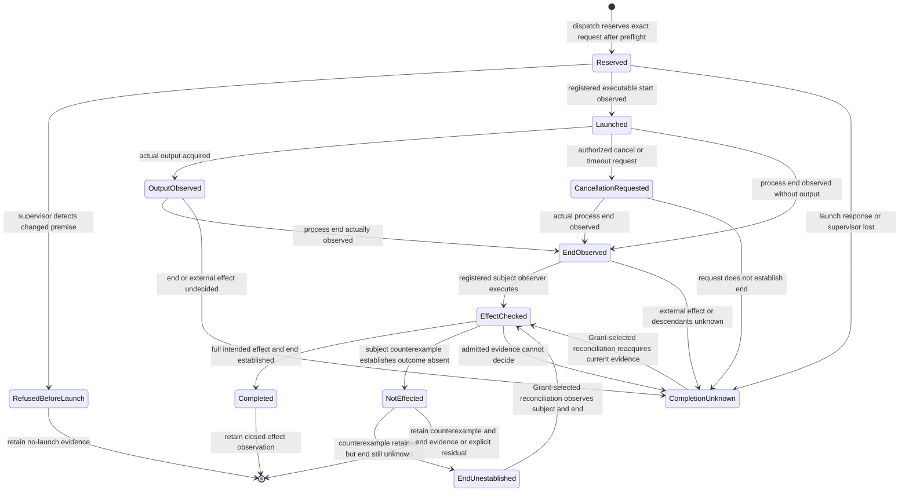
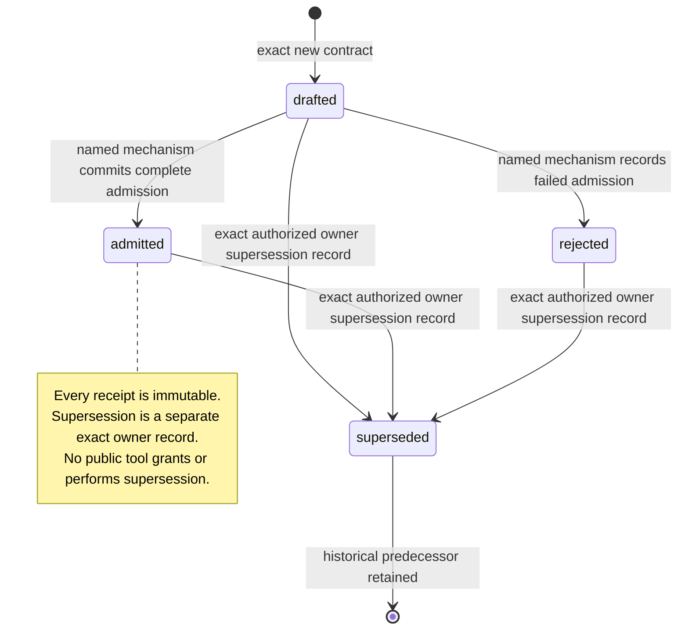
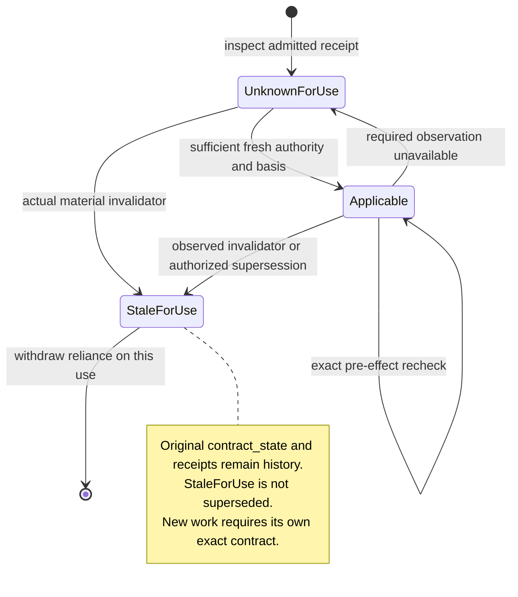
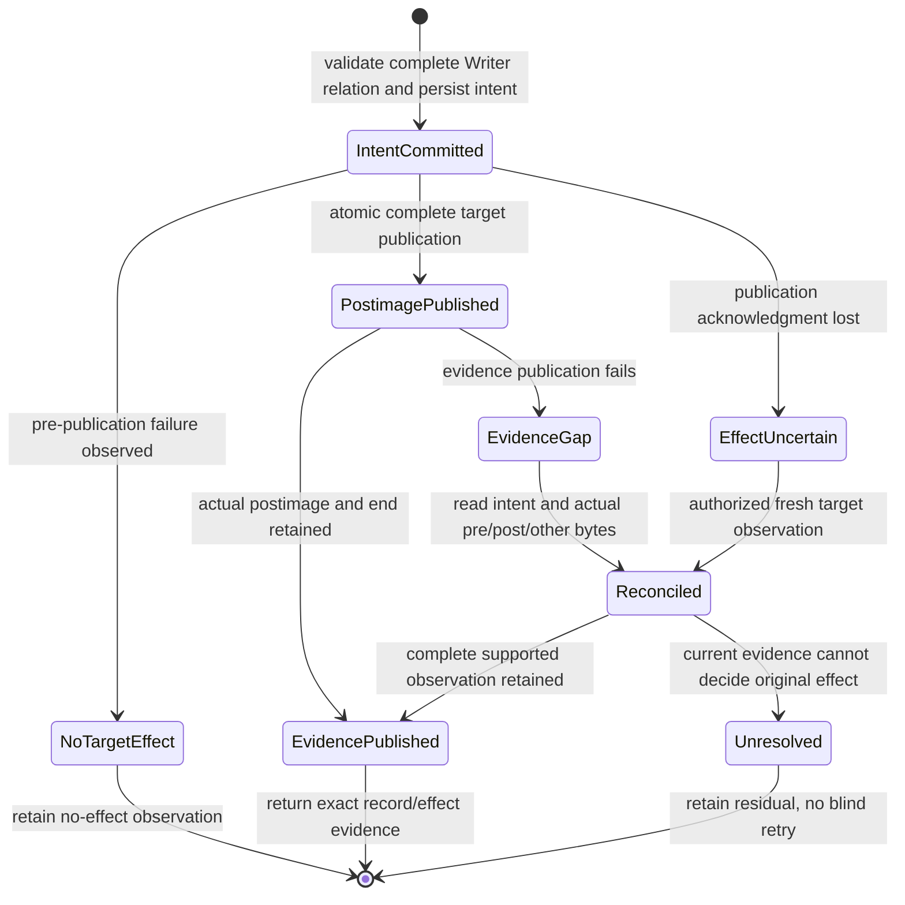

# Deterministic support for F_P development actors

Status: **proposed HOW, design-review-repair-001 for T-008**. This is tenant HOW for
[REQ-AC-FD-001..013](../../../specification/requirements/fd-support-tools.md)
and the [qualification obligations](../../../specification/requirements/fd-support-verification.md).
This document specifies the selected contract; separate closed module returns
record provisional construction evidence. Integrated qualification, actual F_P
assessment, semantic acceptance and benefit remain pending. The unchanged codec
and source-generation designs retain their existing checked scopes.

This candidate is a current design_reframe proposal against HOW
b38eedbe85ee32ef11d945d6a60ed3f9bb2312ac10e873d8ddc9b7986744a005,
under the Root Writer grant retained with exact preimages. The actual
[source-first platform design review](../../../.ai-workspace/comments/codex/t008-platform-design-review-001/STAGE2.md)
found missing whole-family Prime/projection and foundation-selection evidence.
Its original falsified and indeterminate results keep their exact subject and
standing. The added evidence is an author proposal; current Prime, decision
completeness, co-evolution and Ontology/design dispositions remain pending
independent assessment and distinct Root decisions. The foundation frontier is
not silently selected. co-evolution-001 at
9dcc63c57b010d6ec9741f4637f957f512f5f243c2fd5130bbc0ab0600a883aa
binds older HOW32095ebef2f2bb1d5a5328faecc576f87fdaae788cdd23570374b0eea4fb9a70;
no current retention or backdated acceptance is inferred.

## Boundary and method binding

The Product is `urn:stdo:product-definition:a-c-implementations`; Graphify is
its existing registered tenant. The increment adds tools to that tenant, not
an Executive, scheduler, independent Product, graph-owned workflow, work ledger
or method. F_P actors select work, frames, material relations, meaning,
assurance claims and already-authorized actions. Named operations acquire,
render, dispatch, retain and record. `F_D[v]` checks evaluate only declared
supported predicates. An executor invoking F_P does not make its answer F_D.

[T-008](../../../.ai-workspace/tickets/active/T-008-fd-tenant-implementation.md)
records the owner's instruction, exact design activation and external bootstrap
admission. The installed construction constitution stays STDO v2.5.1-rc.2,
manifest `3d860ff4c1746f06ac25295a9e205cffb8e7725869615ac77cf2304b70ff2782`.
The owner selects Claude RC9 for this bounded work's execution, including its
Executive and software-design profiles. This does not rewrite the installed
constitution or assert a published/accepted V3 install.

The [RC9 binding](fd-method-claude-rc9.json) pins source commit
`c2cfa9b908d1722ae3f26c32fa4ece691083bdc3`, custody
`3a2097137c3588ba44b98e3ea801ac7f2be1daf0`, standards tree
`98de394b352179c25dfa63b0b59a9b6bdd43632d` and exact deciding members. The
same profile is the first finite consumer contract supported by the toolset.
The source-owner map from T-007 remains the prior common-candidate derivation,
not a substituted execution basis. Exact model subjects remain a third basis
role. Runtime imports no V3 code, native compiler, sibling Product, study MCP
or generated study model. Method content is supplied through verified source
references; its source repository need not be mutable or colocated.

The unchanged profile's design_revision:3 and preservation_inventory are
historical binding/baseline metadata, not the version or identity of this
current HOW. The referenced preservation-inventory-002.json at
9184010efa481890e4da7d377191db7ee0c69ce1df6ba03e4d43e0835749dcb8
records selected commit43fe4c9ab403268b2bea01a46edcc4d9db78f464 and original
anchor94ac5d3e8b977d28f668a5988327fdd5b340f0bd. It remains immutable history.
This proposal's exact current source conservation is separately recorded in
[PRESERVATION.json](../../../.ai-workspace/qualification/t008/design-review-repair-001/PRESERVATION.json).
Keeping that historical profile does not assert its old whole trees equal the
new source plus approved additions. No profile byte or Core.PROFILE_SHA256
change is proposed solely for chronology; bdb937545c13d2cea8eaa93507102cff7c2ea41ca0fc169a8ec84c81003dc7d1
remains the exact supported serialization/method binding. A future functional
profile revision would require a new profile digest and matching Core pin,
current runtime/source binding and qualification; it cannot repoint old proof.

### Deciding owners and translation scope

| Tool relation | Exact RC9 deciding owner |
|---|---|
| Activation carrier and source/identity relations | REFERENCE_FRAME §11 and RF-005/006/012/013/014 |
| Contract admission, intake, context/fit, actor duties, effects and recovery | ACTIVATION §§1–3, 5 and 7; TICKETS §5 |
| Result predicates, original domain outcomes, gaps, conjunction and reuse | FOUNDATIONS §4 Results, Conjunction of results, Change impact and evidence reuse |
| Evidence versus semantic law, source-first expectations and independence | EVALUATION §§1–4; ASSURANCE §§3, 10, 13–16 |
| Selected role additions, no Executive mutation and event-driven attention | EXECUTIVE_BASELINE §§6, 8–10, 12, 17 and 19 |
| Work/evidence ownership and recorded decisions | TICKETS §7; PRODUCT_DEFINITION §8 |
| This source-to-module gate | DESIGN_MODULE §5 Decision-complete symbolic design and §7 three-view gate |

These routes retain source conditions and exclusions. A profile describes a
finite serialization/check binding; it supplies no new method rule. An unknown
cut, optional-profile selection, vocabulary, predicate primitive, translation
or executor contract refuses specifically. A matching label or hash establishes
neither applicability nor authority. No arbitrary cross-method join is supported.

## Operating model and trust boundary

A trusted local Product operator starts the CLI/server with an exact policy
file, its expected SHA-256 and one fixed principal identity. The operator
selects the Product, source roots/repositories, method profile, owner records,
existing work grants, roles, predicate/operator definitions, executors and
protected evidence root. The API caller is untrusted with respect to these
choices. A request cannot create or replace policy, change its principal,
register an executor, grant territory or declare itself owner. Policy bytes
are acquired and checked again before effects. Their digest checks continuity;
it does not authenticate whoever wrote them. Authority rests on the trusted
operator's separately established Product/owner binding.

The supported deployment is a cooperative local development account: the
operator and registered executor programs are trusted to honor their declared
operation contracts. Requests, workspace content and F_P output are untrusted
input to the tool. Same-account actors able to rewrite protected policy,
executables or retained evidence behind the server are outside this boundary;
the tool provides no OS credential isolation, signing or adversarial concurrent
filesystem sandbox. It still detects ordinary dirty state, dependency drift,
conflicting tool writes, missing evidence and incorrect request boundaries.
No internal path is trusted merely because it is internal.

A registered process is **not OS-confined**. Preflight and dispatch enforce
its exact invocation, input and configuration, check its registered dependency
preimages, and observe declared effect surfaces. They do not prove that an
arbitrary child cannot write elsewhere or create descendants. An executor's
qualified contract must honestly declare its tools, local-effect behavior,
dependency population, termination observations and unobserved host conditions.
Unsupported enforcement requirements refuse; no `sandboxed` guarantee appears.

Policy/source roots and the protected evidence root cannot be in any permitted
Writer territory. All API-relative paths reject absolute paths, `..`, empty or
ambiguous components and symlink components, including a symlink leaf; regular
file opens use non-following checks. Immutable Git acquisition resolves an
exact full object/revision and member, checks regular-blob mode and hash, then
reads blob bytes without checkout, hooks, filters or a moving branch. Product
read roots may exceed write territory only where explicitly configured. A
missing or inaccessible root is a gap, never permission to search elsewhere.

## Ontology and invariants

The irreducible domain carriers are the selected policy/binding, exact acquired
content/observations, activated context, one execution attempt, original return
and downstream operation evidence. Files, CLI messages and MCP results are
representations of those carriers. No separate mutable task object is needed.

| Carrier | Identity, ownership and relationship |
|---|---|
| `OwnerPolicy` | One exact operator-selected id/digest per Runtime, binding one Product definition id/digest and fixed principal. Contains existing grants and approved operation/executor/predicate references. External authority, never public-tool output. |
| `MethodBinding` | One exact registered profile id/digest and method cut plus member hashes. References owners; maps their packet/result contracts to tenant serialization. |
| `SourceRef` | One engine, registered root/repository, exact relative path/object and whole-content SHA-256. One optional selector narrows acquisition, never changes parent identity. |
| `Observation` | One named acquisition scope/time, enumerated path population, existence/mode/byte hashes and relevant configuration/dependency preconditions. Dirty/untracked bytes participate. |
| `ModelRef` | One exact raw input digest, model id/digest, codec/profile and subject basis; source grounding is separately supplied. Model and carrier identities stay distinct. |
| `Context` | One caller-selected method packet plus actual record/source payloads, late-acquisition manifest, projection boundaries, rendered stdin bytes and scoped fit evidence. |
| `Preflight` | One exact activation/context/grant/executor/result-surface tuple, policy and source preimages, finite admission findings and receipt. It does not admit its cited outcome. |
| `Attempt` | One protected identity/reservation, exact invocation/payload/settings, ordered retained observations, stdout/stderr and named result surface. May have predecessor attempt; never an inferred continuation. |
| `ClosedReturn` | One original raw payload and producer/activation/subject/basis/consumer bindings, original predicates/domain values, provenance, residuals and invalidators. Checks do not rewrite it. |
| `OperationEvidence` | One immutable request/response/content manifest and hash-linked observations. Reconstructable downstream evidence, not a work-state authority. |
| `ExistingCarrier` | An externally owned work/evidence source. Projection does not own its state. Only a named, separately granted Writer operation changes it. |

Cross-carrier invariants:

1. Full semantic identities and content digests remain separate. No equality of
   labels or payloads creates a join or grants authority.
2. Acquired payload is distinct from a locator. Derived projections preserve
   parent identity, all required closure records, qualifications and boundaries.
3. Every dependency-sensitive effect rechecks its exact material preconditions,
   policy, Product definition, method/profile and executor dependencies. It does
   not silently rebase on new bytes. Effects are recorded before returning.
4. Admission comes from the protected selected mechanism and existing policy
   authority. A request's alleged grant/receipt is not trusted evidence.
5. Role is startup-bound. Executive/Reviewer cannot call a candidate/work-carrier
   Writer operation or receive mutation authority from a role label. Automatic
   tool evidence stays outside the Product/worktree; it is not such a mutation.
6. Receipt, evaluation, output, intended effect and observed end are independent
   facts. Lost response, timeout, cancellation and process exit do not alone
   establish external completion or rollback.
7. Historical returns retain original subject, basis, predicate and verdict.
   Current applicability is a new check/relation. Duplicate evidence is not an
   additional assessment; inconsistent evidence remains visible.
8. Unsupported/missing premises remain gaps. Negative reachability in incomplete
   coverage proves no non-influence, fit proves no attention, and a necessary
   condition proves no stronger claim.
9. Evidence retention never creates a disposition, acceptance, release, role
   transition, work-state ledger or next-action grant.

## Public wire grammar

All public operations use integer-only JSON, UTF-8, duplicate-key rejection,
finite strings/arrays/objects, no NaN/infinity and a closed versioned request.
Tenant canonical JSON uses the existing sorted-key compact UTF-8 grammar;
array order is significant. It is not asserted to be JCS. `id` is a nonempty
caller request identity; exact retries of an effect reuse its reservation,
while the same id with different effective inputs refuses.

```json
{
  "schema": "a_c.fd-support.request/1",
  "id": "request-001",
  "operation": "tools.describe",
  "arguments": {}
}
```

```json
{
  "schema": "a_c.fd-support.response/1",
  "id": "request-001",
  "operation": "tools.describe",
  "status": "ok",
  "result": {"artifact": null, "value": {}},
  "refusal": null,
  "operation_outcome": {
    "predicate": "B(tools.describe): the declared exact inventory output is available",
    "value": "returned",
    "cause": "declared output available",
    "core_value": "satisfied",
    "source_parent": {
      "member": "FOUNDATIONS.md",
      "sha256": "fd2d895f90eb39bda0950c1c7ff02057ef5d8ae73fcbc5b3203f7e99081d6e3f",
      "clause": "results"
    },
    "evidence": [],
    "limits": ["output availability only"]
  },
  "evidence": {"id": "operation-evidence-id", "sha256": "64 hex characters"}
}
```

`status` is `ok`, `refused` or `error`, a transport distinction, never
a semantic result algebra. The distinct operation-boundary outcome below has
its own availability predicate and source-bound core mapping. Refusal contains exactly `code`, `reason`, `gaps`
and `source_refs`; `result` may retain partial observations but cannot pretend
that the refused effect occurred. `error` preserves caught external failure and
unknown effects. An `F_D[v]` result appears separately under `result.value.judgment`
with predicate, original domain outcome, core value, subject/basis, evidence
and limits. An unperformed evaluation has no such judgment. Refusals name the
unmet supported contract; they never fabricate a Worker work result.

The boundary-to-wire map is closed and shared by CLI/MCP and persist_outcome:

| Bound operation outcome | response.status / CLI exit | response.refusal |
|---|---|---|
| returned | ok / 0 | null; this includes a truthful available negative or unknown inner judgment/observation, and a completely available rejected-admission receipt. |
| refused(constraint), refused(basis), refused(authority), refused(capability) | refused / 2 | Required exact code/reason/gaps/source_refs; code must map to that cause in the closed code table. The denied dependent effect has not begun. |
| held(observation), held(effect) | error / 1 | Required exact held-cause code/reason/gaps/source_refs; retain any actual partial output, effect and publication uncertainty. |
| no bound operation (parse/startup/protocol failure) | refused / 2 for a known guard violation; error / 1 for a caught observation/internal/publication failure | Exact applicable diagnostic code; operation_outcome is null, and no named evaluation is fabricated. |

A timeout returning its contracted current unknown observation is returned/ok;
an interrupted operation unable to provide its contracted output is held/error.
The difference is output availability under that exact operation contract,
not the inner effect value. A caught error cannot be relabeled returned merely
because it has a diagnostic. Inner method/F_P results are never rewritten to
match status. MCP isError is true exactly for refused/error tool responses;
protocol parse/invalid-request/method/params failures use JSON-RPC errors and
have no named operation outcome. A trusted store failure may leave evidence
null with its exact publication gap as already specified; no false durable ref.

`SourceRef` has the exact keys below. `object` is null for workspace files and
retained evidence, and an exact full Git revision/object for Git sources.
`selector` is null, `{"lines":[first,last]}` (inclusive 1-based, UTF-8 text) or
`{"json_pointer":"/path"}`. `sha256` always binds whole parent content.

```json
{
  "engine": "workspace-regular-file",
  "root": "registered-read-root",
  "path": "relative/member.md",
  "object": null,
  "sha256": "64 lowercase hex characters",
  "selector": null
}
```

`ArtifactRef` is exactly `{"id":"protected-artifact-id","sha256":"..."}`.
It resolves only in the Runtime's evidence store and checks the complete retained
artifact envelope bytes below; it is not an arbitrary filesystem path. Raw blobs
may share storage, but their provenance-bearing acquisition/return records do not
share identity merely because their payload bytes match. `ModelRef` is exactly `{"source":SourceRef,
"format":"model|carrier","model_id":"...","model_sha256":"..."}`.
The `format` value is the enum `model` or `carrier`, not the literal string
containing a vertical bar. A Writer target uses the same SourceRef fields;
only there `sha256:null` denotes a required absent preimage for exclusive
creation. Source reads never accept a null digest.
Inputs requiring currentness take retained Observation refs, not a caller's
unverified assertion that HEAD matches. Unknown fields and enum variants refuse.

The inventory below is the closed operation family for this increment. All
listed keys are required unless marked optional. Empty lists are explicit;
semantically required nonempty populations are checked. Discovery publishes
these same contracts and limits, including JSON Schemas; CLI/MCP do not have
independent schemas or dispatch implementations.

| Operation | `arguments` keys | Result payload |
|---|---|---|
| `tools.describe` | optional `operation`, optional `method_profile` | Inventory or exact contract, effect prerequisites, checked fragment, supported profile, qualification status and unsupported variants. |
| `workspace.observe` | `scope` (registered file/directory scopes), optional `previous` (Observation ref) | Exact enumerated current observation, additions/removals/byte/config changes against previous, acquisition limits and current Git metadata as supplementary data. |
| `source.read` | `source` (SourceRef), `encoding` (`utf8` or `base64`), optional `max_content_bytes` | Actual content, parent/selected hashes and routes, original line coordinates; no locator-only substitution. |
| `records.find` | `model`, `text` | Exact literal matches and model scope, via `ac_graph.find`. |
| `records.read` | `model`, `ids` | Exact payloads and typed references via `ac_graph.inspect`; unknown ids refuse the batch. |
| `graph.project` | `model`, `selections` (ordered `seeds`, optional `budget_records`) | `ac_graph.project_many` views with complete governing closure and untouched boundary/population semantics. |
| `relations.query` | `model`, `declarations` (SourceRef), `query` (`dependencies`, `path`, `impact`, `coverage`), `seeds` | Paths/closure/coverage from explicitly authored typed declarations, supplied applicability separated, incomplete-coverage boundaries. |
| `context.assemble` | `packet`, `models` (ModelRef plus selections), `sources` (SourceRefs), `late_acquisition` (SourceRefs), `envelope` | Protected Context artifact, actual acquisition manifest, exact bytes and selected-capacity measurement/fit judgment (unperformed when no such gate is selected). Does not emit over-capacity content to an actor. |
| `contract.preflight` | `context` (ArtifactRef), `grant_id`, `executor_id`, `result_key`, `observations` (ArtifactRefs), optional `admission_record` | Exact draft/admitted/rejected coordinates, deterministic findings and protected receipt bound to policy authority or explicitly registered owner override. |
| `dispatch.start` | `preflight` (ArtifactRef), optional `retry_of` (Attempt ref), optional `reconciliation` (ArtifactRef) | Named attempt receipt, exact effective invocation/input/settings and retained observations. No arbitrary argv/env/script argument. |
| `dispatch.observe` | `attempt` (ArtifactRef), `after_event` (integer) | Events/raw-output routes, available output and subject/effect/end observations; currentness gaps. |
| `dispatch.cancel` | `attempt`, `reason` | Retained cancellation request, any observed signal delivery/end; no automatic completed/not-effected value. |
| `events.wait` | `attempt`, `after_event`, `timeout_ms`, `cadence_ms`, `purpose`, `stop_condition` | Decision-relevant events or bounded timeout observation; notification sink delivery/receipt distinguished. |
| `return.capture` | `attempt`, `payload` (ArtifactRef), `return_contract` (SourceRef) | Original payload/provenance and source coordinates. Only actual output acquired from that registered dispatched attempt can authenticate; external raw material is retained unauthenticated with binding gaps. External-producer authentication is unsupported. |
| `return.check` | `return` (ArtifactRef), `context`, `consumer`, `observations`, `predicates` (registered ids) | Binding/currentness/predicate findings, duplicate/conflict metadata, preserved historical verdicts and explicit non-consumable gaps. |
| `review.prepare` | `phase` (`expectation` or `candidate`), `claim` (SourceRef), `sources`, `candidate` (SourceRef or null), `proof` (SourceRefs), `comparison` (SourceRef or null), `expectations` (ArtifactRef or null), `expectation_body` (null or `text`/`source_inputs` object) | Raw acquired authority/candidate/proof/diff payloads, producer/assertion/execution provenance and observed exposure ordering. |
| `checks.evaluate` | `predicate_id`, `inputs` (ArtifactRef/SourceRef bindings), `subject`, `basis` | Actual finite `F_D[v]` judgment with source contract, domain, counterexample/missing premises and limits. |
| `results.conjoin` | `operator_id`, `plan` (SourceRef), `returns` (ArtifactRefs), `current_observations` | Exact method-owned conjunction, original results, stale/absent planned assessments, uncovered obligations, conflicts and failures. |
| `work.project` | `carrier` (SourceRef), `selection` (JSON pointers or Markdown headings) | Exact selected original content, source-linked facts and original owner wording; no inferred task state. |
| `work.write` | `grant_id`, `target` (SourceRef with preimage), `mode` (`append` or `replace`), `record`, `interpretation` (separate or null), `observations` | Named Writer-only exact record application, pre/post identities and actual effect/end evidence or refusal. |
| `refresh.prepare` | `previous`, `current` (Observation refs), `declarations` (SourceRef), `results` (ArtifactRefs), `invalidators` (SourceRef) | Material diffs, affected candidates, explicit unknown impact, surviving exact applicability checks and reconstructable handoff artifact. |
| `resources.aggregate` | `attempts` (unique retained Attempt/Operation refs), `accounting` (SourceRef) | Measured/unknown counters, all attempts/failures, elapsed versus summed intervals, overlapping/subcounter metadata and supported selected-limit checks. |

`evidence.read` is additionally provided for all three roles: `artifact`
(ArtifactRef), optional `max_content_bytes`. It returns the retained exact
payload, actual public schemas/prompts/invocation/raw proof and parent digest.
It cannot reach unregistered private paths. Returned evidence refs remain
acquisition routes; the caller chooses whether to acquire them.

The exact ordinary CLI entry is:

```sh
python3 code/ac_support.py --policy POLICY.json --policy-sha256 POLICY_SHA256 --principal EXECUTIVE_ID call --request REQUEST.json
python3 code/ac_support.py --policy POLICY.json --policy-sha256 POLICY_SHA256 --principal REVIEWER_ID mcp
```

`--request -` reads one JSON object from stdin. CLI emits exactly one response
object on stdout and exits 0 for `ok`, 2 for `refused`, 1 for an external/internal
`error`; diagnostics belong on stderr. `mcp` serves the protocol below. There
is one internal fixed supervisor entry, inaccessible through public operation
arguments. No interface changes the operator's host/global configuration.

### Returned actor payload

The supported closed-return carrier is `a_c.fd-support.closed-return/1`.
Its exact keys are `schema`, `id`, `frame`, `activation`, `subject`, `basis`,
`actor`, `consumer`, `evaluations`, `not_performed`, `work_result`, `residuals`
and `invalidators`. Frame is id/revision; activation is id/SHA-256; subject is
id/SHA-256; basis is the exact method-profile id/digest plus Observation refs;
actor is id/family/authorship identity. These coordinates are checked against
the original activation and protected identity bindings, never accepted merely
because the answer asserts them.

The expected activation coordinate is derived only after full packet acquisition
and validation: `{"id": packet.activation.id, "sha256": SHA256(canonical(packet))}`.
The complete canonical packet body, including revision/configuration and every
other field, participates. Its acquired raw parent SourceRef/hash, the Context
and Preflight artifact hashes, and frame/subject/basis coordinates remain
separate. No caller replacement hash is accepted. The coordinate is published
as `activation_identity` in the ordinary Context summary and in its rendered
`boundaries`, so an actor can construct the return through the public surface.
This derived coordinate adds no packet field and has no self-hash recursion.

Each performed evaluation has exactly `id`, `predicate`, `domain_outcome`,
`core_value`, `evidence`, `residuals` and `invalidators`. `predicate` is its exact
source identity or explicitly supplied predicate body bound to the activation;
`core_value` uses the source-owned five-value vocabulary. Domain outcome is the
original JSON value, not a rewritten success flag. `not_performed` lists planned
evaluation ids and contains no verdict. `work_result` is null for a return not
asserting construction availability; otherwise it contains exactly `value`,
`cause`, `candidate`, `evidence` and `residuals`, preserving RC9 ACTIVATION's
value/cause relation. `candidate_ready` must resolve its exact candidate and
transition evidence. The parser reports a wrong mapping without inventing the
Worker's answer. The original bytes always survive invalid format or binding.

This is a serialization of the selected method-owned relations, not an
additional result algebra or requirement that F_P judgment be deterministic.
Registered return-contract SourceRefs resolve the exact ReturnContract content
schema and role-specific proof obligations in Closed acquired content contracts
below; no arbitrary body or hidden proof convention is accepted. Unsupported return carriers remain retained
raw output with an explicit unsupported-format gap.

### Packet carrier

The `packet` object is a tenant serialization of REFERENCE_FRAME §11's minimum
binding, with exactly the following source-owned groups, not a second packet
law. The RC9 profile supplies each group's owner route. Group values are closed
objects with the listed keys. Text is supplied by the F_P actor or referenced
existing authority; tooling does not author its meaning.

| Group | Keys and binding |
|---|---|
| `activation` | `id`, `revision`, `configuration` (SourceRef) |
| `frame` | `id`, `revision`, `declaration` (SourceRef), `evaluation` (SourceRef), `result_algebra` (SourceRef) |
| `subject_basis` | `subject` (`id`, `sha256`), `method_profile` (id/digest), `product` (id/definition SourceRef), `observations` (ArtifactRefs), `dependencies` (SourceRefs), `time_basis` (explicit string) |
| `attention` | `material_relations` (SourceRefs), `invariants` (SourceRefs), `semantic_sources` (SourceRefs), `exclusions` (strings), `prohibited_assumptions` (strings) |
| `actor_authority` | `actor_id`, `role`, `capability` (SourceRef), `semantic`, `evaluation`, `operation`, `decision`, `acceptance`, `publication` (authority SourceRefs or explicit null), `territory` (registered paths), `tools` (registered ids) |
| `evidence_relations` | `admissible_evidence` (SourceRefs), `acquisition` (SourceRefs), `dependencies` (SourceRefs), `conjunction` (SourceRef or null), `translation` (null in this fragment), `consumer`, `return_contract` (SourceRef) |
| `stop_change` | `invalidators`, `stop_conditions`, `residuals`, `re_entry`, `reconfiguration` (explicit arrays of source-bound supplied records) |
| `profile_additions` | `worker` (operation-grant id, mutation subject and territory) or `reviewer` (claim, composition, population, oracle, ordinary/module path, falsification condition, independence/assurance SourceRefs and severity-scale SourceRef or explicit null) or `executive` (Product-role map, mandate, frontier, result/triage ledger, priority policy, conjunction and disposition grant SourceRefs), exactly the selected role |

`envelope` is exactly `{"capacity_bytes": integer-or-null,
"boundary":"executor-stdin-utf8","host_context":{"state":"known|bounded|unknown",
"bytes":integer-or-null,"evidence":SourceRef-or-null}}`. The context artifact
retains the supplied packet, full selected records and source content,
projection boundaries, late-acquisition refs and exact canonical rendered body.
A manifest distinguishes content supplied now, explicitly permitted late reads,
failed/denied reads and unresolved sources. Source locators alone do not count
as acquired deciding material. Mandatory late reads have to be named by the
selected contract; a future read is not reported as already supplied.

Where B declares a numeric context capacity, measure the exact full active
input before delivery, including template/framing, material late-acquisition
allowance and any host context, or use an actually supported host-inclusive
upper bound as ACT §2 step 3 requires. Exact retained stdin bytes alone are not
a whole-host measurement. A known/bounded host contribution needs actual
supporting evidence; unknown host context makes a required full-active fit
judgment indeterminate unless a measured excess already falsifies it. A
positive required fit cannot follow from incomplete inputs or a guessed bound.
Token capacities refuse as unsupported rather than use a guessed ratio, and
measured excess never trims content.

capacity_bytes:null means no numeric context capacity is declared. ACT §2 then
requires no size measurement/fit gate; RF-002's other finite-attention and
material-context conditions still apply. Exact rendered/dispatched bytes and
any actual byte count are retained for identity/observation, but no numeric or
whole-host fit result is invented or coerced to satisfied. A fit evaluation not
selected is not performed (judgment null); host/full-fit unknown scope remains
explicit. This branch allows ordinary admission only when the existing selected
grant requires no numeric/whole-host fit predicate and all other authority,
basis, outcome, material-context and capability premises hold. Null cannot hide
a known required capacity or silently reduce the outcome. An explicitly required
fit stays required. A separately lawful exact override may authorize its own
stated action, but never manufactures a satisfied fit or removes its unknowns.
Fit, attention in actual use and semantic sufficiency remain separate.

## Source, state and graph mechanics

`workspace.observe` enumerates configured relevant files and declared directory
scopes, including new untracked paths and deletions, with byte hashes, type,
existence and acquisition time. It hashes present bytes, not HEAD versions.
Relevant Product, policy, method-source and executor configuration/dependency
preimages participate. A declared tree scope detects newly added files; an
explicit file list says nothing about unlisted additions. Enumeration or byte
caps refuse incomplete observations instead of returning a complete-looking
snapshot. Unreadable files, symlinks and scope changes remain named gaps.

Every dependent effect compares a new observation over the same scope to the
retained one, including path population, before its effect begins. Git HEAD and
status are useful metadata, not authority for current bytes. Stable scope can
coexist with unrelated dirty files outside it; those files are preserved.
Read-modify-write operations acquire an exclusive per-target tool lock and
recheck the target inside that lock. The declared threat model excludes a
hostile non-tool filesystem swap between check and effect; this limitation is
recorded rather than mislabeled atomic isolation.

Acquisition supports regular workspace files, exact Git blobs and protected
retained evidence. Whole-content digest and selected payload digest are both
returned. Line reads retain original inclusive coordinates; JSON pointers are
exact, and a missing pointer refuses rather than returns null. UTF-8 decoding
failure is explicit; base64 returns actual binary content when requested.
Missing mappings and source grounding do not become inferred mappings.

`ModelRef` verification uses `ac_graph.validate` or `decode(GraphCarrier)` and
checks exact model and raw carrier coordinates. Existing `find`, `inspect`,
`project_many` and carrier identity are reused without editing their model
schemas or dependency semantics. A model can be methodology-only; its declared
subject/coverage are always returned. No operation calls it a complete Product
workspace map. Composite/cross-model querying needs an explicit supported
identity/translation rule; this first fragment refuses it.

`relations.query` acquires the exact integer-only RelationDeclarations JSON
body and returns the closed RelationQueryResult below. Both schemas are in the
shared content catalog/tools.describe; this paragraph supplies no looser
alternative. The same validated model, represented subject, native calculus
basis and selected execution-method coordinates bind the declaration and every
usable applicability judgment. source -> target means dependent -> prerequisite.
Only explicitly governing, not-authentically-excluded edges participate;
unresolved conditions are included conservatively and qualified as unknown.
Coverage is raw seed-scoped declared-support mapping, never semantic covered,
satisfied, unaffectedness, F_P frontier selection or automatic re-entry.
Native codec closure/governing semantics and all other public contracts remain
unchanged; this authored graph is not an alternate authority or activation path.

## Product-bound admission and exact dispatch

Owner policy has schema `a_c.fd-support.policy/1`, with closed top-level keys
`id`, `product`, `method_profile`, `sources`, `principals`, `grants`,
`predicates`, `operators`, `executors`, `event_sinks`, `independence_policy`,
`evidence_root`, `limits` and `authority_sources`. Operator startup supplies its path and expected digest;
there is no public registration/write operation for it.

- `product` binds definition id, exact definition SourceRef and work/outcome
  source records. `sources` registers exact local roots/repositories, allowed
  read scopes and immutable-source aliases.
- `principals` binds startup requester principal to actor id, role, authorship/family
  metadata and allowed operations. A request cannot change these values.
- Each `grant` names id, existing owner/delegation SourceRefs, exact outcome,
  permitted requester principals and activated targets, operations/tools/executors/territory, required material
  preconditions, admission mechanism/conditions and `notification_sink` selecting
  an existing sink id (or null only for a non-dispatch grant). The operator verifies the
  source owners; the tool checks these registered bindings, not the truth of
  arbitrary supplied authority prose.
- Each `predicate` names id, exact source contract, subject/domain/basis and
  supported expression; each `operator` names the exact source-owned
  conjunction and selected declared rule, coverage/basis and decision-owner
  requirements. These cannot be chosen by an unregistered request definition.
- Each `executor` names a fixed executable and argv, dependency/configuration
  SourceRefs, cwd, allowlisted environment, effective actor/settings, input and
  stdout decoders, available tools, permitted local-effect contract and
  termination/effect observation capabilities. Public requests choose its id.
  No shell parsing, arbitrary executable, argument suffix, cwd or environment
  injection is accepted.
- `limits` names selected enumeration, message, attempt, observation and resource
  bounds with their units/scope. They are this deployment's controls, not
  universal method quotas. `authority_sources` names the trusted operator/owner
  records; their hashes establish bytes, not author authenticity.

`contract.preflight` re-acquires policy/definition/method/grant material and
selected current observations, validates the exact packet and registered
predicate premises, checks role/effects/tools/territory/result surface and
executor dependencies, and binds the draft to the exact context digest.
Only `grant.admission.required_predicates` are evaluated for admission, on the
activation subject `packet.subject_basis.subject` and selected execution Basis.
The optional reconciliation selection below is not evaluated on that subject
or folded into admission; preflight still validates its closed carrier.
If the protected mechanism's conditions hold it records its actual admission
receipt: mechanism id/digest, authority source, exact contract digest, decision,
evidence and predicates actually evaluated. An optional existing admission or
owner override is usable only when resolved through the trusted policy's
registered source and exact contract binding. Caller-created receipt JSON,
a ticket title or successful schema validation cannot substitute.

The admitted artifact is not an indefinitely valid bearer token. Dispatch
rechecks all material preimages and authority binding. Drift refuses before
launch, names which premise changed and retains the historical receipt. It
never silently substitutes new context or settings. Missing basis, authority,
closure or capability is routed through the selected RC9 owners and is not
reported as a Worker result.

The following concrete registry carriers close the public policy seams. Registry
populations are id-keyed objects; duplicate ids/unknown fields refuse. Source
references use the grammar above. The policy's `method_profile` is the exact
id/digest plus SourceRef of the shipped binding. Each local source root has
exactly `path`, `read_scope`, `kind` (`workspace` or `git`), and `writable`;
root paths are trusted startup configuration, never request fields.

| Registry record | Exact fields |
|---|---|
| Principal | `actor_id`, `role`, `family`, `authorship`, `operations`, `role_binding`, `role_transition` |
| Grant | `id`, `authority_sources`, `outcome`, `principals`, `targets`, `operations`, `tools`, `executors`, `territory`, `preconditions`, `admission`, `notification_sink` |
| Admission selection | Required: `mechanism_id`, `mechanism_source`, `authority_source`, `required_predicates`, `allowed_override_sources`; optional: `required_reconciliation_predicates` |
| Executor | `id`, `executable`, `argv`, `dependencies`, `cwd`, `environment`, `actor_id`, `settings`, `tools`, `effect_scope`, `stdin_mode`, `stdout_decoder`, `observers` |
| Predicate | `id`, `source`, `subject`, `basis`, `input_names`, `expression`, `limits` |
| Conjunction operator | `id`, `source`, `decision_authority`, `rule`, `plan_source`, `qualification` |

`outcome` is id plus exact source; `territory` is a list of registered-root and
relative file/directory scopes. `preconditions` are exact SourceRefs and retained
Observation refs. `admission` may reference only the implemented finite
mechanism `product-policy-preflight/1`: all source/identity, scope, role, effect,
result-surface and selected registered predicate checks above. It is a real
Product-bound mechanism under the protected policy, not mere shape validation.
An unsupported mechanism id refuses. The mechanism's implementation and policy
remain distinct provenance. An override source must be separately registered
by the operator and explicitly bind the exact contract; the request cannot add
one to that registry. No authority is inferred from the words in `outcome`.

This provisional policy/1 refinement permits exactly one additional optional
Admission-selection key, `required_reconciliation_predicates`. It has the same
finite nonempty-string id-list grammar as `required_predicates`, naming only
registered predicates. Other unknown keys, null/non-array values and malformed
ids refuse under the existing closed policy boundary. Absence means an empty
reconciliation selection, not a default predicate or retry permission. Old
grants without an explicit nonempty selection cannot retry. The two lists have
distinct domains: required_predicates is activation-subject admission only;
required_reconciliation_predicates is predecessor-Attempt/current-Basis
reconciliation only. Neither is a source from which the other is inferred or
classified by predicate name, role or matching subject. This adds no public
operation, request argument, method law or shared-content schema definition.

Executor `executable` is an exact absolute regular-file path/digest chosen by
the operator; `argv` is its complete fixed string array including argv[0].
Dependencies/configuration are SourceRefs rechecked before launch; environment
is a complete explicit string map, not inherited arbitrary caller variables.
The tool retains any required host/environment unknowns. `stdin_mode` is
`context-utf8`; its byte payload is exactly the saved Context rendering, with no
unmeasured appended prompt. `stdout_decoder` has exactly `format` (`json` or
`utf8`), `pointer` (JSON pointer or null), and `decode_json_string` (Boolean).
This permits a provider's JSON envelope containing the actual answer as a JSON
string to be unwrapped reproducibly. Missing/invalid decoding retains raw output
and a format gap. No decoder executes code. Observers are `process-end` and
`file-postimages` with exact selected scope/expected hashes; they establish only
their named predicates, not semantic task success. File completion/end is
claimed only where the registered effect contract and actual observer establish
both; otherwise external effects/descendants remain unknown. `effect_scope`
declares the expected local-effect and unsupported enforcement boundary.

`work.write.record` is exactly `{"text":"literal UTF-8 bytes as text",
"provenance":SourceRef}`. Append adds precisely that UTF-8 text, with no
implicit newline or method prose; replace supplies the whole target body.
`interpretation` is null or `{"text":"...","author":SourceRef}` and is
retained separately in operation evidence, not silently inserted as an owner
ruling in the target. New absent targets and existing targets both use explicit
grant/territory and expected preimages as described above.

### Attempts, notifications and uncertain effects

`dispatch.start` atomically reserves a unique request/activation key under the
protected evidence root before launching a small per-attempt supervisor. This
is process supervision for one named invocation, not task scheduling or
method-workflow control. The supervisor rechecks admission/preimages again at
the actual effect edge, starts the fixed executable with exact retained stdin,
records acknowledgments, stdout/stderr, events, timestamps and observed process
end, and writes the named result surface. Provider/actor settings are retained
exactly; provider usage absent from its actual result stays unknown.

A repeated exact request returns the existing attempt and its observations;
a conflicting use of the key refuses. If the caller loses a response or a
supervisor dies during the launch interval, the reservation remains and no
automatic second launch occurs. A fresh actor can acquire the named attempt,
reconcile observed effects/end, and supply an explicit already-authorized retry
with predecessor/reconciliation evidence. `retry_of` is required for another
attempt of the same activation. The same applicable protected Grant must
explicitly select at least one registered predicate in
`admission.required_reconciliation_predicates`; `required_predicates` is never
the retry selector. Every selected reconciliation predicate must declare the
complete predecessor Attempt id/digest as its exact subject and the selected
current execution Basis, with the operator-verified owner-selected source
contract for this retry scope. A wrong subject/basis/unknown id is a failed
premise, not a predicate silently filtered out or reclassified as admission.
Only actual protected checks.evaluate OperationEvidence on those exact
coordinates can supply its satisfied judgment. An F_P Return evaluation,
caller-authored record, arbitrary satisfied check or supplied predicate cannot
substitute. All selected predicates require current input acquisition and
ordinary Grant conditions; historical satisfaction alone is insufficient.
Core checks the pure binding and effects freshly rechecks it at reservation
and launch. Absent/empty reconciliation selection holds retry as
`effect_unreconciled`; malformed selection refuses the closed contract.
Missing/unsatisfied/stale/wrong-route evidence retains its exact existing
gap/refusal, never grants retry. Original predecessor/source/reconciliation refs, results and
unknown effects survive; success neither relabels the predecessor nor grants
retry authority or establishes descendant/effect completion. No success or retry
grant follows from silence, and no automatic retry is introduced.

The supervisor is launched through the tenant's own fixed entry point and
pinned code dependencies, without user scripts or shell. Its operator-startup
Python binding is distinct from the actor Executor executable/settings and
cannot be overridden by an actor or public request. Actual child receipt,
process exit, effect snapshots, durable writes and unknown descendants are
separate event kinds. Process exit establishes only that observed process's
end. External work or descendants may remain unknown under that executor's
contract. An actual executor-specific effect observer may establish more,
within its declared checked scope; a return saying “done” alone does not.

Cancellation and timeout retain request/signal/partial-output events and
current subject observations. A terminate/kill request does not establish end,
completion or rollback. On uncertain end, subsequent dependent actions and
retries require the selected reconciliation predicate; no reset deletes the
partial evidence. An effect value is emitted only when the registered observer
establishes RC9 ACTIVATION Effects' premises. Otherwise it is
`completion_unknown`, with end separately unestablished and its deciding
observation named. A counterexample to a bounded outcome may establish
`not_effected` even when its end remains unknown, as that owner requires.

Notifications use only the exact `grant.notification_sink` selection, carrying
its registered consumer, attempt, kind and cursor. The fixed binding is sealed
in the Attempt reservation and freshly rechecked before delivery; neither
Executor settings nor public request arguments select or override it. Appending and syncing a sink record establishes
local delivery, not that the consumer saw it. Return, exception, observed basis
change and selected deadline/checkpoint events are distinct. The ordinary CLI
may use `events.wait` as declared bounded fallback with purpose, cadence,
evidence target, deadline and stop/escalation condition; it cannot become an
unbounded polling controller. MCP returns the same event records through tools;
it does not claim unsupported push/task features. Notification failure is
recorded and the declared fallback remains visible.

## Returns, review and qualified checks

`return.capture` preserves original payload and provenance, including malformed
or partial output. Authentication is supported only for the exact final output
acquired and retained by the registered dispatched Attempt, with its actual
executor/actor, transport, output-slot and complete-byte binding. Caller imports,
manual pastes, externally run CLIs and a producer name or hash cannot authenticate
a return in this increment. Their raw material remains evidence with explicit
unauthenticated/producer-binding gaps; no external-producer registry or
authentication branch is implemented. The presence of an `attempt` argument
does not make supplied bytes that Attempt's output. `return.check` compares original activation, actor, consumer,
subject, method/basis/dependency and currentness coordinates, applies only the
selected registered predicates and reports exact gaps. A historical satisfied
result on another subject remains that result and is non-consumable here.
Replay of the same activation/evaluation/producer/attempt evidence identity is
a duplicate and is not counted as a second assessment. Identical payload bytes
from two genuine distinct attempts/producers retain separate evidence records;
equal answers alone establish neither duplication nor independence. Different original results over the same bound predicate
are retained and identified as conflict; neither is silently overwritten.

Source/expectation provenance, execution/run provenance and authenticated
producer binding are separate. Protected actor identity proves neither the
independence of expected answers nor completeness of exposure history. Family
independence requires an explicit governing policy; absent one, two activations
of one family do not count independent for semantic judgment.

`review.prepare` expectation phase permits exact governing-source and relevant
proof-contract acquisition, records the Reviewer's source-derived expectations
as its F_P evidence and excludes candidate content. Claim scope is the acquired
ReviewClaim population declared below, not an inferred prose/link mapping.
Candidate phase acquires
exact immutable candidate, source, actual tests/fixtures/proof and selected
comparison directly, preserving expectation/preimage and observed exposure
ordering. The author summary is optional evidence, never a replacement. The
same public source/evidence operations are available to Workers for their
implementation/proof context. Comparisons are exact byte and canonical-record
diffs; neither labels a finding, severity, priority or disposition.

Candidate exposure observed earlier for that principal/claim is reported, not
forgotten by a fresh context. Unobserved external exposure remains unknown.
The tool checks only supplied/observed independence premises; it does not
certify all semantic independence or turn a nonauthor name into acceptance.
Reviewer expectation evidence and automatic tool logs stay in the external
protected evidence surface. They do not grant Reviewer write access to the
candidate or authoritative work carrier.

### Predicate and conjunction fragment

Registered predicates operate over explicitly bound JSON observations. The
finite expression grammar has `equals(left,right)`, `member(value,set)`,
`contains_all(set,required)`, `all(expressions)`, `any(expressions)` and
`not(expression)`. Operands are literals or exact JSON pointers into named
acquired inputs. No code strings, import, shell, arbitrary calculus execution,
model-authored predicate body or inferred truth is executed. Boolean operations
use complete known values; missing premises are retained, and a decisive false
for `all` or true for `any` may decide without discarding the missing premises.
Every registered definition states its domain, predicate meaning and source
provenance; support claims are only for this explicit decidable fragment.

Actual evaluation returns satisfied/falsified for a decided predicate,
indeterminate for missing deciding evidence inside its declared domain,
invalid_basis for an input that cannot bind the required subject/basis, and
out_of_frame for an undeclared material capability. Unsupported syntax refuses
without pretending an evaluation ran. Semantic applicability and mandatory
planning remain supplied F_P judgments. Checks over source identity or context
fit establish only those predicates, never candidate fitness or acceptance.

The expression carrier is closed: a literal is `{"literal":JSON}`, a bound
input operand is `{"input":"name","pointer":"/exact/path"}`, and a call
is `{"op":"equals","args":[operand,operand]}` with the named operator's
fixed arity. `member`/`contains_all` have arity two, `not` arity one, and
`all`/`any` a nonempty list of expressions. Bindings resolve only registered
input names acquired in this request; unbound pointers remain explicit missing
premises. Nested results preserve undecided premises even when another branch
decides the Boolean. Integers are not Booleans. A wrong operand domain is a
domain/basis failure, not a false applicability premise.

The sole supported join is `claude-rc9.conjunction/1`, implementing FOUNDATIONS
Conjunction of results under a qualified registered plan. The plan states its
exact composite predicate/subject/basis, decision authority, ordered mandatory
assessments, exact producer/activation/attempt/evaluation keys, coverage,
required obligations, applicability premises, basis relations and selected rule.
The qualified fragment uses finite nonempty required-obligation and planned-
assessment populations. It supports equal exact bases only; composite-basis
translations remain unsupported.

One planned assessment names exactly one actual evaluation key and accepts zero
or one authenticated closed evaluation. Zero is a planned-assessment gap. Exact
replay of that evaluation/evidence is one contribution. A second different
payload claiming that same key is a provenance/cardinality conflict, retained
as evidence and excluded from direct reliance until the authority resolves it;
that assessment contributes a gap, never a selected arbitrary winner. A genuine
second actor/run/evaluation is a separate assessment id with its own key and
explicit mandatory/coverage relation. The input list may contain any finite
number of these records; list order never implicitly selects a winner.

A return contract binds one exact final output slot per attempt; partial output
or another stdout fragment is not an additional closed return. Multiple distinct
performed predicates within one actor return are independently keyed by their
evaluation ids. Each keeps its predicate, domain outcome, subject/basis and
producer/run provenance. Matching bytes across distinct genuine keys remain
distinct evaluations. Stale/wrong-subject held results remain original evidence
and create gaps for current planned assessments; they are not relabeled new
invalid_basis returns.

The declared rule selects the first non-satisfied **mandatory applicable returned
result in the plan's explicit assessment order**. There is no universal priority
among the four non-satisfied values. All failures/counterexamples, original domain
outcomes, provenance conflicts and both gap sets survive. When there is no such
mandatory non-satisfied return, incoherent required basis relations report
invalid_basis; otherwise any planned/uncovered gap reports indeterminate;
otherwise a counterexample to a plan-declared required constraint falsifies the
composite whichever contributor found it; otherwise satisfied is reported.
Nonmandatory results are record-only except such exact required-constraint
counterexamples. Required-constraint identity is source/plan-bound; tooling does
not infer semantic materiality. Nested joins union inherited failures and
planned gaps, recompute uncovered obligations and cannot hide them by wrapping
a prior conjunction as a single satisfied component.

The exact RF §5 output is computed **after** that core value: satisfied maps to
`decision(holds)`; falsified maps to `conflict` only when mandatory evaluations
for the same exact claim include both satisfied and falsified, otherwise to
`decision(fails)`; indeterminate maps to `indeterminate`; out_of_frame and
invalid_basis are returned directly as those core values. The RF `conflict`
cause is conditional on the conjunction already reporting falsified. A later
falsified return never overrides a different earlier non-satisfied mandatory
value merely to manufacture conflict. Disagreement metadata and counterexamples
remain present whichever core value the declared rule reports. Gaps are records
beside this result, never synthesized component values. This entire method
result is distinct from the tool operation's output-availability outcome.


## Existing records, refresh and accounting

`work.project` supports exact JSON-pointer and Markdown-heading projections of
named authoritative carriers, keeping raw original content and source identity.
It does not derive a work-state value from incidental prose. `work.write` is a
named interface for an already-authorized Writer record. It checks fixed
current caller Worker role and named Writer operation grant, exact target territory/preimage and
material observations, acquires a per-target lock, rechecks them and writes
complete exact bytes only under the qualified same-directory atomic publication
contract below; an unsupported filesystem refuses before the effect. Appending
preserves original bytes; replacing requires the explicit selected update grant.
Absent-file creation publishes a fully written/fsynced temporary file by
exclusive atomic link; any conflicting writer or unexpected target refuses
rather than overwrites or exposes partial target bytes. Symlink and protected-policy/
evidence aliases refuse. Caller record wording and optional interpretation
remain separate; it neither invents an owner ruling nor adopts a recommendation.
Actual postimage and observed write end are retained before returning.

`refresh.prepare` compares actual observations and declared transitive evidence
dependencies. Affected support is the intersection of declared dependency
closure and the supplied conservative impact cover. It retains missing
coverage/invalidator premises as unknowns, names new obligations and mandatory
gates, and does not prove non-influence from absent edges. Retention on a new
subject requires the registered applicability/preservation evidence; originals
remain bound to old subjects. Unchanged applicable support survives role/session
changes. Handoff names exact current work carriers, original/successor results,
valid-support relations, source routes, residuals and unreconciled attempts;
it needs no hidden conversation or replay of unaffected work. Frozen studies
are never refresh targets.

`resources.aggregate` accepts only actually retained attempt/operation records.
It rejects conflicting records for the same evidence identity and deduplicates
replays of that same attempt/counter identity. Equal counter values from distinct
attempts remain distinct contributions. Original failures, partial outputs, repair/retry/review/acquisition
attempts and unknown usage remain visible. Integer nanoseconds represent time;
provider counters keep units and raw source. Counter identity is attempt plus
provider/counter id, unit and measurement scope; repeated cumulative snapshots
of one counter are not additive. Select a supported authoritative snapshot or
retain ambiguity; equal content alone is not a deduplication key. Cache/reasoning subsets are marked
as subsets and never added twice to totals. Wall elapsed is the union/enclosing
boundary declared by the accounting contract; summed actor duration is reported
separately and overlapping intervals are explicit. Known-subtotal and unknown
population are both reported; missing usage is not zero. Unsupported pricing
or a counter's undocumented scope is not guessed. Selected limit checks are
finite declared predicates. No accounting result claims accepted-result benefit.

### Closed acquired content contracts (repair-004)

The SourceRefs in relations.query.declarations, results.conjoin.plan,
refresh.prepare.declarations and invalidators, resources.aggregate.accounting
and return.capture.return_contract, plus the structured review.prepare.claim route,
resolve **actual UTF-8 JSON bodies**, parsed with the same integer-only,
duplicate-key-refusing grammar as public requests. They are not merely manifests
or arbitrary dictionaries. Their exact keys/types are the following shared
content schemas. `tools.describe` returns these `content_schemas` with the
operation contract, including referenced definitions; request_schema describes
the full request envelope and its SourceRef arguments, while core validates the
acquired body against the same published content definition. No private builder
or unstated implementation default supplies semantics. Unknown fields/schema
revisions refuse unsupported_contract/contract_violation as appropriate; an
unreadable or mismatched source retains the applicable basis gap. Policy bounds
finite populations. Source/body validity supplies no semantic authority.

The normative schema below is JSON Schema 2020-12 with closed object keys.
The strict JSON parser additionally rejects all decimal/exponent number tokens
(including 1.0), duplicate keys and nonfinite values before schema validation;
JSON Schema's mathematical integer test alone does not enforce that lexical
rule. All quantities are integers, exact integer ratios or explicit null; an
integer is never a Boolean. No implicit null/empty/default substitution occurs.
Id is a nonempty string; Sha256 is lowercase 64-hex. ArtifactRef.id must equal
`sha256:` plus its sha256, beyond the shape check. SourceRef engine spellings
are those already pinned in the unchanged method profile. Its object is a full
40/64-hex Git object only for immutable-git-blob and null otherwise; selectors,
regular-blob/path/read-scope and parent-hash laws above still apply. The schema
is a finite serialization, not a replacement method or arbitrary schema engine.

JudgmentRef names an exact pointer from the complete envelope root into an actually produced,
verified retained record: an authenticated Return's original performed evaluation, or this tool's
actual OperationEvidence result.value.judgment. Imported/caller-authored JSON
with the same shape cannot satisfy it. The selected predicate, subject/basis,
original domain outcome and provenance are checked; no pointer to an arbitrary
Boolean is a judgment. ProofCondition.evaluation null means missing evidence,
never a satisfied condition. Applicability null means the source-qualified plan
states an unconditional obligation/assessment. A nonnull Applicability has an
exact applicability predicate and actual judgment: satisfied requires it;
falsified excludes it under ACT §1; unresolved/missing/other values leave it
required and unresolved. Its exclusion is a state, not a result of the skipped
obligation. This only serializes ACT Applicability, whose result is preserved.

#### Review claim population and exposure scope

The public review.prepare.claim argument remains a SourceRef. Its acquired
structured body is exactly ReviewClaim: `{"id": Id, "candidate_sources":
[SourceRef,...]}`. The finite unique list is the F_P supplier's explicitly
complete declared candidate-source population; that claim of scope is not a
tool-inferred semantic mapping. The claim parent's identity is distinct from
these member parents. Exact shape/ref validation rejects duplicate declared
refs, ambiguous whole-parent hashes, dangling/out-of-scope/wrong-parent bindings
under the existing boundary codes. Adding the explicit candidate to the
population uses exact union, not a second copy of the same ref. Before candidate
phase, member locators/hashes can be inspected without reading candidate bytes.

All declared refs plus the explicit candidate participate in historical
exposure overlap and actual-delivery checks, including earlier test/fixture
member acquisitions. Matching retains source/parent/selection identity and
uncertain overlaps. Opaque prose is retained verbatim; its extra population is
unknown, so no clean source-first/independence conclusion covers a broader unseen
population. Missing or opaque declarations can yield truthful unknown output;
actual qualification selects a structured complete population. Candidate-phase
proof must bind the same claim/source identity and check the full historical
population, not merely its manifest file. SourceRef validity, supplied scope and
observed delivery remain distinct from semantic independence.

Positive: an exact structured unique population includes both implementation
and fixture parents; a prior fixture read is detected for that claim. Adverse:
duplicate/dangling/competing-parent refs refuse or retain their precise basis
gap, never infer a mapping. Unknown: opaque or absent extra scope cannot certify
clean exposure, and an unobserved external acquisition remains unknown. These
are uses of review.prepare and existing reads, not a new method sequence.

#### Relation declarations and query facts (FD-004)

RelationDeclarations has exactly the schema/catalog fields below. `model` is
the exact request ModelRef, acquired/validated through the unchanged codec;
its model_id/model_sha256 must bind the decoded model. `model_basis.id` equals
the decoded model.basis.id and model_basis.sha256 hashes that complete native
basis under the existing canonical grammar. `subject` equals that native
basis.subject's id/SHA-256. `basis` is separately the existing execution Basis:
its method_profile equals Runtime's selected exact profile, and its Observation
refs resolve actual retained observations. These are different coordinates;
model/calculus identity is not a replacement execution-method basis. The query
claims facts on that exact supplied model, not a complete/current Product
workspace. Cross-model identities or translations are unsupported.

RelationEdge is exactly id/source/target/kind. Its id is a unique declaration
edge identity; source and target are existing same-model record ids resolvable
by ac_graph.inspect, as are every seed, declared coverage obligation and support
id. Strings are case-sensitive exact identities. Parallel edges with distinct
ids are allowed. Duplicate relation ids, governing kinds, obligation ids,
support ids within one mapping, mapping rows for one obligation, unknown rows
for one obligation, or applicability rows for one target are contract_violation.
A mapping/unknown/applicability obligation must be in coverage.obligations;
an applicability relation target must be in relations. Dangling model-record
ids are domain_invalid; wrong model/subject/native basis/execution coordinates
use the existing exact-basis codes, never a fabricated semantic judgment.
Unknown fields/body revisions/target kinds are unsupported_contract or
contract_violation under the existing closed table. None adds a new code.

`governing_kinds` is the explicit finite set for this declared graph. A
non-governing edge is preserved but never traversed or promoted, even with a
true applicability result. Applicability rows separately name target.kind
(relation or obligation), target.id and condition using the **existing**
Applicability type. Explicit null condition declares unconditional. An absent row is
missing/unknown, never an implicit unconditional condition. A nonnull condition is usable only through
its actual qualified/authenticated JudgmentRef, exact predicate, target subject
and execution Basis. ACT §1's satisfied requires, falsified excludes, and
missing/unresolved/other values keep it required and qualified. Original
judgments and excluded/unknown edge records survive in the result; no supplied
JSON Boolean or same-shaped return text creates a judgment or exclusion.

Target identity is nonrecursive and constructible **before** acquiring the
judgment. For a relation, target_sha256 hashes only its canonical RelationEdge
tuple (applicability is in the separate population). For an obligation it
hashes the exact unmodified `record` from ac_graph.inspect(model,id). Let
`binding` have exactly model (`{"id":model_id,"sha256":model_sha256}`),
model_basis, subject, basis, target (kind/id) and target_sha256. The applicability
evaluation's expected subject is exactly `{"id":target.id,"sha256":digest(binding)}`;
its basis is the declaration's execution Basis and its predicate is the exact
condition.predicate. This binds native calculus via model_basis and the actual
represented subject plus the execution method without hashing a later
JudgmentRef. Neither the final whole declaration digest nor condition/ref bytes
enter this target hash. The acquired declaration still keeps its own separate
whole-parent digest and provenance. A changed tuple/record/model/basis requires
a new binding; adding the resulting ref creates no fixed-point dependency.
Each returned applicability fact supplies expected_subject, so the ordinary
caller can acquire that coordinate without private construction knowledge.

For a finite registered condition, the caller first performs the existing
checks.evaluate with that expected subject/basis and its registered acquired
inputs, then supplies the actual returned judgment pointer through JudgmentRef.
No inline predicate id/body is accepted in RelationDeclarations and no second
condition language is executed. A genuine F_P judgment must have the same
exact target coordinates and authenticated dispatched-return provenance under
its source contract; it is not deterministically invented. Missing prior check,
missing/unproven target binding, unauthenticated/stale/wrong-basis result or
unreadable proof leaves condition unknown with its exact gap. It cannot remove
a relation or obligation. Registering a source/label alone proves no result.

Let G retain edges whose kind is governing and whose relation applicability is
not authentically false; unresolved/missing edges are included conservatively.
Forward closure follows dependent -> prerequisite and includes seeds; reverse
closure follows prerequisite -> dependent and includes seeds. Closure traversal
uses finite visited sets with lexically sorted ids, including cycles. For
query dependencies and coverage, records is sorted forward closure of seeds;
for impact it is sorted reverse closure. For path it is sorted forward search
closure of the first seed, with path separately ordered. traversed_relations
is the sorted set of retained edges encountered in that traversal. Other edge
records remain in relations/applicability/boundary, not silently discarded.

Dependencies/impact/coverage accept a finite unique seed list, including empty
(empty closure/scoped population, no global non-influence assertion). path is null for all non-path query kinds. Path
requires exactly two ordered same-model ids; equal endpoints yield the
zero-edge path. It returns the fewest-edge directed path through G; ties use
lexical record-id sequence, then lexical relation-id sequence for parallel
edges. No path is null, not a Worker/semantic failure. A path's records and
relations arrays retain path order; other set-like output arrays are sorted
lexically by id (applicability by target kind then id). For dependencies/coverage,
an unresolved edge matters when its source is in forward closure; for impact
when its target is in reverse closure; for path when its source is reachable
from seed[0] and its target can reach seed[1] in G. boundary.candidate_closure
is true exactly when such unresolved traversal edges exist. Their ids appear
in unresolved_traversal_relations; the computed closure/path is then explicitly
candidate/unknown, never a uniquely established activation closure. Even an
unqualified declared-graph path establishes no semantic dependency completeness.

Coverage facts are populated only for query coverage; otherwise coverage is
null. Its scoped_population is coverage.obligations intersected with the
**conservative forward governing closure of the supplied seeds**, sorted.
SupportMapping has exactly obligation_id and support_ids. Every scoped
obligation with one nonempty explicit list is in declared_support_present with
that exact list; absence/empty support is in missing_declared_support, split
into mapping_absent and empty_declared_support. An absent mapping is a missing
unknown declaration, never inferred support or unaffectedness. Nonempty support
is only the structural fact that an authored mapping exists to actual records,
not evidence that an obligation is semantically covered/satisfied. An
explicit_unknowns row is obligation_id/reason, retained for scoped obligations
whether support exists or not. No mapping sufficiency predicate is inferred.
All these raw facts include **every** scoped declared obligation regardless of
its applicability. Obligation applicability/exclusion is reported separately;
required_missing is missing_declared_support minus only obligations whose
actual authenticated applicability is falsified. Unknown/missing applicability
stays in that subset and in boundary. No inapplicability judgment becomes an
obligation result, and no frontier/re-entry or acceptance is selected.

RelationQueryResult is exactly the output definition below. declarations is the
acquired whole-parent SourceRef, relations preserves all declared edge tuples,
applicability contains one computed fact per declared relation/obligation even
if its row is absent, and each fact keeps original condition/ref, actual usable
core value or null, expected_subject and gaps. Explicit null has
excluded=false/unresolved=false/core_value=null (not performed); a missing row
has declaration_present=false/unresolved=true. An authenticated falsified
condition alone has excluded=true. boundary distinguishes non-governing,
excluded and relevant unresolved edges, scoped unknown obligations, absent
mappings and out-of-scope obligations, plus the fixed limits of the declared
model/graph. These are computed facts beside original judgments, not another
result algebra or RF audit_coverage. A completely available honest unknown
result is returned/ok; malformed/unsupported/basis failures retain their existing
boundary codes. tools.describe exposes this result schema with the same catalog.

#### Conjunction plan

ConjunctionPlan is the exact plan source registered on the qualified operator;
operator id/rule/decision authority/plan digest must match that selection.
`first_non_satisfied_in_plan_order` names this tenant's already-declared rule
above, not a universal order. Array assessment order is the only selection
order; object order or input-return order has no effect. Each id is unique in
its namespace. Each coverage/constraint id resolves to a required obligation;
unknown/different-source collisions are contract conflicts, not invented
coverage. RequiredConstraint.predicate is the exact mandatory-constraint
predicate; a retained falsified result counts as that constraint's
counterexample only if its predicate/source and admitted coverage match. Raw
prose cannot become a constraint verdict.

Every Assessment key binds the genuine registered producer, activation digest,
Attempt and evaluation id; exactly one original performed evaluation can
contribute under it. Its expected predicate/subject/basis must match the
returned original. The expected subject/basis equals the composite's under
`exact_equal_to_composite`; other translations are unsupported. Assessments
may be nonmandatory with empty coverage. Their results remain record-only
except the explicitly matched required-constraint counterexample rule already
stated. A conditional exclusion removes only its own obligation/assessment;
unresolved applicability is not exclusion. Coverage C is the union admitted by
the nonexcluded planned assessments, regardless of whether they have a closed
return; missing returned evaluations are planned gaps, not uncovered coverage.
Required R removes only separately supported excluded obligations.

`inherited` names prior results.conjoin OperationEvidence records, rehashed and
checked on their exact plans. Their original failures/planned gaps and obligation
identities are carried, unioned by full source/provenance identity and combined
with the new plan; uncovered coverage is recomputed over the combined required
obligations and planned coverage. An inherited satisfied wrapper cannot erase
a known failure or gap. Missing/stale inherited evidence creates an explicit
inherited planned gap; it is not an empty successful nested result. Cardinality,
fall-through and RF output are exactly the previously declared rules.

#### Refresh declarations and invalidators

RefreshDeclarations' nodes are exact declared dependency coordinates, not new
work objects. Edge direction is dependent -> dependency; traversal includes
the starting check node and terminates through visited identities even for
cycles. Check.result is a JudgmentRef resolving one exact original supplied evaluation
inside the request's acquired results population (never an ambiguous whole
multi-evaluation return); null is an explicit
unperformed/missing check. Obligations are source-owned identifiers, gates name
existing check ids or new_obligation ids. Every node/edge/check/gate/reference
must resolve unambiguously. The declaration's old/new subject and basis bind
the actual previous/current observations and supplied results; no HEAD proxy.

Invalidators.declarations_sha256 equals the whole declarations source hash.
Its only event kinds are the three ACT §7 invalidators, with named nodes and
actual supporting observations: material_input_change has previous/current
SourceRefs (one null for creation/deletion, not both); changed_basis has the
exact old/new Basis; declared_revising_observation names the exact trigger
already declared by the affected result and its actual observation. An equal
before/after assertion is not evidence of change. Empty events means no
asserted event, not proof of no observed change. Actual unmodeled changes,
missing/contradictory event evidence, unresolved materiality and unmatched
triggers remain gaps and widen candidates; they cannot authorize reuse.

`impact_cover` is the explicitly supplied conservative I(delta). For each
check, core computes D*(check) intersection I(delta) from these declarations,
not semantic influence from file proximity. coverage.population_source names
the declared material universe; dependency_complete and impact_complete are
source-bound ProofConditions. Missing/unknown completeness or an unmodeled
observed change leaves the purported unaffected frontier unknown (conservatively
include the undeclared frontier in reassessment or withhold its reuse). True
completeness is never inferred from the mere absence of an edge. New obligations
and mandatory gates survive selection. Selection produces no new execution
result. `retention` is a list of exact original JudgmentRefs plus the four actual
new-subject/new-basis ProofConditions named by FOUNDATIONS retain_applicable:
claim/scope, assertion basis, observation basis and dependencies/preservation.
All must be applicable satisfied judgments for supported retention; otherwise
that applicability relation stays unresolved. Originals retain their original
subject/value; a supported retention relation is recorded separately. Nothing
here executes a refresh, changes a work carrier or supersedes source authority.

#### Accounting and actual resource samples

Accounting.records equals the request's explicit unique root-record set;
`attempts` accepts retained Attempt or OperationEvidence refs. The protected
resolver acquires their actual resource records/events and verified linked
operations within the declared selected population. An incomplete history/link
is an unknown population, not a zero-cost omitted attempt. No completeness
outside that selected population or accepted-result cost benefit is claimed.
Resource and CounterSample close the actual recorded content. Owner is the
exact Attempt or OperationEvidence ref, never payload hash alone. A sample's
full identity is owner/provider/counter_id/unit/scope/sample_id; exact replay
counts once, conflicting bytes for that identity create an ambiguity, and equal
values from different actual owners remain separate. Resource.owner and each
sample.owner must agree; raw_source is actual acquired provider/observer data,
not a caller's invented measurement. Missing raw usage is value null with a gap.
There is no resource self-hash cycle: a Resource owned by an OperationEvidence
ref is created only after that exact complete operation marker is published.
It is a separate subsequent immutable history record, found by verified
query_artifacts on that owner; that owner does not contain a ref back to its
later Resource. Its resources array can reference only already-created,
noncyclic records (for example Attempt-owned observations). Effects uses the
same complete core envelope constructor after the owner ref is known, without
placeholder patching. A missing/failed later resource publication or an
unobserved tail remains an accounting gap, not zero cost or complete coverage.

CounterRule's provider/counter_id/unit/scope is an exact documented population;
its source declares delta or cumulative semantics. Unknown/undocumented units
or scope produce an accounting gap, not a guessed conversion. Delta adds only
unique actual samples. Cumulative selects the unique greatest sequence snapshot
per owner/counter identity, never sums snapshots; conflicting maximum sequence
or missing authoritative sequencing leaves that counter unknown. Replays of
the same sample identity dedup; equal snapshot bytes at different sequence
numbers are still retained observations. `subset_of` names another counter id
with the same owner/provider/unit/scope, forms no cycle and references an
existing rule. Subsets are displayed separately and excluded from additive
root totals, including cached/reasoning subsets. No sum crosses different
provider/unit/scope without an explicitly supported conversion (none here).

Interval has integer Unix nanoseconds with ended_ns >= started_ns. Intervals
are actual acquired attempt/operation observations; a missing endpoint is a
null interval/gap. Accounting.elapsed.window null selects their full observed
population; a nonnull window clips each interval to its intersection. The
selected interval_union sums disjoint covered lengths; enclosing_interval uses
min start to max end. Both report known support and unknown intervals separately;
empty known population contributes 0 only for that explicitly empty known set.
Summed observed actor duration is always a separate sum of selected actual
Attempt intervals (including overlap), and each overlap is retained. Operation
and Attempt intervals describing the same work cannot be added together as
independent actor duration. No clock conversion or unobserved end is guessed.

Pricing null means unselected/unknown price. A nonnull Pricing requires actual
source-bound rates keyed by exact provider/counter/unit/scope; currency and
minor_unit_scale identify the owner's denomination. Each rate is numerator
minor units per denominator counter units, denominator > 0. Output price is an
exact integer numerator/denominator in that denomination, with no implicit
rounding, extrapolation or combination of currencies. Unpriced/unknown counts
remain visible beside any known subtotal. limit_predicates are registered
finite predicates over named inputs totals, unknowns, elapsed and actor_duration;
missing deciding quantities remain unknown under their source-owned predicates.
A limit or cost judgment is not acceptance or efficiency evidence.

#### Role-specific return contract

ReturnContract is the exact packet.evidence_relations.return_contract source;
its authority_source, role and required_evaluations are checked against the
registered grant/activated target and declared evaluation plan, not merely
against its own words. It selects one final_stdout_object slot under the exact
registered decoder; partial streams/protocol wrapper objects are not additional
closed returns. The closed-return body's existing keys remain unchanged.
required_evaluations has unique ids and exact predicate SourceRefs. Each is
present exactly once as performed or in not_performed; no id appears in both,
and unplanned evaluations are retained as additional evidence without satisfying
a different obligation. Nonperformance has no verdict. Evidence entries are
SourceRef or ArtifactRef routes, acquired and verified separately, never claims
that listing a route means the actor read it.

| Contract role | Closed proof fields and their exact use |
|---|---|
| Worker | transition_sources is the selected requirement/design/operation transition contract, not a new grant. For candidate_ready, work_result.candidate binds the actual exact candidate and work_result.evidence contains the actual transition/proof records matching those sources; absent/unestablished transition is a binding/proof gap. Other construction outcomes keep their own cause/evidence; no candidate is synthesized. predicate_ids selects only registered finite checks. |
| Reviewer | claim equals the activated exact claim; expectations is the actual supplied Reviewer expectation artifact or null; proof_sources and comparison are exact selected source/test/fixture/proof/diff material, acquired under ordinary public tools. independence_policy equals the selected policy SourceRef or null. return.check compares these with actual actor/exposure/acquisition history, required evaluation evidence and known non-authorship. Null expectations or missing proof stays a gap wherever required, not a fabricated independent judgment. Reviewer work_result is null in this assessment-only fragment, and no record grants candidate/work-carrier mutation. |
| Executive | mandate, consumed_results, conjunction and disposition_authority are the exact selected profile bindings. Null conjunction/disposition means no such result/authority was supplied; it cannot authorize or fabricate acceptance. Existing evaluations/evidence retain actual consumed results and any independently recorded decision; tools do not author a disposition. Executive work_result is null in this coordination-only fragment and no authoritative carrier mutation is allowed. |

Each role's predicate_ids must resolve to source-bound supported predicates over
named acquired inputs original, context, proof and history, with subject/basis
coordinates checked independently. They decide only their stated finite
properties. The real F_P author supplies its answer and semantic evidence;
passing shape/proof-reference checks never accepts that answer. Unsupported
role/carrier contracts retain raw output with a named gap; they do not invent
an allowed execution path. A contract may explicitly require extra method-owned
proof through registered predicates and cited source, but cannot introduce
arbitrary executable predicates or a new authority category.

The following is the complete shared type catalog for these acquired bodies.
All object fields listed in a definition are required; explicit nullable
branches have the meanings above. Identity/foreign-key/authority/currentness
and cross-field constraints in this section supplement shape validation.

```json
{
  "$schema": "https://json-schema.org/draft/2020-12/schema",
  "$id": "urn:a-c:fd-support:content-schemas:1",
  "$defs": {
    "Id": {"type":"string","minLength":1},
    "Sha256": {"type":"string","pattern":"^[0-9a-f]{64}$"},
    "JsonPointer": {"type":"string","pattern":"^(?:/(?:[^~]|~[01])*)*$"},
    "Json": {"oneOf":[{"type":"null"},{"type":"boolean"},{"type":"integer"},{"type":"string"},{"type":"array","items":{"$ref":"#/$defs/Json"}},{"type":"object","additionalProperties":{"$ref":"#/$defs/Json"}}]},
    "Identity": {"type":"object","properties":{"id":{"$ref":"#/$defs/Id"},"sha256":{"$ref":"#/$defs/Sha256"}},"required":["id","sha256"],"additionalProperties":false},
    "ArtifactRef": {"type":"object","properties":{"id":{"type":"string","pattern":"^sha256:[0-9a-f]{64}$"},"sha256":{"$ref":"#/$defs/Sha256"}},"required":["id","sha256"],"additionalProperties":false},
    "SourceRef": {"type":"object","properties":{"engine":{"enum":["workspace-regular-file","immutable-git-blob","retained-evidence"]},"root":{"$ref":"#/$defs/Id"},"path":{"$ref":"#/$defs/Id"},"object":{"oneOf":[{"type":"null"},{"type":"string","pattern":"^(?:[0-9a-f]{40}|[0-9a-f]{64})$"}]},"sha256":{"$ref":"#/$defs/Sha256"},"selector":{"oneOf":[{"type":"null"},{"type":"object","properties":{"lines":{"type":"array","prefixItems":[{"type":"integer","minimum":1},{"type":"integer","minimum":1}],"items":false,"minItems":2,"maxItems":2}},"required":["lines"],"additionalProperties":false},{"type":"object","properties":{"json_pointer":{"$ref":"#/$defs/JsonPointer"}},"required":["json_pointer"],"additionalProperties":false}]}},"required":["engine","root","path","object","sha256","selector"],"additionalProperties":false},
    "AcquiredRef": {"oneOf":[{"$ref":"#/$defs/SourceRef"},{"$ref":"#/$defs/ArtifactRef"}]},
    "Basis": {"type":"object","properties":{"method_profile":{"$ref":"#/$defs/Identity"},"observations":{"type":"array","items":{"$ref":"#/$defs/ArtifactRef"}}},"required":["method_profile","observations"],"additionalProperties":false},
    "JudgmentRef": {"type":"object","properties":{"record":{"$ref":"#/$defs/ArtifactRef"},"pointer":{"$ref":"#/$defs/JsonPointer"}},"required":["record","pointer"],"additionalProperties":false},
    "ProofCondition": {"type":"object","properties":{"predicate":{"$ref":"#/$defs/SourceRef"},"evaluation":{"oneOf":[{"type":"null"},{"$ref":"#/$defs/JudgmentRef"}]}},"required":["predicate","evaluation"],"additionalProperties":false},
    "Applicability": {"oneOf":[{"type":"null"},{"$ref":"#/$defs/ProofCondition"}]},
    "Obligation": {"type":"object","properties":{"id":{"$ref":"#/$defs/Id"},"source":{"$ref":"#/$defs/SourceRef"},"applicability":{"$ref":"#/$defs/Applicability"}},"required":["id","source","applicability"],"additionalProperties":false},
    "AssessmentKey": {"type":"object","properties":{"producer":{"$ref":"#/$defs/Id"},"activation":{"$ref":"#/$defs/Identity"},"attempt":{"$ref":"#/$defs/ArtifactRef"},"evaluation_id":{"$ref":"#/$defs/Id"}},"required":["producer","activation","attempt","evaluation_id"],"additionalProperties":false},
    "Assessment": {"type":"object","properties":{"id":{"$ref":"#/$defs/Id"},"key":{"$ref":"#/$defs/AssessmentKey"},"predicate":{"$ref":"#/$defs/SourceRef"},"subject":{"$ref":"#/$defs/Identity"},"basis":{"$ref":"#/$defs/Basis"},"mandatory":{"type":"boolean"},"coverage":{"type":"array","items":{"$ref":"#/$defs/Id"}},"applicability":{"$ref":"#/$defs/Applicability"}},"required":["id","key","predicate","subject","basis","mandatory","coverage","applicability"],"additionalProperties":false},
    "RequiredConstraint": {"type":"object","properties":{"obligation_id":{"$ref":"#/$defs/Id"},"predicate":{"$ref":"#/$defs/SourceRef"}},"required":["obligation_id","predicate"],"additionalProperties":false},
    "Composite": {"type":"object","properties":{"predicate":{"$ref":"#/$defs/SourceRef"},"subject":{"$ref":"#/$defs/Identity"},"basis":{"$ref":"#/$defs/Basis"}},"required":["predicate","subject","basis"],"additionalProperties":false},
    "ConjunctionPlan": {"type":"object","properties":{"schema":{"const":"a_c.fd-support.conjunction-plan/1"},"id":{"$ref":"#/$defs/Id"},"authority_source":{"$ref":"#/$defs/SourceRef"},"operator_id":{"const":"claude-rc9.conjunction/1"},"composite":{"$ref":"#/$defs/Composite"},"decision_authority":{"$ref":"#/$defs/SourceRef"},"rule":{"const":"first_non_satisfied_in_plan_order"},"basis_relation":{"const":"exact_equal_to_composite"},"required_obligations":{"type":"array","items":{"$ref":"#/$defs/Obligation"},"minItems":1},"required_constraints":{"type":"array","items":{"$ref":"#/$defs/RequiredConstraint"}},"assessments":{"type":"array","items":{"$ref":"#/$defs/Assessment"},"minItems":1},"inherited":{"type":"array","items":{"$ref":"#/$defs/ArtifactRef"}}},"required":["schema","id","authority_source","operator_id","composite","decision_authority","rule","basis_relation","required_obligations","required_constraints","assessments","inherited"],"additionalProperties":false},
    "Node": {"type":"object","properties":{"id":{"$ref":"#/$defs/Id"},"source":{"$ref":"#/$defs/SourceRef"}},"required":["id","source"],"additionalProperties":false},
    "Dependency": {"type":"object","properties":{"dependent":{"$ref":"#/$defs/Id"},"dependency":{"$ref":"#/$defs/Id"},"source":{"$ref":"#/$defs/SourceRef"}},"required":["dependent","dependency","source"],"additionalProperties":false},
    "RefreshCheck": {"type":"object","properties":{"id":{"$ref":"#/$defs/Id"},"node":{"$ref":"#/$defs/Id"},"result":{"oneOf":[{"type":"null"},{"$ref":"#/$defs/JudgmentRef"}]},"obligations":{"type":"array","items":{"$ref":"#/$defs/Id"}}},"required":["id","node","result","obligations"],"additionalProperties":false},
    "Coverage": {"type":"object","properties":{"population_source":{"$ref":"#/$defs/SourceRef"},"dependency_complete":{"oneOf":[{"type":"null"},{"$ref":"#/$defs/ProofCondition"}]},"impact_complete":{"oneOf":[{"type":"null"},{"$ref":"#/$defs/ProofCondition"}]}},"required":["population_source","dependency_complete","impact_complete"],"additionalProperties":false},
    "Retention": {"type":"object","properties":{"result":{"$ref":"#/$defs/JudgmentRef"},"claim_scope":{"$ref":"#/$defs/ProofCondition"},"assertion_basis":{"$ref":"#/$defs/ProofCondition"},"observation_basis":{"$ref":"#/$defs/ProofCondition"},"dependencies":{"$ref":"#/$defs/ProofCondition"}},"required":["result","claim_scope","assertion_basis","observation_basis","dependencies"],"additionalProperties":false},
    "RefreshDeclarations": {"type":"object","properties":{"schema":{"const":"a_c.fd-support.refresh-declarations/1"},"id":{"$ref":"#/$defs/Id"},"authority_source":{"$ref":"#/$defs/SourceRef"},"old_subject":{"$ref":"#/$defs/Identity"},"new_subject":{"$ref":"#/$defs/Identity"},"old_basis":{"$ref":"#/$defs/Basis"},"new_basis":{"$ref":"#/$defs/Basis"},"nodes":{"type":"array","items":{"$ref":"#/$defs/Node"}},"dependencies":{"type":"array","items":{"$ref":"#/$defs/Dependency"}},"checks":{"type":"array","items":{"$ref":"#/$defs/RefreshCheck"}},"coverage":{"$ref":"#/$defs/Coverage"},"impact_cover":{"type":"array","items":{"$ref":"#/$defs/Id"}},"new_obligations":{"type":"array","items":{"$ref":"#/$defs/Obligation"}},"mandatory_gates":{"type":"array","items":{"$ref":"#/$defs/Id"}},"retention":{"type":"array","items":{"$ref":"#/$defs/Retention"}}},"required":["schema","id","authority_source","old_subject","new_subject","old_basis","new_basis","nodes","dependencies","checks","coverage","impact_cover","new_obligations","mandatory_gates","retention"],"additionalProperties":false},
    "MaterialChange": {"type":"object","properties":{"id":{"$ref":"#/$defs/Id"},"kind":{"const":"material_input_change"},"nodes":{"type":"array","items":{"$ref":"#/$defs/Id"}},"previous":{"oneOf":[{"type":"null"},{"$ref":"#/$defs/SourceRef"}]},"current":{"oneOf":[{"type":"null"},{"$ref":"#/$defs/SourceRef"}]},"evidence":{"type":"array","items":{"$ref":"#/$defs/ArtifactRef"}}},"required":["id","kind","nodes","previous","current","evidence"],"additionalProperties":false},
    "BasisChange": {"type":"object","properties":{"id":{"$ref":"#/$defs/Id"},"kind":{"const":"changed_basis"},"nodes":{"type":"array","items":{"$ref":"#/$defs/Id"}},"previous":{"$ref":"#/$defs/Basis"},"current":{"$ref":"#/$defs/Basis"},"evidence":{"type":"array","items":{"$ref":"#/$defs/ArtifactRef"}}},"required":["id","kind","nodes","previous","current","evidence"],"additionalProperties":false},
    "RevisingObservation": {"type":"object","properties":{"id":{"$ref":"#/$defs/Id"},"kind":{"const":"declared_revising_observation"},"nodes":{"type":"array","items":{"$ref":"#/$defs/Id"}},"declaration":{"$ref":"#/$defs/SourceRef"},"observation":{"$ref":"#/$defs/ArtifactRef"}},"required":["id","kind","nodes","declaration","observation"],"additionalProperties":false},
    "Invalidator": {"oneOf":[{"$ref":"#/$defs/MaterialChange"},{"$ref":"#/$defs/BasisChange"},{"$ref":"#/$defs/RevisingObservation"}]},
    "Invalidators": {"type":"object","properties":{"schema":{"const":"a_c.fd-support.invalidators/1"},"id":{"$ref":"#/$defs/Id"},"declarations_sha256":{"$ref":"#/$defs/Sha256"},"events":{"type":"array","items":{"$ref":"#/$defs/Invalidator"}}},"required":["schema","id","declarations_sha256","events"],"additionalProperties":false},
    "Interval": {"type":"object","properties":{"clock":{"const":"unix_ns"},"started_ns":{"type":"integer","minimum":0},"ended_ns":{"type":"integer","minimum":0}},"required":["clock","started_ns","ended_ns"],"additionalProperties":false},
    "CounterOwner": {"type":"object","properties":{"kind":{"enum":["attempt","operation"]},"record":{"$ref":"#/$defs/ArtifactRef"}},"required":["kind","record"],"additionalProperties":false},
    "CounterSample": {"type":"object","properties":{"owner":{"$ref":"#/$defs/CounterOwner"},"provider":{"$ref":"#/$defs/Id"},"counter_id":{"$ref":"#/$defs/Id"},"unit":{"$ref":"#/$defs/Id"},"scope":{"$ref":"#/$defs/Id"},"sample_id":{"$ref":"#/$defs/Id"},"sequence":{"type":"integer","minimum":0},"value":{"oneOf":[{"type":"null"},{"type":"integer","minimum":0}]},"raw_source":{"$ref":"#/$defs/AcquiredRef"},"interval":{"oneOf":[{"type":"null"},{"$ref":"#/$defs/Interval"}]}},"required":["owner","provider","counter_id","unit","scope","sample_id","sequence","value","raw_source","interval"],"additionalProperties":false},
    "Resource": {"type":"object","properties":{"schema":{"const":"a_c.fd-support.resource/1"},"owner":{"$ref":"#/$defs/CounterOwner"},"samples":{"type":"array","items":{"$ref":"#/$defs/CounterSample"}},"interval":{"oneOf":[{"type":"null"},{"$ref":"#/$defs/Interval"}]},"gaps":{"type":"array","items":{"$ref":"#/$defs/Json"}}},"required":["schema","owner","samples","interval","gaps"],"additionalProperties":false},
    "CounterRule": {"type":"object","properties":{"provider":{"$ref":"#/$defs/Id"},"counter_id":{"$ref":"#/$defs/Id"},"unit":{"$ref":"#/$defs/Id"},"scope":{"$ref":"#/$defs/Id"},"source":{"$ref":"#/$defs/SourceRef"},"mode":{"enum":["delta","cumulative"]},"subset_of":{"oneOf":[{"type":"null"},{"$ref":"#/$defs/Id"}]}},"required":["provider","counter_id","unit","scope","source","mode","subset_of"],"additionalProperties":false},
    "Rate": {"type":"object","properties":{"provider":{"$ref":"#/$defs/Id"},"counter_id":{"$ref":"#/$defs/Id"},"unit":{"$ref":"#/$defs/Id"},"scope":{"$ref":"#/$defs/Id"},"numerator":{"type":"integer","minimum":0},"denominator":{"type":"integer","minimum":1}},"required":["provider","counter_id","unit","scope","numerator","denominator"],"additionalProperties":false},
    "Pricing": {"type":"object","properties":{"source":{"$ref":"#/$defs/SourceRef"},"currency":{"$ref":"#/$defs/Id"},"minor_unit_scale":{"type":"integer","minimum":0},"rates":{"type":"array","items":{"$ref":"#/$defs/Rate"}}},"required":["source","currency","minor_unit_scale","rates"],"additionalProperties":false},
    "Elapsed": {"type":"object","properties":{"mode":{"enum":["interval_union","enclosing_interval"]},"window":{"oneOf":[{"type":"null"},{"$ref":"#/$defs/Interval"}]}},"required":["mode","window"],"additionalProperties":false},
    "Accounting": {"type":"object","properties":{"schema":{"const":"a_c.fd-support.accounting/1"},"id":{"$ref":"#/$defs/Id"},"authority_source":{"$ref":"#/$defs/SourceRef"},"records":{"type":"array","items":{"$ref":"#/$defs/ArtifactRef"}},"counter_rules":{"type":"array","items":{"$ref":"#/$defs/CounterRule"}},"elapsed":{"$ref":"#/$defs/Elapsed"},"pricing":{"oneOf":[{"type":"null"},{"$ref":"#/$defs/Pricing"}]},"limit_predicates":{"type":"array","items":{"$ref":"#/$defs/Id"}}},"required":["schema","id","authority_source","records","counter_rules","elapsed","pricing","limit_predicates"],"additionalProperties":false},
    "RequiredEvaluation": {"type":"object","properties":{"id":{"$ref":"#/$defs/Id"},"predicate":{"$ref":"#/$defs/SourceRef"}},"required":["id","predicate"],"additionalProperties":false},
    "WorkerProof": {"type":"object","properties":{"transition_sources":{"type":"array","items":{"$ref":"#/$defs/SourceRef"}},"predicate_ids":{"type":"array","items":{"$ref":"#/$defs/Id"}}},"required":["transition_sources","predicate_ids"],"additionalProperties":false},
    "ReviewerProof": {"type":"object","properties":{"claim":{"$ref":"#/$defs/SourceRef"},"expectations":{"oneOf":[{"type":"null"},{"$ref":"#/$defs/ArtifactRef"}]},"proof_sources":{"type":"array","items":{"$ref":"#/$defs/SourceRef"}},"comparison":{"oneOf":[{"type":"null"},{"$ref":"#/$defs/SourceRef"}]},"independence_policy":{"oneOf":[{"type":"null"},{"$ref":"#/$defs/SourceRef"}]},"predicate_ids":{"type":"array","items":{"$ref":"#/$defs/Id"}}},"required":["claim","expectations","proof_sources","comparison","independence_policy","predicate_ids"],"additionalProperties":false},
    "ExecutiveProof": {"type":"object","properties":{"mandate":{"$ref":"#/$defs/SourceRef"},"consumed_results":{"type":"array","items":{"$ref":"#/$defs/ArtifactRef"}},"conjunction":{"oneOf":[{"type":"null"},{"$ref":"#/$defs/ArtifactRef"}]},"disposition_authority":{"oneOf":[{"type":"null"},{"$ref":"#/$defs/SourceRef"}]},"predicate_ids":{"type":"array","items":{"$ref":"#/$defs/Id"}}},"required":["mandate","consumed_results","conjunction","disposition_authority","predicate_ids"],"additionalProperties":false},
    "ReturnContract": {"oneOf":[{"type":"object","properties":{"schema":{"const":"a_c.fd-support.return-contract/1"},"id":{"$ref":"#/$defs/Id"},"authority_source":{"$ref":"#/$defs/SourceRef"},"carrier":{"const":"a_c.fd-support.closed-return/1"},"output_slot":{"const":"final_stdout_object"},"required_evaluations":{"type":"array","items":{"$ref":"#/$defs/RequiredEvaluation"}},"role":{"const":"Worker"},"proof":{"$ref":"#/$defs/WorkerProof"}},"required":["schema","id","authority_source","carrier","output_slot","required_evaluations","role","proof"],"additionalProperties":false},{"type":"object","properties":{"schema":{"const":"a_c.fd-support.return-contract/1"},"id":{"$ref":"#/$defs/Id"},"authority_source":{"$ref":"#/$defs/SourceRef"},"carrier":{"const":"a_c.fd-support.closed-return/1"},"output_slot":{"const":"final_stdout_object"},"required_evaluations":{"type":"array","items":{"$ref":"#/$defs/RequiredEvaluation"}},"role":{"const":"Reviewer"},"proof":{"$ref":"#/$defs/ReviewerProof"}},"required":["schema","id","authority_source","carrier","output_slot","required_evaluations","role","proof"],"additionalProperties":false},{"type":"object","properties":{"schema":{"const":"a_c.fd-support.return-contract/1"},"id":{"$ref":"#/$defs/Id"},"authority_source":{"$ref":"#/$defs/SourceRef"},"carrier":{"const":"a_c.fd-support.closed-return/1"},"output_slot":{"const":"final_stdout_object"},"required_evaluations":{"type":"array","items":{"$ref":"#/$defs/RequiredEvaluation"}},"role":{"const":"Executive"},"proof":{"$ref":"#/$defs/ExecutiveProof"}},"required":["schema","id","authority_source","carrier","output_slot","required_evaluations","role","proof"],"additionalProperties":false}]},
    "ContractSupersession": {"type":"object","properties":{"schema":{"const":"a_c.fd-support.contract-supersession/1"},"contract_sha256":{"$ref":"#/$defs/Sha256"},"successor_contract_sha256":{"$ref":"#/$defs/Sha256"},"authority_source":{"$ref":"#/$defs/SourceRef"},"reason":{"$ref":"#/$defs/Id"},"evidence":{"type":"array","items":{"$ref":"#/$defs/AcquiredRef"}}},"required":["schema","contract_sha256","successor_contract_sha256","authority_source","reason","evidence"],"additionalProperties":false},
    "ModelRef": {"type":"object","properties":{"source":{"$ref":"#/$defs/SourceRef"},"format":{"enum":["model","carrier"]},"model_id":{"$ref":"#/$defs/Id"},"model_sha256":{"$ref":"#/$defs/Sha256"}},"required":["source","format","model_id","model_sha256"],"additionalProperties":false},
    "RelationEdge": {"type":"object","properties":{"id":{"$ref":"#/$defs/Id"},"source":{"$ref":"#/$defs/Id"},"target":{"$ref":"#/$defs/Id"},"kind":{"$ref":"#/$defs/Id"}},"required":["id","source","target","kind"],"additionalProperties":false},
    "SupportMapping": {"type":"object","properties":{"obligation_id":{"$ref":"#/$defs/Id"},"support_ids":{"type":"array","items":{"$ref":"#/$defs/Id"},"uniqueItems":true}},"required":["obligation_id","support_ids"],"additionalProperties":false},
    "RelationUnknown": {"type":"object","properties":{"obligation_id":{"$ref":"#/$defs/Id"},"reason":{"$ref":"#/$defs/Id"}},"required":["obligation_id","reason"],"additionalProperties":false},
    "RelationCoverage": {"type":"object","properties":{"obligations":{"type":"array","items":{"$ref":"#/$defs/Id"},"uniqueItems":true},"mapped_support":{"type":"array","items":{"$ref":"#/$defs/SupportMapping"}},"explicit_unknowns":{"type":"array","items":{"$ref":"#/$defs/RelationUnknown"}}},"required":["obligations","mapped_support","explicit_unknowns"],"additionalProperties":false},
    "RelationTarget": {"type":"object","properties":{"kind":{"enum":["relation","obligation"]},"id":{"$ref":"#/$defs/Id"}},"required":["kind","id"],"additionalProperties":false},
    "RelationApplicability": {"type":"object","properties":{"target":{"$ref":"#/$defs/RelationTarget"},"condition":{"$ref":"#/$defs/Applicability"}},"required":["target","condition"],"additionalProperties":false},
    "RelationDeclarations": {"type":"object","properties":{"schema":{"const":"a_c.fd-support.relation-declarations/1"},"id":{"$ref":"#/$defs/Id"},"model":{"$ref":"#/$defs/ModelRef"},"model_basis":{"$ref":"#/$defs/Identity"},"subject":{"$ref":"#/$defs/Identity"},"basis":{"$ref":"#/$defs/Basis"},"relations":{"type":"array","items":{"$ref":"#/$defs/RelationEdge"}},"governing_kinds":{"type":"array","items":{"$ref":"#/$defs/Id"},"uniqueItems":true},"coverage":{"$ref":"#/$defs/RelationCoverage"},"applicability":{"type":"array","items":{"$ref":"#/$defs/RelationApplicability"}}},"required":["schema","id","model","model_basis","subject","basis","relations","governing_kinds","coverage","applicability"],"additionalProperties":false},
    "RelationApplicabilityFact": {"type":"object","properties":{"target":{"$ref":"#/$defs/RelationTarget"},"declaration_present":{"type":"boolean"},"condition":{"$ref":"#/$defs/Applicability"},"expected_subject":{"$ref":"#/$defs/Identity"},"core_value":{"oneOf":[{"type":"null"},{"enum":["satisfied","falsified","indeterminate","out_of_frame","invalid_basis"]}]},"judgment":{"oneOf":[{"type":"null"},{"$ref":"#/$defs/JudgmentRef"}]},"excluded":{"type":"boolean"},"unresolved":{"type":"boolean"},"gaps":{"type":"array","items":{"$ref":"#/$defs/Json"}}},"required":["target","declaration_present","condition","expected_subject","core_value","judgment","excluded","unresolved","gaps"],"additionalProperties":false},
    "RelationPath": {"type":"object","properties":{"records":{"type":"array","items":{"$ref":"#/$defs/Id"}},"relations":{"type":"array","items":{"$ref":"#/$defs/Id"}}},"required":["records","relations"],"additionalProperties":false},
    "RelationCoverageFacts": {"type":"object","properties":{"scoped_population":{"type":"array","items":{"$ref":"#/$defs/Id"},"uniqueItems":true},"declared_support_present":{"type":"array","items":{"$ref":"#/$defs/SupportMapping"}},"missing_declared_support":{"type":"array","items":{"$ref":"#/$defs/Id"},"uniqueItems":true},"mapping_absent":{"type":"array","items":{"$ref":"#/$defs/Id"},"uniqueItems":true},"empty_declared_support":{"type":"array","items":{"$ref":"#/$defs/Id"},"uniqueItems":true},"explicit_unknowns":{"type":"array","items":{"$ref":"#/$defs/RelationUnknown"}},"required_missing":{"type":"array","items":{"$ref":"#/$defs/Id"},"uniqueItems":true}},"required":["scoped_population","declared_support_present","missing_declared_support","mapping_absent","empty_declared_support","explicit_unknowns","required_missing"],"additionalProperties":false},
    "RelationBoundary": {"type":"object","properties":{"candidate_closure":{"type":"boolean"},"unresolved_traversal_relations":{"type":"array","items":{"$ref":"#/$defs/Id"},"uniqueItems":true},"excluded_relations":{"type":"array","items":{"$ref":"#/$defs/Id"},"uniqueItems":true},"non_governing_relations":{"type":"array","items":{"$ref":"#/$defs/Id"},"uniqueItems":true},"unknown_obligations":{"type":"array","items":{"$ref":"#/$defs/Id"},"uniqueItems":true},"missing_mappings":{"type":"array","items":{"$ref":"#/$defs/Id"},"uniqueItems":true},"out_of_scope_obligations":{"type":"array","items":{"$ref":"#/$defs/Id"},"uniqueItems":true},"limits":{"type":"array","items":{"$ref":"#/$defs/Id"}}},"required":["candidate_closure","unresolved_traversal_relations","excluded_relations","non_governing_relations","unknown_obligations","missing_mappings","out_of_scope_obligations","limits"],"additionalProperties":false},
    "RelationQueryResult": {"type":"object","properties":{"schema":{"const":"a_c.fd-support.relation-query-result/1"},"query":{"enum":["dependencies","path","impact","coverage"]},"declarations":{"$ref":"#/$defs/SourceRef"},"model":{"$ref":"#/$defs/ModelRef"},"model_basis":{"$ref":"#/$defs/Identity"},"subject":{"$ref":"#/$defs/Identity"},"basis":{"$ref":"#/$defs/Basis"},"seeds":{"type":"array","items":{"$ref":"#/$defs/Id"}},"records":{"type":"array","items":{"$ref":"#/$defs/Id"},"uniqueItems":true},"relations":{"type":"array","items":{"$ref":"#/$defs/RelationEdge"}},"traversed_relations":{"type":"array","items":{"$ref":"#/$defs/Id"},"uniqueItems":true},"path":{"oneOf":[{"type":"null"},{"$ref":"#/$defs/RelationPath"}]},"coverage":{"oneOf":[{"type":"null"},{"$ref":"#/$defs/RelationCoverageFacts"}]},"applicability":{"type":"array","items":{"$ref":"#/$defs/RelationApplicabilityFact"}},"boundary":{"$ref":"#/$defs/RelationBoundary"}},"required":["schema","query","declarations","model","model_basis","subject","basis","seeds","records","relations","traversed_relations","path","coverage","applicability","boundary"],"additionalProperties":false}
,
    "ReviewClaim": {"type":"object","properties":{"id":{"$ref":"#/$defs/Id"},"candidate_sources":{"type":"array","items":{"$ref":"#/$defs/SourceRef"},"uniqueItems":true}},"required":["id","candidate_sources"],"additionalProperties":false}
  },
  "oneOf": [{"$ref":"#/$defs/ConjunctionPlan"},{"$ref":"#/$defs/RefreshDeclarations"},{"$ref":"#/$defs/Invalidators"},{"$ref":"#/$defs/Accounting"},{"$ref":"#/$defs/Resource"},{"$ref":"#/$defs/ReturnContract"},{"$ref":"#/$defs/ContractSupersession"},{"$ref":"#/$defs/RelationDeclarations"},{"$ref":"#/$defs/ReviewClaim"}]
}
```

These illustrative bodies use all-zero hash placeholders solely to make the
ordinary content/key grammar concrete. They are **not active sources, grants,
receipts or usable evidence**; ordinary use substitutes acquired exact bytes
and their verified refs, including Invalidators.declarations_sha256. Each body
is independently schema-valid; the examples make no executed/runtime claim.

```json
{
  "conjunction_plan": {
    "schema": "a_c.fd-support.conjunction-plan/1",
    "id": "plan1",
    "authority_source": {
      "engine": "workspace-regular-file",
      "root": "example-read-root",
      "path": "work-grant.md",
      "object": null,
      "sha256": "0000000000000000000000000000000000000000000000000000000000000000",
      "selector": null
    },
    "operator_id": "claude-rc9.conjunction/1",
    "composite": {
      "predicate": {
        "engine": "workspace-regular-file",
        "root": "example-read-root",
        "path": "predicate.json",
        "object": null,
        "sha256": "0000000000000000000000000000000000000000000000000000000000000000",
        "selector": null
      },
      "subject": {
        "id": "subject",
        "sha256": "0000000000000000000000000000000000000000000000000000000000000000"
      },
      "basis": {
        "method_profile": {
          "id": "urn:a-c:fd-support:method:claude-rc9:executive:1",
          "sha256": "bdb937545c13d2cea8eaa93507102cff7c2ea41ca0fc169a8ec84c81003dc7d1"
        },
        "observations": [
          {
            "id": "sha256:0000000000000000000000000000000000000000000000000000000000000000",
            "sha256": "0000000000000000000000000000000000000000000000000000000000000000"
          }
        ]
      }
    },
    "decision_authority": {
      "engine": "workspace-regular-file",
      "root": "example-read-root",
      "path": "decision-owner.md",
      "object": null,
      "sha256": "0000000000000000000000000000000000000000000000000000000000000000",
      "selector": null
    },
    "rule": "first_non_satisfied_in_plan_order",
    "basis_relation": "exact_equal_to_composite",
    "required_obligations": [
      {
        "id": "o1",
        "source": {
          "engine": "workspace-regular-file",
          "root": "example-read-root",
          "path": "obligation.md",
          "object": null,
          "sha256": "0000000000000000000000000000000000000000000000000000000000000000",
          "selector": null
        },
        "applicability": null
      }
    ],
    "required_constraints": [
      {
        "obligation_id": "o1",
        "predicate": {
          "engine": "workspace-regular-file",
          "root": "example-read-root",
          "path": "predicate.json",
          "object": null,
          "sha256": "0000000000000000000000000000000000000000000000000000000000000000",
          "selector": null
        }
      }
    ],
    "assessments": [
      {
        "id": "a1",
        "key": {
          "producer": "worker1",
          "activation": {
            "id": "activation1",
            "sha256": "0000000000000000000000000000000000000000000000000000000000000000"
          },
          "attempt": {
            "id": "sha256:0000000000000000000000000000000000000000000000000000000000000000",
            "sha256": "0000000000000000000000000000000000000000000000000000000000000000"
          },
          "evaluation_id": "e1"
        },
        "predicate": {
          "engine": "workspace-regular-file",
          "root": "example-read-root",
          "path": "predicate.json",
          "object": null,
          "sha256": "0000000000000000000000000000000000000000000000000000000000000000",
          "selector": null
        },
        "subject": {
          "id": "subject",
          "sha256": "0000000000000000000000000000000000000000000000000000000000000000"
        },
        "basis": {
          "method_profile": {
            "id": "urn:a-c:fd-support:method:claude-rc9:executive:1",
            "sha256": "bdb937545c13d2cea8eaa93507102cff7c2ea41ca0fc169a8ec84c81003dc7d1"
          },
          "observations": [
            {
              "id": "sha256:0000000000000000000000000000000000000000000000000000000000000000",
              "sha256": "0000000000000000000000000000000000000000000000000000000000000000"
            }
          ]
        },
        "mandatory": true,
        "coverage": [
          "o1"
        ],
        "applicability": null
      }
    ],
    "inherited": []
  },
  "refresh_declarations": {
    "schema": "a_c.fd-support.refresh-declarations/1",
    "id": "deps1",
    "authority_source": {
      "engine": "workspace-regular-file",
      "root": "example-read-root",
      "path": "impact-owner.md",
      "object": null,
      "sha256": "0000000000000000000000000000000000000000000000000000000000000000",
      "selector": null
    },
    "old_subject": {
      "id": "subject",
      "sha256": "0000000000000000000000000000000000000000000000000000000000000000"
    },
    "new_subject": {
      "id": "subject",
      "sha256": "0000000000000000000000000000000000000000000000000000000000000000"
    },
    "old_basis": {
      "method_profile": {
        "id": "urn:a-c:fd-support:method:claude-rc9:executive:1",
        "sha256": "bdb937545c13d2cea8eaa93507102cff7c2ea41ca0fc169a8ec84c81003dc7d1"
      },
      "observations": [
        {
          "id": "sha256:0000000000000000000000000000000000000000000000000000000000000000",
          "sha256": "0000000000000000000000000000000000000000000000000000000000000000"
        }
      ]
    },
    "new_basis": {
      "method_profile": {
        "id": "urn:a-c:fd-support:method:claude-rc9:executive:1",
        "sha256": "bdb937545c13d2cea8eaa93507102cff7c2ea41ca0fc169a8ec84c81003dc7d1"
      },
      "observations": [
        {
          "id": "sha256:0000000000000000000000000000000000000000000000000000000000000000",
          "sha256": "0000000000000000000000000000000000000000000000000000000000000000"
        }
      ]
    },
    "nodes": [
      {
        "id": "source1",
        "source": {
          "engine": "workspace-regular-file",
          "root": "example-read-root",
          "path": "input.md",
          "object": null,
          "sha256": "0000000000000000000000000000000000000000000000000000000000000000",
          "selector": null
        }
      },
      {
        "id": "check1",
        "source": {
          "engine": "workspace-regular-file",
          "root": "example-read-root",
          "path": "predicate.json",
          "object": null,
          "sha256": "0000000000000000000000000000000000000000000000000000000000000000",
          "selector": null
        }
      }
    ],
    "dependencies": [
      {
        "dependent": "check1",
        "dependency": "source1",
        "source": {
          "engine": "workspace-regular-file",
          "root": "example-read-root",
          "path": "dependencies.md",
          "object": null,
          "sha256": "0000000000000000000000000000000000000000000000000000000000000000",
          "selector": null
        }
      }
    ],
    "checks": [
      {
        "id": "check1",
        "node": "check1",
        "result": {
          "record": {
            "id": "sha256:0000000000000000000000000000000000000000000000000000000000000000",
            "sha256": "0000000000000000000000000000000000000000000000000000000000000000"
          },
          "pointer": "/payload/original/evaluations/0"
        },
        "obligations": [
          "o1"
        ]
      }
    ],
    "coverage": {
      "population_source": {
        "engine": "workspace-regular-file",
        "root": "example-read-root",
        "path": "population.md",
        "object": null,
        "sha256": "0000000000000000000000000000000000000000000000000000000000000000",
        "selector": null
      },
      "dependency_complete": null,
      "impact_complete": null
    },
    "impact_cover": [
      "source1"
    ],
    "new_obligations": [],
    "mandatory_gates": [
      "check1"
    ],
    "retention": []
  },
  "invalidators": {
    "schema": "a_c.fd-support.invalidators/1",
    "id": "delta1",
    "declarations_sha256": "0000000000000000000000000000000000000000000000000000000000000000",
    "events": [
      {
        "id": "change1",
        "kind": "material_input_change",
        "nodes": [
          "source1"
        ],
        "previous": {
          "engine": "workspace-regular-file",
          "root": "example-read-root",
          "path": "input.md",
          "object": null,
          "sha256": "0000000000000000000000000000000000000000000000000000000000000000",
          "selector": null
        },
        "current": {
          "engine": "workspace-regular-file",
          "root": "example-read-root",
          "path": "input.md",
          "object": null,
          "sha256": "1111111111111111111111111111111111111111111111111111111111111111",
          "selector": null
        },
        "evidence": [
          {
            "id": "sha256:0000000000000000000000000000000000000000000000000000000000000000",
            "sha256": "0000000000000000000000000000000000000000000000000000000000000000"
          }
        ]
      }
    ]
  },
  "accounting": {
    "schema": "a_c.fd-support.accounting/1",
    "id": "cost1",
    "authority_source": {
      "engine": "workspace-regular-file",
      "root": "example-read-root",
      "path": "accounting-owner.md",
      "object": null,
      "sha256": "0000000000000000000000000000000000000000000000000000000000000000",
      "selector": null
    },
    "records": [
      {
        "id": "sha256:0000000000000000000000000000000000000000000000000000000000000000",
        "sha256": "0000000000000000000000000000000000000000000000000000000000000000"
      }
    ],
    "counter_rules": [
      {
        "provider": "provider1",
        "counter_id": "input",
        "unit": "tokens",
        "scope": "request-input",
        "source": {
          "engine": "workspace-regular-file",
          "root": "example-read-root",
          "path": "counter-contract.md",
          "object": null,
          "sha256": "0000000000000000000000000000000000000000000000000000000000000000",
          "selector": null
        },
        "mode": "cumulative",
        "subset_of": null
      }
    ],
    "elapsed": {
      "mode": "interval_union",
      "window": null
    },
    "pricing": null,
    "limit_predicates": []
  },
  "worker_return_contract": {
    "schema": "a_c.fd-support.return-contract/1",
    "id": "worker-return1",
    "authority_source": {
      "engine": "workspace-regular-file",
      "root": "example-read-root",
      "path": "worker-role.md",
      "object": null,
      "sha256": "0000000000000000000000000000000000000000000000000000000000000000",
      "selector": null
    },
    "carrier": "a_c.fd-support.closed-return/1",
    "output_slot": "final_stdout_object",
    "required_evaluations": [
      {
        "id": "e1",
        "predicate": {
          "engine": "workspace-regular-file",
          "root": "example-read-root",
          "path": "predicate.json",
          "object": null,
          "sha256": "0000000000000000000000000000000000000000000000000000000000000000",
          "selector": null
        }
      }
    ],
    "role": "Worker",
    "proof": {
      "transition_sources": [
        {
          "engine": "workspace-regular-file",
          "root": "example-read-root",
          "path": "transition.md",
          "object": null,
          "sha256": "0000000000000000000000000000000000000000000000000000000000000000",
          "selector": null
        }
      ],
      "predicate_ids": []
    }
  },
  "reviewer_return_contract": {
    "schema": "a_c.fd-support.return-contract/1",
    "id": "review-return1",
    "authority_source": {
      "engine": "workspace-regular-file",
      "root": "example-read-root",
      "path": "worker-role.md",
      "object": null,
      "sha256": "0000000000000000000000000000000000000000000000000000000000000000",
      "selector": null
    },
    "carrier": "a_c.fd-support.closed-return/1",
    "output_slot": "final_stdout_object",
    "required_evaluations": [
      {
        "id": "e1",
        "predicate": {
          "engine": "workspace-regular-file",
          "root": "example-read-root",
          "path": "predicate.json",
          "object": null,
          "sha256": "0000000000000000000000000000000000000000000000000000000000000000",
          "selector": null
        }
      }
    ],
    "role": "Reviewer",
    "proof": {
      "claim": {
        "engine": "workspace-regular-file",
        "root": "example-read-root",
        "path": "predicate.json",
        "object": null,
        "sha256": "0000000000000000000000000000000000000000000000000000000000000000",
        "selector": null
      },
      "expectations": null,
      "proof_sources": [
        {
          "engine": "workspace-regular-file",
          "root": "example-read-root",
          "path": "proof.md",
          "object": null,
          "sha256": "0000000000000000000000000000000000000000000000000000000000000000",
          "selector": null
        }
      ],
      "comparison": null,
      "independence_policy": null,
      "predicate_ids": []
    }
  },
  "executive_return_contract": {
    "schema": "a_c.fd-support.return-contract/1",
    "id": "executive-return1",
    "authority_source": {
      "engine": "workspace-regular-file",
      "root": "example-read-root",
      "path": "worker-role.md",
      "object": null,
      "sha256": "0000000000000000000000000000000000000000000000000000000000000000",
      "selector": null
    },
    "carrier": "a_c.fd-support.closed-return/1",
    "output_slot": "final_stdout_object",
    "required_evaluations": [
      {
        "id": "e1",
        "predicate": {
          "engine": "workspace-regular-file",
          "root": "example-read-root",
          "path": "predicate.json",
          "object": null,
          "sha256": "0000000000000000000000000000000000000000000000000000000000000000",
          "selector": null
        }
      }
    ],
    "role": "Executive",
    "proof": {
      "mandate": {
        "engine": "workspace-regular-file",
        "root": "example-read-root",
        "path": "mandate.md",
        "object": null,
        "sha256": "0000000000000000000000000000000000000000000000000000000000000000",
        "selector": null
      },
      "consumed_results": [
        {
          "id": "sha256:0000000000000000000000000000000000000000000000000000000000000000",
          "sha256": "0000000000000000000000000000000000000000000000000000000000000000"
        }
      ],
      "conjunction": null,
      "disposition_authority": null,
      "predicate_ids": []
    }
  },
  "relation_declarations": {
    "schema": "a_c.fd-support.relation-declarations/1",
    "id": "urn:example:declarations",
    "model": {
      "source": {
        "engine": "workspace-regular-file",
        "root": "example-read-root",
        "path": "model.json",
        "object": null,
        "sha256": "0000000000000000000000000000000000000000000000000000000000000000",
        "selector": null
      },
      "format": "model",
      "model_id": "urn:example:model",
      "model_sha256": "0000000000000000000000000000000000000000000000000000000000000000"
    },
    "model_basis": {
      "id": "urn:example:model-basis",
      "sha256": "0000000000000000000000000000000000000000000000000000000000000000"
    },
    "subject": {
      "id": "urn:example:represented-subject",
      "sha256": "0000000000000000000000000000000000000000000000000000000000000000"
    },
    "basis": {
      "method_profile": {
        "id": "urn:a-c:fd-support:method:claude-rc9:executive:1",
        "sha256": "bdb937545c13d2cea8eaa93507102cff7c2ea41ca0fc169a8ec84c81003dc7d1"
      },
      "observations": [
        {
          "id": "sha256:0000000000000000000000000000000000000000000000000000000000000000",
          "sha256": "0000000000000000000000000000000000000000000000000000000000000000"
        }
      ]
    },
    "relations": [
      {
        "id": "urn:example:e1",
        "source": "urn:example:a",
        "target": "urn:example:b",
        "kind": "requires"
      },
      {
        "id": "urn:example:e2",
        "source": "urn:example:b",
        "target": "urn:example:c",
        "kind": "requires"
      },
      {
        "id": "urn:example:e3",
        "source": "urn:example:c",
        "target": "urn:example:a",
        "kind": "requires"
      },
      {
        "id": "urn:example:e4",
        "source": "urn:example:a",
        "target": "urn:example:d",
        "kind": "annotation"
      }
    ],
    "governing_kinds": [
      "requires"
    ],
    "coverage": {
      "obligations": [
        "urn:example:a",
        "urn:example:c",
        "urn:example:d"
      ],
      "mapped_support": [
        {
          "obligation_id": "urn:example:a",
          "support_ids": [
            "urn:example:b"
          ]
        },
        {
          "obligation_id": "urn:example:c",
          "support_ids": []
        }
      ],
      "explicit_unknowns": [
        {
          "obligation_id": "urn:example:c",
          "reason": "No sufficient support has been authored."
        }
      ]
    },
    "applicability": [
      {
        "target": {
          "kind": "relation",
          "id": "urn:example:e1"
        },
        "condition": null
      },
      {
        "target": {
          "kind": "relation",
          "id": "urn:example:e2"
        },
        "condition": null
      },
      {
        "target": {
          "kind": "relation",
          "id": "urn:example:e3"
        },
        "condition": null
      },
      {
        "target": {
          "kind": "relation",
          "id": "urn:example:e4"
        },
        "condition": null
      },
      {
        "target": {
          "kind": "obligation",
          "id": "urn:example:a"
        },
        "condition": null
      },
      {
        "target": {
          "kind": "obligation",
          "id": "urn:example:c"
        },
        "condition": null
      },
      {
        "target": {
          "kind": "obligation",
          "id": "urn:example:d"
        },
        "condition": null
      }
    ]
  },
  "relation_applicability_with_prior_check": {
    "target": {
      "kind": "relation",
      "id": "urn:example:e1"
    },
    "condition": {
      "predicate": {
        "engine": "workspace-regular-file",
        "root": "example-read-root",
        "path": "edge-applicability-predicate.json",
        "object": null,
        "sha256": "0000000000000000000000000000000000000000000000000000000000000000",
        "selector": null
      },
      "evaluation": {
        "record": {
          "id": "sha256:1111111111111111111111111111111111111111111111111111111111111111",
          "sha256": "1111111111111111111111111111111111111111111111111111111111111111"
        },
        "pointer": "/payload/response_without_evidence/result/value/judgment"
      }
    }
  },
  "relation_expected_subject": {
    "id": "urn:example:e1",
    "sha256": "13150a2535d1271d57b112728fffaf9d3eaa40fe12547c9030bfc86029e9b1c8"
  },
  "review_claim": {"id":"review-claim1","candidate_sources":[{"engine":"workspace-regular-file","root":"example-read-root","path":"candidate.py","object":null,"sha256":"0000000000000000000000000000000000000000000000000000000000000000","selector":null}]}
}
```

The new relation example's ids end in a/b/c/d and e1..e4; these suffixes
are used below as shorthand for their exact urn:example ids. Its illustrated
ModelRef/record/hash coordinates are placeholders, like the existing examples.
The separate conforming relation_applicability_with_prior_check row replaces
only e1's condition after a real prior check; relation_expected_subject is
computed from e1's tuple and model/native/execution coordinates **before** that
JudgmentRef is inserted. The final declaration parent hash is separately
acquired afterward; it never enters expected_subject.

| FD-004 finite source-selected case | Required facts, not a runtime trial |
|---|---|
| Base declarations, coverage seeds=[a], all explicit null conditions | Forward closure a/b/c despite the cycle; scoped obligations a/c, declared_support_present a->[b], missing_declared_support=[c], empty_declared_support=[c], mapping_absent=[], explicit c unknown retained; d is outside scope. |
| e1 actual authenticated satisfied condition on relation_expected_subject | Same closure/mapping; original judgment retained. |
| e1 actual authenticated falsified condition | e1 excluded; closure from a is [a]; e4 remains non-governing, so no d promotion. Raw scope changes through the declared graph, not an obligation verdict. |
| e1 row absent, evaluation null, unauthenticated or wrong target/model/basis | Conservatively include e1, closure a/b/c, candidate_closure=true with e1 unresolved; never substitutes supplied false text or reports unique activation closure. |
| Obligation c applicability authentically falsified | Raw missing_declared_support=[c] and explicit unknown stay; required_missing=[] and the separate c exclusion retains its actual predicate. Missing/unknown proof leaves required_missing=[c]. |
| Remove a's mapping but retain it as a scoped obligation | missing_declared_support=[a,c], mapping_absent=[a]; no inferred support, covered or unaffected claim. |
| Dependencies seeds=[c]; impact seeds=[c]; coverage seeds=[d]; seeds=[] | The governing cycle visits finite a/b/c forward/reverse; coverage from d scopes only d and reports its absent mapping. An empty non-path seed population produces empty scoped facts, not global irrelevance. |
| Path seeds=[a,c]; equal seeds=[a,a]; equal-length alternatives | Base path is a/b/c via e1/e2; equal endpoints give [a]/[]. If another two-edge route via d is explicitly governing/unconditional, lexical record sequence selects via b; parallel edge ties use relation-id sequence. Unresolved edges on any possible a->c route qualify the result. |
| Duplicate e1/id or mapping row; support to absent model id; wrong subject; cross-model ref | contract_violation for duplicate/conflicting declarations; domain_invalid for dangling model record; existing basis code for wrong coordinates; unsupported_translation for cross-model. No semantic result is invented. |

| Case / exact input variation | Contract-derived expected distinction |
|---|---|
| Plan above + one actual authenticated e1=satisfied with current exact basis | One contribution, no planned/uncovered gap, satisfied; returned/ok. |
| Same plan + e1=falsified with its actual counterexample | Preserve original outcome/counterexample; declared rule reports falsified, RF decision(fails); returned/ok. |
| Same plan + returns=[] or stale e1 | Planned a1 gap, not an invented indeterminate/invalid_basis component; composite indeterminate when no other deciding returned result; returned/ok. |
| Two same-key different payloads; or coverage=["unknown-id"] | Cardinality conflict yields gap/no arbitrary winner; unknown coverage foreign key is contract_violation/refused. Distinct genuine equal-answer attempts stay distinct planned keys. |
| Refresh above + actual matching changed source1 observation | check1 is affected through declared D* intersection I; gates survive; no refresh execution evidence is created. |
| Same change but omit the edge or completeness proof | No supported unaffected conclusion; retain unknown frontier/widen candidates. A changed_basis or declared trigger event uses only its exact schema branch; newly invented kind is unsupported_contract. |
| Retention entry with all four current satisfied ProofConditions | Record supported new-subject applicability; retain original subject/verdict. One null evaluation withdraws dependent direct reuse and leaves a named gap, without relabeling the original. |
| Two actual owners each with input=10 under the same rule | Root token subtotal 20. Exact replay of one sample counts once; differing same-identity values are ambiguous. |
| One cumulative owner sequence1=10, sequence2=14; subset=6 | Counter contribution 14, subset displayed separately; neither 24 nor 20. Highest-sequence conflict is unknown. |
| One sample value=null, or undocumented scope, or pricing=null | Known subtotal and unknown/unpriced population remain separate; no missing count/price becomes zero. A rate denominator 0 or elapsed ended_ns < started_ns violates the contract. |
| Worker candidate_ready with actual transition refs; Reviewer actual source-first expectations/proof | Preserve each original F_P answer and observed binding/proof; structural checks give only their named predicates, not semantic acceptance. |
| ReturnContract.role=Reviewer with Worker proof keys; or external raw body pasted as an Attempt output | Wrong role shape refuses contract_violation at contract use; external body remains raw/unauthenticated and creates binding gaps, even with identical bytes/producer labels. |
| Reviewer expectations=null; missing actual exposure evidence | Missing source-first/independence condition remains unknown/nonconsumable where required; never fills in expectations or certifies clean ordering. |


## Module contracts and composition

### Foundation selection for this finite boundary

This is a current author selection account under RC9 DESIGN_MODULE
Capability and foundation selection (UP-023) and Computational disposition.
It supplies missing evidence for this proposal; it is not a claim that this
pass occurred before construction or that the earlier construction was accepted.

The required capability, without implementation labels, is: acquire exact
permitted content and scoped observations; apply declared finite projections
and qualified checks; render a bound packet; commit one complete authorized
admission or record unit; reserve and invoke one registered operation; and
retain reconstructable evidence of actual delivery, effects and uncertainty
across processes. Identity, authority, admission, reuse and result meaning
belong to the relations below and their cited owners. Serialization, traversal,
storage, locking, process IO and protocol framing are supporting mechanics,
not new authorities.

Discovery is bounded and non-exhaustive. The cutoff and exact local source
identities are in [FOUNDATION.sources.json](../../../.ai-workspace/qualification/t008/design-review-repair-001/FOUNDATION.sources.json)
and [PRESERVATION.json](../../../.ai-workspace/qualification/t008/design-review-repair-001/PRESERVATION.json).
The platform-doc basis is Python 3.11 documentation, observed as 3.11.17; this
documents APIs, not qualification of every Python/filesystem combination.
No package was installed or trial implementation run for this pass.

| Candidate category | Discovery basis and inclusion | Found composition / disposition and exclusions |
|---|---|---|
| Existing project capability (standing retained) | Existing tenant design and the exact source identities of ac_graph, ac_generate, ac_grounding and ac_repair; include the selected codec's actual finite model, identity and closure contract. | Consume validate/find/inspect/project_many where their contract applies. Generation/grounding/repair remain separate F_P source-authoring routes, not FD dispatch or semantic authority. A protocol-study server is not a reusable public API. No different codec or shared task engine is selected. |
| Runtime/platform/standard library | Python 3.11 os, fcntl, json and sqlite3 primary documentation; the existing declared local POSIX/cooperative operating model. Include alternatives that retain complete units, cross-process recovery and exact public bytes. | A: canonical immutable file artifacts, verified enumeration with optional rebuildable indexes, POSIX publication/locks, fixed process IO and a narrow stdlib wire adapter. B: SQLite canonical BLOB/row storage and transactions plus the same external-file/process membrane, with verified exports where required for independent raw acquisition. Also consider SQLite only as a nonauthoritative index over A. |
| Accepted predecessor / immutable lineage | Existing codec/source-authoring design and selected immutable method/constitution sources. No accepted FD-support predecessor is asserted. | Reuse supplies the named codec relation, not FD admission/attempt/history law. co-evolution-001 binds older HOW32095ebe…, not this proposed network; it is not a retroactive foundation or current acceptance receipt. |
| Maintained external SDK / runtime category | Official MCP SDK collection and official Python SDK repository, plus the exact 2025-11-25 transport contract. Include a reusable framing/client-server component as a partial foundation; compare its composition with the same domain/effect membrane. | C: file or SQLite evidence mechanics plus an SDK-backed adapter. The current SDK collection is 2026-07-28; its listing proves discovery, not this adapter's legacy compatibility. No release/package pin, installation or whole SDK qualification is claimed. General workflow/task runtimes are outside the required capability: no task-state ownership, scheduler or continuation service is selected. A durable runtime confined to the same declared role would reopen this comparison if acquired. |
| Deliberately local / no-retention countercategory | The closed operation contracts themselves; consider a small in-memory map/process-only wrapper without durable artifacts. | D: use memory only for transient calculations, never as the sole retained truth. D alone fails FD-007/008/009/011/012/013: another process cannot reconstruct a reservation, original return, prior exposure, partial Writer effect or resource identity after loss. This is a contract falsifier, not an unfavorable performance score. |

The technical claims used here are narrow. Python documents successful
os.replace as atomic rename, possible cross-filesystem failure, and fsync as
the file-descriptor flush interface; fcntl exposes Unix locking operations.
Those APIs do not establish this tool's complete admission, exclusion of
uncooperative writers, crash durability or cross-filesystem atomicity.
Those remain the explicit platform/qualification premises in F2.
[os publication and synchronization](https://docs.python.org/3.11/library/os.html#os.replace),
[flock interface](https://docs.python.org/3.11/library/fcntl.html#fcntl.flock).
SQLite supplies connection/transaction control; it is a genuine storage
alternative, not an assumed inferior mechanism.
[sqlite3 transaction control](https://docs.python.org/3.11/library/sqlite3.html#transaction-control).
Official SDKs are discovered as reusable MCP components; no current-protocol
or untested legacy-compatibility claim is imported.
[MCP SDK collection](https://modelcontextprotocol.io/docs/2026-07-28/sdk),
[Python SDK source](https://github.com/modelcontextprotocol/python-sdk),
[the selected transport revision](https://modelcontextprotocol.io/specification/2025-11-25/basic/transports).

| Material dimension | A: file artifacts + local membrane | B: SQLite + external-effect membrane | C: reusable SDK composition |
|---|---|---|---|
| Functional/constructability fit and authority | Direct representation of complete canonical envelopes and named local surfaces. Actual POSIX and executor qualifications still required. It owns no method decisions. | Can represent the same envelopes/keys; schema/transaction-to-public-artifact mapping and recovery must be supplied. SQL does not by itself authorize a role or complete an external Writer/process effect. | May realize framing/transport within an explicitly assigned role. Product policy, exact tokens, selected legacy lifecycle, acquisition provenance and effect boundaries still require the same source-bound binding. |
| Determinism, concurrency and failure | Full-envelope verification, exact request keys, bounded scope/target/attempt locks and separate markers are explicit. Filesystem failure and incomplete history stay gaps. | Row/key transactions can replace store/reservation internals; target-file mutation, process start and notification observations remain separate commits. An export/index must have one declared truth owner and a reconstruction rule, never a second ledger. | SDK lifecycle/error/concurrency behavior must preserve the exact full-envelope interface and refusal distinctions. No SDK behavior is presumed to satisfy those checks. |
| Adapter/integration/migration/deletion/exit | Canonical envelope and ArtifactRef are the replacement boundary; indexes are disposable. Local publication/history code has a real proof and maintenance burden. | Requires a row/BLOB mapping and, where selected, raw export/acquisition path and store migration/rebuild proof. It could reduce custom indexing or transactional mechanics; net work is unmeasured. An index-only variant preserves A's canonical artifact truth. | Requires a release/implementation/dependency pin and adapter conformance/replacement proof. It could reduce framing maintenance; net integration/deletion work is unmeasured. |
| Licence, maintenance, security, upgrade and supply chain | Reuses the already selected language/platform and codec; local code still needs assurance and maintenance. Existing trust/pins do not certify correctness. | Shares the standard-library distribution category; the actual SQLite build, runtime/locking behavior and migration support would need qualification. No separate-server assumption is required for this candidate. | Published SDK source is discoverable; full selected-release licence, dependencies, security/upgrade posture and legacy support are unqualified here. Those unknowns cannot be scored as favorable or silently treated as an admitted dependency. |
| Startup/storage/operational/proof cost | No throughput, scan-cost or storage advantage is claimed. Verified history may scan the retained population; growth and fsync/lock behavior are material risks. | Query/index and transaction behavior may alter growth costs. Comparative latency, storage, corruption/recovery and startup are unmeasured, not assumed wins or losses. | Startup, package footprint, compatibility and proof-cost differences are unmeasured. Feature breadth is not evidence for or against the composition. |

A, B and C are not ordered by a universal score. D is eliminated by the
durable-reconstruction contract. No evidence establishes that B or C dominates
A on every material dimension; no inverse performance or global-superiority
claim is made. The bounded frontier therefore retains the viable storage and
adapter alternatives as incomparable where their costs/qualification differ.

The existing Product priorities are exact evidence/identity, direct
source-reenterable acquisition, preservation of existing work/evidence owners,
bounded development support, no a_c methodology/task-state ownership and explicit
qualification of effects and uncertainty (PRODUCT Capability, F_D support,
Delivery and qualification; FD-002/003/007/008/009/011/012/013).
These are hard conditions for every candidate. They do not supply a preference
between two candidates that satisfy them. The Product explicitly leaves
storage, protocols and concrete stack to tenant HOW.

The live choice is therefore not silently closed by the incumbent. Root, as the
bounded build trade-off owner, must choose whether to retain A, authorize a
SQLite-backed canonical store B, or select an index-only extension, and whether
the adapter remains narrow stdlib or becomes an SDK-assisted composition C.
The author offers A only as a candidate under a proposed priority for directly
acquirable canonical artifacts and a small currently selected local trust
boundary, accepting its local proof and growth burden. That priority/risk
ordering is not already Product law and is not accepted by this author record.
A choice of B or C requires the smallest affected design/qualification re-entry
before its new mechanism is retained. No code, dependency or current HOW change
is inferred from this proposal.

| Unknown / live choice | Consequence and present decision standing |
|---|---|
| A: exact filesystem publication/fsync/locking and cooperative participant premises | Required for current effect fitness. The documented APIs are not actual platform qualification; a consumer lacking a required premise must hold/refuse. This evidence pass adds no runtime qualification or adversarial isolation. Retaining A preserves the already specified commit units and requires no new store/adapter structure. |
| B as canonical store: actual SQLite build/transaction settings, verified complete envelope/key/history representation and independent raw acquisition/export | These are current functional/reconstruction-fit questions for adopting B, not merely future performance. Until demonstrated, B cannot be treated as a drop-in qualified store. Selecting it changes internals and proof/migration/recovery obligations; external process/file effects remain separate. No dual authority may be introduced. |
| SQLite as optional rebuildable index over A | It cannot own reservations, completeness or truth. Selection adds an accelerator and its rebuild/stale-index controls, not a second ledger. No current functional requirement demands this extension; its scale/cost benefit is unknown. |
| C: exact SDK release/dependencies, legacy2025-11-25 behavior, strict public tokens versus outer numeric metadata, refusal/error and lifecycle preservation | These can change current functional/access fitness. Current SDK listing and repository identity are discovery only. Compatibility/security/licence/dependency evidence must be acquired before adopting a concrete composition; an SDK listing or MIT repository label cannot qualify all dependencies or the selected contract. |
| A/B/C comparative startup, scan/index/storage, integration, maintenance, replacement and assurance costs; large-history growth | Unmeasured, never favorable zero. No large-history throughput/storage target is currently declared, so no faster/cheaper claim decides present functional fitness. Root may resolve routine cost/risk trade-offs within the authorized build; a later material workload or newly acquired evidence that changes the frontier reopens this selection. |
| Required OS confinement, hostile same-account mutation, distributed transactions or arbitrary method/runtime support | Outside the existing declared fragment. A request requiring them is a present applicability/fitness hold, not a claim that A, B or C supplies them. Expansion requires its existing upstream/design owner, not an implementation preference. |

Discovery gaps are explicit: no exhaustive package survey, concrete SDK release
qualification, alternate-store prototype, comparative benchmark, large-history
envelope or alternate-filesystem qualification is supplied. The category-level
discovery is reproducible and closes only at its recorded cutoff; it establishes
no product-specific performance ranking. Current-fit unknowns above prevent
adopting the affected alternative until supplied. Future scale/cost unknowns
remain risks rather than missing semantic laws or invented acceptance targets.
The unresolved owner selection is a material evidence gap for foundation
closure; current decision completeness/co-evolution is not affirmed here.
A new applicable composition or evidence that could change the frontier
invalidates the affected account; neither unknowns nor old construction are
converted into retrospective selection authority.

The computational disposition is total for the material mechanics:

| Obligation | Semantic disposition / computational realization |
|---|---|
| Model validation, identity, inspection and governing closure | Consume the existing codec relation and its exact public functions; no parallel calculus. |
| Typed JSON, canonical identity and strict public grammar | Apply the existing identity and wire laws using stdlib JSON/UTF8 and the selected strict-token membrane; no JSON parser result creates authority. |
| Workspace/Git/source resolution | Apply Acquire and Observe with the existing registered-root/path/full-object/hash rules; adapt local filesystem and fixed read-only Git plumbing. No arbitrary process primitive. |
| Finite relation traversal, coverage and impact | Apply Project to the already closed RelationDeclarations modes, direction, seeds, conservative applicability and sorted finite traversal. Reuse codec closure only on its actual domain; no inferred semantic relation. |
| Predicates, operator composition and fit | Apply Evaluate to exact registered qualified rule/domain and method-owned operands; render packet through Acquire+Project+Identity and its separately selected fit check. No new result algebra or host-fit assertion. |
| Verified history, acquisition/exposure and retention | Apply Retain+Acquire+Project+Observe to complete immutable records and exact observed scope; local verified enumeration/index glue is subordinate. Source-first and independence judgments keep their source-owned predicates. |
| Reservation, supervision and external effect | Apply Reserve+Invoke+Observe with the existing key, precheck, fixed executor and uncertain-end law; consume process IO/locks, retain one per-attempt supervisor rather than a work scheduler. |
| Complete receipt, evidence, sink and Writer publication | Share the low-level stage/fsync/publish mechanism where equivalent; keep Admit, Retain and Write semantically distinct at their existing authority/commit units. No cross-filesystem transaction is manufactured. |
| CLI and pinned MCP framing | Apply the same strict request and response relation through two encodings; the adapter owns no semantic rule. SDK adaptation is an explicitly unselected alternative. |
| Resource aggregation and refresh/handoff | Compose Project+Evaluate over exact attempts/counter owners, original results and declared invalidators; preserve unknowns and valid survivors. No pricing, re-entry decision or benefit verdict is added. |

This is consume/adapt/local-realization disposition of existing source-owned
relations, not a claim that newly written generic machinery owns their meaning.
It introduces no dependency, schema, algorithmic law, scheduler or public
operation. Local helper factoring is incidental only while these selected
identity/authority/failure/reconstruction relations remain equal.

Use Python 3.11+ stdlib, the existing codec and explicit typed JSON/dataclasses.
No package installation, global MCP configuration, network service, database
or second runtime is required. Three files separate deterministic relations,
local effects and public transport; no speculative generic framework is added.

| Module | Owned boundary and exported seam |
|---|---|
| `code/ac_support_core.py` | Strict grammar and refusal type, Runtime/policy/source/profile binding, source/observation/model/context relations, read/query/review/return/check/conjunction/refresh/resource operations and inventory/schema data. Exports `SupportError(code, reason, gaps, source_refs)`, `Runtime.from_policy(path, expected_sha256, principal)`, `canonical(value)`, `digest(value)`, `read_source(runtime, ref)`, `observe(runtime, scope)`, `check_preconditions(runtime, recheck_set)`, `inventory(operation=None)`, `request_schema(operation=None)`, `parse_request(raw_bytes)`, `validate_request(request)`, `make_artifact(kind, payload, provenance)`, `execute_read(runtime, request) -> CoreOutcome`, `build_preflight(runtime, request) -> EffectPlan` , `check_writer_authority(runtime, request) -> None` and `prepare_write(runtime, request) -> EffectPlan`. The authority helper performs the exact pure current Writer authority check without mutable target-preimage planning. No F_P actor, registered-executor or general-effect launches, and no authoritative carrier writes. Fixed-argv read-only Git plumbing is allowed solely as the immutable-source acquisition primitive, bound to the exact registered root, full object, member path and blob hash, with observed Git executable/configuration scope; no shell, hooks, filters, checkout, configuration mutation, moving-ref substitution or lazy network fetch. This allowance exposes no arbitrary subprocess primitive or new capability. |
| `code/ac_support_effects.py` | Protected EvidenceStore, exact preflight receipt persistence, attempt reservation/supervisor, fixed-executor dispatch/observe/cancel/events, Writer effect membrane and retained evidence. Imports core; core does not import effects. Exports `EvidenceStore(runtime)`, `execute_effect(runtime, request, plan) -> CoreOutcome` and `persist_outcome(runtime, request, outcome) -> Response`, plus private fixed-supervisor reentry `supervise(runtime, attempt_ref) -> int`. The int is the OS-supervisor exit code, never a semantic/Worker result. execute_effect remains the sole public-request effect entry; other dispatch/observe/cancel/events/Writer helpers remain internal. Core owns the current Writer authority check and lazy EffectPlan construction; effects serializes request identity/claim/history recovery before invoking those helpers, then rechecks and executes the fresh plan only when no prior completion/intent exists. |
| `code/ac_support.py` | Thin authoritative dispatcher, JSON CLI and legacy MCP stdio adapter. Imports both modules. Exports `execute(runtime, request)` and `main(argv=None)`. Validates once, routes to existing operations, retains exact response evidence; no independent method logic. work.write enters execute_effect with plan=null before any mutable-preimage planning; the adapter cannot eagerly call prepare_write on a replay. Also owns the fixed internal supervisor entry point, which calls exactly `effects.supervise(runtime, ArtifactRef)`. |
| `design/fd-method-claude-rc9.json` | Exact data binding to RC9 member bytes and owner routes. Unchanged profile identity/digest required by supported Runtime. No method source-body copy. |

Core receives narrow read-only callbacks `resolve_artifact(ArtifactRef)->bytes`
and `query_artifacts(kind, exact_match_fields)->HistoryQuery` from the effect
edge. It never writes the store or imports effects. `Runtime.from_policy` may
receive these callbacks as optional named parameters; an operation needing an
absent callback returns the exact evidence gap, never an empty successful
history. The immutable Runtime contains no mutable current-request slot.
Core returns the complete-envelope CoreOutcome settled below or the exact EffectPlan below;
the effect membrane retains the envelope and performs only its named operation.
Every handler receives the full strict request, including its identity/hash;
Writer and cancel calls cannot lose their idempotence/provenance key. Full raw
bytes and canonical parsed/provenance identities are distinct. This seam avoids
a circular import or hidden mutable request state.

The core Worker owns the public argument/schema inventory in the core module;
the integration Worker emits that one inventory and owns top-level routing
tests. All Workers honor the operation names and argument keys above. If a
required implementation changes a material semantic boundary,
it returns the exact design gap to Executive; it does not silently pick another
policy, algebra, state machine or authority route. Equivalent local algorithms,
helper names and internal immutable types remain ordinary realization choices.

## Repaired immutable carrier and history seams

These are v2 clarifications/repairs A–G selected by Executive under the exact
[T-008 repair contract](../../../.ai-workspace/qualification/t008/design/design-repair-001-contract.json).
They preserve the frozen v1 subject and its original hashes; they do not claim
that the v1 design passed independent assessment or that code already exists.
Public request/response version 1 is still an unreleased construction contract;
“v2” identifies this source design revision. Independent assessment of the
separate frozen v1 subject returned falsified for decision completeness. That
historical result is neither erased nor automatically adopted as disposition.
V2 constructed only A–G and retained the additional supported review gaps.
The separately admitted repair-002 now supplies the F1–F5 decisions below.
Independent v3 assessment/disposition remains required; no historical review is
rewritten and no overall design-acceptance or implementation-readiness decision
is inferred from this authored candidate.

### One retained envelope and stable payloads

Every retained domain artifact has exactly these keys:

```json
{
  "schema": "a_c.fd-support.artifact/1",
  "kind": "context",
  "provenance": {},
  "payload": {}
}
```

`provenance` has exact request id/hash, requester principal, activated target
principal where present, Product/profile/policy digests, actual actor/producer,
Attempt ref or null, and observed interval. These fields bind one actual
operation, not just equal payload bytes. `ArtifactRef.sha256` covers the whole
canonical envelope; its protected id resolves that immutable envelope. Raw blob
storage may be content-addressed and shared; assessment and acquisition identity
always retain activation/evaluation/producer/attempt provenance. Separate genuine
executions with equal answers remain separate observations. Replaying one exact
evidence identity is a duplicate, not a new independent assessment.

The finite kind population is `observation`, `context`, `preflight`, `attempt`,
`return`, `expectation`, `acquisition`, `operation`, `resource`, `raw` and
`qualification`. Exact primary payload keys are settled as follows:

| Kind | Exact payload keys |
|---|---|
| observation | `schema` (`a_c.fd-support.observation/1`), `scope`, `observed_interval`, `entries`, `bindings`, `git`, `diff`, `gaps` |
| context | `schema` (`a_c.fd-support.context/1`), `packet`, `projections`, `sources`, `late_acquisition`, `boundaries`, `rendered_utf8`, `rendered_sha256`, `fit`, `observations` |
| preflight | `schema` (`a_c.fd-support.preflight/1`), `context`, `contract_sha256`, `grant_id`, `executor_id`, `result_key`, `requester`, `target`, `contract_state`, `decision`, `state_evidence`, `mechanism`, `authority`, `evaluations`, `recheck`, `gaps` |
| attempt | `schema` (`a_c.fd-support.attempt/1`), `preflight`, `context`, `request`, `requester`, `target`, `executor`, `invocation`, `notification`, `result_key`, `retry_of`, `reconciliation` |
| return | `schema` (`a_c.fd-support.return/1`), `attempt`, `raw_payload`, `return_contract`, `original`, `producer`, `transport`, `binding_checks` |
| expectation | `schema` (`a_c.fd-support.expectation/1`), `claim`, `subject`, `producer`, `text`, `source_inputs`, `exposure_check`, `external_exposure` |
| operation | `schema` (`a_c.fd-support.operation/1`), `request`, `response_without_evidence`, `artifacts`, `acquisitions`, `interval`, `resources`, `gaps` |

Observation entries are exact root/path/existence/type/size/SHA-256 records,
including untracked/new/deleted entries. Bindings hold policy/Product/profile
and dependency references. Context retains full exact rendering; its ordinary
public result is the selected summary/manifest and ArtifactRef, with actual
content acquired through `evidence.read` or delivered by dispatch. Rendering is
exactly the UTF-8 prefix `Use the activated frame and declared return contract below.\n` followed by tenant-canonical JSON with exactly `schema`
(`a_c.fd-support.actor-context/1`), `packet`, `projections`, `sources`,
`late_acquisition` and `boundaries`. Sources are actual acquired payloads with
parent identities. `boundaries.activation_identity` contains the expected whole-
packet activation coordinate above; the ordinary summary also exposes it as
`activation_identity`. Fit, rendered hash, store metadata and the rendering itself
are outside that body, avoiding a self-counting/self-hashing context. The exact
prefix plus JSON is measured and dispatched unchanged. An exceeded
envelope never causes the full body to be supplied implicitly. A Return's
`original` is the decoded original actor carrier or null if malformed; raw bytes
survive both cases. Later binding/currentness checks are separate observations.

Attempt is an **immutable reservation anchor**, not a mutable hash-bound file.
Its later events, raw output, end/effect observations and final result are
separate immutable records. `dispatch.observe` derives a current projection
bound to that anchor and verified events. A stale snapshot remains a historical
snapshot. No changing status invalidates or silently overwrites the Attempt ref.

The operation-evidence payload's `response_without_evidence` uses null for the
response evidence field. The final returned response points to this record;
its hash never includes itself. This avoids circular identities while retaining
the effective request/result and actual output artifact references.

### Pure plans and actual edge rechecks

V3 settles CoreOutcome as complete result/artifact envelopes, operation outcome,
explicit refusal-or-null and acquisition facts (the Realization seam below); effects persists those exact
bytes and retains operation evidence without arbitrary placeholder patching. A CoreOutcome itself performs no persistence,
admission receipt, dispatch or carrier write. A prepared effect uses:

```json
{
  "schema": "a_c.fd-support.effect-plan/1",
  "operation": "contract.preflight",
  "request_id": "request-001",
  "request_sha256": "64 hex characters",
  "requester_principal": "executive",
  "target_principal": "worker",
  "policy_sha256": "64 hex characters",
  "recheck": {},
  "payload": {}
}
```

`target_principal` is null where there is no activation target. The prepared
payload contains the exact admitted operation binding above, not arbitrary
executable instructions. No public request accepts a raw EffectPlan or changes
its operator identity. Core constructs it from the validated whole request
and trusted policy. For work.write the adapter first enters the sole effect
membrane with plan=null; effects performs the locked authority/claim/history
relation below and asks Core for a fresh plan only when no completion/intent
exists. For contract.preflight the adapter supplies the Core-produced plan.
The effect membrane compares full request/policy identity and freshly reruns
its named checks at the actual effect edge; no public caller supplies a plan.

RecheckSet has exactly `schema` (`a_c.fd-support.recheck/1`), `policy_sha256`,
`product_definition`, `method_profile`, `sources`, `observations` and
`executor_dependencies`. `check_preconditions(runtime,recheck_set)` freshly
acquires those exact source/preimage and Observation scopes and returns actual
observations, changes and gaps. A required stale/missing premise prevents the
dependent effect; new observations are retained by effects. An old successful
boolean is not a fresh check. Core preflight returns a plan with its finite
findings; the admission decision/receipt becomes durable only through the
selected effect-owned mechanism and protected policy authority.

The finite recheck population includes the Context's actual typed material
inputs, not just packet/grant/owner/executor locators: every
Context.sources[*].source; every Context.projections[*].model.source with its
selected model id/digest retained in the bound Context/plan; and
Context.fit.host_context.evidence when it supports a selected required fit.
Core puts those exact SourceRefs into the existing RecheckSet/preflight evidence;
effects reacquires them at admission, dispatch and the supervisor's actual launch
edge. Workspace refs retain whole-parent digest/current-byte checks; retained
and exact Git refs retain their immutable engine/identity rules. A changed
source or selected model identity prevents the dependent action without
substituting new bytes into the old Context/receipt. A required fit supported by
stale/missing evidence cannot pass. No-capacity/no-selected-fit applicability is
unchanged. Explicit late acquisition remains a named boundary, never an already
acquired or assumed-current input.

This population comes only from those declared typed input positions and the
already named packet/grant/owner/executor premises. Opaque record/source content,
quoted JSON, identity-shaped values and host assertion prose are not recursively
mined for new sources or authority. Missing typed deciding support remains a
gap; a string resembling a SourceRef is not promoted into an extra premise.

Effects exports `EvidenceStore.resolve(ref)->bytes`,
`EvidenceStore.query_artifacts(kind,exact_match_fields)->HistoryQuery` and
`EvidenceStore.retain(envelope)->ArtifactRef`. Retain accepts the complete
core-created provenance envelope, verifies its canonical bytes/ref and publishes
those exact bytes; it never constructs or patches semantic payloads. The only
public-request effect entry is `execute_effect(runtime,request,plan)`; the private fixed-supervisor cross-module reentry is `supervise(runtime,attempt_ref)->int`. Every other internal
handler receives the full request, not an arguments-only object or hidden
mutable current-request global. Equivalent local immutable helper types are
allowed; these cross-module JSON meanings and effect ownership are fixed.

### Verified cross-process history and exposure

HistoryQuery has exactly `refs`, `complete`, `gaps`, `scope` and
`observed_at_ns`. The store enumerates/rebuilds its protected immutable operation
history within the declared Product/principal/evidence scope. Any index is only
an accelerator: entry bytes/hashes and exact match fields are verified, and a
stale index cannot hide a later record. Core independently resolves and checks
returned matching envelopes. Unreadable/corrupt/in-flight history or an unknown
history prefix produces explicit incomplete coverage/gaps, never an apparently
complete empty list. A caller can still acquire partial known records; a
predicate requiring complete history cannot rely on that incomplete result.

Every operation actually supplying source/candidate-derived content retains an
acquisition record: recipient/requester actor, exact parent source/model/carrier
identity, supplied selection/range/record population, operation, observed
delivery interval and request/attempt provenance. This includes source.read,
records.read/find, graph.project, evidence.read of such content, review content
acquisition and actual dispatched context delivery. A manifest/hash alone is
not recorded as full payload delivery. Partial/unknown delivery stays scoped.

A known structured ReviewClaim supplies its explicitly declared complete
candidate-source population through its bound claim source, unioned with the
explicit candidate reference. Opaque prose retains unknown additional scope;
it is never parsed as an implicit source map. Matching uses verified source
identity/digest and actual selection overlap; model acquisition may additionally
match an exact model id/digest under its declared representation equivalence.
No guessed semantic source mapping is introduced. When a claim becomes known,
its check queries earlier acquisitions retrospectively; source.read or record
reads before review.prepare cannot disappear across CLI processes or sessions.
Concurrent intervals that do not establish order remain uncertain. Unobserved
external exposure is always a separate unknown, even when public history is
complete. The tool reports observed ordering, not an unconditional certificate
of independent reasoning or absence of prior knowledge.

### Actual F_P expectation recording

The new public `expectation_body` is null or exactly
`{"text":"supplied F_P wording","source_inputs":[ArtifactRef]}`. In an
expectation request with a null body, review.prepare acquires permitted source
content only. A nonnull body records the fixed Reviewer's actual supplied text;
`source_inputs` name prior protected acquisition records showing that exact
authority was delivered to that same actor before this request. Missing or
wrong-actor source delivery is a provenance gap. The tool retains the text even
where those premises fail but does not claim that the source-first condition
holds. It never generates the expectations itself.

The resulting expectation ArtifactRef is the existing `expectations` input to
candidate preparation. `candidate` can bind the exact candidate's coordinates
in an expectation request without reading its bytes. Accidental source-input
intersection with candidate material is still an exposure and is retained.
This is acquisition versus supplied F_P recording through one operation, not
a new methodology phase/stage sequence or universal extra review. Wording's
semantic adequacy and whether its assertion was truly derived stay F_P review
questions; acquisition, assertion producer and execution provenance remain
separate. Executive can prepare source/context for a target Reviewer, but cannot
impersonate that Reviewer by filling a packet role label or recording independent
expectation text as that target. Direct Reviewer recording uses its own bound
principal and existing read/evidence grant.

### Requester versus activated target

Runtime's startup principal is the **requester**, whose actual role/capability
and allowed tool operation are checked. The packet's actor/role is the
**activated target**, separately resolved through policy and the selected
executor's actor. A grant's `principals` are allowed requesters; its new
`targets` list names permitted activated principal ids. Preflight requires
both relations, exact packet/profile additions and the selected executor target
to agree. An Executive with coordination authority may therefore assemble,
preflight and dispatch a Worker/Reviewer context without becoming its target.

Direct work.write uses the current requester Worker role and exact named Writer
operation grant. A Writer is that bounded Worker recording relation, not a
fourth methodology role or an Executive temporarily impersonated by JSON.
Executive/Reviewer requests cannot gain mutation from a target packet, delegated
Worker capability or allowed dispatch. Tool evidence remains downstream outside
the Product/worktree as before. A direct Worker record and dispatched Worker
operation keep their distinct caller/target/effect provenance.

### Supplied qualified-operator evidence

The operator policy entry now includes `qualification`, a SourceRef or ArtifactRef
to an externally supplied declared qualification claim/evidence. Runtime checks
that this record binds the exact operator id/definition/rule, method/profile,
actual implementation/dependency digests, exercised fragment and cited proof
sources under the selected owner qualification contract. Missing, stale,
wrong-rule or wrong-implementation support refuses `unqualified_operator`.

Registration and matching labels/body hashes do not establish qualification.
The trusted owner selects the external qualification claim; tooling checks its
declared coordinates and actual cited bytes, not recursively inventing semantic
qualification of itself. The semantic/evidence authority and qualification
limits remain external and explicit. A finite source-derived operator-control
proof can supply bounded evidence before actual use; the join cannot bootstrap
its qualification merely by calling itself. All source-owned gap, original
predicate/domain-outcome, unordered non-satisfied and failure-survival rules
remain as specified above.

### Exact requirement-to-RC9 routes

The profile's `requirement_routes` maps every FD/FDV id to its ordinary operations
and exact RC9 member/hash/clause references. These are the deciding support
owners for this finite execution binding. The prior common-candidate owner map
is still derivation history. No whole-corpus semantic equivalence or automatic
translation from common to RC9 is asserted. Unresolved rules beyond these
checked contracts remain F_P source questions or unsupported operations.

## Three-view projection

These are projections of the ontology and operation contracts above. The state
view concerns **attempt/evidence observation**, not an a_c task lifecycle.
The prior codec boundary is unchanged and cites [its design](README.md).



```mermaid
sequenceDiagram
  participant P as Principal
  participant R as Runtime
  participant M as MethodBinding
  participant O as OwnerPolicy
  participant S as SourceRef
  participant C as Context
  participant F as Preflight
  participant A as Attempt
  participant X as Executor
  participant E as OperationEvidence
  P->>R: select question, frame, sources and declared operation
  R->>M: verify exact supported cut and source routes
  R->>S: acquire current permitted bytes and declared closure
  R->>C: render exact packet; measure fit only for selected declared capacity
  R->>E: query verified prior return and source exposure history
  R->>O: check caller coordination grant and activated target separately
  R->>O: resolve grant, sole sink/consumer and activation admission predicates
  alt missing authority, basis, closure or required fit
    R->>E: retain exact refusal and deciding gap
    R-->>P: return source-owned refusal, no Worker result
  else finite admission conditions hold
    R->>F: bind contract digest, mechanism, authority and checked premises
    P->>R: dispatch selected exact Preflight
    R->>O: recheck policy, sources, dependencies and preimages
    opt explicit retry_of
      R->>O: require selected predecessor reconciliation predicates/current Basis
      R->>E: verify actual protected checks.evaluate evidence and current inputs
    end
    R->>A: reserve attempt with complete Grant-selected sink binding before launch
    A->>X: fixed invocation and exact retained context
    X-->>A: acknowledgment, output and observed process end
    A->>S: acquire declared subject/effect observations
    A->>E: retain raw evidence, partial output, unknowns and notifications
    E-->>P: publish named result/event routes to Grant-selected sink; receipt separate
    P->>R: capture/check return or request bounded reconciliation
    R->>E: preserve original verdict and separate currentness findings
    R-->>P: exact closed evidence or non-consumable gaps
  end
  Note over P,E: F_P selects/assesses/disposes; no tool output activates another step
```



`NotEffected -> EndUnestablished` does not rewrite the effect verdict; it names
the attempt's unresolved-end observation state for reliance/retry. The retained
not_effected outcome and counterexample survive. No terminal observation grants
continuation; another attempt needs a new exact admitted invocation and, where
applicable, reconciliation. Raw output never transitions to accepted Product.

### Cross-view check of the candidate design

These are Writer design evaluations, not independent acceptance. Source review
must test their support. `pass` maps only to the design predicate named by
DESIGN_MODULE §7; implementation enforcement remains unperformed.

| Axiom | Ontology evidence | Authority | Domain evidence | Sequence evidence | State evidence | Native enforcement | Admission/compiler enforcement | Verdict | Gap owner |
|---|---|---|---|---|---|---|---|---|---|
| Exact identity/basis and no implicit composition | SourceRef/ModelRef, invariants 1–3 | RF-005; PDEF | exact digest associations | exact binding/acquisition | changed-premise refusal | closed JSON/typed refs planned | policy/profile/preimage checks planned | pass for design | implementation/assessor |
| Authority conservation, no Executive/Reviewer mutation | policy/principal and invariant 4–5 | RF-006; EXEC §6 | Writer-only carrier association | separately selected grant | refusal before launch | fixed principal/op family planned | protected policy, exact territory planned | pass for design | implementation/assessor |
| Material closure and bounded context | Context, invariants 2/8 | ACT §2; AC-010/011 | acquired payload and fit evidence | closure then selected-capacity measurement before delivery | refusal/unknown retained | existing project_many reused | no truncation, unknown host preserved | pass for design | implementation/assessor |
| Honest effects, cancellation and reuse | Attempt, invariants 6–7 | ACT Effects/§5/7 | invocation versus observers | output and end separate | uncertain/end/counterexample paths | separate variants planned | subject observer/reconciliation planned | pass for design | executor qualification |
| Closed results and joins retain gaps | ClosedReturn and invariant 7–8 | FOUND Results/Conjunction | original predicates retained | capture then checks | output never accepts Product | finite operator planned | exact plan/basis/coverage rules planned | pass for design | implementation/assessor |
| Source-first independent review | review acquisition contract | EVAL §§2–4 | separate principal/exposure evidence | source expectations then candidate | role change does not erase evidence | immutable expectation record planned | policy authorship/family checks planned | pass for design | independent assessor |
| Reconstructable owned truth, no rival work ledger | ExistingCarrier/evidence | TICK §7; ACT §5 | downstream versus source stereotypes | named durable evidence | attempt observations only | immutable evidence refs planned | Writer preimage/grant membrane planned | pass for design | implementation/assessor |
| Graph-owned workflow/runtime admission | no graph-native workflow Product selected | Product boundary; RF-016 | external Executor, no task graph | named local process effect | not a graph execution state machine | not applicable | method coordinates F_P externally | not_applicable | none: actual Product scope |
| Complete a_c calculus execution | existing unsupported operations unchanged | AC-R-011/012; Product | finite model/projection reuse only | no arbitrary predicate execution | no transformation states | unsupported explicit | finite source-bound predicates only | not_applicable to full conformance claim | Product owner if scope changes |

Every public operation maps to a carrier transform or explicit effect above.
No lifecycle state uses a process-local controller as authoritative task truth.
Unknowns in actual run/executor/independence evidence remain proof obligations;
these design-level evaluations do not erase them.

## Qualification plan and requirement-to-module trace

Tests derive from the common requirement/scenario authority and the source-owned
failure conditions, with source-selected expectations established separately
from implementation. They must contain real positive paths as well as meaningful
controls; a stub that always refuses or always reports satisfaction cannot pass.
This is the complete planned first-fragment inventory, not executed evidence.

| Requirement | Public operations and owning module | Deciding positive and adverse proof |
|---|---|---|
| FD-001 | describe; core inventory, integration CLI/MCP | Ordinary actors discover actual schemas; unsupported op/profile refuses; protocol/schema parity. |
| FD-002 | observe/read; core, effect recheck | Dirty and new untracked bytes change observation while HEAD fixed; new path in tree scope and changed dependency/policy block dependent effect; unrelated scope preserved. |
| FD-003 | source/records/evidence read/find; core | Direct raw authority and proof content, exact slices/grounding; stale hash, missing map, denied scope, symlink and malformed source refuse/gap. |
| FD-004 | relations.query/project/checks; core | Authored closure cycles and conditional true/false/missing premises; inferred edge cannot govern, incomplete absence cannot prove unaffectedness. |
| FD-005 | context.assemble; core | Real records/source acquired and exact stdin count; locator-only, denied late read, excess and unknown host remain distinct; no trimming. |
| FD-006 | preflight; core + effects receipt | Product-bound trusted grant actually admits supported contract; fabricated receipt, wrong Product/outcome/basis and missing durable surface refuse. |
| FD-007 | dispatch/observe/cancel/events; effects | Real registered process and actual F_P actor; positive retry must pass actual public contract.preflight with activation admission predicates, then dispatch.start with separately selected predecessor reconciliation evidence. Admission-list-only/absent/empty retry selection, wrong subject/basis, stale inputs, F_P/wrong-route evidence and unselected check cannot permit retry. Invocation drift, changed helper/preimage, timeout, lost response, partial write, unknown descendant and bounded fallback retain actual distinctions; a fixture bypassing preflight qualifies no public retry. |
| FD-008 | return capture/check; core + retention edge | Original valid/stale/wrong-subject/wrong-basis/malformed/duplicate/conflicting returns; no unperformed review result and no duplicate independence. |
| FD-009 | review.prepare, raw proof access/diff; core | Nonauthor source-first expectations then exact candidate/tests/fixtures acquired through public tools; early exposure and same-family-without-policy cannot certify independence. |
| FD-010 | checks/conjoin; core | Decidable truth/false/unknown, method gap-versus-invalid_basis, original domain outcomes, stale component and nested failure/gap survival; necessary-condition cannot satisfy stronger predicate. |
| FD-011 | work.project/write; effects + core projections | Actual already-authorized Writer record with correct pre/postimage; forged grant, Executive/Reviewer mutation, symlink/protected path, conflict and out-of-territory writes refuse. |
| FD-012 | refresh/handoff; core + retained evidence | Changed source affects declared dependent support, unchanged supported survivor remains; incomplete impact unknown, original verdict/history retained, fresh actor resumes without blind retry. |
| FD-013 | resources.aggregate; core + effect observations | Partial/failed/retried calls and real acquisition/review recorded; unknown counter not zero, duplicate ids/subsets not double-counted, overlapping summed versus elapsed times distinct. |
| FDV-001 | all ordinary JSON/MCP interfaces | One actual bounded Product task: Executive prepares/dispatches; Worker acquires source/proof; nonauthor Reviewer records expectations and accesses candidate/proof; no private builders or fixtures supply semantic answers. Retain exact raw interfaces and actor settings. |
| FDV-002 | all adverse/control paths above | Execute SC-AC-FD-002..014 and fresh handoff with exact source/profile/candidate/assertion/run identities. Every unexercised variant stays an explicit gap. |
| FDV-003 | resource/acceptance evidence capability only | SC-AC-FD-015 matched accepted-result benefit study remains unperformed. Support records the required accounting; it makes no efficiency/quality/compression claim. |

Qualification runs include the existing tenant regressions appropriate to the
unchanged codec reuse and an actual pinned-upstream compatibility trial before
renewing a Graphify compatibility claim. New source/profile/dispatch tests do
not replace the prior codec's proof. Protocol tests run real subprocess stdio,
not only direct handler calls. A process fixture is a control for deterministic
transport/effect law, not an F_P semantic reviewer. Actual independently
source-derived assessment is separately activated by Executive and, for this
new F_D dispatch/authentication claim, must use the registered public path with
exact configuration/usage preserved. An externally launched CLI may supply
separate unauthenticated raw assessment evidence but cannot satisfy this path
or return-authentication claim. Fixtures do not
supply its expected answers. No expensive broad usefulness claim is selected.

### Disjoint implementation grants proposed for Executive selection

These are proposed territories, not active grants. Each activation must bind its
exact accepted design preimage, source, grant, result surface and invalidators.

1. **Core Worker**: new `code/ac_support_core.py`, new
   `test_env/test_ac_support_core.py`. Own strict grammar/policy/source/model/
   context/read/query/return/review/check/conjunction/refresh/accounting relations
   and their source-derived tests. Read other seams; do not edit codec, effects,
   adapter, common WHAT, frozen studies or another Worker's files.
2. **Effect Worker**: new `code/ac_support_effects.py`, new
   `test_env/test_ac_support_effects.py`, new regular-file process fixtures under
   `test_env/support_fixtures/`. Own protected evidence, admission receipt,
   exact executor lifecycle/observations, event fallback, Writer membrane and
   adverse effect tests. Consume the declared core seam without changing it.
3. **Integration Worker**: new `code/ac_support.py`, new
   `test_env/test_ac_support_interfaces.py`, tenant README ordinary-use guidance,
   new example policy/request carriers under `examples/fd-support/` and a new
   qualification README/inventory. Own shared public schema/routing conformance,
   CLI/MCP actual subprocess tests and runnable public path. Example policy is
   visibly operator-authored demo configuration, never an active owner grant.

Workers 1 and 2 may develop disjoint modules against these accepted contracts.
Worker 3 integrates after their closed candidates, using supported public seams.
A seam defect is returned to Executive and repaired only by a new named grant;
workers do not silently edit each other's source. A separate Writer records
Executive dispositions/evidence in T-008/basis/Goals and any authorized checkpoint.
The independent assessor edits none of the assessed candidate. Design review
must close material underconstraint before retained implementation.

## Design-stage claim boundary

This candidate settles a small finite implementation: one exact RC9 method
binding, real public source/context/check/dispatch/evidence tools, registered
local executors and a thin legacy MCP adapter. It promises no OS sandbox,
universal method engine, semantic oracle, whole-workspace graph completeness,
accepted-result benefit, Product acceptance or release. Complete calculus
execution and unsupported methods/translations are outside this fragment.
Executor/host evidence and actual use are qualified only when exercised. The
finite design claim remains subject to independent assessment. Root separately
admitted provisional construction on repair-007 and explicit refinements;
composed mechanical qualification, actual registered F_P source-first assessment
and integrated independent assessment precede separate ontology/design
dispositions and any promotion. The Product runtime binding stays proposed
until separately selected for exact live qualification.

## Pinned protocol references

The stdio adapter implements the **legacy MCP 2025-11-25** boundary only:
`initialize`, `notifications/initialized`, `ping`, `tools/list`, `tools/call`.
For every valid initialize it responds with supported revision 2025-11-25,
including when the requested revision differs; the client may disconnect if
it cannot use that revision. Malformed/incompatible initialization may refuse;
it makes no latest/current-protocol claim and does not implement the modern
`server/discover` era. Startup requires the fixed trusted policy and principal;
there is no global host installation or configuration effect.

Transport is newline-delimited UTF-8 JSON-RPC; stdout contains protocol messages
only. Initialize/initialized precede tool calls. All tools expose the same
argument schemas as CLI and return structuredContent plus serialized JSON text;
operation refusals use tool `isError`, whereas malformed/unknown protocol/tool
requests use the applicable JSON-RPC error. No task-augmented execution,
resource/prompt endpoints or unsupported notification capability is advertised.
Internal async Attempt handles are domain records, not claimed MCP Tasks.

Primary exact-version references: [stdio transport](https://modelcontextprotocol.io/specification/2025-11-25/basic/transports),
[lifecycle](https://modelcontextprotocol.io/specification/2025-11-25/basic/lifecycle)
and [tools](https://modelcontextprotocol.io/specification/2025-11-25/server/tools).
The adapter uses stdlib and does not import the I5 study server or an external
MCP SDK. Actual protocol qualification remains to be executed.

## V3 closing declarations for selected F1–F5

These close the specific semantic choices exposed by the frozen-v1 assessment,
under [repair-002](../../../.ai-workspace/qualification/t008/design/design-repair-002-contract.draft.json).
They are tenant binding decisions under exact RC9 SPEC_METHOD §11, not changes
to the method. The v1 assessment retains its original falsified predicate and
subject. Review recommendations were inputs to Executive selection, not
mechanically adopted rulings. Source parents are pinned in the profile.

### F1: operation availability, facts and requested judgments

Every supported named operation has the computational boundary predicate:
**B(op): the operation yielded its declared exact output/effect-evidence payload
on the requested supported basis under its input and effect contract.** This
predicate says nothing about the requested F_P answer being true, an admission's
upstream outcome being authorized, a candidate being fit or accepted, a diff
being semantically material, or external work being complete. Its result is
`operation_outcome`, distinct from transport `status`, computed facts and every
returned method/F_D predicate. This is the tenant-declared operation refinement
per SPEC_METHOD §11 and FOUNDATIONS Results, with the source parent in the
core; it does not borrow a method refinement's value with a different predicate.

`operation_outcome` is null when strict request/startup/protocol validation never
bound a supported operation. Otherwise it has exactly `predicate`, `value`,
`cause`, `core_value`, `source_parent`, `evidence` and `limits`. Predicate is B(op)
with exact op/subject/basis. The closed values are:

| Boundary value | Cause | Core parent, exact RC9 owner |
|---|---|---|
| `returned` | Declared exact payload, including an honest negative/unknown inner judgment, is available as contracted. | satisfied, FOUNDATIONS Results |
| `held(observation)` | Operation began but external acquisition/observation or evidence publication cannot decide output availability. | indeterminate, FOUNDATIONS Results |
| `held(effect)` | Operation began and its contracted effect/output cannot be decided; known partial facts and end uncertainty remain. | indeterminate, FOUNDATIONS Results; actual effect separately uses ACTIVATION Effects |
| `refused(constraint)` | Demonstrated violation of this operation's declared request/effect constraint prevents its output. | falsified, FOUNDATIONS Results |
| `refused(basis)` | Only missing/stale/mismatched/ambiguous exact input or qualified support prevents the operation; no input truth is rewritten. | invalid_basis, FOUNDATIONS Results |
| `refused(authority)` | The named operation/acquisition/effect or durable surface has no applicable admitted authority. | out_of_frame, FOUNDATIONS Results; governing activation guard separately uses RF §5/ACTIVATION §3 |
| `refused(capability)` | Requested capability/operation/measurement is outside the selected finite supported contract. | out_of_frame, FOUNDATIONS Results |

These seven values map once. Where a performed operation observes several
conditions it retains each separate check/fact. The reported boundary cause
uses this decision order: no supporting exact basis; missing authority;
unsupported capability; demonstrated operation-constraint violation;
unresolved effect; unresolved observation; otherwise returned. This is only
this computational boundary's qualified discriminator, not a precedence over
returned semantic/core results. A check that actually demonstrates a constraint
counterexample keeps its own falsified judgment even if the operation's missing
basis prevents its declared output. No evidence or evaluation is discarded.

The refusal `code` population is closed and maps to those causes:

| Code(s) | Boundary value | Precise discriminator |
|---|---|---|
| `malformed_request`, `unknown_operation`, `invalid_initialize`, `unsupported_protocol_method` | none; operation_outcome null | No supported named operation was activated. These are parser/protocol facts, not evaluation verdicts. |
| `unsupported_contract`, `unsupported_measurement`, `unsupported_translation`, `unsupported_executor`, `unsupported_check` | refused(capability) | Request needs an undeclared operation/capability in this finite binding. |
| `authority_missing`, `acquisition_denied`, `result_surface_denied`, `role_effect_denied`, `transition_record_missing` | refused(authority) | Governing authority/role/territory/surface relation is absent, not manufactured from its request. |
| `basis_missing`, `basis_ambiguous`, `basis_stale`, `source_missing`, `digest_mismatch`, `dependency_changed`, `history_incomplete`, `unqualified_operator`, `domain_invalid` | refused(basis) | Exact declared basis/reference/proof support cannot establish this operation's output. |
| `path_refused`, `budget_exceeded`, `request_identity_conflict`, `target_conflict`, `contract_violation` | refused(constraint) | Concrete syntax/path/size/identity/preimage contract is demonstrably violated. |
| `observation_unavailable`, `evidence_publication_failed`, `internal_failure` | held(observation) | Begun operation lacks deciding observation or published evidence. Internal failure is never a semantic counterexample. |
| `effect_unreconciled`, `effect_completion_unknown` | held(effect) | Intended effect/output remains unknown or an effect's end is unestablished. |

A failure known before any named operation began instead has null boundary
outcome; the same textual diagnostic cannot be presented as a performed
semantic evaluation. No arbitrary new exception code is added downstream.
Unexpected exceptions are retained as `internal_failure` with actual failure
scope; original actor/core results remain untouched.

All operations admit returned plus authority/basis/capability/observation causes
where their public inputs need those relations. The additional exercised
constraint/effect cases and inner source-parent mappings are explicit:

| Operations | Additional causes / inner result binding |
|---|---|
| tools.describe | Unsupported requested contract is capability refusal; returned inventory is a fact, not method selection. |
| workspace.observe, source.read, records.find/read, evidence.read, work.project | Path/scope/size request violations are constraint causes. Deltas, search matches, raw content and selected next-action/support/owner fields are facts with no semantic core value. |
| graph.project | Budget violation is constraint cause; inexact input model/seed/dependency basis is basis cause. Actual AC-010/011 operation result separately uses AC-007: declared result/satisfied, hold/indeterminate, gap/invalid_basis, refusal(constraint)/falsified, refusal(basis)/invalid_basis on that AC operation's own predicate. |
| relations.query, refresh.prepare | Declared path/impact/coverage/diff and survivor-candidate sets are computed facts, never RF audit_coverage or semantic non-influence judgments. An explicitly executed applicability/reuse predicate keeps its own declared domain/core result. |
| context.assemble | Closure/basis failure is basis cause; measured excess is retained as a fit counterexample, not truncation. A rendered context may return with indeterminate/falsified fit; its boundary result establishes rendering availability only. If actual activation is requested by its contract, ACT §3 closure_unresolved/invalid_basis and RF §5 capability/authority/basis guards use their original activation predicate separately. |
| contract.preflight | Output availability is a complete receipt/decision, not lawful activation inferred from its presence. ACT §3 admission_refused(authority)/out_of_frame and admission_refused(basis)/invalid_basis are separately recorded with their original predicate when those guards actually run. Unknown full-context fit makes admission basis insufficient only when a selected declared-capacity/fit predicate requires that judgment; no-declared-capacity is not a universal gate and yields no invented fit result. Measured non-fit identifies the unavailable actor capability; an override never manufactures fit. |
| dispatch.start/observe/cancel, events.wait | Identity conflict is constraint cause; undecided launch/effect/end is held(effect) only when the contracted output requires that decision. A truthful receipt/current unknown observation can itself be returned. Actual Effects values are completed/satisfied, not_effected/falsified or completion_unknown/indeterminate for the intended effect, with end separately recorded. No Worker availability verdict is invented. |
| return.capture/check, review.prepare | Capturing malformed raw output can return successfully while schema/consumer/currentness checks falsify or invalidate their own predicates. Missing claim/source/exposure basis is reported; author/actor equality and exposure facts alone certify no semantic independence. |
| checks.evaluate | Returning an actual negative/unknown F_D judgment is returned/satisfied only for B(op). The requested declared predicate keeps satisfied, falsified, indeterminate, out_of_frame or invalid_basis on its own exact domain, with unperformed syntax left without a judgment. |
| results.conjoin | Qualification/basis failure refuses output. When a join actually executes, its RF §5 domain output and composite core are exactly the cardinality/rule binding above; no availability result overwrites them. |
| work.write | Unauthorized role/territory refuses authority; id/preimage/path contract conflict refuses constraint; stale material basis refuses basis; unresolved external write/end/publication retains held(effect)/held(observation) and actual partial subject evidence. |
| resources.aggregate | Duplicate-counter conflict is constraint cause; unknown/cumulative/overlapping counters remain facts/gaps. An actually executed selected resource-limit predicate has its own result. No cost-benefit verdict follows. |

Method refinements retain original predicates and owner values. RF §5 activation
causes map authority/capability to out_of_frame and basis to invalid_basis;
ACT §3 closure_unresolved maps invalid_basis. AC-007's basis-versus-constraint
rule applies to the AC operation actually judged: an invalid model used as a
projection input is basis, whereas a structural judgment *of that model* may
falsify its declared constraint. A source absence whose resolution is still
open is a gap; an evaluated dangling reference is a constraint refusal for the
model judgment. The wrapper does not classify by matching exception-message
phrases: it knows the invoked check, its subject-versus-basis role and exact
failed premise. Existing ac_graph refusals remain unchanged implementation data.

### F2: Product-authorized admission and complete commit relations

Runtime `product` has exactly `definition_id`, exact `definition` SourceRef and
`authority_binding`. The latter has exactly `definition_locator`, `owner_record`,
`mechanism`, `result_surface` and `scope`. `definition_locator` is an exact JSON
pointer into an existing permitted Product-definition authority/design locator;
`owner_record` is the exact authorized record it resolves to; `mechanism` binds
id/source/implementation digest; `result_surface` binds its registered evidence
root/namespace and authorized consumer; `scope` is the bounded existing work.
The resolved owner record explicitly selects the mechanism and surface. An
operator policy cannot introduce a different owner merely by asserting this
chain. Missing/unresolved/unauthorized trace refuses real admission authority.

The installed v2.5.1-rc.2 Product-definition schema SHA-256 is
`e0a3b544dae6c83bf941096b440700d02fa988fd2767f3b4ab297a1a03f67abf`;
it has no admission key. No new installed-schema key is invented. For this
source project, the existing reference-frame authority locator to T-008 and
existing HOW design locator permit acquisition of the explicit selected tenant
binding record in T-008. That record is a proposed HOW selection until the
Executive accepts its design within the owner mandate; it does not create a
new work grant or grant future consumers a global RC9 adoption. Other consumers
must supply their own exact Product-definition-located authorized binding.
The policy projects that existing record and its bounded outcome, never admits
or renews the upstream outcome itself.

The only public-runtime admission mechanism is product-policy-preflight/1. The
external bootstrap mechanisms in this ticket remain historical deliberately
independent realizations for their exact named design-construction contracts.
Their records prove only those exact admissions. They are not callable tools,
default fallback, registered runtime competitors or permission for another
contract. Their code/evidence remains for historical reconstruction, not as an
undisposed same-scope runtime admission path. Reinterpreting one historical
receipt as a new runtime admission is unsupported and refuses.

The first qualified local effect model requires a local POSIX filesystem with
qualified atomic same-directory file publication and fsync behavior, and
cooperative serialization of participating mutable material inputs. Tool
Writers use the shared scope/target lock protocol; registered executors and
operator-controlled other writers honor the selected quiescent commit scope.
For dispatch the Product scope lock covers only the fresh precondition check,
launch intent and actual spawn/start-observation edge. A separate per-Attempt
supervision lock spans actor IO and preserves at-most-once invocation. The
Product lock is released before waiting/streaming actor IO, so a separately
granted actor-side Worker Writer can acquire Product/target locks during the
invocation. Later post-effect observers acquire their own actual bounded
quiescence scope; no global lock is assumed across F_P thought or the lifetime
of a Worker MCP Writer child. Pins, edge rechecks, launch uncertainty, retry
reconciliation and target Writer serialization remain required.
Immutable exact snapshots require no mutable lock. If the requested currentness
requires unsynchronized external mutation to be excluded but that premise is
not supported, admission refuses/holds the actual gap; it does not claim a
multi-file or cross-filesystem snapshot transaction. Ordinary basis advance
before lock/edge recheck is detected. Hostile same-account mutation, arbitrary
network/distributed transactions and unqualified filesystem publication are
outside this finite effect binding, not silently weaker alternate paths.

Admission and each external effect are different transition domains. No receipt
claims a later process/write/notification effect has occurred. Each transition
has one complete semantic commit; downstream evidence publication is a separate
observable transition, never an incomplete authoritative entity accepted as
truth. The exact enclosing participants and units are:

| Owner / transition | Enclosing relation and basis continuity | Complete commit unit and reconstruction | Competing path |
|---|---|---|---|
| Product mechanism / Preflight admission | Exact Product/authorized owner binding, outcome/grant, packet/context, caller/target, method/profile, all material observation/dependency refs, executor/surface, applicable predicates and preimages. Reacquire/lock and validate every join before commitment. | One immutable complete Preflight receipt envelope after all referenced payloads are present/verified. Draft/staging artifacts confer no admitted truth. Reconstruct exact receipt and its complete references; absent marker means no receipt. | Only selected authorized mechanism; bootstrap historical scope as above, no request-supplied bypass. |
| Effect membrane / Attempt reservation | Admitted receipt plus exact request key/hash, context, target/executor/settings, result surface, the complete exact Grant-selected notification sink binding/consumer, retry_of plus separately selected admission.required_reconciliation_predicates evidence on exact predecessor/current Basis, and fresh required basis. | One complete immutable Attempt reservation anchor, atomically published before launch. No durable reservation means no launch. Exact replay returns the same reservation; conflicting key refuses. | Only registered supervisor path; no direct shell or user entry point establishes reservation/admission. |
| Registered executor edge / Invocation | Existing reservation, exact executable/helper/config preimages, caller/target authority and fresh inputs locked only across precheck/intent/spawn/start observation; per-Attempt supervision remains locked across actor IO. | Admission is already complete. Release Product scope before waiting/streaming actor IO; later observers reacquire their bounded scope. Actual process start is an external effect, not transactionally coupled to evidence. Intent exists first; lost spawn/ack leaves completion_unknown, never automatic repeat. Fresh observation uses the anchor and actual process/subject evidence. | Registered executor only; arbitrary argv/projection-triggered execution unsupported. |
| Writer membrane / one target record | Exact caller Worker/Writer grant, target preimage, intended whole postimage, authority/method/current dependencies, target lock and durable intent. | One whole target-file publication: complete new bytes or original/absent target. Existing replacement uses same-directory atomic replace; absent creation links a fully written/fsynced temp file exclusively into an absent target, never exposes a partially written new file. Reconstruct from durable intent and actual pre/post/other bytes; unknown other state cannot be reset or blindly retried. | Only named granted Writer interface for this tool domain; no Executive/Reviewer target impersonation or non-atomic fallback. |
| Evidence store / immutable artifact or event | Exact complete envelope, all dependencies, provenance and content digest; protected namespace and existing evidence grant. | Complete same-directory atomic publication of one verified envelope. Raw/staged payloads are not admission markers. History only treats complete verified marker records as admitted evidence; orphan staging is not success. | One envelope grammar/verification path; optional indexes are nonauthoritative and rebuildable. |
| Sink / one notification delivery | Registered sink id/root/consumer/retention and exact event payload, all already committed evidence refs. | One complete atomic sink event record. Delivery is that local publication; consumption is unobserved unless separately evidenced. Failed sink publication retains gap/fallback. | Registered durable-file-events sink only; no request-supplied network/file target. |

A Writer intent is complete and durable **before** target publication and names
preimage, exact intended postimage, operation/grant and request identity. The
external target update and its post-observation/result publication are not one
cross-filesystem transaction. An after-target evidence failure reports the
actual observed effect or uncertainty, never rollback. A receipt/event/index
failure cannot expose a subset as the complete admitted relation. Public reads
verify all referenced content and marker validity before using that relation.

Every materially distinct post-validation failure boundary is tested, without
replacing commit failure by final-validation failure:

| Boundary | Before/after failure and fresh reconstruction discriminator |
|---|---|
| staging bytes + file fsync | No admitted marker or target until complete staging; truncation/failure exposes no complete truth. Temp bytes may remain private/orphaned. |
| atomic receipt/artifact/reservation marker publication | Immediately before: no complete transition; immediately after: exactly one complete marker with all refs. Request replay reconstructs that same outcome, never a subset. |
| directory fsync after publication | Complete visible bytes may exist but durable-survival guarantee is unknown until qualified sync/observation. Report this actual uncertainty; do not undo or duplicate. Process interruption reconstruction distinguishes complete present marker from none. |
| executor spawn and acknowledgment | Intent/reservation already durable; lost response cannot distinguish start/no-start without observation. No replay launches another child. |
| external target replace/exclusive link | Immediately before: preimage/absence; immediately after: exact complete postimage. Supported filesystem/lock assumptions apply; no partial target is admitted. |
| post-effect observation and result envelope | Missing/unavailable proof leaves intent plus actual current subject; retain unknown/partial facts and reconcile. No fabricated completed/no-effect record. |
| sink delivery and optional index/checkpoint | Missing sink/index is not absent work. Full committed events reconstruct from markers; bounded fallback and unknown consumer receipt remain explicit. |

For independent immutable records the staging/publication/fsync algorithm is the
same semantic boundary: each instance is nevertheless exercised per owning
admission/Writer/sink relation. No equivalence is claimed between an external
process spawn, target mutation and evidence publication. No cross-filesystem
atomicity is claimed. This is the complete supported partial-failure surface;
new external publication mechanisms require a new qualified binding.

The ACT §4 ten standing forms are planned per Preflight, reservation and Writer
owner, with the relevant store/sink publication observations above:

| Standing form | Supported proof/control |
|---|---|
| direct | Derive complete one-Product relation and commit once; positive controls for each owner. |
| supported composite/nested | Receipt→reservation→executor or Writer uses exact constituent refs, separate complete transitions and fresh basis checks; no constituent alone proves the outer effect. Generic cross-Product/distributed atomic composition is explicitly unsupported, not a weaker alternate route. |
| forged | Reachable request-minted receipt/grant/target identity, mixed producer and altered reference fail without dependent effect under the declared model. |
| ambiguous enclosing relation | Multiple unresolved Product/owner/target/sink joins refuse, with no guessed authority. |
| stale/advanced basis | Mutate a material input after observation/preflight and before edge lock/recheck: effect-free refusal/re-entry, no mixed basis. |
| incoherent multi-owner basis | Constituent owners must bind equal exact basis; unsupported composite-basis relation refuses. |
| competing same-scope authority | Request-supplied or unregistered alternate admission cannot establish transition; historical bootstrap ids are not runtime admissions. |
| fresh reconstruction | Fresh process reads protected markers/actual targets, derives complete same relation and exact original outcome or truthful unresolved effect. |
| exact replay equality | Same request/basis/reservation reconstructs same complete admission/effect history and does not repeat effect. Genuine new observation/retry is separately keyed, not relabeled replay. |
| atomic publication failure | Inject after complete validation at every boundary above, on both sides; reconstruct complete transition or none, retaining unknown external effect where atomic coupling is impossible and unclaimed. |


### F4: carrier lifecycles, authority and Prime contraction

These lifecycles belong to tool carriers and operation evidence. They add no
Product task status, phase sequence, agent topology or automatic continuation.
“Retire” below means stop relying on a carrier under its owner-selected
invalidator; historical bytes remain immutable. The public API has no delete,
policy-mutation, scope-adoption or acceptance operation.

| Carrier | Declare/create and read | Transition/currentness | Retirement and source truth |
|---|---|---|---|
| OwnerPolicy | Trusted operator binds exact authorized Product record; Runtime reads actual bytes/digest. | A new externally authorized policy supersedes its exact predecessor; active effects recheck. No hot latest substitution. | Owner revokes/supersedes externally; retained old records remain historical. Policy cannot authorize itself. |
| MethodBinding | Tenant publishes exact finite source/profile data; owner selects through policy. | Digest/cut/profile change invalidates dependent use; another cut is unsupported until qualified. | Source owner/tenant versioning, never tool discovery selecting latest. |
| SourceRef | Existing source owner or caller selects exact authorized locator/digest; read verifies actual bytes. | Changed/missing bytes create a new observation/gap, not a rewritten old ref. | Source owner owns mutation/withdrawal; tool retains observed original data/provenance. |
| ModelRef | Existing codec verifies exact model/carrier identity; actors select it. | New model/grounding is separately authored; projection does not mutate it. | Model/source owners; unsupported transformations remain unsupported. |
| Observation | Acquisition produces immutable scope/time/material record. | Comparison derives current/stale/unknown facts; original record never changes. | New observation supersedes reliance only under exact invalidators; no deletion on session change. |
| Context | Selected packet/acquisition yields sealed exact rendering/fit evidence. | New source/frame/target/envelope requires a new Context; late reads remain named. | Owner-selected basis/invalidator withdraws applicability; original context stays evidence. |
| Preflight | Pure candidate is drafted; selected mechanism atomically commits admitted/rejected receipt. An exact separately authorized supersession record can project superseded; no public request creates it. | Valid only while exact policy, Product/owner/grant, Context/basis, role, dependencies and allowed surface remain applicable. Recheck at each effect; no universal TTL. Explicit unsupported temporal-grant semantics refuse. | Contract state is exactly drafted/admitted/rejected/superseded under the separate state relation below; applicability is a different current observation. Authorized supersession is a separate immutable exact-owner record. Historical admission is never relabeled. |
| Attempt | Effect edge reserves one exact key before launch; read anchor plus verified events. | Process/output/end/effect events add immutable facts; cancellation is a request. Retry has a new identity and required reconciliation. | No closure/retry inferred from silence. Owner retention preserves unresolved effects and original anchors. |
| ClosedReturn | Capture original bound producer/attempt payload; consumer checks without rewrite. | New consumer/currentness/applicability is another check. Same evidence replay is duplicate; genuine equal answers remain distinct. | Original subject/verdict persists; invalidated applicability does not erase original result. |
| OperationEvidence / expectation / acquisition | Protected store records actual operation, assertion/execution and source delivery. | Verified append of immutable records; exposure history spans sessions and reconstructs. | No automatic garbage collection or rewriting. First fragment retains indefinitely; any future destruction needs explicit external owner retirement outside this API. |
| ExistingCarrier | Owner's existing work/evidence surface; tool projects exact selected fields/content. | Named Worker/Writer operation publishes one exact preimage→postimage under its existing grant. | Existing carrier owner controls supersession/closure/retirement; tools cannot adopt recommendations or invent state. |
| EvidenceStore | Operator selects protected root/namespace through Product-authorized binding. | Atomic complete envelopes/markers, verified histories and rebuildable indexes; gaps are explicit. | First fragment retains committed records indefinitely; no delete/overwrite public tool. Host backup/storage operations are external owner duties. |
| Event sink | Owner registers exact durable-file-events endpoint and consumer. | Each atomic event publication is delivery; actual consumer acknowledgment separately observed. Missing delivery uses bounded declared fallback. | Indefinite retention in first fragment; revocation/sink change is a material policy change checked before next delivery. No silent relocation. |

Authority is not determined by an actor count or these carrier names:

| Boundary | Proposer / evaluator / verifier | Admitter / executor / projector / retirement owner |
|---|---|---|
| Policy/method/work grant | Owner's existing authority; tool verifies exact source and bindings only. | Authorized owner selects; operator deploys exact selection; read tools project; owner revokes. |
| Context and dependency selection | F_P Executive/Worker/Reviewer selects; core computes declared closure/fit. | Existing grant permits acquisition; tool renders; F_P owner judges sufficiency/re-entry. |
| Preflight receipt | Caller drafts; core evaluates full finite premises; source-bound policy supplies mechanism. | Product-selected mechanism alone commits receipt; effects persists; owner/consumer checks applicability. |
| Actor invocation/effects | Executive selects already-authorized target; core/effects verify exact tuple. | Registered executor performs target's operation; observers retain only actual scope; owner reconciles/retire under existing authority. |
| Return/check/join | Actor supplies original; core verifies/evaluates supported properties; independent assessor supplies independent judgment where required. | No automatic acceptance. Declared consumer/decision owner disposes; tools project and retain. |
| Review expectation/candidate | Fixed Reviewer authors expectation and acquires proof; history verifies observed exposure. | Review grants no candidate mutation/disposition; Executive/owner consumes; original producer owns assertion. |
| Work record | Already-authorized Worker/Writer supplies exact record; core validates grant/preimage. | Writer membrane commits target unit; source owner owns work truth; separate evidence is downstream. |
| Evidence/sink | Tool supplies actual event under existing evidence grant; store verifies refs/bytes. | Protected store/sink publishes complete record; consumer acquisition is separate; external owner retains/revokes, not a task engine. |

The event-sink policy registry is concretely `event_sinks: {id: record}`. A record
has exactly `kind` (`durable-file-events`), `directory` (relative beneath the
protected evidence root), `consumer`, `authority_source` and `retention`
(`indefinite`). The Grant has the sole notification selection field
`notification_sink`, required in every Grant: an existing registered sink id or
null. If its permitted operations include dispatch.start it must be a nonnull
registered id; null is permitted only for a non-dispatch grant. Executor records
have no notification-selection field or authority. Preflight resolves this id
from the selected Grant, requires the sink consumer to equal the activated
packet's declared consumer, and rechecks sink/Grant/policy bytes at the effect
edge. Attempt.notification is exactly `{"sink_id":string,"binding":SinkRecord}`;
`binding` is the complete exact registered record above, whose directory is
resolved only beneath the same protected evidence root bound by policy. The
consumer is derived only from that binding, never from request or Executor
settings. No default sink or implicit sole-sink selection exists. Missing/null
dispatch selection, mismatched consumer or unknown id refuses before
reservation/launch as contract_violation (or authority_missing where the
underlying grant itself is absent). Unsupported kind, escaped path, absent
consumer/authority or unknown sink
refuses before delivery; public requests cannot register an endpoint. Sinks are
not independent sources of work-state truth. Indexes/cursors are projection
metadata, not an alternate admission ledger.

### Whole-family contraction and realization mapping

This is author evidence for the current candidate, not Prime, Ontology or design
acceptance. The stable labels below name relations already specified in this
HOW. They add no runtime entity, schema, functor or public operation. The previous
eight operation-family labels are a computational convenience, not a proof of
Prime or a required number. This pass includes identity, authority, lifecycle,
topology, functions, composition, effects and closure before mapping modules.

#### Retained candidate semantic atoms

Each row states the complete admitted domain for that relation in this finite
boundary, its law and a concrete falsifier. All apply only with the exact
supported Product/method/profile and declared cooperative operating model.
The cited clauses above remain their contract; the table cannot widen them.

| Stable identity | Irreducible relation and admitted domain | In-domain falsifier / contraction discriminator |
|---|---|---|
| Identity | Preserve distinct semantic coordinate, carrier/content digest, model/calculus/method basis and actual producer/activation/attempt/evaluation identity. Domain: every supported ref, packet, record and effect key. | Equal payload hashes collapse distinct genuine executions, a selector changes parent identity, a label establishes a join, or whole-packet activation is confused with raw parent/Context hash. Other atoms use these equalities; none may choose another identity law. |
| Authority | Existing owner/operator authority binds Product, mechanism, requester role, target, grant, operation, territory, dependency and sink/consumer; supplied bytes/labels never create that relation. Domain: every acquisition/evaluation/effect under the fixed policy. | Executive gains Writer rights from its target packet; requester and target are conflated; Executor selects a competing sink; an asserted grant or role switch authorizes itself. Predicate truth/serialization cannot establish this external authority. |
| Acquire | Resolve an exact permitted SourceRef/model/carrier/artifact to actual bytes/records while preserving identity, selection and provenance. Domain: the closed source engines and existing codec fragment. | Wrong parent/path/object/hash, symlink escape, locator-only response reported as payload, or unreadable history treated as an acquired empty population. Observe can establish a current fact but cannot replace exact source acquisition. |
| Project | Produce a selected finite view from acquired authored records/declarations without adding meaning. Domain: declared record selection, codec closure and RelationDeclarations modes; explicit governing kinds, same-model ids, seed scope, direction, applicability and boundaries. | An inferred edge promotes governing closure; false applicability traverses; unresolved applicability is dropped; cycle/path/coverage projection claims semantic sufficiency or non-influence. Typed modes share this law; no new dependency authority is introduced. |
| Evaluate | Execute only the selected qualified predicate/operator on exact subject/basis/domain, preserving original outcomes and all mandatory gaps. Domain: finite registered checks, fit where required, binding/currentness/independence predicates and supplied qualified conjunction. | Missing/stale held result becomes a synthetic judgment, an F_P assertion becomes F_D evidence, wrong-domain input becomes false applicability, or an undeclared global five-value precedence joins results. A check's success cannot perform Admit or an external effect. |
| Admit | The Product-selected mechanism commits the complete enclosing execution relation as an immutable admitted/rejected receipt; drafted has no receipt. Domain: the declared finite Product-bound preflight and commit unit. | A candidate/ticket/role or partial receipt is admitted, a missing participant/basis join is ignored, or a later effect is claimed by admission. Authority+Evaluate+Retain are necessary but do not themselves constitute the mechanism's admission transition. |
| Reserve | Establish one complete Attempt anchor per exact request/activation key before launch; exact replay returns it and conflict refuses. Domain: registered dispatch, including explicitly authorized predecessor/current-basis reconciliation. | Response loss/replay starts another child, conflict reuses the key, retry lacks selected actual reconciliation, or reservation alone asserts start/end. A content-addressed evidence write has no activation-key exclusivity; Invoke alone has no replay law. |
| Invoke | Perform only the already-authorized registered process/start or cancellation request with exact retained inputs, settings and freshly rechecked dependencies. Domain: the fixed executor and private supervisor/cancel boundary. | Request supplies arbitrary argv, changed preimages are silently repinned, cancel request establishes end, or invocation creates another task/continuation. Reserve/Admit retain identity/permission but do not establish the actual external action. |
| Observe | Establish and retain only actual scope/time/delivery/process/subject/resource facts and their unknowns. Domain: declared currentness, acquisition/transport, effect/end, notification/receipt and accounting observations. | Prepared delivery is reported write_flushed, parent exit proves descendant end, unknown usage is zero, or absence in incomplete history proves no exposure/effect. Acquire of an old record cannot establish a new observation; F_P meaning remains outside this atom. |
| Write | Commit one exact already-owned target preimage-to-whole-postimage transition under current Worker/Writer grant and durable intent, retaining partial/unknown effects. Domain: the named one-file Writer interface and qualified local commit unit. | Executive/Reviewer mutates, publication exposes partial target bytes, evidence failure is rollback, or uncertain current target is reset/blindly retried. Retain shares publication machinery but never owns this mutable work-carrier transition. |
| Retain | Publish a complete provenance-bound immutable evidence/receipt/anchor/event envelope at its selected protected surface; verify complete references/history and preserve originals. Domain: the selected indefinite-retention store and Grant-selected durable-file-events sink. | A staged/subset/corrupt record counts complete, an index becomes truth, equal bytes erase producer attempts, a sink publication proves consumer receipt, or public deletion/overwrite changes history. Write's owner target is not this downstream immutable truth; Admit/Reserve own additional constitutive laws. |

Observe and Acquire retain different establishing acts: actual scoped fact
establishment versus exact acquisition of an already selected source. Write and
Retain may share one low-level publication algorithm, but current target ownership,
mutable preimage and uncertain external effect differ from immutable downstream
evidence. These distinctions are not inferred from source-file separation.
No retained row is established by a module count or by having its own schema.

#### Whole-family contraction record

The initial population is every material relation in the contracts, invariant,
lifecycle and authority inventories, not just the operation list. The following
disposition covers that population; row grouping does not invent peer entities.

| Material candidate family (existing deciding location) | Contraction / retained relation and preserved law |
|---|---|
| Product, method, model, raw/carrier and selector identity; actual producer/evaluation identity (Ontology, packet, Returns) | One Identity family with closed coordinate roles. Parameterization preserves every equality/distinction; no cross-role hash/label conversion. |
| Owner policy, grants, role transition, requester/target, executor, Writer and sink consumer (Operating model; Requester versus activated target; F2/F4/F5) | One Authority family with explicit owner/operation-role variants. No inferred role or shared callback confers authority; target invocation and direct Writer rights stay separate. |
| Workspace/source/Git, record/find, evidence/work reads (Source mechanics; verified history) | Acquire plus the applicable Project/Observe/Retain. Typed source engines share exact acquisition law; workspace freshness and permitted mutable scope remain separately observed. |
| Governing/dependency/impact/path/coverage topology, applicability, cycle closure and seed boundary (closed RelationDeclarations) | Project with its already closed modes; prior authenticated applicability comes from Evaluate. Forward/reverse/shortest-path variants share a finite selection family while retaining their exact direction/order/cardinality law. Coverage mapping is a raw fact, never a coverage judgment. |
| Registered predicate, qualified conjunction, operation-boundary result, domain outcome and return-conflict mapping (Predicate/conjunction; F1/F5) | Evaluate with explicit qualified operator/operand roles. Composition remains the externally supplied rule, not a tenant conjunction or a second result law. Operation output availability remains a different predicate from the requested F_P/semantic answer. |
| Packet construction, exact rendering and selected-capacity fit (Packet; Context) | Render contracts into Acquire+Project+Identity, Evaluate only the required fit predicate, and Retain. Its exact packet/late-content/envelope law is preserved as this composition; it adds no independent authority or generic context-sufficiency rule. No capacity selection means no invented numeric fit result. |
| Full admission relation, drafted/admitted/rejected receipt (Product-bound admission; F2) | Retain Admit as constitutive, with Identity+Authority+Acquire+Evaluate prerequisites and Retain publication. Evaluated premises or published bytes alone cannot replace its deciding mechanism. |
| Reservation, exact replay/conflict, predecessor edge, fresh reconciliation and launch ordering (Attempts; F2) | Retain Reserve independently of Admit/Invoke/Retain. Retry is the already authorized new attempt relation, not in-place replay or a new scheduler. Predecessor predicates remain separately selected checks on exact predecessor/current basis. |
| Process start, cancellation, dependency edge checks and private supervisor reentry (Attempts; realization seam) | Invoke with closed start/cancel variants, Reserve and Observe. Supervisor is realization of that same reserved invocation, not another admission/authority path. |
| Process/output/end/effect, delivery versus receipt, counterexample and unknown (Attempts; F2; transport seam) | Observe, with retained temporal/scope qualifications; no terminal state is semantic acceptance. Typed observation variants do not grant continuation. |
| One target Writer intent, preimage/postimage, failure and reconstruction (Existing records; F2; Writer state) | Retain Write separately from Invoke and Retain. It composes Authority+Acquire+Evaluate+Observe/Retain; only its target owner authorizes the complete mutable commit. |
| Immutable operation/evidence, actual F_P assertion, acquisition, receipt/anchor/event publication, verified history (immutable seams; F2/F4) | Retain parameterized by already owned complete envelope/unit. History querying is Acquire+Project+Observe over verified records and coverage, never a mutable task database. Receipt and Attempt add Admit/Reserve law, not another persistence authority. |
| Closed raw return, authentication, assessment cardinality/order, duplicate/conflict and independence (Returns; F5) | Acquire+Identity+Evaluate+Project+Retain; authenticity only from actual registered attempt provenance. External raw text stays unauthenticated. Equal answers from different genuine runs remain different assessment keys. No new Return authority is introduced. |
| Reviewer source acquisition, supplied expectation, candidate overlap, exposure order and comparison (review/history/F5) | Acquire+Project+Observe+Evaluate+Retain under Authority. F_P writes the assertion; actual prior delivery and independence conditions stay distinct. No Review oracle or method phase engine is retained. |
| Owner contract supersession versus current applicability/retirement (F4 contract-state and applicability views) | Acquire+Authority+Identity+Project+Evaluate+Retain. Supersession projects the separately authorized exact predecessor/successor record; no public supersede action. Current StaleForUse/unknown is a separate observation, never an old receipt mutation or synthetic core result. |
| Selective invalidation, preserved support, refresh and handoff (Existing records; refresh declarations) | Acquire+Project+Evaluate+Retain, plus the same rendering composition where needed. Surviving original results are not rerun/rebased by session change; absent dependency coverage leaves uncertainty. F_P selects semantic re-entry. |
| Attempt/counter ownership, cumulative/delta deduplication, interval and limits (Accounting) | Identity+Acquire+Project+Evaluate over Observe facts. Counter identities and source-owned rules survive; elapsed versus summed work and unknown/unpriced values remain separate. No benefit atom. |
| Grant-selected notification, local publication, fallback and consumption (F2/F4) | Authority+Retain+Observe, with Project for bounded event acquisition. Sink is an effect endpoint, not a second source of work/permission; failed delivery and unknown consumption remain distinct. |
| Function composition, three-view messages/states, module exports and CLI/MCP variants (module/contracts/views) | Compose the retained relations only. Wire wrappers, callbacks, indexes, fixed supervisor and local helpers are subordinate projections; none creates identity, authority, lifecycle, effect or closure law. |

This contracts the old Render family to an explicit composition, separates the
already existing identity, authority and reservation laws from verbs, and
distinguishes mutable Write from immutable Retain. It is not a proposed runtime
refactor. Further contraction must exhibit one closed parameterization preserving
the rows' owner, identity/key, ordering, mutation, lifecycle, effect, refusal and
reconstruction law. A generic callback or a tag whose implementation supplies
unrecorded meaning is not that evidence. Conversely no additional atom is
justified merely by a payload schema, public name, module or another observation
kind. The author's claim is irreducibility of this bounded candidate family under
those discriminators, not global minimality from a count.

#### IACS and total view/function mapping

The candidate IACS is the existing role family OwnerPolicy, MethodBinding,
Observation, Context, Preflight, Attempt, ClosedReturn, OperationEvidence and
ExistingCarrier. OwnerPolicy/MethodBinding/ExistingCarrier are external
authoritative inputs; the locally retained observations/contexts/returns/evidence
are downstream. Preflight and Attempt carry their exact constitutive effect-edge
relations, never upstream outcome/task authority. Each role remains necessary
for the differing owner, basis, currentness, commit or original-producer law in
the table; this is candidate justification, not accepted IACS status.

SourceRef and ModelRef are subordinate exact-identity/selection payloads of those
roles. Predicate, relation, accounting, return-contract and other closed catalog
forms are subordinate source-owned payloads, not 58 semantic peers. Runtime,
Principal, Executor, EvidenceStore and EventSink in the domain view denote the
already declared external/edge participants and registered resources: fixed
authority acquisition, actual process invocation and selected storage/delivery.
Their presence creates no local work-state or new top-level authority. Request,
response, transport and private EffectPlan/CoreOutcome forms project those same
roles; no carrier promotion or extra schema is proposed.

| Atom(s) and function inputs -> outputs | Carrier projection and visibility | Sequence / state projection |
|---|---|---|
| Identity; Authority: exact sources/principals/grants/roles/target -> bound relation or refusal | OwnerPolicy, MethodBinding, ExistingCarrier; subordinate SourceRef/ModelRef and packet/provenance fields. External authority, public exact references; Runtime verification is module-local. | Initial binding and every material effect-edge recheck; no tool role switch. Basis/authority change withdraws use, never rewrites historical receipt. |
| Acquire; Project: permitted source/model/declarations/selection -> bytes/records/finite closure and boundary | Observation, Context and OperationEvidence; subordinate SourceRef/ModelRef and query payloads. Public read/projection operations, core codec/resolver helpers local. | Acquire actual content before use; source-only and candidate acquisition stay explicit. Closure is not a workflow transition or claim of semantic sufficiency. |
| Evaluate: exact subject/basis/qualified rule/operands -> named judgment/facts/gaps | Original ClosedReturn, Observation/OperationEvidence and subordinate rule/JudgmentRef/domain payloads. Public checks/joins and binding operations, evaluator helpers local. | Before admission/use where required; after original return for consumer checks; missing or unknown premises remain exact gaps. No automatic disposition state. |
| Admit: complete selected execution tuple -> drafted candidate or committed receipt | Preflight with Context and external OwnerPolicy/MethodBinding. Public preflight; mechanism/effect persistence local. | Exact mechanism transition drafted->admitted/rejected; source-owned supersession and applicability project separately in the two existing state diagrams. |
| Reserve; Invoke: exact admitted tuple/key -> Attempt anchor, then actual registered invocation/cancel request | Attempt with external Executor, fixed target/principal and Grant-derived EventSink. Public dispatch/cancel; private supervisor is the same reserved edge. | Reserve before launch, effect recheck before spawn, exact replay same anchor, predecessor-bound reconciliation before new attempt; process/Writer IO never owns a task phase. |
| Observe: selected actual scope -> observed facts/unknowns | Observation, Attempt and OperationEvidence; resource/acquisition/event/delivery payloads subordinate. Public observation/event routes; host/executor observers local/registered. | Existing attempt/effect states distinguish output, cancellation request, parent end, subject check and unknown descendants; sink delivery is not consumption. |
| Write: existing grant+target preimage+whole postimage -> actual target transition/unknown | ExistingCarrier, immutable intent/OperationEvidence; no new work carrier. Public Worker-only work.write; core plan/effects commit helpers local. | Existing Writer sequence/state: durable intent before target, target/evidence publication separate, fresh reconciliation after uncertainty. |
| Retain: complete bound envelope/unit -> immutable verified ref/event/history | OperationEvidence with protected EvidenceStore and Grant-selected EventSink; original return/context/receipt/anchor payloads retain their owners. Public evidence acquisition, store publication helpers local. | Every named evidence commit reconstructs from complete markers; staging/indexes do not become truth. Indefinite history, no public retirement/delete transition. |

The notes in the domain classDiagram use these relation names/signatures as
projection annotations, not runtime methods or accepted-Prime stereotypes.
The existing sequence/state participants and cardinalities retain the same
contracts. The mapping includes every public operation below; realization-local
helpers must compose the owning row and cannot become another constructor.


The complete existing acquired-content catalog has the following subordinate
projection map. Every one of its 58 definitions occurs in exactly one group;
this is an accounting check, not evidence that 58 peer entities or Prime atoms
exist. The grammar and all public oneOf selections are unchanged.

| Existing closed schema definitions | Owning carrier role / relation projection |
|---|---|
| Id, Sha256, JsonPointer, Json, Identity, ArtifactRef, SourceRef, AcquiredRef, Basis, ModelRef | Exact coordinate/payload vocabulary within all carriers; Identity and Acquire. No scalar/ref authenticates authority or promotes itself. |
| JudgmentRef, ProofCondition, Applicability, Obligation, AssessmentKey, Assessment, RequiredConstraint, Composite, ConjunctionPlan | Existing owner-selected predicate/assessment sources and downstream original result evidence; Authority+Identity+Evaluate, Project for declared scope. No new result algebra. |
| Node, Dependency, RefreshCheck, Coverage, Retention, RefreshDeclarations, MaterialChange, BasisChange, RevisingObservation, Invalidator, Invalidators | ExistingCarrier declarations and Observation/OperationEvidence handoff facts; Acquire+Project+Evaluate+Observe+Retain. No work-state owner. |
| Interval, CounterOwner, CounterSample, Resource, CounterRule, Rate, Pricing, Elapsed, Accounting | Observation/OperationEvidence and externally selected accounting sources; Identity+Observe+Project+Evaluate+Retain. Unknown usage/pricing stays unknown. |
| RequiredEvaluation, WorkerProof, ReviewerProof, ExecutiveProof, ReturnContract | ExistingCarrier method/role contract and ClosedReturn original/proof; Identity+Authority+Acquire+Evaluate+Retain. Recording is not disposition. |
| ContractSupersession | Exact authorized ExistingCarrier source projected onto Preflight state; Authority+Identity+Acquire+Project+Evaluate. No supersede effect/API. |
| RelationEdge, SupportMapping, RelationUnknown, RelationCoverage, RelationTarget, RelationApplicability, RelationDeclarations, RelationApplicabilityFact, RelationPath, RelationCoverageFacts, RelationBoundary, RelationQueryResult | Authored model/declaration sources and downstream finite projection facts; Identity+Acquire+Project+Evaluate under their exact existing domain. No inferred coverage/meaning. |
| ReviewClaim | Exact ExistingCarrier claim population/coordinates, used by observation/expectation evidence; Identity+Acquire+Project+Observe+Evaluate+Retain. Candidate body acquisition and semantic assessment remain separate. |

The declared exported realization units also map totally, without using their
names or presence as Prime evidence:

| Existing realization projection | Relation / stage and authority boundary |
|---|---|
| core SupportError, parse_request, validate_request, inventory, request_schema | Subordinate strict public/diagnostic projection of the selected operation; Acquire/Project/Evaluate availability/grammar, never an underlying semantic verdict. |
| Runtime.from_policy, canonical, digest, read_source, observe, check_preconditions | Identity/Authority startup and exact Acquire/Observe/Evaluate helpers; no hidden current request or new principal. |
| make_artifact, execute_read | Construct complete Identity/Retain envelope or the exact read composition mapped below; construction does not persist or claim delivery. |
| build_preflight, prepare_write | Pure complete Admit candidate or Write plan under the exact full request. Effects owns reservation/history/fresh edge order; Core owns authorization and plan construction, not publication. |
| effects EvidenceStore, persist_outcome | Retain exact core envelopes and project/verify their history under Acquire/Project/Observe; no semantic payload patching or new owner. |
| effects execute_effect and private supervise | Existing effect compositions of Admit/Reserve/Invoke/Write/Observe/Retain. supervise only re-enters the same protected Attempt; no public alternate admission. |
| adapter execute, main and fixed private supervisor route | Strict CLI/MCP projection/dispatch of the same relations, with fixed startup and exact complete request; no independent workflow or Writer authority. |


| Public operations | Existing relation composition / module projection |
|---|---|
| tools.describe | Identity+Authority+Acquire+Project+Retain registered data; core, thin adapter. |
| workspace.observe | Authority+Observe+Retain the actual declared scope; core/effect edge. |
| source.read; records.find/read; evidence.read; work.project | Identity+Authority+Acquire+Project+Retain; currentness/delivery observations remain Observe, not inferred full reads. |
| graph.project; relations.query | Acquire+Project and any actually required Evaluate under Identity/Authority; existing codec and exact authored topology, no dependency engine. |
| context.assemble | The Render composition: Acquire+Project+Identity, required Evaluate and Retain; exact method packet and unknown host boundary preserved. |
| contract.preflight | Identity+Authority+Acquire+Evaluate+Admit+Retain the complete relation. |
| dispatch.start | Applicable Admit receipt+Identity/Authority+Reserve+Invoke+Observe+Retain; no automatic second invocation. |
| dispatch.observe; events.wait | Authority+Acquire+Project+Observe+Retain actual bounded event/effect evidence; no scheduler. |
| dispatch.cancel | Authority+Invoke cancellation request+Observe+Retain; no inferred end. |
| return.capture; return.check | Acquire+Identity+Retain original, then qualified Evaluate/Project over exact producer/subject/basis/consumer/currentness. |
| review.prepare | Authority+Acquire+Project+Observe+Evaluate+Retain supplied F_P assertion/proof/exposure; no semantic-review oracle. |
| checks.evaluate; results.conjoin | Identity+Authority+Acquire+Evaluate+Retain only the actual qualified predicate/operator. |
| work.write | Identity+Authority+Acquire+Evaluate+Write+Observe+Retain one already-owned target transition. |
| refresh.prepare | Acquire+Project+Evaluate+Retain and the same explicit rendering composition for handoff; F_P chooses next action. |
| resources.aggregate | Identity+Acquire+Project+Evaluate+Retain existing counter observations/limits; no benefit inference. |

Core owns the pure typed relations/complete envelopes and plans, effects owns
publication and the registered external edge, and the adapter projects the same
strict wire relation. This total mapping does not make a source file Prime.
Accepted loss is none within the declared contracts. Existing exclusions remain:
unobserved host/external/mental state, incomplete relation/history coverage,
unqualified executors/operators/platforms, arbitrary calculus/cross-model or
cross-method/distributed forms and semantic F_P sufficiency. These are retained
boundaries/unknowns, not waivers introduced by contraction.

Contract state is an explicit field separate from receipt decision and
current application. Preflight.contract_state is exactly drafted, admitted,
rejected or superseded; decision is admitted/rejected only for the corresponding
mechanism decision and null for drafted/superseded. state_evidence is an array
of exact SourceRef/ArtifactRef evidence. Core's pure candidate is drafted with
no admission receipt; effects rechecks the relation and commits a new complete
admitted or rejected receipt. The receipt's mechanism/authority/evidence never
changes. Rejected is an actual recorded failed admission, not a relabeled
candidate result. A later contract has its own digest and activation.

Only an existing owner's exact ContractSupersession source, explicitly selected
among the trusted Grant.authority_sources and authenticated by the operator's
separate owner binding, may project superseded. Its closed schema is in the
content catalog above; it binds the exact predecessor contract digest, a
different exact successor contract digest, actual owner authority, reason and
evidence. No request, caller label, matching hash or arbitrary SourceRef adds
such authority. The tool has no supersede operation. It can acquire/project
that authorized source or report its absence/ambiguity as a gap. A successor
receipt alone is not evidence that its owner superseded the predecessor.
Supported source transitions are drafted -> admitted or rejected by the named
mechanism, and drafted/admitted/rejected -> superseded only under that separately
owner-authorized exact record. Superseded has no in-place reactivation; a new
contract is separately drafted/admitted. Prior receipts/evidence remain immutable
history. An unsupported requested transition refuses; no receipt is rewritten.

For an admitted receipt, fresh applicability is separately applicable,
StaleForUse or unknown under the existing material invalidators. StaleForUse
withdraws direct reliance; it is not superseded, rejected or a new core result.
A current superseded projection also withholds use while preserving the original
admission. There is no transition from stale applicability into an old contract's
drafted state; a new exact contract begins another lifecycle. This distinction
serializes ACT §1 Admission, §7 and TICKETS §5 without new supersession authority.

The additional state views project contract state, receipt applicability and
one target Writer operation; no accepted Product state is inferred:







```mermaid
sequenceDiagram
  participant P as Principal
  participant R as Runtime
  participant S as SourceRef
  participant E as OperationEvidence
  participant W as ExistingCarrier
  P->>R: review.prepare source-only or supplied expectation request
  R->>E: query verified acquisition/exposure history
  R->>S: acquire exact permitted authority and proof
  R->>E: record actual supplied F_P expectation and provenance
  P->>R: review.prepare exact candidate and comparison
  R->>S: acquire actual immutable candidate, fixtures and source
  R->>E: retain exact diff and observed exposure boundaries
  P->>R: return.check / results.conjoin on exact declared relations
  R->>E: preserve original outcomes, all gaps and qualified check evidence
  P->>R: refresh.prepare supplied dependency/invalidator/reuse inputs
  R->>S: reacquire actual current material inputs
  R->>E: retain affected/unknown/survivor facts and handoff
  P->>R: work.write under current Worker and exact Writer grant
  R->>W: lock/recheck whole predecessor and intended postimage
  R->>E: persist complete Writer intent
  R->>W: atomically publish one complete target unit
  R->>E: retain actual postimage/end or honest uncertainty
  E-->>P: return through declared consumer; no automatic disposition
```

Every participant is an ontology carrier or fixed external actor already named.
Messages name the public operation/atom and its existing role authority. The
expected source, prior/current observations, actual target and evidence stores
are explicit far sides of the admission relation; no hidden helper becomes an
admission owner.

ASSURANCE §16 module lifecycle answers for core, effects, adapter, profile/data
and their public functions are shared where the owning surface is identical:

| Phase | Answer for this prototype boundary |
|---|---|
| Intent/requirements | Answered by common Product/FD/FDV and existing AC-R rows; no tenant-owned method semantics. |
| Build/realization | Answered by the three selected module/test territories and exact source/profile binding; implementation remains downstream, not an unresolved design owner. |
| Assurance/proof | Answered by FDV-001/002 ordinary actor paths, source-selected/adverse controls, all standing forms and unchanged realization inventory. Execution evidence pending under implementation/assurance owners. |
| Release/packaging | Source-delivered local Python prototype in existing tenant; no formal RC/release claim selected. Jim retains later Product release and its qualification; a future release is not silently considered complete. |
| Deploy/install | Answered by explicit source CLI or operator-started local stdio server, qualified Python/filesystem and exact policy. No global install or host configuration mutation. |
| Live invocation | Answered by the single public request grammar and CLI/MCP routes; real actor proof remains an execution obligation, not an implied passed claim. |
| Telemetry/projection | Answered by immutable invocation/acquisition/check/return/resource and sink records, actual usage/unknowns and verified history; no task-state ledger. |
| Retire/revoke/supersede | Owner revokes policy/grant/profile externally, checked before effects. Current applicability withdraws; historical immutable proof retained indefinitely. No destructive cleanup API in this fragment. |
| Owner/source truth | Jim/Product owner reserves meaning, scope, acceptance and release; consumer authority selects exact policy/binding; existing carrier owners retain truth. Executive/Worker/Reviewer boundaries remain RC9's. |

No phase is answered by assumed future software behavior. The pending execution
proof and later formal release are explicit reserved work under their owners,
not asserted lifecycle closure. This candidate claims the operational posture
is designed; it does not claim live use, installation qualification or release.

### F5: explicit independence, severity and role/domain bindings

`independence_policy` is an exact SourceRef to the Product-authorized governing
conditions, or null. Its supported structured carrier has exactly `id`,
`authority_source`, `claim_scope`, `require_non_author`, `allowed_family_pairs`,
`source_first`, `mechanical_sharing` and `predicates`. Pair entries are explicit
family-id pairs permitted by that source policy; an empty population permits no
inference from family difference. `require_non_author` and `source_first` retain
EVALUATION §3's conditions; tooling cannot weaken them. `predicates` names the
registered finite checks over actual producer/source/exposure evidence, not
arbitrary code or asserted mental independence. The selected record states claim scope, author/actor/family
relations, required source-before-candidate exposure and permitted sharing of
mechanical proof. Runtime acquires its actual bytes and checks its registered
finite predicates; it cannot infer policy from family labels or new sessions.
Null means no added family-independence policy: same-family semantic judgments
are not counted independent, and any separately required unresolved independence
condition remains a gap. A cross-family difference alone also supplies no proof
of non-authorship or source-derived expectations.

Reviewer packet `severity_scale` may be SourceRef or explicit null. Null records
that no Product scale was selected; it never invents a severity value or blocks
an otherwise lawful source assessment by requiring a nonexistent reference.
If the particular claim requires scale-based complete triage, that missing
premise is retained and the requested complete triage cannot be reported as
performed/satisfied. Findings keep supported consequence/evidence and unknown
triage fields. Numeric/priority/boundary/disposition values are not inferred.

Each principal has `role_binding` (exact existing activation/work-carrier
SourceRef) and `role_transition` (SourceRef or null). For the same actor changing
from Executive to Worker/Writer, a prior existing-carrier transition must name
actor, old/new activation and frame, operation/grant, subject/territory and
source authority **before** the effect. Merely restarting the CLI under another
principal is not that record. If history/policy shows the change but required
record is absent, the effect refuses `transition_record_missing`. A separately
activated Writer may record the authorized transition; an Executive cannot
write the record itself as an exception. Different actual actor identities
need their own role/grant bindings; a role switch alone establishes no review
independence. The tool consumes a supplied transition; it never grants it.

Operand-domain choice is exact: equals accepts any supported typed JSON values
and compares their canonical typed values (integer and Boolean distinct);
member/contains_all require finite arrays in their set positions; all/any/not
require Boolean subexpressions under the declared missing-premise semantics.
A well-formed requested predicate with acquired wrong-domain operands returns
invalid_basis for that requested predicate, naming expected/observed domain;
it does not report applicability false. Missing deciding input within the
declared domain yields indeterminate, unless a valid decisive branch suffices
under its exact Boolean rule, with gaps retained. Unsupported AST/operator or
unqualified definition is not performed and receives no semantic predicate
result; operation capability/basis refusal is separate. A separately requested
input-domain predicate may itself falsify on a counterexample; that is a
different named predicate, never a rewrite of the original one.

### Realization seam: exact envelopes, schema and persistence

The authoritative core exports `parse_request(raw_bytes)`,
`validate_request(request)`, `inventory(operation=None)` and
`request_schema(operation=None)`. One core catalog owns operation/argument/schema
and closed outcome-code data. Adapter and effects import it; neither invents
an operation schema, failure code or independent admission predicate.
`parse_request` rejects duplicate keys/unsupported request grammar before
`validate_request` binds the exact versioned request. Inventory/schema access
itself grants no authority.

The settled CoreOutcome supersedes the v2 carrier draft: it has exactly
`result`, `artifacts`, `operation_outcome`, `refusal` and `acquisitions`. `refusal` is null for returned output and otherwise the exact closed
code/reason/gaps/source_refs object required by the status table; no diagnostic
is hidden in arbitrary result fields. `result` is null when none is available,
otherwise the complete public object `{"artifact":ArtifactRef-or-null,"value":JSON}`.
`artifacts` is an ordered list of **complete provenance envelopes**, and every
reference in result/artifacts is computed from their final canonical bytes.
No random placeholder, mutable current request or post-hoc arbitrary result
patching is allowed. The primary ref points to the corresponding typed envelope;
Context's public value is only its manifest/fit summary, not implicit full body.

Core `make_artifact(kind,payload,provenance)` returns the complete envelope and
`{"id":"sha256:<digest>","sha256":"<digest>"}`, where digest hashes that
whole envelope. The evidence store maps this protected id to its verified object
file. Provenance has exactly `request_id`, `request_sha256`,
`requester_principal`, `target_principal`, `product_id`, `definition_sha256`,
`method_profile_sha256`, `policy_sha256`, `actor`, `attempt` and
`observed_interval`. Target/attempt may be null. Interval has `started_ns`,
`ended_ns` and `clock` (`unix_ns`), reflecting the actual scoped acquisition/
operation observation, never assumed actor thought or external end. Clock and
external-source observations are explicit inputs to reproducibility; replay
of the same retained input observations preserves the same semantic relation.

Effects persists exactly these envelopes using the qualified publication law;
it may not silently add fields or change their references. `persist_outcome`
verifies the complete outgoing result/artifact graph, publishes dependencies
before its complete owning marker, and then builds one complete OperationEvidence
from the original request and final response with evidence=null. Its final ref
is inserted only into the specified response evidence field by the declared
wrapper. That fixed nonrecursive wrapper construction is not permission to
patch arbitrary core semantics. Typed artifacts and original raw bytes retain
separate identities. The outer response always has the exact keys shown above,
including `operation_outcome`; its result is the explicit artifact/value object
or null where no result is available.

Core execute_read(runtime,request)->CoreOutcome,
build_preflight(runtime,request)->EffectPlan,
check_writer_authority(runtime,request)->None and
prepare_write(runtime,request)->EffectPlan receive the complete strict request.
The new internal cross-module authority helper is Core-owned and pure: it
checks current policy/Product/owner, startup principal, operation/role,
selected grant, territory and any required role-transition authority, without
demanding the original mutable target preimage. It raises the existing exact
SupportError on failure; None creates no receipt, grant or semantic judgment.
prepare_write retains Core's complete fresh target/authority/plan relation.

check_preconditions(runtime,recheck_set) returns newly acquired observations,
changes and gaps; effects records and reruns it at the actual edge.
Effects execute_effect(runtime,request,plan)->CoreOutcome remains the sole
public-request cross-module effect entry. plan is a Core-produced EffectPlan
for contract.preflight and must be null on initial entry for work.write and
the other named effect operations. No CLI/MCP-supplied plan is accepted.
The separate private fixed-supervisor reentry remains
supervise(runtime,attempt_ref)->int for the same protected Attempt.

For work.write, effects holds the existing per-request identity lock across:
current Core authority validation; complete request+policy claim/conflict
checking; verified completed-outcome or existing durable-intent recovery; and,
only if neither exists, fresh Core planning, effect and completion publication.
An unlocked early lookup is insufficient. Exact completed replay returns the
original historical CoreOutcome/primary refs, not a fresh effect authorization,
new current target judgment or second write. A new operation/transport wrapper
may record actual delivery of that historical outcome. Current authority-source
drift still refuses; historical completion is never cached permission.
An existing uncertain intent holds its original effect/residual without fresh
prepare_write or blind append/replace. Conflicting request/policy/principal,
missing/corrupt/incomplete protected history and denied current authority retain
their existing exact refusal/gap distinctions. Another actor cannot bypass
the claim by supplying a precomputed plan.

Core planning occurs with the request lock held but before Product/target locks
and without a protected store publication lock. Its source/history callbacks
take their own short store locks. The existing order is request identity,
then bounded Product scope, then target, then bounded store publication.
No publication calls back into a request lock. Core still owns authorization
and plan construction; Effects owns history, serialization, external effects
and persistence. Product/target locks cover fresh target checks/publication,
not Core callbacks or F_P actor lifetime. No extra mutable work state,
arbitrary callback/effect, outcome wrapper or public operation is introduced.

persist_outcome(runtime,request,outcome)->Response remains the sole retention
and response-wrapper entry. It maps only the closed boundary status table and
retains inner judgments unchanged. Existing internal names such as dispatch,
write_record and retain_operation are not alternative public entries. Effects
constructs actual post-effect observations with the same core envelope constructor
and persists complete final bytes. A prepared intent is not a post-effect fact.

Every source/candidate-content acquisition records its exact prepared/supplied
scope. Actual observed transport/context delivery, where available, is a
separate complete event. A lost response never becomes proof of no exposure:
prepared content with uncertain delivery is potential exposure/unknown in the
history check. Actual public return or acknowledged context delivery is an
observed route, not a claim that an actor mentally attended to every byte.
Missing/in-flight delivery proof cannot certify clean source-first ordering.

After a complete actual CLI/MCP response write and flush, the fixed adapter
calls the pure `core.transport_observation(runtime,request,response,interval,
bytes_sha256,byte_count)` builder, then `EvidenceStore.retain` once. The complete
`acquisition` envelope payload is exactly `schema`
(`a_c.fd-support.transport-observation/1`), `operation` (OperationEvidence ref),
`response_sha256`, `request_sha256`, `recipient`, `acquisitions`, `delivery` and
`wire`. `delivery` is exactly `{"state":"write_flushed","interval":Interval}`;
`wire` is exactly `{"sha256":Sha256,"bytes":nonnegative integer}`. The builder
reacquires/verifies the protected operation against the exact original request
and response (its evidence coordinate is separate), and derives acquisition
refs only from that operation's actual public-response content scope for the
fixed principal. The envelope provenance binds the original request/principal
and actual interval. A Context summary is not delivery of its retained body.
The response digest covers the public tool response; the wire digest/byte count
cover the actual full CLI or JSON-RPC bytes written, including its framing.
This event is an observed local write/flush, never consumer acquisition, mental
receipt or a second result. `persist_outcome` remains the sole response wrapper;
there is no second public operation, prior-envelope patch or fabricated receipt.
In-flight/partial/failed writes and missing/failed event publication remain
potential exposure/unknown. A post-write publication failure reports the gap on
stderr without changing the already written response or silently retrying it.
History matches the verified operation/acquisition/recipient/interval relation;
missing evidence cannot certify clean source-first ordering.

The internal supervisor entry is fixed:

```text
<operator-startup Python> <exact ac_support.py> _supervise
  --policy <operator-selected absolute policy path>
  --policy-sha256 <exact digest>
  --principal <original requester principal>
  --attempt-id <protected immutable anchor id>
  --attempt-sha256 <exact anchor digest>
```

Only the effects module creates this argv from the retained reservation; public
requests supply none of these path/argv values. Before supervisor spawn, the
immutable Attempt invocation seals its `supervisor` binding: `python` is the
resolved regular-file path/SHA-256 of the actual startup interpreter; `modules`
contains exact path/SHA-256 pins for ac_support.py, ac_support_core.py and
ac_support_effects.py; `startup` retains Python invocation, policy path/digest
and principal; `argv_template` identifies the fixed private entry and `argv`
retains its fixed construction. The anchor-coordinate suffix alone uses the
fixed `<immutable-anchor-id>` / `<immutable-anchor-sha256>` placeholders until
that complete anchor is hashed; filling those two values is not re-pinning.
Interpreter/module pins are checked before supervisor spawn and at private
reentry before actor launch. Drift/unreadability/unavailability refuses or
holds without launch; reentry never silently selects new bytes. Canonical
symlink resolution identifies the actual operator-started Python, not a
request-selected authority. Actor Executor executable/argv/settings remain a
separate registered binding and cannot override this startup/own-code scope.
The fixed adapter entry calls
exactly `effects.supervise(runtime, ArtifactRef)`. This private reentry resolves
only a complete protected Attempt reservation, recovers its original full strict
request and exact retained Context, and rechecks policy, grant, target, fixed
executable and dependency binding before the already registered launch. It
creates no forged public request, new public operation, hidden Runtime mode or
alternate admission path. supervise returns an integer OS-supervisor exit code,
not a semantic judgment or Worker result. Other effect helpers remain internal. Supervisor
stdout/stderr go to separate protected diagnostic files; they never contaminate
CLI/MCP stdout or substitute for actual executor stdout/stderr. Exact stdin,
worker outputs, invocation observations and unknown usage remain distinct.

Startup failure before trusted policy/store binding emits a CLI refusal/error
with null evidence and explicit unretained scope (or a protocol initialization
error); it writes no untrusted location and creates no admission/result. A
malformed call before a bound operation has id/operation null where they cannot
be trusted, status refused and operation_outcome null; it may retain raw input
as protected diagnostic evidence only if a trusted store is available. Store
failure emits status error, null/unavailable durable refs and the actual
publication gap. It never emits a computed-but-unpublished ref as durable
support. If an external effect may have happened, the durable pre-effect intent
and actual known/unknown subject state are retained/reconstructed; no failed
recording path manufactures rollback or completed work. The caller can acquire
valid partial evidence while the output-availability predicate remains held.

### Ordinary CLI and pinned MCP projection

CLI passes the exact full versioned request envelope to the single dispatcher.
For MCP, each ordinary operation is published as its tool name, and
`tools/call.arguments` is that same **full envelope**, including schema, stable
request.id, operation and arguments. `tools/call.params.name` must equal
request.operation; the published inputSchema is the core full-envelope schema
with that operation fixed. The caller's request.id is the effect idempotence
identity. JSON-RPC session/request ids are transport identities and never
synthesize or replace it. A different RPC id can retry the same exact effect
request without creating another effect.

A valid initialize always responds with supported protocolVersion 2025-11-25,
using the client's requested value when it equals that revision and otherwise
the same supported server revision; the client may disconnect if incompatible.
This follows the pinned lifecycle's negotiation rule, rather than falsely
rejecting every different requested revision. Invalid initialization/capability
syntax may return protocol error. Initialized precedes tools/list/tools/call;
ping is supported. Modern server/discover and task execution are not advertised.
JSON-RPC parse/invalid-request/method/params errors use the protocol error route;
an actual bound tool refusal returns isError=true with the exact structured
response plus serialized text. Stdout remains newline-delimited protocol only.
There is no global MCP/host configuration effect or dependency on the study MCP.

The outer pinned MCP/JSON-RPC envelope permits ordinary finite numeric metadata
(including decimal/exponent forms) with exact numeric identity and original
number-token class/lexeme preserved; no binary-float rounding is allowed.
Duplicate keys, NaN/infinity and out-of-bound messages refuse at transport.
Extended clientInfo/capabilities and RPC ids remain transport data, never
Product/grant/operation authority. The complete actual tools/call.arguments is
serialized and reparsed by the strict core request parser. Integer public
tokens stay integers; public decimal/exponent tokens, including 1.0 and 1e0,
remain decimal/exponent tokens and refuse even if numerically integral. A
Decimal normalization that turns 1e0 into 1 is not permitted. Legal outer
metadata decimals and exact numeric id roundtrips do not weaken public lexical
rules, canonicalization or identities. The pinned schema source is
[2025-11-25 schema.ts](https://raw.githubusercontent.com/modelcontextprotocol/specification/2025-11-25/schema/2025-11-25/schema.ts).

### Authoritative F_D path and explicit legacy exclusions

The new F_D support path is CLI/MCP -> the single ac_support dispatcher ->
core source/policy/Context/plan relation -> effects execute_effect and protected
Attempt reservation/supervisor -> registered exact executor -> observed raw
output/effects -> persist_outcome and the declared consumer. Only that actual
path can establish the new FD-006/007 dispatch/admission/return-authentication
claims. Path qualification acquires both the selected caller and executor edges,
including the fixed supervisor and persistence boundary; equal output through
another entry proves neither path realization nor new authority.

Existing entries code/ac_graph.py::main, code/ac_generate.py::main and
::run_actor, code/ac_grounding.py::main, and code/ac_repair.py::main (including
its call to ac_generate.run_actor), plus every actor/provider entry beneath
the seven exact frozen study roots in preservation-inventory-002, remain
unchanged, available for their previously declared functions and explicitly
excluded from this F_D dispatch/admission/authentication claim. They are not
fallback entries, registered admission competitors or an implicit bypass.
A future owner may separately register and qualify a fixed executor using
existing functionality, but these legacy entry points gain no F_D authority
merely by remaining present. No producer/consumer migration of their disjoint
existing contract is required by this additive support increment; new support
consumers use only the new declared path. This is the path-exclusion inventory
for the changed boundary, not removal or redefinition of prior source authority.

### Preservation and test authority

The exact [preservation inventory](../../../.ai-workspace/qualification/t008/design/preservation-inventory-002.json)
pins the existing code/test and seven frozen study directory trees, all 3,492
Git members and seven named realization/source-design blobs against current
checkpoint and initial source anchor. At that pre-implementation freeze, scoped status had no tracked
change or nonignored untracked source in those roots. Ignored local caches are
not frozen source. Code, source-authoring, grounding, repair and study bytes
remain unchanged; this design creates no regenerated models or new upstream
trial result. Future implementation preservation checks compare every pinned
existing member by path/type/bytes and admit only the exact additions selected
in that implementation grant. A changed code/test whole-tree hash is expected
when approved members are added; old whole-tree equality is not a post-addition
closure criterion. Unapproved additions, changed/removal/rename of any pinned
member or a frozen-study tree change are material preservation failures, not
explained away by a new tree digest.

Qualification must distinguish output availability from actual semantic/method
predicates in every applicable operation, exercise the concrete new outcome
codes and all standing forms above, show correct cardinality/RF outputs under
at least two plan orders, and show fact-only diffs/coverage never become semantic
verdicts. Module tests derive from these exact relations and common scenarios,
not private builder snapshots. Ordinary CLI and real subprocess MCP use the
same public schema; fixed-id retries, separate genuine equal-answer attempts,
partial publication and fresh-process reconstruction are material controls.
Actual Worker/Reviewer use and independent source assessment remain separately
produced evidence. For an LLM-interface usability claim, ASSURANCE §13
requires actual clean-room F_P use with only the ordinary supplied context and
permitted tools: record source-derived expected outcomes before inspecting
responses; cover the selected sunny, ambiguity and negative cases; retain exact
unedited responses and every failure/retry; do not silently retry until green.
Fixtures/replays and private implementation knowledge cannot establish that
claim. Disclose substitutions and keep unexercised claims open. FDV-003 and formal acceptance/release remain unqualified.
