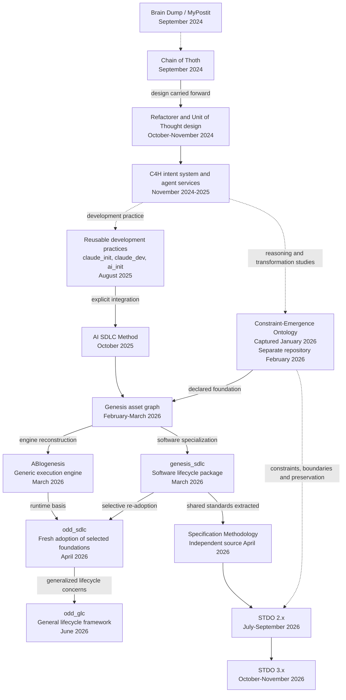
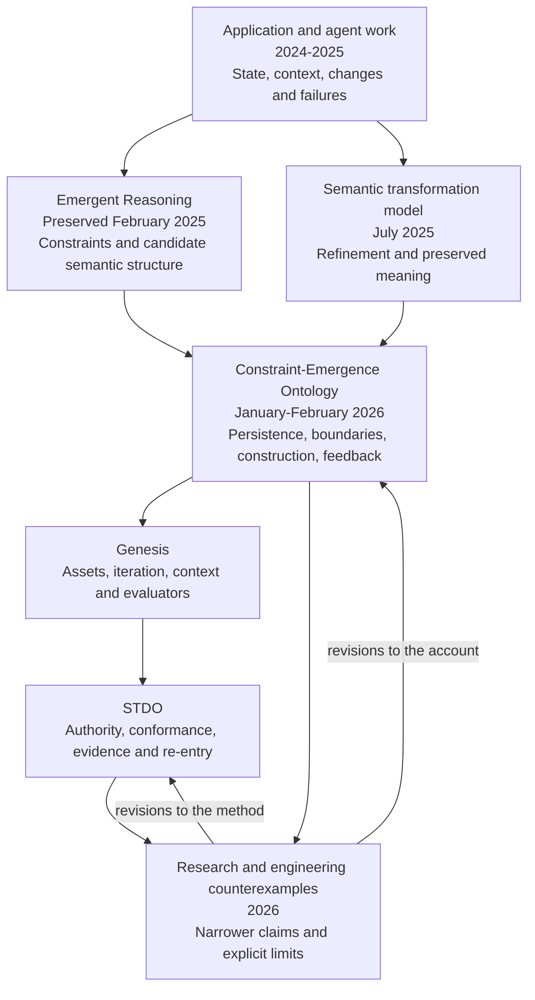
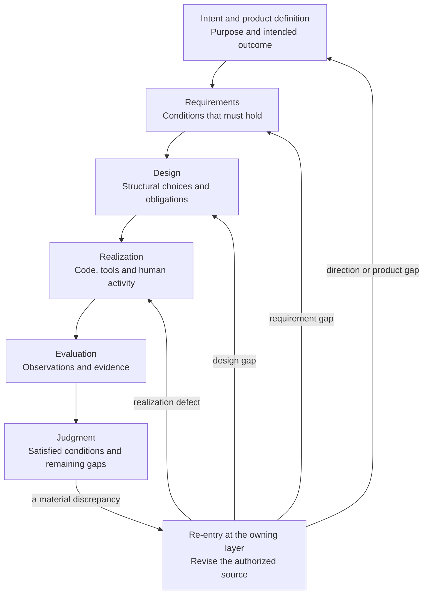

# A history of STDO

*From AI-assisted applications to a methodology for constrained construction and evaluation*

**Historical cut: 21 November 2026.** The latest published method cut at this
date is **STDO 3.1.0-rc.3**, published on 18 November. This document describes
the development of the ideas, implementations and project boundaries that led
to it. It is historical commentary; the selected immutable method release
remains the source for a consumer's governing rules.

STDO (Specification, Ticketing, Design, and Outcome-Driven Development)
developed through applications, coding agents, development workflows,
execution engines and a parallel investigation into constraints and emergence.
Its independent repository began in April 2026. The author dates the beginning
of the work to **mid-2024**, before the surviving application check-ins.
Its practical ancestry includes a collaborative whiteboard, Chain of Thoth
and Coder for Hire, usually shortened to C4H.

The applications and the foundational investigation developed together. In the
author's account, questions about the fundamentals were already part of the
early work. The later Constraint-Emergence Ontology captured that thinking in a
more explicit form. Its repository creation date therefore marks a publication
and separation of the work, rather than the beginning of the inquiry.

Across these projects, the recurring problem was how to turn an intention into
an implementation while preserving the relationships that made the intention
meaningful. Each generation made another part of that problem explicit:
state and history, task context, transformation lineage, requirements,
evaluation, authority, recovery and the limits of a completion claim.

## Reading the lineage

The arrows below describe project relationships and conceptual transfers. They
do not all represent Git forks. Several projects were reconstructions, and
some reused a specification or design while replacing the implementation.
Dotted arrows mark conceptual influence or a precursor relationship rather
than a demonstrated transfer of code.



The oldest surviving implementation found during this investigation is the
August 2024 `discover_build` experiment. The whiteboard is the author's
recollection of the first application. Those are compatible descriptions:
an early experiment, a first application and the first preserved check-in
need not be the same event. Dates below identify surviving records, with
their recorded time zones; they do not establish when an idea was first
conceived. Some early repositories require access to the author's archives.

## 2024: applications, state and the first construction agents

### Mid-2024: the work begins

The author's initial work began in mid-2024, using conversational AI to explore
ideas and construct applications. The first application recalled was a Mural
replacement, later preserved as Brain Dump / MyPostit. The surviving Git
history anchors the experiments in August and the whiteboard implementation
in September; it does not establish the first day of the work.

The model releases provide context for this period. ChatGPT launched using
GPT-3.5 on **30 November 2022**, and Anthropic introduced Claude on
**14 March 2023**. By mid-2024, OpenAI had announced GPT-4o on **13 May**, and
Anthropic released Claude 3.5 Sonnet in **June**. The project's mid-2024 start
therefore belongs to that later generation of tools. It is separate from the
original launches of ChatGPT and Claude. These dates describe availability;
they do not establish which model was used for each early experiment.
[ChatGPT introduction][chatgpt-launch], [Claude introduction][claude-launch],
[GPT-4o announcement][gpt4o-launch], [Claude 3.5 Sonnet][sonnet35-launch]

### Brain Dump and MyPostit

The likely Mural replacement is the project preserved as **Jims-Brain-Dump**
and **MyPostit**. Both repositories share the same initial history. A scaffold
was checked in on 15 September 2024, followed that day by the first substantial
TypeScript application, commit `b361df7605`.

The application had an infinite canvas, movable notes, arrows and connection
points, storage, import and export, and an event history interface. It was
already an exercise in keeping relationships intact as objects changed. Moving
a note also meant preserving the meaning and position of its connections.
The event-log and undo/redo machinery show an early concern with recoverable
state, although their presence alone does not establish complete replay
correctness. [First application check-in][brain-dump]

The [following commits][brain-history] record the experience of building with an AI assistant
more candidly than a retrospective feature list could. They describe lost
arrows, unstable positioning and a Claude 3.5 refactor. The record supports a
limited but useful observation: apparently local changes could damage
relationships elsewhere in the application. Later concerns with preserved
meaning and evidence can be understood against that experience. This is a
historical interpretation, rather than a claim that the September application
already contained STDO's later theory.

An earlier side branch, **discover_build**, was checked in on 20 August 2024.
It combined retrieval using FAISS and sentence embeddings with AutoGen agents
for topic refinement and code execution. It establishes that experimentation
with model context and agent-mediated work preceded the surviving whiteboard
implementation. A direct derivation from this experiment to C4H has not been
established. [Retrieval and agent experiment][discover-build]

### Chain of Thoth: making change explicit

**Chain of Thoth** begins on 17 September 2024. Its early commits explicitly
introduce command/query separation and event sourcing. The Rust backend
represents notes, arrows, groups and embedded boards, with command handlers,
query handlers, an event store, snapshots and collaborative sessions.
React and Flutter clients followed in September and October.
[Chain of Thoth source][thoth]

This made the application a system with an explicit history of change. A board
was a state reconstructed and communicated through operations, with separate
paths for changing it and observing it. That distinction later reappeared in
the separation between runtime facts and their projections, although the
repositories do not establish a continuous reuse of the same code.

The techniques themselves were established. Event sourcing, including
reconstruction from recorded changes, had been described well before 2024.
The significance here is their adoption in the author's early AI-assisted
application work. The later methodology grew partly from problems exposed by
using these techniques. [Fowler's 2005 account of event sourcing][event-sourcing]

### From a board to a Unit of Thought

The connection to the coding-agent work becomes explicit in **refactorer**,
whose first check-in is dated 20 October UTC, or 21 October in Sydney.
Its implementation uses specialized AutoGen agents for intent, scoping,
analysis, refactoring and testing. A `coder4h_config.yaml` file places the
Coder for Hire name in this precursor.

More revealing is `Chain_of_Thoth_v001.md`, retained in the refactorer
repository. It describes a **Unit of Thought** with operations for capturing
intent, constraining scope, verifying and optimizing. Feedback can travel back
through the structure. Agent specializations include discovery, scoping,
refactoring, testing and Coder4H. The document is a direct bridge between the
Thoth name and the construction-agent design. [Unit of Thought design][uot]

The conceptual unit had changed. A note on a board was a piece of represented
thought; the proposed Unit of Thought was a bounded piece of work with intent,
constraints, execution and feedback. It anticipated later concerns with
construction units and evaluation, while leaving much of their meaning to
the agent implementation.

This work belonged to an active field. Microsoft's September 2023 AutoGen
announcement already described specialized agents combining models, tools
and human participation. MetaGPT, first submitted in August 2023, encoded
software-team roles and operating procedures into agent workflows. SWE-agent's
May 2024 paper examined interfaces through which agents navigate repositories,
edit code and execute tests. The presence of several agents or a testing role
was therefore established practice by the time of refactorer.
[AutoGen][autogen], [MetaGPT][metagpt], [SWE-agent][swe-agent]

The distinctive direction within this lineage was the attempt to make intent,
scope and feedback properties of the work unit itself. That is a design
contribution visible in the source, without implying that the project had
demonstrated superior performance or invented multi-agent development.

## Late 2024-2025: C4H and the preservation of intent

### C4H was a sequence of implementations

The surviving **c4h_intent_system** history begins on 3 November 2024. Its
architecture describes an intent-driven flow through discovery, solution,
refactoring and verification. Events carry operation lineage, including root,
parent and branch relationships. Deterministic skills and model-driven work
occupy different roles. [Early C4H repository][c4h-intent]

The implementation changed quickly. November commits record a move away from
an AutoGen 0.4 attempt toward LiteLLM, followed by semantic extraction,
iteration, coding and feedback work. A Prefect implementation appears in
December. The main **c4h** repository starts on 31 December with a commit that
explicitly says it reinitializes a monorepo. That date marks a consolidation;
the earlier repositories preserve its antecedents. The author's recollection
places the beginnings of C4H around mid-2024, but the named implementation
records recovered here establish October and November as firm anchors.
[C4H consolidation][c4h-root]

During early 2025, C4H separated agent capabilities from service orchestration.
Discovery, solution and coding could be arranged into configured teams.
Execution context carried a workflow identifier, an agent execution
identifier, a parent and an execution path. The editor provided a place to
submit and inspect work orders. These changes addressed practical questions:
which request produced a change, which agent acted, and which context it used.

The May methodology documents made that separation more explicit. They
distinguished the interface, the declarative methodology and the reference
implementation. Configuration snapshots, stateless agents, explicit responses
and traceable transformations were recurring concerns. The SDLC account
connected intent and work orders to discovery, design, coding and assurance.
[C4H methodology and process archive][c4h-processes]

The innovation within C4H was this combination of work-order semantics,
configured transformation stages and execution lineage. Each ingredient had
precedents. Their combination made the system an experiment in accountable
construction across several steps. Recording inputs and configuration improved
inspectability; it did not by itself make probabilistic outputs deterministic
or establish that every transformation preserved meaning.

### The foundational inquiry was already present

The C4H archive contains **From Constrained Problem Domains to Emergent
Reasoning in LLMs**, first checked in on **22 February 2025**. Following the
file across later moves is necessary to recover that date. Its eventual
location under `Philosophy/` can otherwise make it appear younger.
[First preserved reasoning paper][early-reasoning]

The paper asks how constraints reduce a problem's possible solutions, how
attention might be understood as a dynamic constraint mechanism, and whether
the matching performed by a transformer has a useful relationship to symbolic
unification. It also considers statistical boundaries and symbol-like
representations. These were proposed interpretations of computation. They
supplied questions and candidate models for the engineering work, rather than
a measured guarantee about model behavior.

A second bridge appears in **A Formal Model for Semantic Transformation in
AI-Augmented Processes**, checked in on **18 July 2025**. It describes a chain
from root or regulatory intent, through contextual policy and business
requirements, to architecture and a solution. Transformations should add
specificity while preserving the source's meaning. Where several constraints
meet, the document explores compositional reconciliation using category-theoretic
language. [Semantic transformation model][semantic-model]

This is an identifiable ancestor of STDO's later authority chain. It moves
attention from the sequence of agents to the relationship between artifacts:
what permits a downstream decision, what it must preserve, and how it can be
traced back. The paper's language sometimes presents semantic preservation as
a guarantee of the proposed model. The historical record establishes the
proposal; it does not establish a general proof that an LLM implementation
satisfies it.

The **emergent_reasoning** repository began on 30 July 2025. Like the later
ontology repository, it separated work already present elsewhere. The practical
and theoretical branches were now independently visible, while continuing to
inform one another. [Emergent Reasoning first check-in][reasoning-repo]

## August 2025-January 2026: development practice becomes a methodology

The August projects **claude_init**, **claude_dev** and **ai_init** extracted
reusable development practices from individual applications. They supplied
project instructions, task records, test-first practices and session
continuity. `ai_init` explicitly began as a copy of `claude_init`.
[Development bootstrap][claude-init], [AI bootstrap][ai-init]

**ai_sdlc_method** starts on **15 October 2025** as a configuration and context
management system. The following day's history explicitly integrates
`ai_init` as its baseline development practices. This is a documented transfer,
rather than an inferred resemblance between two repositories.
[AI SDLC origin][ai-sdlc-root], [Baseline integration][ai-init-integration]

Through November, the project developed requirements, design, code and testing
skills, configurable context and implementations for different coding-agent
environments. The method could increasingly be described separately from a
particular agent or application. C4H had implemented a development process;
AI SDLC was making the process itself a reusable subject of development.

By this time, specification-led agent workflows were also becoming a visible
part of the wider tooling landscape. Kiro's **14 July 2025** introduction
described requirements, technical design and implementation tasks, with
acceptance criteria and links back to requirements. GitHub's **2 September
2025** Spec Kit announcement described specification, planning, tasks and
implementation across several coding agents, with human checkpoints.
[Kiro's introduction][kiro], [Spec Kit's introduction][spec-kit]

These are relevant contemporaries, not evidence of influence in either
direction. They establish that documents before code, task decomposition,
traceability and multiple supported agents were shared concerns by late 2025.
The distinctive thread developing here was the connection to a proposed model
of semantic refinement: the method was intended to explain what survives a
transformation, as well as to organize the work of performing it.

## January-February 2026: the Constraint-Emergence Ontology

The ontology was first checked into **AI SDLC on 22 January 2026**, in commit
`3760f2fae0`. Its initial synthesis connected questions about physics,
computation and emergence with requirements and homeostasis. The separate
**constraint_emergence_ontology** repository began on **9 February 2026**;
AI SDLC then recorded the migration of the philosophy material out of its own
tree. [Ontology synthesis][ontology-origin], [Independent repository][ontology-root]

The inquiry asked what allows structures to form, persist, interact and become
components of further construction. Constraints described admissible states
and changes. Boundaries allowed a structure to be treated as a unit. Meaning
was considered through relationships that survive transformation. Evaluation
and feedback connected a model of an intended state to observations of an
actual state.

For software, this suggested a practical interpretation. A requirement could
act as a continuing condition on a product. An implementation was one
realization of those conditions. Observations could reveal a gap in the
implementation, the design, or the requirements themselves. Repair therefore
needed a way to return to the layer responsible for the discrepancy.

The ontology gave this interpretation a vocabulary and a broader research
programme. Its physical and cross-domain claims remained hypotheses or
philosophical proposals with their own evidential burdens. The engineering
method could use explicit constraints, boundaries and feedback without
requiring those broader claims to be established.



The later revisions matter to the history. The September 2026 working paper
distinguishes constraints, dynamics and evaluation. It requires an account of
reachability and persistence before inferring that an allowed structure will
form. It reserves a Markov-boundary claim for a declared screening property
that has been tested. Its research discussion reports structured
representations and interventions alongside failed screening tests.
[Constraint and Emergence, September revision][ontology-v3]

This is a refinement of the original programme. The language became more
careful about the difference between a useful organizing model and an
established mechanism. In the method, the corresponding discipline is to
state what a claim is about, what would count as evidence, and where the
claim stops applying. The source record supports that correspondence; it
does not establish that every later STDO rule was deduced from the ontology.

## February-March 2026: Genesis and the asset graph

On **19 February 2026**, AI SDLC records the **Asset Graph Model**. The Genesis
name appears in the same repository later that week. The transformation was
conceptual as well as nominal: a fixed development sequence was recast in
terms of four primitives—assets in a graph, iteration, evaluators, and
specification plus context. [Asset graph revision][asset-graph]

The central operation was written as:

```text
iterate(Asset, Context[], Evaluators) → Asset'
```

An intent, a design, a piece of code or a test artifact could be treated as a
subject of construction and evaluation. A software lifecycle was one
configuration of the graph. Different work could select different assets,
transitions, evaluators and stopping conditions. Human judgment, probabilistic
model work and deterministic evaluation became explicit categories, later
written as `F_H`, `F_P` and `F_D`.

The ontology connection was declared in the project's README. Requirements
and context bounded construction; evaluation determined whether a candidate
met the selected conditions; telemetry and other observations could reopen
work. The February **Genesis Bootloader** attempted to express the governing
ideas in a compact context that an LLM could consume. The associated
**abiogenesis principle** proposed human bootstrapping followed by a system
capable of sustaining its own development.
[Genesis account][genesis-readme], [Bootloader][bootloader], [Abiogenesis principle][abiogenesis-principle]

Graphs and evaluation were already part of AI tooling. DSPy's October 2023
paper described declarative language-model modules in transformation graphs,
optimized against a metric. LangGraph's January 2024 introduction supplied
cyclic graphs for agent runtimes. Genesis's graph representation therefore
belongs to a wider development in the field. Its particular synthesis applied
a common construction-and-evaluation model across lifecycle artifacts, with
the specification/context boundary carrying the conditions of acceptable work.
[DSPy][dspy], [LangGraph][langgraph]

One March decision makes the intended freedom of realization explicit.
**ADR-S-036**, dated 12 March and revised on 14 March, treated invariants as
conditions to satisfy, with room for agents of different capabilities to take
different construction paths. It referred to a project built in a construction
pass followed by an assurance pass. That account motivated the decision; it
is not independent qualification of the reported build.
[Invariant and procedure decision][invariant-adr]

The decision also exposes a tension that later versions had to resolve.
Equivalent final artifacts do not settle every question about authorized
effects, necessary causal order or admissible evidence. STDO would retain
freedom where the contract permits it while making those additional
obligations explicit. The progression was a continuing adjustment of what
belongs in the method and what belongs in a particular realization.

## March-June 2026: separating engine, lifecycle and method

### ABIogenesis and genesis_sdlc

**ABIogenesis** begins on **15 March 2026** with an explicit statement that
the earlier Genesis engine had accumulated implementation history and needed
a clean reconstruction. Its initial intent names six functions—`iterate`,
`project`, `emit`, `bind_fd`, `delta` and `schedule`—and a GTL-first engine.
GTL, the graph declaration language, was being developed as a typed Python
library. The initial plan set a self-hosting gate in which the engine would
build a successor of itself. [ABIogenesis initial intent][abg-origin]

The compiler analogy was deliberate. A language describes the construction;
an engine executes it; the engine can eventually be built using an earlier
engine. The first intent even proposed that the GTL package itself was the
requirements surface. Later work gave requirements and design their own
authority again. This records an actual change of position about how much
meaning should be owned by an executable declaration.

**genesis_sdlc** also begins on 15 March. It supplied the software-development
graph and practices that a generic engine would not own. Its subsequent
specification describes that missing layer through a compiler-and-standard-
library analogy. Work on module decomposition addressed a concrete weakness:
a direct jump from design to code forced module-boundary decisions and
implementation decisions into the same step.
[genesis_sdlc origin and specification][gsdlc]

The separation made several different questions visible. The engine needed
to execute and preserve runtime facts. The software lifecycle needed to say
what those facts meant for development. The method needed to say what counted
as an authorized and sufficiently evidenced result. Sharing a vocabulary
did not make those responsibilities interchangeable.

### odd_sdlc: retaining selected foundations

The repository now called **odd_sdlc** begins on **5 April 2026**, initially
using the `odd_method` name. Its first intent explicitly describes a fresh
constitutional line informed by `genesis_sdlc`. It retained specification
authority, graph functions, GTL/ABIogenesis execution, runtime fact ownership
and scenario-based evidence. It rejected the inheritance of a product-local
automation layer that duplicated runtime responsibility.
[odd_sdlc founding intent][odd-origin]

This was selective re-adoption. A successor was expected to identify which
predecessor requirements it still wanted and where they were now owned.
Repository ancestry and working code were insufficient reasons to preserve
every old obligation or implementation choice. Later STDO rules about
migration and predecessor conservation gave this lesson a general form.

### odd_glc: the lifecycle extends beyond software

On **27 June 2026**, **odd_glc**, the **ODD General Life Cycle**, received its
first check-in. Its bootstrap cites the preceding ABIogenesis requirements-
algebra strategy and observations from `odd_sdlc`. It identifies concerns
such as materialization, evidence, partial completion, unresolved obligations,
re-entry and release as applicable beyond software delivery.
[General lifecycle bootstrap][glc-origin]

Its intended position was between the generic execution substrate and domain
products. ABIogenesis/GTL would preserve and execute the declared structures;
`odd_glc` would interpret their lifecycle meaning; domain products would add
their own policy and interpretation. The bootstrap expressly prevents the
new layer from becoming another local runtime or closure ledger.

The general-lifecycle branch is recorded as `odd_glc`, distinct from the
software-development specialization `odd_sdlc`.

## March-April 2026: Specification Methodology becomes independent

The method predates its repository. **SPEC_METHOD.md** was first checked into
`genesis_sdlc` on **27 March 2026**, with an internal document date of 24 March.
**GRAPH_METHOD.md** followed on **3 April**. ABIogenesis distributed copies
into installed workspaces. That arrangement made a shared method depend on
which product's source tree happened to supply the installer.
[First specification method][spec-origin], [First graph method][graph-origin]

The independent **specification_methodology** repository was established on
**7 April 2026**, commit `287c866787`. Its provenance document states the
reason: remove ambiguity over the authoritative source. Shared standards would
be authored in one place, published as complete immutable cuts, and adopted
through exact release identities. Installed copies would derive their
authority from the selected cut. [Independent method origin][method-origin]

The extracted method made the direction of authority explicit. Intent and
requirements govern design; requirements and design govern realization.
Evidence can reveal a defect at any of those layers. A report, index or
generated view remains a representation of its source. The process for
returning to an owning layer allows the specification to evolve without
allowing a local workaround to rewrite it silently.



This diagram summarizes the authority and feedback relationship. It is not
a mandatory runtime schedule. Some work can satisfy several obligations in
one construction, while a declared causal or evidence obligation may require
a particular ordering.

The independent repository is the point at which lessons from the engines
became a separately versioned method. Engine behavior could now be evaluated
against it. A working engine would no longer define the method solely through
its existing behavior.

## April-June 2026: the first released method

The 1.x line established a method that could govern its own development and
the products using it. It distinguished a mutable source project, an immutable
release, an installed product and a product acting as the builder of another
product. This distinction followed directly from the bootstrap experience:
the source being edited and the installed tool doing the work could have
different identities and different authority.

The line also accumulated rules for migration, bounded work, design,
probabilistic operations and evaluation. Each addition addressed a different
way that useful construction could lose its connection to the intended
outcome. A sprint needed a bounded claim. A migration needed to say which
old requirements survived. A successful test needed to be related to the
property it actually observed.

By **1.8.0**, the scope explicitly covered the operational lifecycle, including
release, deployment, live use, telemetry and retirement. Correctness had
become a continuing relationship between the specification and the observed
product. This carried forward the homeostatic interpretation developed in
Genesis and the ontology: a system remains answerable to its governing
conditions as its environment and implementation change.

| Period | Method cut | Main refinement |
|---|---|---|
| 15 April 2026 | [1.0.0](specification_methodology/v2/releases/v1.0.0.md) | Independent method product; recursive product taxonomy; shared world-model, graph, release and work-record conventions. |
| April 2026 | 1.1.0; [1.0.1](specification_methodology/v2/releases/v1.0.1.md); [1.0.2](specification_methodology/v2/releases/v1.0.2.md) | Consolidated method and agent bootstrap guidance; explicit migration and re-adoption; distinction between a mutable candidate and an immutable release candidate. |
| 26-27 April 2026 | [1.2.0](specification_methodology/v2/releases/v1.2.0.md), [1.3.0](specification_methodology/v2/releases/v1.3.0.md) | Probabilistic boundaries and outcome-driven construction; explicit UI state, messages, effects and replay obligations where selected. |
| 30 April 2026 | [1.4.0](specification_methodology/v2/releases/v1.4.0.md), [1.5.0](specification_methodology/v2/releases/v1.5.0.md) | Bounded execution, evidence cost and authority; consolidation of repeated method prose. |
| 10 May 2026 | [1.6.0](specification_methodology/v2/releases/v1.6.0.md) | Constructive evaluation and yield; clearer closure conditions and design-decision conventions. |
| 7 June 2026 | [1.7.0](specification_methodology/v2/releases/v1.7.0.md) | Agentic construction walkthrough, admission boundaries and source-bound method compressions. |
| 30 June 2026 | [1.8.0](specification_methodology/v2/releases/v1.8.0.md) | Explicit coverage of the complete operational lifecycle. |

The early 1.x publication order is not a simple ascending sequence of version
numbers. The [2.0.0 predecessor-conservation record][release-2] identifies the
accepted families carried forward, including 1.1.0 and the subsequent 1.0.x
amendments. The conceptual history is clearer when those accepted changes are
followed directly rather than inferred from numeric sorting.

## July-September 2026: STDO 2 and the boundaries of evidence

### An incremental successor with stricter claims

**2.0.0**, in July, explicitly conserved the accepted 1.8.0 method. Its release
note describes an incremental successor and distinguishes it from earlier
rejected reconstruction candidates. The method added design-boundary work and
lessons from delivery incidents. [2.0.0 release account][release-2]

Several of those lessons concern the difference between a useful observation
and the claim someone wants it to support. Evidence must identify its subject.
A test through a substitute path does not establish behavior on the actual
authority path. A result for one candidate does not automatically qualify a
changed candidate. Passing a component check does not close a product-level
outcome. Independent review must have an identifiable subject and a durable
disposition.

This sharpened the earlier lineage work. C4H had asked which operation
produced an output. STDO now also asked what that output justified, under
which basis, for which subject, and with what remaining uncertainty.

The method also made its own cost part of the judgment. A disproportionate
control or redesign could damage delivery without providing evidence relevant
to the actual claim. The developing position required sufficient structure
and assurance for the consequence at issue. It did not equate more ceremony
with a stronger result.

### The ontology also had to respect its application boundaries

The **2.2.2** release records a specific correction to the world-model method.
Earlier wording had made a geometric Markov-object construction part of the
publication requirements for recovered entities. That could reject an
institutional or software entity whose identity and evidence were adequate
but whose source offered no suitable geometric representation.
[Entity and geometry correction][release-222]

The correction made the **entity cut** the primary semantic unit and treated
the geometric Markov-object account as an optional overlay requiring an
appropriate representation space. This is a concrete example of the
foundational inquiry being refined through use. An explanatory model had
introduced an obligation that did not fit every governed domain. The method
retained the useful boundary questions and narrowed the geometric claim.

### Reference frames and a shared result vocabulary

The August **2.4.0** line introduced a general reference-frame account. A
judgment has a purpose, a subject, a governing basis, an authority boundary and
evidence. A result can be satisfied, falsified, indeterminate, outside the
frame, or based on an invalid basis. These distinctions preserve information
that a single success/failure flag loses.
[Reference-frame release][release-240]

For example, an evaluator lacking the necessary observation has a different
result from an evaluator that observed a counterexample. An out-of-scope
judgment cannot be made relevant by reporting confidence. A valid result
about an earlier release does not silently transfer to a later one. These
were methodological conditions for interpreting results, with concrete
realization left to the applicable product.

The 2.4.x line also established the STDO naming and Product Definition binding,
and made release selection and installation more explicit. The 2.5.x work
developed a shared axiomatic account, source-linked representations and
construction/evaluation profiles. Deterministic, probabilistic and human
functions remained distinguishable from the actors performing them and from
the authority to accept their results.

| Period | Line | Development |
|---|---|---|
| July 2026 | [2.0.0][release-2] | Exact evidence subjects, independent review, product-outcome conservation and proportionate method obligations. |
| July 2026 | [2.2.0](specification_methodology/v2/releases/v2.2.0.md)-[2.2.2][release-222] | Bounded authority for growth, decision-complete constraints, and separation of entity recovery from optional geometry. |
| August 2026 | [2.3.0](specification_methodology/v2/releases/v2.3.0.md) | Transformation admission, reconstructable design and explicit computational mapping. |
| August 2026 | [2.4.0][release-240]-[2.4.2](specification_methodology/v2/releases/v2.4.2.md), followed by 2.4.3 candidates | Reference frames, claim-relative testing, STDO Product Definitions and more precise release selection. |
| August-September 2026 | 2.5.0 candidates | Axiomatic calculus, representation tooling, construction profiles and bounded executive attention. |
| September 2026 | 2.5.1 candidates | Review and triage refinement; RC2 made triangulation depend on distinct evidence and constraints rather than a count of reviewers. |

The [30 September RC2 change][triangulation] is a useful example of the
direction. Several similar assessments can repeat the same blind spot.
Triangulation requires observations or frames that constrain a diagnosis in
different ways. The evidential relationship matters more than the number of
agents producing prose.

## October-November 2026: STDO 3, finite context and separate products

### Reconstructing accumulated rules around common foundations

The October work developed separate Claude and Codex constructions against a
common specification, followed by comparison and synthesis. The common
definition owned the required meaning; each tenant supplied a realization.
Candidate packaging and comparison results retained their own scope. Neither
the existence of two implementations nor a successful package check established
whole-method qualification.

Version 3 organized the accumulated method around shared foundations. Entities,
relations, authority, selected bases and evaluation results had clearer common
owners. Reference frames and independent review already existed in 2.x; the
new work integrated them and made finite context, activation and continuation
more explicit. [V3 source project and construction record][v3-construction]

This addressed a recurring operational fact of AI-assisted development: a
session is finite. A later actor may receive only part of the earlier context.
A useful continuation therefore needs enough current state to identify the
subject, its governing source, completed work, unresolved matters and the
next authorized action. A summary can direct attention, but its omissions
cannot amend the underlying obligations.

The method's result vocabulary also became a common basis for composing
judgments. Missing coverage, an invalid basis and a demonstrated failure retain
their different meanings when work is combined. A coordinator consumes results
within its grant; a writer needs authority for its effects; applicable review
requires the necessary independence. A particular Executive/Worker/Reviewer
arrangement remains a selected profile rather than a universal organizational
chart.

### From a method package to independently owned supporting products

The first native 3.0.0 candidate cut was recorded in October. Subsequent
releases developed distribution, recursive product composition, tools and
native workflows. By November, the repository also contained independently
owned support products. Their co-location did not give one product authority
over another.

**3.0.4** supplied native work, review, status, ticket and help workflows. It
made distinctions such as landing a change, closing work and qualifying a
release visible in ordinary use. It later remained the construction basis
for the 3.1 release work. A methodology can therefore be built under one
released version while producing a different successor.

The **3.1** arrangement separated **Purpose Context**, which owns reusable
indexes and context construction, from **STDO Skills**, which binds those
capabilities to supported hosts. Representation Tools and STDO Representation
serve visual documentation. Axiom Indexer retains its separately owned
conversion and projection responsibilities. This was another application of
the ownership lesson learned during the engine/lifecycle split.

The history of representation tools includes formal and Lean-related work.
The 3.1 boundary changes retired the earlier formal/context routes from the
active product arrangement and made visual documentation optional. An index
or diagram could help a reader find and understand a rule while remaining
answerable to its exact source. It would not become a new owner of that rule.

| Period | Cut | Main change |
|---|---|---|
| October 2026 | 3.0.0-rc.1 and 3.0.1-rc.1 | Native successor packages following the common-definition and tenant construction work. |
| 26 October 2026 | 3.0.2 | Recursive product composition and integrated outcome responsibility, with explicit limits on inherited authority. |
| 2 November 2026 | 3.0.3 | Bundled exploration and source-reading tools, with bounded evidence for the represented examples. |
| 3 November 2026 | 3.0.4 | Native method workflows; clearer distinctions among review, closure and release. |
| 7 November 2026 | 3.0.5-rc.1 | A coordinated five-product distribution with exact member identities and acquisition evidence. |
| 15 November 2026 | 3.1.0-rc.1 and rc.2 | Six independently owned products, including Purpose Context; RC2 corrected a missing predecessor obligation in the context coverage. |
| 18 November 2026 | [3.1.0-rc.3][latest-release] | Self-contained method meaning, optional tracking machinery, and a clearer distinction between intended product and current work. |

The [native release history][native-history] and the individual release
records retain the exact cut identities. Native packages have their own
deliberately small Git history. That history alone cannot reconstruct the
earlier source development, which remains in the source repository and the
predecessor projects.

### RC3: preserving obligations while removing an inherited mechanism

The latest published cut in this account is
`specification_methodology/v3.1.0-rc.3`, native commit
`b2e21ad0a2bab04e59afd5246b990da992417047`. GitHub records its publication on
**18 November 2026 at 08:19:51 UTC**. The project published it as a normal
GitHub release while retaining the `rc.3` identity. Those are separate facts;
the label should not be silently rewritten as a final `3.1.0` cut.
[Published release][latest-release]

RC3 corrected a remaining dependency of method meaning on downstream products
and runtime machinery. Every normative tier, including optional profiles,
must define its terms and rules within the method. Tracking obligations,
decisions, progress and unresolved matters remains required. So does conserving
needed facts and reconciling a work record with the actual workspace. A generic
register is one possible realization. ODD no longer imposes an immutable
ledger, a fixed evaluator API or a universal replay architecture.
[RC3 native release note][rc3-note]

That correction is historically significant. Event histories and runtime
lineage had been useful from the first whiteboard and C4H implementations.
They helped expose the need to preserve state, explain change and retain
evidence. By RC3, the method stated those obligations without requiring every
consumer to reproduce the machinery through which they had first been
explored. A product may still require replay or a particular ledger when its
own contract calls for them.

RC3 also clarified that **Product** describes the intended product and end
state, including capabilities still to be built, while **Goals** describes
the current epics or work wave. That distinction prevents a bounded delivery
plan from quietly shrinking the product's intended outcome.

The release retains six independent products and the STDO 3.0.4 construction
basis. Its evidence distinguishes source assessment, package identity,
context coverage, installed-host observations and public acquisition. The
release note explicitly limits the conclusions: publication does not establish
whole-method qualification, universal context coverage or successful future
tasks, and it does not migrate existing consumers. Later mutable source work
also remains a separate subject from this historical release boundary.
[RC3 distribution and evidence record][rc3-note]

## The contribution that accumulated

The differentiators are most accurately described as a combination that
developed over time. The early projects used established application and
agent techniques. The later work made their governing relationships an
independent object of design.

**Meaning across transformations.** C4H's intent and operation lineage,
the 2025 semantic model and STDO's requirements/design chain all address
preservation through change. The refinement was to make preservation an
explicit obligation with a subject and evidence, rather than assume it from
the fact that several stages completed.

**A shared account of construction and evaluation.** Genesis applied its
asset-and-evaluator model to multiple development artifacts. STDO generalized
the conditions of acceptable construction while allowing different products
to choose their realizations. This extends the project's scope beyond a
particular coding-agent loop or document-to-task workflow.

**Authority and evidence that remain attached to their basis.** A source
document, released method, installed tool, generated view and evaluation
result have different roles. The separation became especially important when
the method was used to build itself and when several products and coding
agents shared a workspace.

**Correction at the layer that owns the problem.** A failed observation can
require a code repair, a different design, a revised requirement or a changed
goal. The lifecycle provides a way to make that decision explicit. Partial
completion and unresolved obligations remain visible instead of disappearing
inside a broad success claim.

**Fundamental ideas exposed to engineering limits.** The constraint-emergence
work supplied a way of thinking about boundaries, persistence, meaning and
feedback. Application and research then exposed where the account needed
qualification: geometric representations were not available everywhere;
screening claims needed tests; admissible outcomes did not remove authority
or causal obligations; useful runtime patterns could become over-prescriptive
when promoted into general method.

These are claims about the design and documented evolution of this project.
The contemporary sources establish that several component ideas were already
in use. They do not support a claim of sole invention, industry-wide priority
or comparative performance. The distinctive work lies in the particular
integration, its continued revision through application, and the effort to
state exactly which relationships an alternative realization must preserve.

## Sources and remaining historical gaps

This account uses surviving Git histories, initial intents, design documents,
method release notes and the public release record. The whiteboard's intended
role as a Mural replacement, the approximate mid-2024 recollection of C4H,
and the presence of foundational thinking during the earliest work are
attributed to the author's recollection. Those recollections help identify
the projects; a later preserved check-in does not establish an earlier date.

Three distinctions matter when extending this history. First, a file move or
repository extraction can conceal an older first check-in; following the
reasoning paper across its moves recovered February 2025. Second, a commit
message reporting successful tests or a completed build records the author's
assessment at that time; this history has not rerun and independently
qualified those implementations. Third, conceptual influence and direct code
descent are different relationships. The narrative identifies an explicit
transfer where the source provides one and labels retrospective interpretation
where it does not.

The comparison with other tools uses their dated publications. It concerns
what those sources described at the time, rather than claiming to survey
every capability of their current versions. Early private repositories may
require access; the STDO release notes linked within this repository provide
the locally available continuation of the record.

[brain-dump]: https://github.com/foolishimp/MyPostit/commit/b361df76052966835dcbd81030895916269de3b4
[brain-history]: https://github.com/foolishimp/MyPostit/commits/f0f7fe6b00cbb8e9a1224bcafaf189dcdf21a02b/
[discover-build]: https://github.com/foolishimp/discover_build/commit/c1f1f9d6296290c7f810891018d2d0fa17066d87
[thoth]: https://github.com/foolishimp/chain_of_thoth/tree/8c8c4ae06570dafa5b6f62aa1b8659e94c4f5d10
[uot]: https://github.com/foolishimp/refactorer/blob/27785481f5eb2e2e633dddd249154eb862325ffb/docs/Chain_of_Thoth_v001.md
[c4h-intent]: https://github.com/foolishimp/c4h_intent_system/tree/2ca732aaa519f7a9ba54388dd16191318267b7f2
[c4h-root]: https://github.com/foolishimp/c4h/commit/356343f
[c4h-processes]: https://github.com/foolishimp/c4h_projects/tree/4633dcdf200225d692dd337be2d216fd6a05a746
[early-reasoning]: https://github.com/foolishimp/c4h_projects/blob/57165be1a0808f5441c8856225a166771508772e/old_docs/EmergentReasoning.md
[semantic-model]: https://github.com/foolishimp/c4h_projects/commit/b907f5b5beaa9f40708f3f3796b1fd77f7cee7fb
[reasoning-repo]: https://github.com/foolishimp/emergent_reasoning/commit/09f648e76f433fc43367fd6c71833709b0201938
[claude-init]: https://github.com/foolishimp/claude_init/tree/86a609bc1d5da9983ff5de28c503d62d82fdcdcf
[ai-init]: https://github.com/foolishimp/ai_init/commit/3c639bd
[ai-sdlc-root]: https://github.com/foolishimp/ai_sdlc_method/commit/b378c17e3f83eb6f9002989a593a5d19b5dbf29b
[ai-init-integration]: https://github.com/foolishimp/ai_sdlc_method/commit/0649ce635456d00f57d4a5190f0007e2be171f9b
[ontology-origin]: https://github.com/foolishimp/ai_sdlc_method/commit/3760f2fae0a40f85094ed0da6e77d819c633d284
[ontology-root]: https://github.com/foolishimp/constraint_emergence_ontology/commit/3b0d79a
[ontology-v3]: https://github.com/foolishimp/constraint_emergence_ontology/blob/942d4bda15c5b0f5ec5162737353cde3d06e28f3/constraint_emergence_ontology_v3.md
[asset-graph]: https://github.com/foolishimp/ai_sdlc_method/commit/91f29bcb53f879ee186609a8a5af49a4c4b9cf62
[genesis-readme]: https://github.com/foolishimp/ai_sdlc_method/blob/bd68f1e33124ba25f180092f7c5fcf3ca1ecbf48/README.md
[bootloader]: https://github.com/foolishimp/ai_sdlc_method/commit/4a97b338bff54efb6de6bd97acf82cfb4323e534
[abiogenesis-principle]: https://github.com/foolishimp/ai_sdlc_method/commit/f2d5a2f24f46bd69f9d2132efb3e7e1199df8b5c
[invariant-adr]: https://github.com/foolishimp/ai_sdlc_method/blob/bd68f1e33124ba25f180092f7c5fcf3ca1ecbf48/specification/adrs/ADR-S-036-invariants-as-termination-conditions-not-procedures.md
[abg-origin]: https://github.com/foolishimp/abiogenesis/blob/abe471b7f7ce8c0055b792979d77206957bfdd47/specification/INTENT.md
[gsdlc]: https://github.com/foolishimp/genesis-sdlc/commit/680541c
[odd-origin]: https://github.com/foolishimp/odd_sdlc/blob/e636d778cf0ad17f2103b7d31babddc079cd27c1/specification/INTENT.md
[glc-origin]: https://github.com/foolishimp/odd_glc/blob/b12bc3eeef7fea61f77997f933b1b4229d8027d6/.ai-workspace/context/project_bootstrap.md
[spec-origin]: https://github.com/foolishimp/genesis-sdlc/blob/e27e895e7e6e1f80aaa337da52c23a6ea4669980/specification/standards/SPEC_METHOD.md
[graph-origin]: https://github.com/foolishimp/genesis-sdlc/blob/bfa5d7710e6ac4cab52f8d9bdc08e0f8740e6345/specification/standards/GRAPH_METHOD.md
[method-origin]: https://github.com/foolishimp/specification_methodology/commit/287c86678730b70a9b7aabb6737b22f4181c98a0
[release-2]: specification_methodology/v2/releases/v2.0.0.md
[release-222]: specification_methodology/v2/releases/v2.2.2.md
[release-240]: specification_methodology/v2/releases/v2.4.0.md
[triangulation]: https://github.com/foolishimp/specification_methodology/commit/c45a6c6739c72c47974d7435424d3db2dc2662a9
[v3-construction]: https://github.com/foolishimp/specification_methodology/tree/225284646/specification_methodology/v3
[native-history]: https://github.com/foolishimp/specification_methodology/commits/b2e21ad0a2bab04e59afd5246b990da992417047/
[latest-release]: https://github.com/foolishimp/specification_methodology/releases/tag/specification_methodology/v3.1.0-rc.3
[rc3-note]: https://github.com/foolishimp/specification_methodology/blob/b2e21ad0a2bab04e59afd5246b990da992417047/specification_methodology/v3/release/release-note.md
[event-sourcing]: https://martinfowler.com/eaaDev/EventSourcing.html
[autogen]: https://www.microsoft.com/en-us/research/blog/autogen-enabling-next-generation-large-language-model-applications/
[metagpt]: https://arxiv.org/abs/2308.00352
[swe-agent]: https://arxiv.org/abs/2405.15793
[dspy]: https://arxiv.org/abs/2310.03714
[langgraph]: https://www.langchain.com/blog/langgraph
[kiro]: https://kiro.dev/blog/introducing-kiro/
[spec-kit]: https://github.blog/ai-and-ml/generative-ai/spec-driven-development-with-ai-get-started-with-a-new-open-source-toolkit/
[chatgpt-launch]: https://openai.com/index/chatgpt/
[claude-launch]: https://www.anthropic.com/news/introducing-claude
[gpt4o-launch]: https://openai.com/index/hello-gpt-4o/
[sonnet35-launch]: https://www.anthropic.com/news/claude-3-5-sonnet
