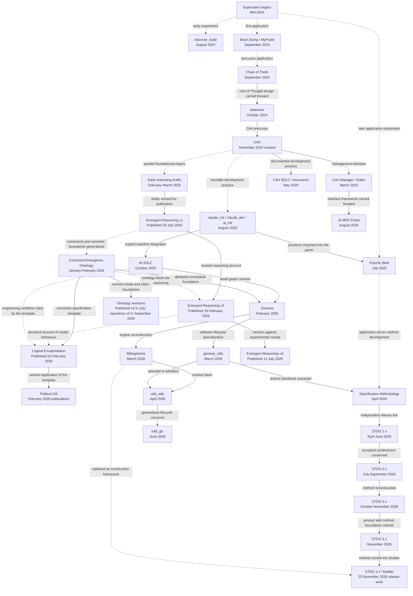
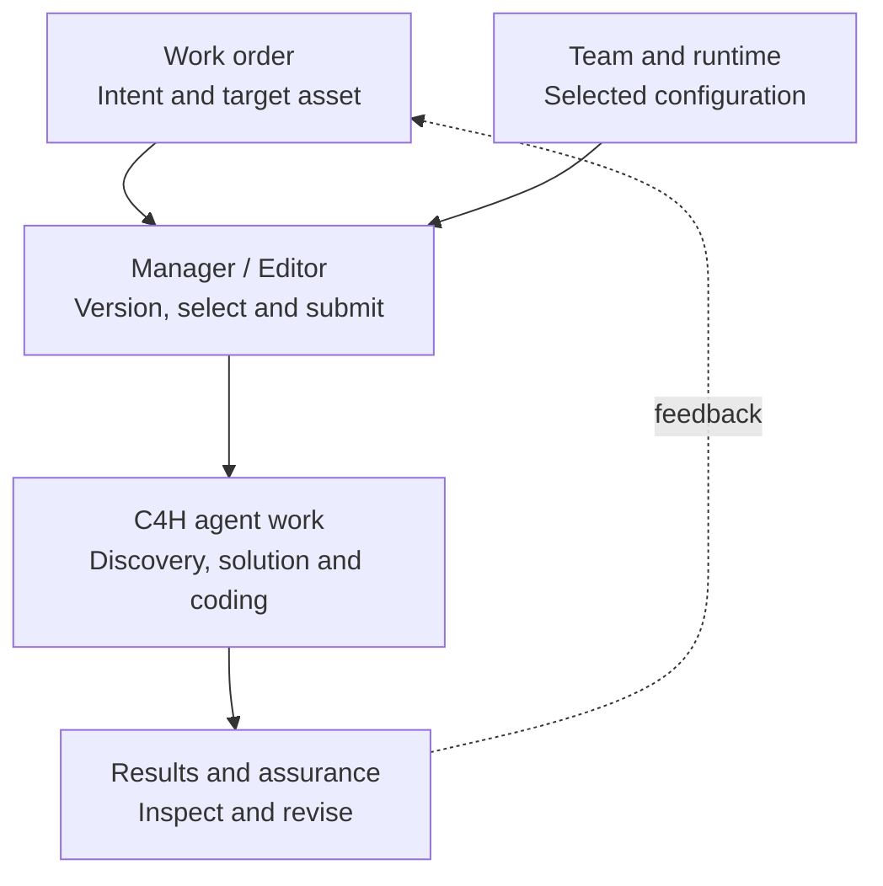
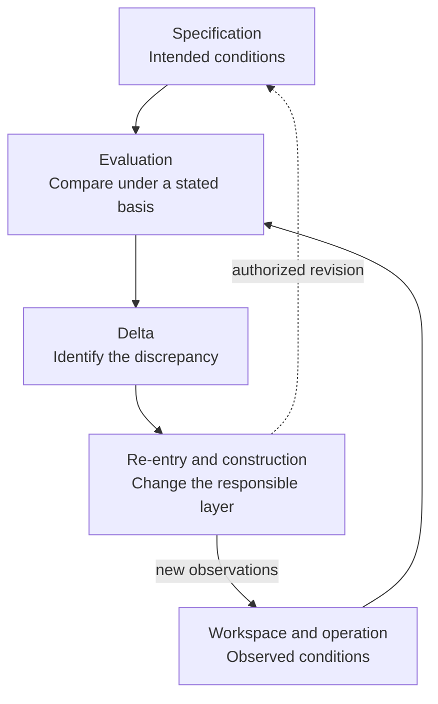
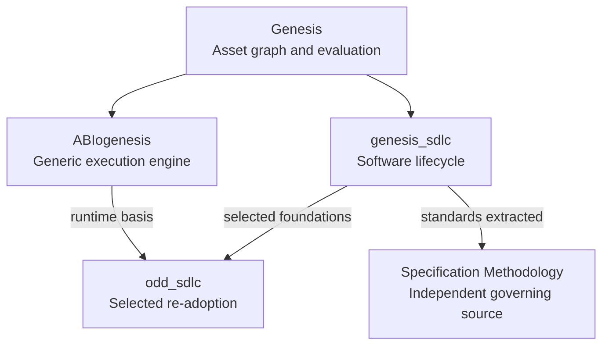
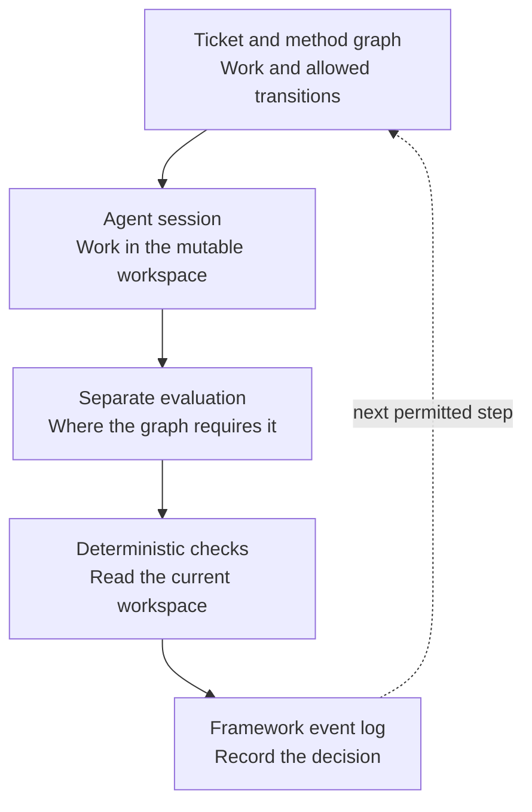

# A history of STDO

*Exploration, convergence and changes of direction, from conversational coding to governed construction.*

**Historical cut: 23 November 2026, Australia/Sydney.** The timeline begins with
ChatGPT's launch in November 2022. Project work began in mid-2024. Its endpoint
is the stripped-down STDO Builder replacing ABIogenesis in the work being
prepared for release as STDO 3.2 today. The latest published method release
verified for this account is 3.1.0-rc.3; the intended 3.2 release and Builder's
local 0.1.0 cut remain separately identified.

Follow the continuous overview of industry releases and software lineage beside
the detailed project commentary, comparisons and diagrams. The source retains
industry, project and concept sections for each period. Industry entries are
selected milestones relevant to
this lineage, rather than a complete model catalogue. Comparisons are historical
interpretations of dated sources, not measurements of industry adoption or
claims of influence. They distinguish convergence, extension, divergence and
reconsideration. A different vocabulary can describe a shared idea; a similar
vocabulary can conceal a different scope.

## Software lineage

This overview connects the applications, shared practices, research and method
releases described below. Solid lines mark documented relationships, including
integration, extraction and selected re-adoption. Dotted lines mark conceptual
influence, exploratory branches or replacement, as labelled. A connection does
not imply a Git fork or continuous reuse of code.



## 30 November 2022: A conversational starting point

### Industry releases

#### 30 November · ChatGPT

ChatGPT launched as a research preview using a model from the GPT-3.5 series.
Its conversational interface supported follow-up instructions, explanations and
code examples. [Launch announcement][chatgpt-launch]

### Project history

#### Before the project work

The project lineage begins in mid-2024. No application or methodology work is
assigned to this earlier period.

### Concepts and comparison

#### The conversation becomes a place to build

ChatGPT provides the starting point for the industry timeline. A conversation
could carry a problem description, a proposed implementation and successive
corrections. That made an interactive route into software construction visible
well before the project's first surviving applications.

The later history repeatedly encounters the limits of that arrangement: where
the intended behaviour is recorded, how a change preserves existing
relationships, and how a new session establishes what has actually been done.
Those are the questions used to read the lineage. They should not be projected
backward as a fully formed methodology in 2022.

## 2023: Agents, evaluation and declarative programs

### Industry releases

#### 14 March · GPT-4 and Claude

GPT-4 and the first public introduction of Claude appeared on the same date.
OpenAI also announced its open-source Evals framework with GPT-4.
[GPT-4 and Evals][gpt4-launch], [Claude][claude-launch]

#### August–September · Software teams as agents

MetaGPT's August paper organized agents around software-team roles and
procedures. Microsoft's September AutoGen announcement described configurable
conversations among models, tools and people. [MetaGPT][metagpt], [AutoGen][autogen]

#### 5 October · DSPy

DSPy described declarative language-model modules assembled into transformation
graphs and optimized against a chosen metric. [Research paper][dspy]

### Project history

#### An existing body of techniques

These publications precede the surviving application and C4H records. They are
part of the environment in which the later exploration took place.

### Concepts and comparison

#### Several ingredients already existed

Role specialization, tool use, evaluation and declarative composition were
already explicit research and engineering concerns. This matters when reading
C4H and Genesis: assembling agents into stages, adding a reviewer or drawing a
graph cannot by itself establish a new idea.

The useful comparison is more specific. What did the project make an explicit
part of the work? Which relationships did it try to preserve? What happened
when an implementation failed to meet the intended conditions? Later project
terms such as assurance, criticality and delta need to be compared at that
level, rather than counted as inventions because their names differed.

Evaluation itself therefore predates this lineage. The historical question is
how evaluation developed from checking an output into a continuing relationship
between requirements, implementation, observation and correction.

## Mid-2024: Exploration becomes application work

### Industry releases

#### 4 March · Claude 3

Anthropic introduced the Claude 3 model family. [Announcement][claude3-launch]

#### May–June · GPT-4o and Claude 3.5 Sonnet

GPT-4o was announced on 13 May; Claude 3.5 Sonnet followed in June. These are
the model generations available around the start of the project work.
[GPT-4o][gpt4o-launch], [Claude 3.5 Sonnet][sonnet35-launch]

#### May · SWE-agent

SWE-agent studied how the interface provided to a coding agent affects its
ability to navigate a repository, edit files and run tests. [Paper][swe-agent]

### Project history

#### Mid-2024 · Work begins

Work began through conversational exploration and AI-assisted implementation.
A Mural replacement became the first application in the development account,
later preserved as Brain Dump / MyPostit.

#### 20 August · discover_build

The earliest surviving implementation found in this investigation combines
FAISS retrieval, sentence embeddings and AutoGen agents for topic refinement
and code execution. [First check-in][discover-build]

### Concepts and comparison

#### Learning through construction

The starting activity aligned with a practical use of the tools: ask for a
working application, inspect what appeared, and iterate. The retrieval and
AutoGen experiment also directly used an existing agent framework. This is a
clear instance of adopting industry techniques.

The applications then supplied problems that a better prompt alone did not
settle. A system could be locally plausible while its state, history or
relationships became inconsistent. That experience would give the later
method its recurring concern with preserving meaning across a change.

The dates need separate treatment. ChatGPT and Claude did not first launch in
mid-2024. That is the beginning of this work, following their 2022 and 2023
introductions. The August experiment is the earliest recovered implementation;
the whiteboard is the first application identified in the development account.
Neither establishes the first day an idea was considered, and no direct code
transfer from discover_build to C4H has been established.

## September 2024: Brain Dump and Chain of Thoth

### Industry releases

#### 12 September · OpenAI o1-preview

OpenAI introduced a reasoning model that spent more computation before
answering. The announcement included coding evaluations, alongside mathematics
and scientific reasoning. [Announcement][o1-launch]

### Project history

#### 15 September · Brain Dump / MyPostit

A scaffold and the first substantial TypeScript application were checked in on
the same day. The application provided an infinite canvas, movable notes,
arrows, storage, import/export and an event-history interface.
[Application check-in][brain-dump]

#### 17 September · Chain of Thoth

The next project explicitly introduced command/query separation and event
sourcing. Its Rust backend represented notes, arrows, groups and embedded
boards, with an event store, snapshots and collaborative sessions. React and
Flutter clients followed. [Preserved source][thoth]

### Concepts and comparison

#### Relationships survive only if changes preserve them

The whiteboard was a concrete exercise in relational state. Moving a note
also had to preserve its arrows. The commit history records lost connections,
positioning problems and a Claude 3.5 refactor. These are useful historical
observations because they expose the gap between producing code and preserving
a working system through successive edits. [Development history][brain-history]

Chain of Thoth made change itself explicit. Commands changed the board;
queries observed it; recorded events supported its history. This adopted
established software techniques. Event sourcing had been described long before
2024, including reconstruction of state from recorded changes.
[Earlier account of event sourcing][event-sourcing]

The significance within this lineage was the experience those techniques
provided. State, change and an account of what happened became separate
engineering concerns. Later runtime projections and evidence records revisit
that distinction, although continuous reuse of the original code has not been
established. The presence of undo, snapshots or a log also does not establish
that every historical state could be replayed correctly.

| Contemporary emphasis | Project emphasis | Relationship |
|---|---|---|
| Stronger model reasoning and coding | Preserve connected application state through edits | A different engineering level: application consistency still needs explicit design. |
| Established event sourcing and CQRS | Chain of Thoth's commands, queries and history | Adoption of existing architecture, followed by lessons for later agent work. |

## October–December 2024: From thought units to C4H

### Industry releases

#### 22 October · Computer use

An updated Claude 3.5 Sonnet introduced computer use in public beta, extending
a model's actions to screen interaction. [Announcement][computer-use]

#### 24 November · Cursor Composer agent

Cursor's 0.43 release added an early Composer agent able to choose context and
use the terminal. [Release record][cursor-agent]

#### 19 December · Agent design patterns

Anthropic distinguished predefined workflows from agents choosing their own
steps, and described an evaluator–optimizer feedback pattern.
[Engineering account][effective-agents]

### Project history

#### 20 October UTC · refactorer

The first check-in, dated 21 October in Sydney, used specialized AutoGen agents
for intent, scope, analysis, refactoring and testing. A `coder4h_config.yaml`
file placed the C4H name in this precursor.

The retained Chain of Thoth design described a **Unit of Thought**: intent,
constraints, execution, verification and feedback. [Design bridge][uot]

#### 3 November · c4h_intent_system

Discovery, solution, refactoring and verification formed an intent-driven
workflow. Events carried root, parent and branch relationships.
[Early implementation][c4h-intent]

#### 31 December · C4H monorepo

The first commit explicitly reinitialized a monorepo. Earlier implementations
had already explored AutoGen, LiteLLM and Prefect. [Consolidation][c4h-root]

### Concepts and comparison

#### The work unit acquires intent and scope

A note represented thought on a board. The proposed Unit of Thought made it a
bounded activity: something with an intention, constraints, a construction
step and a way to return feedback. The retained Thoth document supplies an
explicit bridge into the coding-agent work.

The multi-agent structure aligned with AutoGen and MetaGPT, which already
provided relevant precedents. C4H's particular emphasis was on carrying the
meaning and lineage of a work request through several transformations. An
execution identifier, its parent and its originating intention were becoming
part of the design, rather than context left entirely in a conversation.

This also exposed a lasting design choice. A workflow can constrain the stages
while an agent chooses how to perform a stage. Anthropic's December distinction
between workflows and agents provides a contemporary comparison; C4H's later
forms and the 2026 Builder repeatedly redraw that boundary.

The surviving C4H implementations provide firm October and November anchors.
The broader exploration began earlier in mid-2024. Treating the December
monorepo creation as the invention date would erase its precursors; assigning
all later C4H capabilities to mid-2024 would go beyond the recovered record.

## January–March 2025: A usable work-order system

### Industry releases

#### 24 February · Claude 3.7 and Claude Code

Claude 3.7 Sonnet combined ordinary and extended reasoning. Claude Code entered
a limited research preview as an agentic command-line tool for repository work.
[Announcement][claude-code-launch]

#### 25 March · Gemini 2.5 Pro Experimental

Google introduced a thinking model with an emphasis on reasoning and code.
[Announcement][gemini25]

### Project history

#### February · Context and execution lineage

C4H separated agent capabilities from orchestration. Configured teams carried
workflow, execution and parent identifiers. The project archive preserves the
methodology and its changing implementations. [C4H archive][c4h-processes]

#### 22 February · Constraints and reasoning

The first preserved reasoning paper explored constrained problem domains,
attention and candidate accounts of semantic structure. This is a draft
check-in; the first Zenodo publication followed on 30 July. The research
therefore predates both its separate repository and the 2026 ontology.
[Early paper][early-reasoning], [First publication][reasoning-zenodo-v1]

#### 10–19 March · C4H Manager / Editor

The management application is preserved under the **C4H Editor** name. Its
initial commit is dated 10 March; the microfrontend implementation is recorded
on 18 March. The 19 March backend revision documented the generic configuration
service. A shell hosted editing and job-management components.
[Editor origin][c4h-editor], [Microfrontend check-in][c4h-mfe]

#### 23 March · Homeostatic Engine

A reasoning-paper revision proposed an intent layer called a **Homeostatic
Engine**, alongside an LLM-like reasoning layer. [Preserved revision][homeostatic-intent]

### Concepts and comparison

#### Making specifications usable in work

C4H Manager supplied more than a chat entry point. Its editor could create,
version and reuse work orders; select team and runtime configurations; submit a
job; and inspect its results. The specification-building function at this stage
was the preparation of usable work orders and configuration for execution.
The preserved source supports that description without implying that it was
already the later STDO specification system. [Manager capabilities][c4h-editor-readme]

The microfrontend architecture separated the shell, configuration editing and
job management. Subsequent requirements moved from the initial Module
Federation approach toward dynamically imported ES modules. The later AI MFE
Portal carried that interface exploration forward. Architecture and usability
were part of the lineage alongside the construction agents.
[Architecture requirements][c4h-mfe-architecture], [Portal origin][ai-mfe-portal]



The homeostatic proposal ran beside this practical work. Its question was what
supplies a system's reason to act, as distinct from the mechanism that reasons
about an action. This was a conceptual proposal inspired by biological models;
it was not yet an implemented evaluation framework. The distinction becomes
important as the terminology later moves into software assurance and feedback.

## April–June 2025: Assurance becomes part of construction

### Industry releases

#### 16 May · Codex cloud preview

OpenAI introduced a coding agent that ran tasks in separate cloud sandboxes,
read repository instructions and returned changes with test and terminal
records. [Launch account][codex-launch]

#### 22 May · Claude 4 and Claude Code GA

Claude Opus 4 and Sonnet 4 arrived with an emphasis on sustained agent work.
Claude Code became generally available, including editor integrations and
background tasks. [Announcement][claude4-launch]

### Project history

#### April · The management surface develops

C4H's portal requirements described configurable frames, applications and
services. Work-order editing, reusable templates and configuration selection
connected the interface to execution. [Editor requirements][c4h-editor-requirements]

#### 17 May · C4H SDLC methodology

The documented process distinguished its interface, declarative methodology
and reference implementation. Its **Assurance Team** could run tests, review
changes with an LLM against intent and standards, involve a person, and send
problems back to solution design or coding. [Methodology][c4h-assurance]

### Concepts and comparison

#### Evals, under the language of assurance

The assurance stage is a concrete overlap with what the wider field called
evaluation. A candidate was compared with criteria; several forms of judgment
could contribute; a failed assessment could cause another construction attempt.
C4H expressed that in the language of development teams, intent and assurance.

There is no need to place the project ahead of evaluation research to explain
the contribution. OpenAI Evals had been public since 2023, and the
December 2024 evaluator–optimizer pattern already described feedback between
generation and review. C4H was applying these concerns to a work order moving
through a development lifecycle.

The source also records interaction with the changing industry tools: the
May process explicitly contemplates Claude Code performing construction within
a stage. This is evidence of integration with a contemporary coding agent.
It shows a move away from having to implement every coding action inside C4H.

| Contemporary concept | C4H terminology | What the comparison supports |
|---|---|---|
| Output evaluation and grading | Verification; Assurance Team | Convergence on assessing candidates against explicit criteria. |
| Generation followed by critique | Return to Solution Design or Coder | A comparable feedback loop across development stages. |
| Coding-agent tool execution | Claude Code within a work stage | Direct integration of an industry tool into the project workflow. |
| Test and execution records | Operation lineage and configuration context | A shared concern with inspectability; records alone do not prove preserved meaning. |

The methodology describes intended capabilities, sometimes conditionally.
It should not be read as evidence that every proposed assurance path was
implemented or that a successful test established the complete product outcome.

## July–August 2025: Psychic Blob and the pressure of complexity

### Industry releases

#### 14 July · Kiro

Kiro introduced a specification-driven workflow connecting requirements,
technical design and implementation tasks, with acceptance criteria and
requirement links. [Introduction][kiro]

#### 7 August · GPT-5

GPT-5 brought reasoning, coding and tool-use capabilities into a new general
model system. [Announcement][gpt5-launch]

### Project history

#### 3 July · Homeostatic monitoring

The automation and AI-organisation proposals compared sensed state with a
reference state and weighted the discrepancy by urgency. They named the result
**Criticality Score** and connected it to an **Improvement Vector**.
[Preserved proposal][homeostatic-monitoring]

#### 5 July · Psychic Blob

The game's first check-in included a requirements/data model, architecture and
TypeScript implementation. Bodies, brains, skills and memories were composed
into avatars whose capacities and personality depended on those relationships.
[Initial application][psychic-blob], [Requirements model][psychic-model]

#### 18 July · Semantic transformation

The formal semantic-transformation model was checked in, making the
preservation of meaning across development layers an explicit subject.
[Model][semantic-model]

#### 30 July · Emergent Reasoning published

*Emergent Reasoning in Large Language Models: Soft Unification, Constraint
Mechanisms, and Computational Traversal* was published on Zenodo as v1.0.
The emergent_reasoning repository opened the same day, providing a separate
publishing surface for the inquiry already present in the C4H archive.
[Published paper][reasoning-zenodo-v1], [Repository][reasoning-repo]

#### August · Reusable development practices

claude_init, claude_dev and ai_init extracted instructions, task records,
testing practices and session continuity. Psychic Blob recorded an explicit
update from claude_init on 16 August. [Bootstrap][claude-init],
[AI bootstrap][ai-init], [Game integration][psychic-practices]

### Concepts and comparison

#### A game becomes a model of a difficult software system

Psychic Blob was a direct driver of specification-methodology development in
this lineage. Its complexity was structural: skills carried memories;
memories affected personality; a body's capacity constrained which skills
could be used; composing an avatar changed several related properties at once.
The game made it necessary to describe what those relationships meant before
judging whether an implementation preserved them.

The first architecture separated a portable TypeScript core from its user
interface and divided responsibilities among character, state, world and other
modules. The July cognitive model pursued memory, affect and coherence in more
detail. These supplied both a demanding application and a way to explore
constraints and emergence. They did not establish a general scientific theory
of cognition. [Game architecture][psychic-architecture], [Cognitive model][psychic-cognition]

The semantic-transformation paper made the engineering question explicit:
requirements and design add specificity while preserving meaning inherited
from intent. Its proposed formal account is an ancestor of STDO's authority
chain. The record establishes that proposal, rather than a proof that every
LLM-generated transformation satisfies it.

Kiro provides a useful contemporaneous comparison. Both lines were making
requirements and design explicit before implementation. The local exploration
also asked how constraints and meaning survive across layers and interacting
components. That was a broader explanatory ambition, with a correspondingly
larger burden of definition and evidence.

| Contemporary emphasis | Project emphasis | Relationship |
|---|---|---|
| Specs, design documents and tasks | Reusable development practices and explicit system models | Convergence on specification-led construction. |
| Observable success criteria | Sensed/reference state, criticality and improvement | Evaluation expands toward a continuing control loop in the proposed model. |
| Feature implementation | Psychic Blob's composed capacities, memory and behaviour | Application complexity drives attention to cross-component meaning. |

The July homeostatic account concerned an automated organisation. It was a
proposal, not proof of a deployed self-regulating system. Its importance here
is the conceptual transfer: a discrepancy becomes a reason to act, and its
importance affects which work should happen next.

#### A public account of how LLMs reason

The July paper proposed **soft unification**: attention makes graded,
context-dependent matches across overlapping local structures, with
symbol-like behaviour emerging from continuous representations. It drew on
constraint satisfaction, Prolog and Markov blankets while distinguishing
partial neural matches from strict symbolic unification. Those were proposed
explanations of model behaviour, with the existence and reliability of the
suggested boundaries still open to testing. [Paper][reasoning-zenodo-v1]

The engineering consequence was already visible in its proposed architecture:
combine a probabilistic LLM with explicit constraints, symbolic checks and a
controller. Reasoning capability and the source of an agent's intent were
separate questions. Alongside the industry's longer reasoning traces and
stronger coding agents, this work pursued a structural explanation and the
design of a system around the model. It supplied a research thread that later
fed the ontology and returned to practical specification work; it did not
establish a new model architecture or a measured performance advantage.

## September–December 2025: The process becomes reusable

### Industry releases

#### 2 September · GitHub Spec Kit

Spec Kit presented specification, planning, task decomposition and
implementation across multiple coding agents. [Introduction][spec-kit]

#### 6 October · Codex GA

Codex became generally available, with an SDK for embedding its agent into
other workflows. [Announcement][codex-ga]

#### 16 October · Agent Skills

Anthropic described discoverable folders of instructions, scripts and
resources for equipping general agents with specific expertise.
[Engineering account][agent-skills]

#### 26 November · Work across sessions

Anthropic's long-running-agent account used an initializer, incremental coding,
progress files and Git history to maintain continuity across fresh contexts.
[Engineering account][long-running-agents]

### Project history

#### 15–16 October · AI SDLC

ai_sdlc_method began as configuration and context management. The following
day's commit explicitly integrated ai_init as baseline development practices.
[Origin][ai-sdlc-root], [Recorded transfer][ai-init-integration]

#### November · Method and host separation

Requirements, design, code and testing skills developed alongside configurable
context and support for different coding-agent environments.

#### 15 December · Runtime feedback

A Runtime Feedback Agent implementation added deviation detection, an agent
module and tests. [Implementation check-in][runtime-feedback]

### Concepts and comparison

#### A method can outlive an individual agent

C4H had implemented a development process. AI SDLC increasingly treated the
process as a reusable subject in its own right. The explicit ai_init import
establishes one of the clearest transfers in the chain: application practices
became a shared baseline, then part of a methodology.

The timing shows substantial alignment with industry tooling. Kiro and Spec
Kit made specification-led work visible in products; Agent Skills packaged
procedural knowledge; long-running-agent designs used files and Git to bridge
sessions. The project's context management, development skills and continuity
records addressed related needs. Reusability and persistent project guidance
were shared concerns by this period.

The distinctive question continuing from the semantic model was what a
transformation must preserve. A set of instructions can guide an agent, but a
method also needs to say what authorizes a decision and what would establish
that its result is acceptable. The later STDO work makes those obligations
increasingly explicit.

Runtime feedback added another part of the homeostatic loop to the codebase.
Observation could expose a discrepancy after construction and feed it back
into development. The check-in proves an implementation existed; it does not
establish deployment, operational reliability or coverage of every relevant
kind of drift.

The comparable industry and project publications establish convergence. Except
where a dependency or integration is recorded, timing and resemblance do not
establish which work influenced the other.

## January–February 2026: Homeostasis becomes an asset-and-evaluator model

### Industry releases

#### 9 January · Agent evaluation practice

Anthropic's evaluation account distinguished code-based, model-based and human
graders, and considered both outcomes and execution transcripts.
[Engineering account][agent-evals]

#### 5 February · Opus 4.6 and GPT-5.3-Codex

Both launches emphasized longer and more demanding agentic work. Opus 4.6
introduced a larger context option; GPT-5.3-Codex emphasized steerable work
across coding and other computer tasks.
[Opus 4.6][opus46], [GPT-5.3-Codex][gpt53-codex]

### Project history

#### 22 January · Ontology synthesis

The Constraint-Emergence Ontology was first checked into AI SDLC. Its separate
repository began on 9 February. These dates mark a synthesis and extraction
of questions already present in the 2025 archive.
[Synthesis][ontology-origin], [Repository origin][ontology-root]

#### 10 February · Ontology published

*Constraint-Emergence Ontology: Reality as Self-Organising Constraint Network*
first appeared on Zenodo. It extended the inquiry from LLM reasoning to a
proposed account of constraints, stable boundaries, meaning and construction
across several domains. [First public version][ontology-zenodo-v1]

#### 14–17 February · A family of papers

The Political Operating System, Emergent Reasoning v3 and Programming LLM
Reasoning made the research, reusable constraint template and worked
application separately available. The reasoning revision explicitly
incorporated ideas from the ontology. The template explicitly named AI SDLC
as the companion engineering workflow.
[Political OS][political-zenodo-first], [Reasoning v3][reasoning-zenodo-v3],
[Constraint template][encapsulation-zenodo]

#### 19 February · Asset Graph Model

Assets, iteration, evaluators, and specification plus context became the four
central primitives. The Genesis name appeared later that week.
[Asset graph revision][asset-graph]

#### 22 February · One delta

Version 2.9 unified the homeostasis and consciousness-loop accounts around a
single discrepancy, or delta. [Gradient-unification revision][delta-unification]

The Genesis Bootloader compressed the governing ideas for agent context. The
associated abiogenesis principle proposed human bootstrapping followed by a
system able to sustain its own development. [Bootloader][bootloader],
[Principle][abiogenesis-principle]

### Concepts and comparison

#### Research becomes a reusable constraint specification

The papers make the research branch visible between the software projects.
The earlier reasoning account helped frame the ontology; the ontology then
fed a revised account of reasoning. **Logical Encapsulation**, published as
*Programming LLM Reasoning*, turned those ideas into a four-layer template:
constraints, ontology, algorithm and operating principle. The intended use
was to declare the assumptions and criteria under which a model should work.
[Reasoning revision][reasoning-zenodo-v3], [Template][encapsulation-zenodo]

The Political OS suite applied the approach outside software development.
Competing political frameworks became explicit specifications with different
primitives, invariants and evaluation procedures. Its place in this history
is as a worked application of reasoning under a declared basis; its political
conclusions are not needed to establish the software lineage.
[Published suite][political-zenodo-latest]

| Zenodo date | Publication | Role in the developing method |
|---|---|---|
| 30 July 2025 | [Emergent Reasoning v1][reasoning-zenodo-v1] | A proposed mechanism for structured reasoning, plus a modular system combining neural work and explicit checks. |
| 10 February 2026 | [Constraint-Emergence Ontology v1][ontology-zenodo-v1] | Generalization from model behaviour to constraints, persistence, boundaries and construction. |
| 14 February 2026 | [The Political Operating System][political-zenodo-first] | Worked constraint specifications and a comparative test suite outside software engineering. |
| 16 February 2026 | [Emergent Reasoning v3][reasoning-zenodo-v3] | Ideas from the ontology return to the LLM account, including local traversal and a distinction between reasoning and verbalization. |
| 16 February 2026 | [Programming LLM Reasoning][encapsulation-zenodo] | Logical Encapsulation packages a declared reasoning basis into a reusable template. |

These are Zenodo's recorded publication dates. The Political OS record is
dated 14 February and was created on 16 February; a further version is dated
17 February. The links identify particular versions, since the series DOI can
resolve to a later revision.

This aligns with the use of context files and agent instructions to shape a
model's work. The particular emphasis was on declaring primitives, invariants
and the procedure of judgment, making the basis available for inspection.
The template also acknowledged the gap between supplying a formal system as
context and executing it correctly. It called for iteration and a surrounding
engineering workflow with verification and lineage. The publication records a
direct connection between the research papers and AI SDLC.
[Template][encapsulation-zenodo]

#### From judging an output to governing a continuing loop

The homeostatic thread can now be followed through distinct records: the March
2025 intent-layer proposal; May's assurance stage; July's sensed/reference
state and criticality; December's runtime-feedback implementation; and the
January–February requirements and delta model. These are related developments,
not interchangeable names for a single unchanged mechanism.

The engineering interpretation became more precise. Requirements supply
conditions for the intended product. Observations describe the product as it
stands. Evaluation identifies where the two do not agree. The resulting work
may change the implementation, design or specification, according to where the
problem belongs.



Genesis applied a common operation to requirements, designs, code and tests:

```text
iterate(Asset, Context[], Evaluators) → Asset'
```

Human judgment, probabilistic model work and deterministic functions became
explicit categories, later written as `F_H`, `F_P` and `F_D`. Graphs and
metric-driven refinement already had precedents in DSPy and LangGraph; the
synthesis here applied construction and evaluation across lifecycle artifacts.
[Genesis account][genesis-readme], [LangGraph's 2024 introduction][langgraph]

| Industry concept | Project vocabulary | Alignment and difference |
|---|---|---|
| Code, model and human graders | Deterministic, probabilistic and human functions | A comparable distinction in how judgments are made; project functions also cover construction. |
| Evaluation against task criteria | Requirements as a homeostatic reference | Shared comparison; the project extends it to a continuing product lifecycle. |
| Feedback-driven refinement | Criticality, improvement vector, delta and re-entry | Shared feedback pattern; the method also asks which layer is entitled to change. |
| Agent graphs and declarative programs | Assets, vectors and evaluators | Alignment in representation; a graph alone is not the differentiator. |

The ontology supplied a broader vocabulary for persistence, boundaries and
meaning. Its claims about physics or cognition remained research proposals.
The engineering model can use constraints and feedback without requiring those
broader claims to be established. Likewise, the term homeostasis does not
establish that the implemented loop is stable or that its evaluators are valid.

## March–April 2026: Engine, lifecycle and method separate

### Industry releases

#### 5 March · GPT-5.4

OpenAI combined recent reasoning and coding capabilities with broader tool and
computer work in a general model. [Announcement][gpt54]

#### March–April · The agent harness becomes explicit

Anthropic published further work on harness design for long-running application
development, followed by the architecture of Managed Agents. These accounts
made the environment and orchestration around a model an explicit design
subject. [Harness design][harness-design], [Managed Agents][managed-agents]

### Project history

#### 15 March · ABIogenesis and genesis_sdlc

ABIogenesis began as a clean reconstruction of the Genesis engine around a
graph declaration language, GTL, and generic execution functions. genesis_sdlc
supplied the software-development graph and practices.
[ABIogenesis intent][abg-origin], [Lifecycle origin][gsdlc]

#### 27 March–7 April · Independent method

SPEC_METHOD.md was first checked into genesis_sdlc on 27 March, with an
internal date of 24 March. GRAPH_METHOD.md followed on 3 April. The independent
specification_methodology repository began on 7 April.
[Specification method][spec-origin], [Graph method][graph-origin],
[Repository origin][method-origin]

#### 5 April · odd_sdlc

Initially named odd_method, this fresh line explicitly re-adopted selected
foundations from genesis_sdlc and rejected a duplicated local runtime layer.
[Founding intent][odd-origin]

### Concepts and comparison

#### Deciding which layer owns the rule

The split exposed three different responsibilities. An engine executes work
and records its events. A lifecycle says what development activities mean.
A method says which source governs a decision and what counts as an acceptable
result. A common vocabulary does not make those responsibilities identical.



ABIogenesis used a compiler analogy: an earlier installed engine could build
its successor. Its original intent even proposed GTL as the requirements
surface. Later work restored requirements and design as separately owned
sources. That is a genuine change of position about how much meaning an
executable declaration should own.

The method's independent repository resolved a practical authority problem.
Installed standards had previously depended on which product supplied them.
An explicit source and immutable release could now govern implementations
without being defined by whichever engine happened to run.

This aligned with industry's increasing attention to harnesses and
orchestration, but pursued a different level of abstraction: a method intended
to survive replacement of the harness itself. The cost was more concepts and
boundaries to keep consistent. The later stripped-down Builder should be read
against both the benefit and that accumulated cost.

A March Genesis decision had emphasized satisfying invariants while leaving
the construction path flexible. Subsequent method work qualified that position:
equivalent final output does not erase an obligation concerning authorized
effects, causal order or necessary evidence. [Recorded decision][invariant-adr]

## May–June 2026: A complete lifecycle, with a growing framework

### Industry releases

#### 9 June · Claude Fable 5 and Mythos 5

Anthropic introduced models aimed at longer and more complex technical work,
with different access conditions. Access was subsequently suspended and
restored on 1 July; the launch date does not imply uninterrupted availability.
[Launch and updates][fable5]

### Project history

#### April–June · STDO 1.x

The first release line distinguished mutable source, immutable release,
installed product and an installed product used to build another product.
It developed migration, bounded work, design and evaluation rules.

#### 27 June · odd_glc

The ODD General Life Cycle generalized materialization, evidence, partial
completion, re-entry and release beyond software development. Its bootstrap
cited ABIogenesis strategy and observations from odd_sdlc.
[Bootstrap record][glc-origin]

#### 30 June · Method 1.8.0

The method explicitly covered release, deployment, live use, telemetry and
retirement. [Release account](specification_methodology/v2/releases/v1.8.0.md)

### Concepts and comparison

#### The feedback loop continues after delivery

The lifecycle expansion carried the homeostatic interpretation into operational
work. A delivered product remained answerable to its requirements as its
implementation and environment changed. Telemetry could expose new work;
release and retirement needed their own decisions and evidence.

The general-lifecycle branch attempted to make those obligations reusable.
ABIogenesis/GTL would execute; odd_glc would interpret lifecycle state; domain
products would supply their own meaning. The bootstrap expressly prevented
odd_glc from becoming another runtime or closure ledger. This was a response to
duplication already encountered in the preceding architecture.

| Method record | Refinement |
|---|---|
| [1.0.0 · 15 April](specification_methodology/v2/releases/v1.0.0.md) | Independent method product and recursive source/release/install distinctions. |
| [1.0.1](specification_methodology/v2/releases/v1.0.1.md), [1.0.2](specification_methodology/v2/releases/v1.0.2.md), and the 1.1.0 family | Migration, selected re-adoption and candidate/release distinctions. |
| [1.2.0](specification_methodology/v2/releases/v1.2.0.md)–[1.3.0](specification_methodology/v2/releases/v1.3.0.md) · 26–27 April | Probabilistic boundaries and outcome-driven construction. |
| [1.4.0](specification_methodology/v2/releases/v1.4.0.md)–[1.5.0](specification_methodology/v2/releases/v1.5.0.md) · 30 April | Bounded execution, evidence cost and consolidation. |
| [1.6.0 · 10 May](specification_methodology/v2/releases/v1.6.0.md) | Constructive evaluation and explicit closure conditions. |
| [1.7.0 · 7 June](specification_methodology/v2/releases/v1.7.0.md) | Construction walkthrough, admission and source-bound method compressions. |
| [1.8.0 · 30 June](specification_methodology/v2/releases/v1.8.0.md) | The complete operational lifecycle. |

The early publication order does not follow simple numeric sorting. The
2.0.0 predecessor record identifies the accepted families carried forward.
[Conservation record][release-2]

Industry launches emphasized what increasingly capable agents could perform.
The project was concentrating on what obligations persist around that work.
These are complementary concerns, but a general lifecycle also enlarges the
method's maintenance burden. Its value depends on making real work clearer,
not on the number of concepts an implementation can represent.

## July–September 2026: Evidence acquires a subject and a limit

### Industry releases

#### 1 September · Fable 5.1 and Mythos 5.1

Anthropic's model history records the next Fable/Mythos generation for complex
technical work. [Fable release history][fable-history],
[Mythos release history][mythos-history]

#### 3 September · GPT-6 Astra

OpenAI introduced a model emphasizing coding, computer use and extended
professional work. [Launch account][gpt6-launch], [Dated release notes][gpt6-date]

### Project history

#### July · STDO 2.0

The accepted successor conserved the 1.8.0 method and incorporated lessons
about design boundaries, delivery incidents, review and evidence subjects.
[Release account][release-2]

#### July–August · Geometry and reference frames

Version 2.2.2 separated entity recovery from optional geometric representation.
Version 2.4.0 introduced a general reference-frame account of judgment.
[Geometry correction][release-222], [Reference frames][release-240]

#### 12 July · Research revisions published

Zenodo received Emergent Reasoning v4 and Constraint-Emergence Ontology v2.
The reasoning revision corrected the treatment of attention as a sufficient
account of transformer computation and recorded experiments that found
semantic structure without establishing the proposed formal Markov blankets.
The ontology revision made the status and limits of its cross-domain mappings
more explicit. [Reasoning v4][reasoning-zenodo-v4], [Ontology v2][ontology-zenodo-v2]

#### August–September · Construction and evaluation profiles

The 2.4.x and 2.5.x lines developed Product Definition binding, source-linked
representations, an axiomatic account and more precise review practices.
A 30 September change made triangulation depend on distinct evidence and
constraints, rather than the number of reviewers. [Revision][triangulation]

### Concepts and comparison

#### A passing result is a claim about something specific

C4H had asked which operation produced an output. STDO 2 also asked which
subject an observation concerned, under which basis, and what conclusion it
could support. A component test, a substitute execution path and an installed
product outcome were different subjects. Evidence about one could not silently
qualify another.

Reference frames made the distinction explicit: purpose, subject, governing
basis, authority and evidence determine the judgment. Satisfied, falsified,
indeterminate, outside the frame and invalid basis preserve differences that
a single pass/fail label can hide. Missing observation is different from an
observed failure.

This extends evaluation practice into rules for interpreting and reusing a
result. It does not establish that industry evaluation lacked such distinctions;
the project made them general obligations within its own method. The separate
question is whether an implementation actually observes them.

The geometry correction is an equally important part of the history. An earlier
world-model account required a geometric construction where an institutional
or software entity might have adequate identity and evidence without one.
Version 2.2.2 made the entity the primary semantic unit and geometry an optional
overlay. A useful explanatory model had become too broad a requirement.

The research publications show a corresponding change in the explanation.
July's Emergent Reasoning v4 retained positive results about semantic structure
alongside failed boundary tests. It distinguished candidate representations
from demonstrated Markov objects and separated proposal, evaluation,
verification and admission. The connection to STDO is a shared design question:
what evidence and authority are needed to accept a probabilistic proposal?
[Published revision][reasoning-zenodo-v4]

The ontology's September repository revision further separated constraints,
dynamics and evaluation. An allowed structure does not necessarily form or
persist, and a claimed Markov boundary needs a declared, tested screening
property. This revision follows the July v2 publication; the two are distinct
records. Research counterexamples narrowed the account.
[Published v2][ontology-zenodo-v2], [Repository v3][ontology-v3]

| Concern | Project refinement | Historical reading |
|---|---|---|
| Tests and model evaluations | Subject, basis, coverage and limits | Extension of the project's assurance vocabulary into claim-relative judgment. |
| Several reviewers | Distinct evidence and constraining frames | Reconsideration: repeated agreement can repeat a blind spot. |
| A general geometric account | Entity first; geometry where applicable | Correction of an overextended foundational model. |
| More governance machinery | Proportionate controls and evidence cost | Recognition that additional structure can impede delivery without strengthening a claim. |

## October–18 November 2026: A method independent of its machinery

### Industry releases

#### 9 November · Fable 5.2 and Mythos 5.2

Anthropic's next release emphasized coding, reasoning and vision, with Fable
available broadly and Mythos under verification programmes.
[Announcement][fable52]

#### 17 November · GPT-6.2 Astra and Sol

OpenAI released two models for demanding reasoning and everyday agentic work.
[Announcement][gpt62]

### Project history

#### October · STDO 3

Claude and Codex constructions worked against a common specification, followed
by comparison and synthesis. The shared definition owned the required meaning;
the tenants supplied realizations. [Construction record][v3-construction]

#### 3 November · Native workflows

STDO 3.0.4 supplied work, review, status, ticket and help workflows. It also
served as the construction basis for later 3.1 release work.

#### 15–18 November · STDO 3.1

Purpose Context, STDO Skills and representation products acquired clearer
independent responsibilities. The latest verified published method cut in this
account is **3.1.0-rc.3**, published 18 November.
[Release][latest-release], [Release note][rc3-note]

### Concepts and comparison

#### Finite context and the ownership of meaning

STDO 3 organized the accumulated method around common foundations and made
activation, continuation and finite context explicit. A later session needs
to identify the current subject, governing source, completed work, unresolved
matters and next permitted action. A summary can direct that reading, but its
omissions cannot amend the source.

This converges with the industry concern about work across context windows,
already visible in the November 2025 harness account. The project's additional
emphasis was authority: a useful index, host skill or diagram does not become
the owner of the rule it represents.

The supporting products reflected that distinction. Purpose Context owned
reusable indexes and context construction; STDO Skills bound capabilities to
hosts; Representation Tools and STDO Representation served visual documentation.
Axiom Indexer retained a separate definition. Co-location in one repository
did not give these products interchangeable responsibilities.

| Cut | Development |
|---|---|
| October · 3.0.0-rc.1 and 3.0.1-rc.1 | Native successor packages from the common-definition construction work. |
| 26 October · 3.0.2 | Recursive product composition and integrated outcome responsibility. |
| 2–3 November · 3.0.3 and 3.0.4 | Exploration/source-reading tools, then native method workflows. |
| 7 November · 3.0.5-rc.1 | Coordinated distribution with exact member identities. |
| 15 November · 3.1.0-rc.1 and rc.2 | Six independent products; RC2 corrected context-coverage obligations. |
| 18 November · 3.1.0-rc.3 | Self-contained method meaning and optional tracking machinery. |

RC3 is a significant turn in the lineage. It retained the obligation to track
work, decisions, unresolved matters and needed facts, while removing a universal
requirement for an immutable ledger, fixed evaluator API or replay architecture.
Those mechanisms could still be required by a particular product.

Event history had been useful since the whiteboard, and lineage since C4H.
The method had now separated the problem those mechanisms solved from the
requirement to use those same mechanisms everywhere. It also clarified that
Product describes the intended outcome while Goals describes the current work,
so a delivery plan cannot quietly narrow the intended product.

The release retained an `rc.3` identity even though GitHub marked it as a normal
release. Its evidence covered named source, packaging and acquisition subjects;
it did not qualify all future tasks or migrate every existing consumer.
Those limits are part of the history, not details to remove from a cleaner
version-number story. [Native history][native-history]

## 23 November 2026: STDO 3.2 and the stripped-down Builder

### Industry releases

#### November · Work over a changing repository

Cursor's 14 November release record described protection against overwriting
files changed since an agent read them. Codex CLI 0.171.0 on 20 November added
the new GPT-6.2 models and further workspace/session support.
[Cursor release record][cursor-current], [Codex changelog][codex-current]

These examples put attention on practical agent behaviour in a live workspace,
alongside the model releases above.

### Project history

#### 23 November · STDO 3.2 release work

The intended release includes the stripped-down **STDO Builder**, replacing
ABIogenesis as the construction framework in this lineage.

Its current definition places a deterministic governance framework over an LLM
agent working in one mutable workspace. The graph carries the method; the
agent performs the work; a log records the framework's events.
[Builder intent][builder-intent], [Product definition][builder-product]

#### 22–23 November · A concrete implementation cut

Commits record release packaging, use of the installed Builder on itself,
setup within a larger repository, the single-log/ticket model, and a
getting-started guide derived from a real run. The local Builder record calls
that cut **0.1.0**, from commit `1e3abb307`.
[Recorded cut and findings][builder-findings]

**Release in progress.** STDO 3.2 is the intended release designation for today's
work. At this historical cut, the public GitHub release record still ends at
3.1.0-rc.3. The local Builder version is retained as recorded, rather than
silently relabelled.

### Concepts and comparison

#### Keeping the constraints and reducing the framework

Builder is a deliberate simplification of the preceding approach. It retains
a graph of permitted work, explicit checks and evaluation, and an account of
what the framework did. It gives the agent freedom to work inside a step,
including choosing its own retries and undo operations.

The mutable workspace is the source of truth about the work. Each step reads
it as it stands. The framework supplies references into it, keeps no copies
of its content and does not freeze, reconstruct or roll it back. Its log
records decisions and events; passing checks against the actual workspace is
what closes a transition. The log does not substitute for the result.



This converges with a longstanding industry preference for simple agent
compositions and with file-based continuity across sessions. The retained
method graph supplies a specific governance boundary. Simplicity was already
explicit in Anthropic's December 2024 engineering account; Builder's reduction
should therefore be understood as a local change informed by accumulated
experience, without presenting minimal agent harnesses as a new invention.

There is also a concrete divergence. Anthropic's April Managed Agents account
separated a durable session log, an agent harness and replaceable sandboxes.
Builder specifies one address space and treats the current workspace as truth,
with a log limited to the framework's own events. Both separate responsibilities;
they place persistence and recovery in different parts of the system. The
choice answers a particular product's needs rather than establishing a
universal advantage. [Managed Agents architecture][managed-agents]

| Earlier emphasis in this lineage | Builder's current decision | Consequence |
|---|---|---|
| Generic execution and lifecycle machinery | A governance library, method graph and setup | A narrower framework responsibility. |
| Runtime records carrying increasing explanatory weight | Current workspace checks establish the result | The event log records what the framework decided. |
| Framework-owned reconstruction and recovery concerns | Continue from the workspace without framework rollback | Less duplicated state; recovery must handle the actual files left behind. |
| Detailed orchestration of agent work | Freedom inside a permitted step | The graph constrains transitions, not every internal action. |
| Many possible records of work | Ticket, workspace and one framework log | Fewer competing accounts of progress and history. |

The local cut also records limits. A small change could still expand into
unwanted edits within an allowed asset. A protected-file violation was detected
without automatically restoring the file. Two intended interfaces and named
verification requirements remained incomplete. These findings matter to the
comparison: reducing machinery clarifies responsibility, but does not by itself
prove complete scope control or product qualification. [Cut findings][builder-findings]

#### What the exploration changed

The chain is not a steady march from less capable to more elaborate systems.
It includes adoption of existing techniques, application-driven extensions,
attempts at broader foundations and later removal of mechanisms that had
become too prescriptive.

The durable thread is the relationship among intent, construction, observation
and correction. The main refinements were to make the subject and basis of a
judgment explicit, preserve meaning through transformations, and return a
discrepancy to the layer entitled to resolve it. Builder carries those concerns
into a smaller operating model. Whether that model delivers the intended
reliability remains a question for evidence from its actual use.

#### How to read the evidence

Project dates identify surviving check-ins, not the first conception of an
idea. The mid-2024 beginning, the whiteboard's Mural-replacement purpose and
Psychic Blob's direct role in developing the method are development context
supplied for this account. The linked artifacts anchor what was preserved.

A documented transfer, an adopted dependency and a conceptual resemblance are
different relationships. Diagrams use solid lines for a recorded connection
and dotted lines for feedback, conceptual relationships or qualified paths,
as labelled. None implies a Git fork unless the text says so.

Industry entries use dated primary publications. Their descriptions concern
what was announced or documented at that time. The selected sources support
comparisons of emphasis and structure; they do not establish industry-wide
priority, comparative performance or influence in either direction. Historical
implementations have not all been rerun. Some early repository links require
archive access. The named immutable method release remains the governing
source for any consumer; this history is commentary.

Builder's sources were inspected locally at `1e3abb307` and the findings at
`c4714ce2b`. Those commits were not available from the public remote at the
time of verification. Its source links therefore open files in this
checkout; they need the matching repository alongside a downloaded HTML file.

## STDO 3.2: Specification, Ticketing, Design and Outcome-Driven Development

### Build what was agreed

STDO provides a method for turning an intended product into an implementation
and keeping the two in agreement as work continues. STDO Builder carries that
method into an agent's work: a person describes the outcome, the framework
selects permitted steps, and the agent constructs and revises the product.

The 3.2 direction brings the accumulated method together with a smaller Builder.
Requirements and design remain explicit. Evaluation remains part of the work.
The framework operates over the files that actually exist, leaving the agent
room to solve the task inside each permitted step. [Intent][builder-intent]

### The method and the Builder

The **method** defines the governing relationships: agree what is wanted,
design how it will be realized, construct it, and evaluate the result against
the applicable conditions. A discrepancy can return work to the requirement,
design or implementation that needs to change.

The **Builder** executes a declared graph of that work. A node names an asset
and its required state; a transition says what work may follow; a graph function
names how that transition is performed. The framework determines which step
may run. The agent chooses how to perform the work within it.

The **workspace** holds the product: its specification, design, code, tests,
evaluations and work records. Each new session reads the current files.
A ticket carries the request, delivered work, decisions and binding rulings;
Git carries the detailed changes. A single event log records framework events.
[Product definition][builder-product]

### From a request to an accepted change

1. **Set up the product.** Select its method and put the graph and Builder
   settings into an empty or existing workspace.
2. **Describe the work.** Write a ticket in ordinary language. The first step
   determines where the change enters the graph and proposes its scope.
3. **Confirm the direction.** Read the proposed work and the files a decision
   concerns. A ruling can carry a constraint through subsequent sessions.
4. **Construct and evaluate.** The agent works on the selected step. A separate
   session evaluates the result where required, then deterministic checks read
   the workspace.
5. **Accept or revise.** Answer where the graph requires a human decision.
   Unresolved findings lead to further work or a stated stop.
6. **Continue from the result.** A later change or resumed run starts with the
   current workspace. Work follows the dependencies affected by the change.

The supplied getting-started guide records this sequence on a small command-line
product, including a later change and a resumed run. It is one concrete example,
not a prediction of the time or cost of another product. [Worked guide][builder-guide]

### What the current Builder provides

| Capability | What it means in use |
|---|---|
| Setup in place | Start from an empty folder or an existing system, including a product folder inside a larger Git repository. |
| Tickets in ordinary language | State the desired outcome; confirm the proposed entry point and work. |
| A declared method graph | Permitted transitions and checks constrain how work progresses. |
| Separate work and evaluation sessions | Configure construction and evaluation independently, including different agents. |
| Human decisions and rulings | Review the named files; accept, reject with a reason, or add a constraint that binds later work. |
| Change and continuation | Amend the existing product and resume stopped work from its current files. |
| Ticket branches | Work takes place on a ticket branch and is merged when completed. |
| Status, changes and cost | Inspect ticket state, changed parts and recorded session costs. Status identifies its record; a run checks current files. |
| Explicit Builder identity | Setup records the constructing release; a different release cannot silently take over a run. |
| CLI and library | Use the command-line program or embed the same operations in an application. |

The supplied CLI uses Claude Code by default. Agent commands and reporting
fields are configurable; work and evaluation can use different commands.
This is configuration support, not a claim that every agent has been qualified.
[User instructions][builder-instructions]

### A smaller boundary around the agent

The framework is deterministic; the agent's construction need not be. This
separates the question of whether a transition is permitted from the question
of how a model will produce a useful result.

The framework passes references to workspace files, keeps no copies of their
content and checks the files as they stand. It records its own events without
attempting to reconstruct everything the agent did within a step. Each ticket
has a working branch, but the agent's workspace on that branch remains mutable.

This is the architectural change from ABIogenesis: the construction framework
has a narrower purpose and a smaller account of state. It keeps the method's
constraints while leaving more implementation activity to the coding agent.
The reduced boundary also makes limits visible. A refusal can stop further work
without undoing a change already made. Restoring or correcting files remains
work to perform in the workspace. [Guard rails][builder-intent]

### Decisions remain visible

STDO does not treat a plausible artifact as sufficient acceptance. The request,
applicable conditions and evidence need to refer to the same work. A person can
inspect the result, reject it with a reason and record a ruling for subsequent
sessions.

The Builder distinguishes construction, evaluation and deterministic checks.
Those functions have different evidential roles: a passing structural check
cannot answer a question it did not test, and an evaluation is a judgment whose
basis matters. The graph determines which are required for a particular step.

Its intended outcome is a product built to its specification. The current cut's
findings show why that outcome still needs scrutiny: permitted work can exceed
the desired amendment inside an asset, and detection of a protected-file change
does not restore the file. [Findings at the cut][builder-findings]

### A first working session

After installing a matching Builder release and its prerequisites, the supplied
CLI workflow starts with setup, a ticket and a run:

```sh
stdo-builder setup repo/hello --name HelloCli
stdo-builder ticket repo/hello "a command-line Hello World in JavaScript with two tests"
stdo-builder run repo/hello
```

When the run asks for a decision, inspect the files it names. Accepting can also
record a constraint:

```sh
stdo-builder answer repo/hello yes --ruling "Use only Node's standard library."
stdo-builder run repo/hello
stdo-builder show repo/hello
```

The current package requires Node.js 24 or later, Git, the STDO method release
manager and a configured command-line agent. The [installation page][builder-install]
and [getting-started guide][builder-guide] describe the actual package and
its prerequisites. These are local source links; no public STDO 3.2 download
is claimed by this draft.

### Release standing at this historical cut

The intended STDO release is **3.2**. The inspected Builder package is **0.1.0**,
with a CLI and an embeddable library. Its construction definition selects an
older method basis, **3.1.0-rc.2**; that basis is distinct from the intended
successor release name. [Builder definition][builder-definition]

A dedicated MCP interface and API service are described in the Product but
were listed as unbuilt at this cut. Additional verification and licence work
also remained recorded. The supplied guide demonstrates a small product path,
and commits record Builder being used on its own development. Neither makes
those remaining capabilities complete. [Recorded limits][builder-findings]

The history ends at release preparation on **23 November 2026**. A published
3.2 cut should supply the final package identity, installation route and exact
acceptance scope. The public record verified here still ends at
[STDO 3.1.0-rc.3][latest-release].

[chatgpt-launch]: https://openai.com/index/chatgpt/
[gpt4-launch]: https://openai.com/index/gpt-4-research/
[claude-launch]: https://www.anthropic.com/news/introducing-claude
[metagpt]: https://arxiv.org/abs/2308.00352
[autogen]: https://www.microsoft.com/en-us/research/blog/autogen-enabling-next-generation-large-language-model-applications/
[dspy]: https://arxiv.org/abs/2310.03714
[claude3-launch]: https://www.anthropic.com/news/claude-3-family
[gpt4o-launch]: https://openai.com/index/hello-gpt-4o/
[sonnet35-launch]: https://www.anthropic.com/news/claude-3-5-sonnet
[swe-agent]: https://arxiv.org/abs/2405.15793
[discover-build]: https://github.com/foolishimp/discover_build/commit/c1f1f9d6296290c7f810891018d2d0fa17066d87
[o1-launch]: https://openai.com/index/learning-to-reason-with-llms/
[brain-dump]: https://github.com/foolishimp/MyPostit/commit/b361df76052966835dcbd81030895916269de3b4
[thoth]: https://github.com/foolishimp/chain_of_thoth/tree/8c8c4ae06570dafa5b6f62aa1b8659e94c4f5d10
[brain-history]: https://github.com/foolishimp/MyPostit/commits/f0f7fe6b00cbb8e9a1224bcafaf189dcdf21a02b/
[event-sourcing]: https://martinfowler.com/eaaDev/EventSourcing.html
[computer-use]: https://www.anthropic.com/news/3-5-models-and-computer-use
[cursor-agent]: https://cursor.com/changelog/0-43-x
[effective-agents]: https://www.anthropic.com/research/building-effective-agents
[uot]: https://github.com/foolishimp/refactorer/blob/27785481f5eb2e2e633dddd249154eb862325ffb/docs/Chain_of_Thoth_v001.md
[c4h-intent]: https://github.com/foolishimp/c4h_intent_system/tree/2ca732aaa519f7a9ba54388dd16191318267b7f2
[c4h-root]: https://github.com/foolishimp/c4h/commit/356343f
[claude-code-launch]: https://www.anthropic.com/news/claude-3-7-sonnet
[gemini25]: https://blog.google/innovation-and-ai/models-and-research/google-deepmind/gemini-model-thinking-updates-march-2025/
[c4h-processes]: https://github.com/foolishimp/c4h_projects/tree/4633dcdf200225d692dd337be2d216fd6a05a746
[early-reasoning]: https://github.com/foolishimp/c4h_projects/blob/57165be1a0808f5441c8856225a166771508772e/old_docs/EmergentReasoning.md
[reasoning-zenodo-v1]: https://zenodo.org/records/16592400
[reasoning-zenodo-v3]: https://zenodo.org/records/18653552
[reasoning-zenodo-v4]: https://zenodo.org/records/21324613
[ontology-zenodo-v1]: https://zenodo.org/records/18573723
[ontology-zenodo-v2]: https://zenodo.org/records/21324795
[encapsulation-zenodo]: https://zenodo.org/records/18653642
[political-zenodo-first]: https://zenodo.org/records/18638455
[political-zenodo-latest]: https://zenodo.org/records/18661906
[c4h-editor]: https://github.com/foolishimp/c4h_editor/commit/b93b2e6
[c4h-mfe]: https://github.com/foolishimp/c4h_editor/commit/91faa9c
[homeostatic-intent]: https://github.com/foolishimp/c4h_projects/commit/07eef8a
[c4h-editor-readme]: https://github.com/foolishimp/c4h_editor/blob/d09384c/README.md
[c4h-mfe-architecture]: https://github.com/foolishimp/c4h_projects/blob/4633dcdf200225d692dd337be2d216fd6a05a746/requirements_docs/MicrofrontendArchitectureRequirements.md
[ai-mfe-portal]: https://github.com/foolishimp/ai_mfe_portal/commit/a9589fa
[codex-launch]: https://openai.com/index/introducing-codex/
[claude4-launch]: https://www.anthropic.com/news/claude-4
[c4h-editor-requirements]: https://github.com/foolishimp/c4h_projects/blob/4633dcdf200225d692dd337be2d216fd6a05a746/requirements_docs/c4h_editor_requirements_0315.md
[c4h-assurance]: https://github.com/foolishimp/c4h_projects/commit/a070b24
[kiro]: https://kiro.dev/blog/introducing-kiro/
[gpt5-launch]: https://openai.com/index/introducing-gpt-5/
[homeostatic-monitoring]: https://github.com/foolishimp/c4h_projects/commit/7bdece9
[psychic-blob]: https://github.com/foolishimp/psychicblob/commit/52c5a84
[psychic-model]: https://github.com/foolishimp/psychicblob/blob/52c5a84/docs/PsychicBlobRequirementsDataModel.md
[semantic-model]: https://github.com/foolishimp/c4h_projects/commit/b907f5b5beaa9f40708f3f3796b1fd77f7cee7fb
[reasoning-repo]: https://github.com/foolishimp/emergent_reasoning/commit/09f648e76f433fc43367fd6c71833709b0201938
[claude-init]: https://github.com/foolishimp/claude_init/tree/86a609bc1d5da9983ff5de28c503d62d82fdcdcf
[ai-init]: https://github.com/foolishimp/ai_init/commit/3c639bd
[psychic-practices]: https://github.com/foolishimp/psychicblob/commit/f741cf1d0686c290989841311fd914862f77ff44
[psychic-architecture]: https://github.com/foolishimp/psychicblob/blob/52c5a84/docs/PB_TechArch.md
[psychic-cognition]: https://github.com/foolishimp/c4h_projects/commit/47e9c99
[spec-kit]: https://github.blog/ai-and-ml/generative-ai/spec-driven-development-with-ai-get-started-with-a-new-open-source-toolkit/
[codex-ga]: https://openai.com/index/codex-now-generally-available/
[agent-skills]: https://www.anthropic.com/research/equipping-agents-for-the-real-world-with-agent-skills
[long-running-agents]: https://www.anthropic.com/research/effective-harnesses-for-long-running-agents
[ai-sdlc-root]: https://github.com/foolishimp/ai_sdlc_method/commit/b378c17e3f83eb6f9002989a593a5d19b5dbf29b
[ai-init-integration]: https://github.com/foolishimp/ai_sdlc_method/commit/0649ce635456d00f57d4a5190f0007e2be171f9b
[runtime-feedback]: https://github.com/foolishimp/ai_sdlc_method/commit/3a1afc8
[agent-evals]: https://www.anthropic.com/research/demystifying-evals-for-ai-agents
[opus46]: https://www.anthropic.com/news/claude-opus-4-6
[gpt53-codex]: https://openai.com/index/introducing-gpt-5-3-codex/
[ontology-origin]: https://github.com/foolishimp/ai_sdlc_method/commit/3760f2fae0a40f85094ed0da6e77d819c633d284
[ontology-root]: https://github.com/foolishimp/constraint_emergence_ontology/commit/3b0d79a
[asset-graph]: https://github.com/foolishimp/ai_sdlc_method/commit/91f29bcb53f879ee186609a8a5af49a4c4b9cf62
[delta-unification]: https://github.com/foolishimp/ai_sdlc_method/commit/21bff46
[genesis-readme]: https://github.com/foolishimp/ai_sdlc_method/blob/bd68f1e33124ba25f180092f7c5fcf3ca1ecbf48/README.md
[langgraph]: https://www.langchain.com/blog/langgraph
[gpt54]: https://openai.com/index/introducing-gpt-5-4/
[harness-design]: https://www.anthropic.com/research/harness-design-long-running-apps
[managed-agents]: https://www.anthropic.com/research/managed-agents
[abg-origin]: https://github.com/foolishimp/abiogenesis/blob/abe471b7f7ce8c0055b792979d77206957bfdd47/specification/INTENT.md
[gsdlc]: https://github.com/foolishimp/genesis-sdlc/commit/680541c
[spec-origin]: https://github.com/foolishimp/genesis-sdlc/blob/e27e895e7e6e1f80aaa337da52c23a6ea4669980/specification/standards/SPEC_METHOD.md
[graph-origin]: https://github.com/foolishimp/genesis-sdlc/blob/bfa5d7710e6ac4cab52f8d9bdc08e0f8740e6345/specification/standards/GRAPH_METHOD.md
[method-origin]: https://github.com/foolishimp/specification_methodology/commit/287c86678730b70a9b7aabb6737b22f4181c98a0
[odd-origin]: https://github.com/foolishimp/odd_sdlc/blob/e636d778cf0ad17f2103b7d31babddc079cd27c1/specification/INTENT.md
[invariant-adr]: https://github.com/foolishimp/ai_sdlc_method/blob/bd68f1e33124ba25f180092f7c5fcf3ca1ecbf48/specification/adrs/ADR-S-036-invariants-as-termination-conditions-not-procedures.md
[fable5]: https://www.anthropic.com/news/claude-fable-5-mythos-5
[glc-origin]: https://github.com/foolishimp/odd_glc/blob/b12bc3eeef7fea61f77997f933b1b4229d8027d6/.ai-workspace/context/project_bootstrap.md
[release-2]: specification_methodology/v2/releases/v2.0.0.md
[fable-history]: https://www.anthropic.com/claude/fable
[mythos-history]: https://www.anthropic.com/claude/mythos
[gpt6-launch]: https://openai.com/index/gpt-6-astra/
[gpt6-date]: https://help.openai.com/en/articles/6825453-chatgpt-release-notes
[release-222]: specification_methodology/v2/releases/v2.2.2.md
[release-240]: specification_methodology/v2/releases/v2.4.0.md
[triangulation]: https://github.com/foolishimp/specification_methodology/commit/c45a6c6739c72c47974d7435424d3db2dc2662a9
[ontology-v3]: https://github.com/foolishimp/constraint_emergence_ontology/blob/942d4bda15c5b0f5ec5162737353cde3d06e28f3/constraint_emergence_ontology_v3.md
[fable52]: https://www.anthropic.com/claude-fable-and-mythos-5-2
[gpt62]: https://openai.com/index/introducing-gpt-6-2-astra-sol/
[v3-construction]: https://github.com/foolishimp/specification_methodology/tree/225284646/specification_methodology/v3
[latest-release]: https://github.com/foolishimp/specification_methodology/releases/tag/specification_methodology/v3.1.0-rc.3
[rc3-note]: https://github.com/foolishimp/specification_methodology/blob/b2e21ad0a2bab04e59afd5246b990da992417047/specification_methodology/v3/release/release-note.md
[native-history]: https://github.com/foolishimp/specification_methodology/commits/b2e21ad0a2bab04e59afd5246b990da992417047/
[cursor-current]: https://prod.cursor.com/docs/release-notes
[codex-current]: https://learn.chatgpt.com/docs/changelog
[builder-intent]: builder/specification/INTENT.md
[builder-product]: builder/specification/PRODUCT.md
[builder-findings]: builder/.ai-workspace/comments/claude/20261123T070500Z_FINDINGS_after_0.1.0.md
[bootloader]: https://github.com/foolishimp/ai_sdlc_method/commit/4a97b338bff54efb6de6bd97acf82cfb4323e534
[abiogenesis-principle]: https://github.com/foolishimp/ai_sdlc_method/commit/f2d5a2f24f46bd69f9d2132efb3e7e1199df8b5c

[builder-guide]: builder/build_tenants/typescript/packaging/GETTING_STARTED.md
[builder-instructions]: builder/build_tenants/typescript/packaging/INSTRUCTIONS.md
[builder-install]: builder/build_tenants/typescript/packaging/INSTALL.md
[builder-definition]: builder/stdo_builder.json
