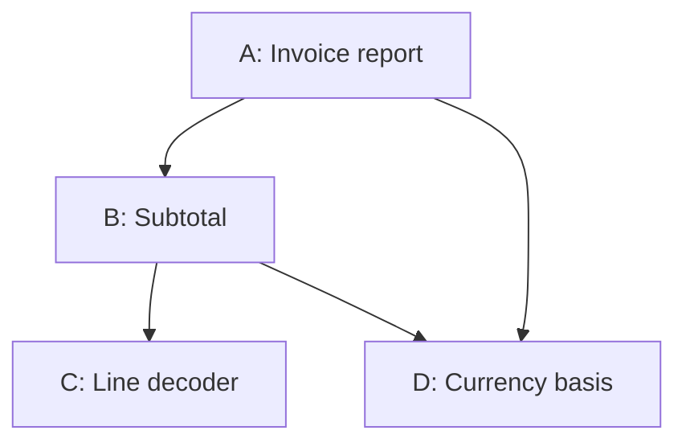

# Recursive Product composition example

This finite worked example applies [PRODUCT_DEFINITION §9](../PRODUCT_DEFINITION.md#product-composition-contract). Its synthetic contracts and expected deductions are not installed Products or executed qualification evidence (P6).

## Boundaries and concrete contracts

The declared decomposition contains A (Invoice report), B (Subtotal), C (Line
decoder) and D (Currency basis). A consumes B and D; B consumes C and D. C and D
are leaves in this view. D is one shared Product, not a copied child with two
identities. A can be consumed by a still larger Product using the same laws.

| Product | Contract at the selected cut | Independently decidable local predicate |
|---|---|---|
| C1 | `decode(text)` returns exact rows `(quantity, unit_minor, currency)` or a defined parse refusal. Input has one comma-separated triple per line, nonnegative integer quantities/prices and a currency token. No rounding or unit conversion. | Parsed fields equal the input fields; malformed or fractional integers refuse. |
| D1 | `basis(currency)` returns an admitted minor-unit exponent: `AUD → 2`; unknown currency refuses. The contract states the units, not just a numeric lookup. | The returned basis matches this selected currency contract. |
| B1 | Uses C1 and D1 to return `amount_minor = Σ quantity × unit_minor`, currency, exponent and exact dependency/evidence coordinates. Mixed currencies refuse. | Sum and units are correct for the original decoded rows and selected basis. |
| A1 | Uses B1 and D1 to render the amount with its currency; verifies matching basis and applicability before emission. | The displayed monetary amount equals the input's monetary amount under the declared currency basis. |

For finite evaluation here, there are at most 100 rows; quantities are 0–100,
prices are 0–1,000,000 minor units, currency is AUD, and integer arithmetic is exact.
Changing those conditions requires a new scoped claim. Operational contracts also
retain each error rather than returning a fabricated amount.

Input `2,125,AUD\n1,100,AUD` yields C1 rows `(2,125,AUD),(1,100,AUD)`, D1 exponent 2,
B1 amount 350 minor units and A1 display `AUD 3.50`. B is entered directly with its
own definition/frame and declared C1/D1 capability closure; A and A's frame are
unneeded. C can likewise be constructed/evaluated from its own contract and test
inputs without B. The surrounding orchestration is optional to those claims.

If C later implements its decoder using an internal parser or further Products,
B need not acquire all their implementations. C's adequate exported contract can
encapsulate them. Material far-side assumptions or evidence needed for B's claim
must still be carried or acquired lawfully; silence is not a preservation proof.

## Local passes, joins and lawful extension

Suppose B1 uses D1's exponent 2 but A selects D2 with exponent 3 for AUD. B's local
arithmetic and A's local formatting procedure can each pass their own checks; A
would render `AUD 0.350`. The required join compares the currency basis identities
and semantic units, and refuses that composition before emission. Four locally
available results do not establish the outer monetary predicate.

Replace C1 with Cbad, the same typed interface, but round `unit_minor` to the
nearest 10. The sample rows become 130 and 100, B returns 360 and A displays
`AUD 3.60`. The replacement fails C's field-preservation contract even though its
signature and downstream arithmetic agree. It cannot inherit C1's evidence.

A successful scoped extension is Dplus: retain AUD exponent 2 with the same units
and add `JPY → 0`. Its AUD projection equals D1 on every input in this example's
domain; the old path makes no new call and changes no grant. Old AUD consumers
can retain their contract under that established relation. A new JPY consumer
needs its own selected input/operation contract and evidence. Likewise Cfast may
replace C1 if it preserves every permitted parse/refusal and relevant execution
condition, rather than merely passing this one sample.

## Authority and information across depth and sharing

For this example, the relevant source owners grant these separate uses:

| Relation / actor | Permitted acquisition or export | Exclusion |
|---|---|---|
| A → B report use | B's result, public contract and declared evidence coordinates | No direct acquisition of C's implementation through B |
| B → C decoder use | C's interface and returned exact rows | No onward disclosure of C's private donor implementation |
| A → D report use | Selected AUD basis and its provenance | Other currency internals/administrative records |
| B → D subtotal use | Selected AUD basis and evidence needed for B's unit check | A cannot borrow any wider B-specific grant |
| C construction Worker | C's required behavior, eligible examples and its own new candidate | Forbidden donor implementation H and algorithm summaries derived from H |
| C nonauthor Reviewer | Governing sources first; candidate/proof, plus H for an explicitly authorized comparison | No permission to forward H or its algorithm into Worker context |

The D acquisition can be deduplicated as bytes only if its separate uses retain
purpose, authority and applicability coordinates. Reaching D by two routes does
not merge their permissions. The named owners and synthetic grants above are
premises of the example, not real grants conferred by this file.

Three acquisitions discriminate permission, information eligibility and exposure:

1. Worker asks for `H/source.py`: denied by its information policy and access grant.
2. B returns an otherwise permitted `notes.md` containing a summary of H's internal
   parsing algorithm. The file's location and B's read permission do not establish
   authorized onward disclosure or clean-room eligibility. Delivery is refused;
   if already delivered, the affected clean-room claim is held and exposure is
   retained. Merely deleting `notes.md` cannot restore the same actor's standing.
3. H's owner separately approves export E containing a behavioral CSV contract and
   public input/output examples. The engagement's declared policy explicitly
   permits this class of exported behavioral specification, including its recorded
   derivation; a named assessment establishes E contains no excluded implementation
   detail. The actor's grant permits E and the actual delivered digest is recorded.
   E may then be used. Owner approval alone is insufficient: under a policy that
   excludes all H-derived information, E must still be refused.

A tool process may execute an authorized decoder without delivering its source to
the Worker. Its returned text, diagnostics, caches and retrieval results remain
subject to the same information policy. Unrestricted shell/search/network access
would bypass a mediated acquisition boundary. Receipts for three permitted calls
cannot prove that such a bypass never occurred; any isolation claim binds the
actual host restrictions and prior-exposure limits.

## Context adequacy and continuation

Fix Γ to the AUD task, one selected actor/grant, these contracts, the same input,
and the decision rule: emit only with current applicable evidence of the basis
join; otherwise hold for reassessment. Both states contain the identical candidate
`AUD 3.50`:

| State | Relevant retained fact | Required continuation |
|---|---|---|
| s1 | Exact join evidence is applicable; no outstanding basis obligation | Emit within the existing grant |
| s2 | An observed basis change makes join applicability unresolved; reassessment is owed | Hold; acquire/reassess the changed condition |

Projection `alpha0(s) = candidate bytes` maps s1 and s2 to the same value and cannot
preserve the required decision. `alpha1` retains the candidate, dependency/basis
identities, applicability, open obligation and the fixed decision contract; it
separates these cases and supports their stated continuations. Source permission
is identical in both states. This is a scoped sufficiency witness, not an optimal
compression result or proof that those fields suffice for arbitrary future work.

## Changes, historical evidence and cycles

A change to C's parse behavior affects B's sum claim and A's output claim. D's
unchanged AUD basis evidence can remain applicable with a supported dependency
account. Evidence for the original A1/B1/C1 cuts stays about those cuts. If the
change is only an irrelevant document edit with an established preservation
relation, it need not invalidate numeric behavior; rereading or a changed hash
alone decides neither case.

A further relation B → A may consume A0's immutable example corpus for validation.
The Product relationship graph is cyclic, yet work can proceed as
`A0 corpus → B1 → A1`. Both basis and read authority for A0 are explicit. In
contrast, `B1 waits for A1 accepted` and `A1 waits for B1 accepted`, with neither
result available, is an unresolved current prerequisite cycle. Appointing a lead
supplies no missing evidence. Select the admitted prior corpus, an explicit seed
or a justified staged/bounded process; until then the dependent closure is held.
